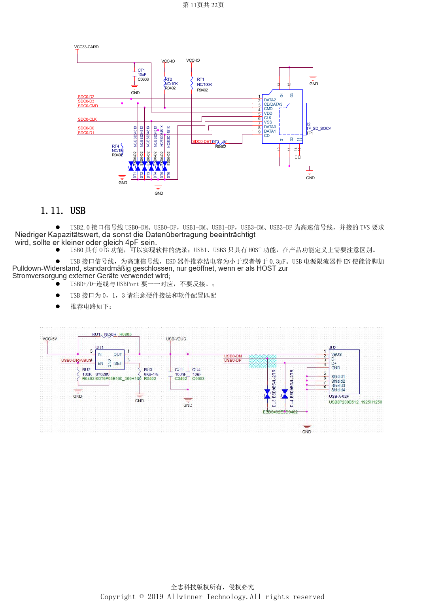
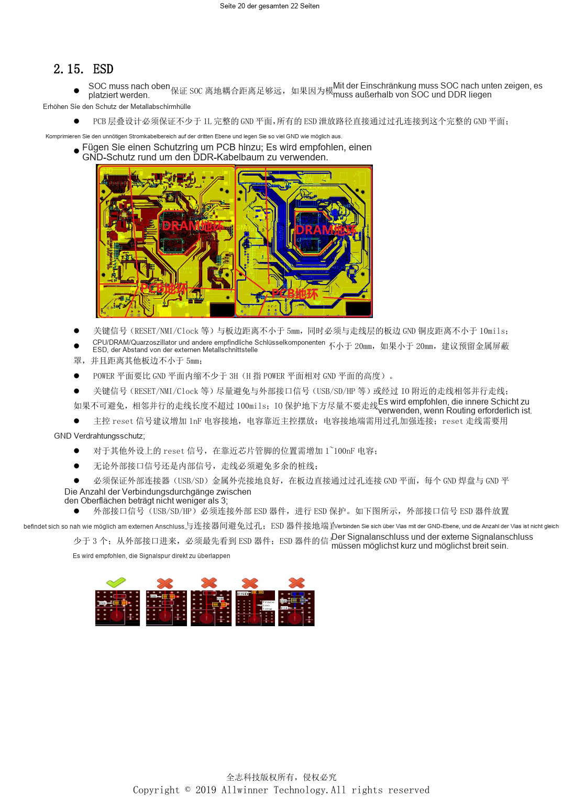

# H618-Schnittstellen: USB, HDMI, Ethernet und ESD-Layout

Dieser quellenbasierte Hardwarebeitrag dient als Plattformreferenz; ein passendes ArmSoM-Board ist nicht bestätigt. Parameter stammen aus der Quelle, nicht aus ArmSoM-Messungen. Siliziumrevision, PCB, SDK/BSP, Kernel, Firmware und Peripheriespezifikationen vor Umsetzung prüfen.

**Design V1.0 §1.7–1.13, §2.6–2.15; PDF 10–13, 17–21; PCB checklist V1.0**

## USB und Anzeige

USB0 unterstützt OTG/Programmierung, USB1 und USB3 sind Hosts. Portnummer 3 bedeutet nicht USB3.0. Enable des Strombegrenzers standardmäßig Low, nur zur Hostversorgung aktivieren. Dieselbe Quellenseite nennt TVS-Kapazitäten ≤4pF und ≤0.3pF; betroffene Netze klären statt einen universellen Wert zu wählen. HDMI enthält IIC/CEC-Pegelwandler; eine Schottky-Diode mit geringem Spannungsabfall verhindert Rückspeisung und ein Absinken unter 4.75V. Der CVBS-Stromausgang braucht 75Ω in 0805 und Masseabschirmung.

## Netzwerk, Wi-Fi und Audio

Ethernet-Hochspannungskondensatoren mindestens 1206 und 2kV, 75Ω-Widerstände in 0805; unter dem Übertrager keine Leitungen und kein Kupfer. Handbuch: >50mil Abstand zur Niederspannung; Checkliste: mindestens 2mm. Strengeren Prüfpunkt erhalten und Konstruktion prüfen. Wi-Fi-IO an PG anpassen, SDIO-Taktreferenz 33Ω und 5.6pF. Bluetooth-Wakeup benötigt eine passende Dauerversorgung. RF: 50Ω, bevorzugt <6cm, >3mm vom Rand, ohne Abzweige/Lagenwechsel, Massevias alle 0.5–1mm. Audio-AVCC ≥25mil, VRA1/2 ≥10mil und ≤300mil; LINEOUT von DDR fernhalten.

## ESD und Wärme gemeinsam prüfen

Mindestens eine durchgängige GND-Lage erhalten. Schutz direkt am Stecker vor internen Schaltungen und mit mindestens drei Massevias. RESET/NMI/Clock ≥5mm vom Rand und ≥10mil vom Rand-Massekupfer; CPU/DDR/Quarze ≥20mm von offenen Metallports, andernfalls Abschirmung erwägen. SoC-Reset: 1nF, Peripherie-Reset: 1–100nF; nicht austauschbar. Versorgungsebenen mindestens 3H gegenüber Masse zurücksetzen. Thermische Vias: 10–12mil Bohrung, 30–40mil Raster. Wärmequellen verteilen, PMU/SoC-Referenzabstand >2cm. Gesamtgeräteprüfung für Temperatur und EMC bleibt nötig.

## Parameterübersicht

| Punkt | Quellenreferenz |
| --- | --- |
| USB-Leitungen | 90Ω; length <4000mil; vias ≤2; clearance >10mil |
| HDMI-Leitungen | 90–100Ω; intra-pair <10mil; inter-pair <100mil; length <3000mil |
| SD-Leitungen | 50Ω; data-to-CLK <500mil; CLK resistor within 300mil of SoC |

## Referenzabbildungen

Die Referenzseiten behalten chinesische Bildbeschriftungen. Keine passende englische Ausgabe gefunden; alle vier Sprachen verwenden die chinesischen Originale. Textparameter und Schritte bleiben kopierbar, Bilder dienen dem Abgleich. Nummern bezeichnen physische PDF-Seiten.

## ArmSoM-Plattform auswählen

Für ArmSoM-Projekte Plattform anhand offizieller Produkte und Dokumentation wählen und Prozessor, Schnittstellen und Software erneut prüfen. A733/H618-Schaltungen nicht pauschal auf andere SoCs übertragen.

- [ArmSoM](https://www.armsom.org/)
- [ArmSoM Docs](https://docs.armsom.org/)

## Weitere Beiträge

- [H618-Minimalsystem: AXP313A, 24MHz-Takt und Bootauswahl](/de/articles/h618-power-clock-boot-design/)
- [H618 DDR und eMMC: Vorlagen, Impedanz und PCB-Prüfung](/de/articles/h618-dram-emmc-pcb-design/)
- [H618-Inbetriebnahme: Flashen, DDR und Stabilitätsprüfung](/de/articles/h618-bringup-stability-validation/)
- [H618 · Serienübersicht](/de/articles/h618-hardware-design-series/)
