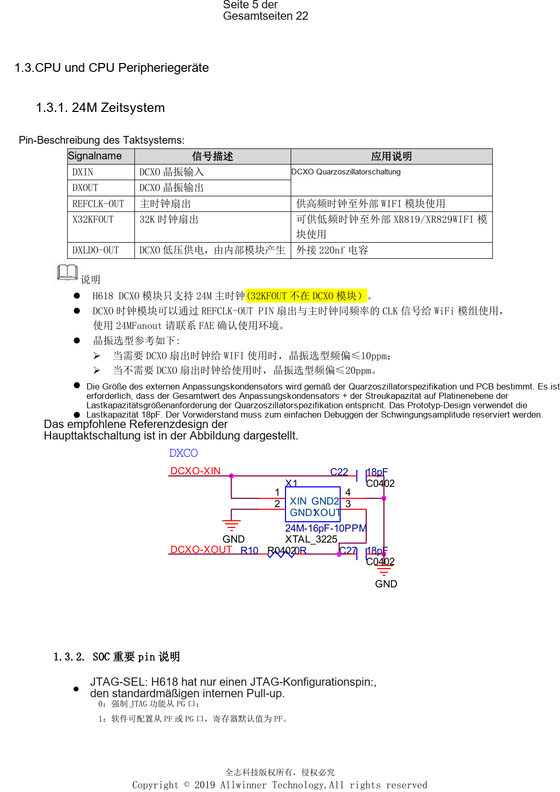
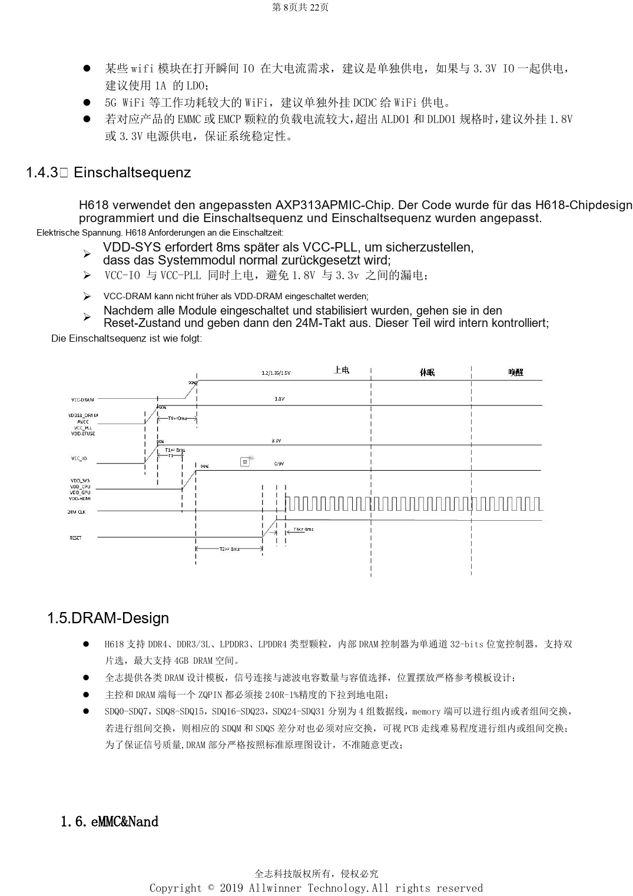

# H618-Minimalsystem: AXP313A, 24MHz-Takt und Bootauswahl

Dieser quellenbasierte Hardwarebeitrag dient als Plattformreferenz; ein passendes ArmSoM-Board ist nicht bestätigt. Parameter stammen aus der Quelle, nicht aus ArmSoM-Messungen. Siliziumrevision, PCB, SDK/BSP, Kernel, Firmware und Peripheriespezifikationen vor Umsetzung prüfen.

**Design V1.0 §1.1–1.4, §2.1–2.3, §2.11; PDF 5–9, 14–15, 19**

## Von BROM zum Betriebssystem

Nach Reset initialisiert BROM Versorgung, Takte, Busse, Reset und Speicher. UART- und DRAM-Initialisierungsdaten gelangen in SRAM; danach folgen Boot0, U-Boot und das Betriebssystem. Serieller Diagnosezugang, Bootbeschaltung und Wiederherstellung gehören zum Minimalsystem. JTAG-SEL ist intern hochgezogen: Low erzwingt PG, High erlaubt PF/PG per Software, standardmäßig PF. AP-RESET nach VCC-PLL hochziehen und RC- sowie ESD-Beschaltung erhalten.

## Versorgung und Sequenz

Die Referenz verwendet einen vorprogrammierten AXP313A. VDD-SYS folgt VCC-PLL nach 8ms, VCC-IO steigt gleichzeitig mit VCC-PLL; VCC-DRAM darf VDD-DRAM nicht vorauseilen. Erst nach stabilen Versorgungen folgen interner Reset und 24MHz-Takt. CPU besitzt eine eigene DVFS-Versorgung, GPU/SYS eine gemeinsame Schiene ohne separate GPU-Spannungsregelung. Vorgesehen sind 22µF an Regler und CPU, zweimal 22µF nahe SYS/GPU und mindestens 10µF nahe VCC-DRAM. Leistungsstarkes Wi-Fi und eMMC oberhalb der LDO-Belastbarkeit gesondert prüfen.

## Takt und Quellenwidersprüche

DCXO unterstützt nur 24MHz. Quarztoleranz: ≤10ppm mit Wi-Fi-Fanout, sonst ≤20ppm. DXLDO-OUT benötigt 220nF. Die 18pF sind Prototypwerte, keine universelle Bestückung. DXIN/DXOUT kürzer als 400mil und mit Masseabschirmung führen. Die Tabelle nennt 1.6A SYS/GPU-Last bei 1.5A PMU-Fähigkeit; eine Reserve ist damit nicht belegt. Inhaltsverzeichnis V2.1 widerspricht Deckblatt und Revision V1.0; die Serie bezeichnet die Quelle als V1.0.

## Parameterübersicht

| Punkt | Quellenreferenz |
| --- | --- |
| Bootmedium; PC3/4/5/6 | MLC NAND / SLC NAND: 1/1/1/1; eMMC USER: 0/1/1/1; eMMC BOOT: 1/0/1/1; SPI_NOR: 1/1/0/1; SPI_NAND: 1/1/1/0 |
| Minimale Modulversorgung | >=1.78V; nominal 1.8V ±1% |

## Referenzabbildungen

Die Referenzseiten behalten chinesische Bildbeschriftungen. Keine passende englische Ausgabe gefunden; alle vier Sprachen verwenden die chinesischen Originale. Textparameter und Schritte bleiben kopierbar, Bilder dienen dem Abgleich. Nummern bezeichnen physische PDF-Seiten.

## ArmSoM-Plattform auswählen

Für ArmSoM-Projekte Plattform anhand offizieller Produkte und Dokumentation wählen und Prozessor, Schnittstellen und Software erneut prüfen. A733/H618-Schaltungen nicht pauschal auf andere SoCs übertragen.

- [ArmSoM](https://www.armsom.org/)
- [ArmSoM Docs](https://docs.armsom.org/)

## Weitere Beiträge

- [H618 DDR und eMMC: Vorlagen, Impedanz und PCB-Prüfung](/de/articles/h618-dram-emmc-pcb-design/)
- [H618-Schnittstellen: USB, HDMI, Ethernet und ESD-Layout](/de/articles/h618-interfaces-esd-layout/)
- [H618-Inbetriebnahme: Flashen, DDR und Stabilitätsprüfung](/de/articles/h618-bringup-stability-validation/)
- [H618 · Serienübersicht](/de/articles/h618-hardware-design-series/)

<!-- editable-source-tables -->

## Anhang: AXP313A-Versorgungstabelle

Design V1.0 · PDF 8

CPU/SYS stehen als „+5%“, nicht „±5%“ in der Quelle; das Zeichen bleibt erhalten. SYS/GPU-Stromwiderspruch siehe oben. DRAM-Wert ist ein DDR3-Beispiel.

| Schiene | Spannung | Genauigkeit Quelle | Ripple/Rauschen | Szenariospitze | PMU-Fähigkeit |
| --- | --- | --- | --- | --- | --- |
| CPU | 0.9V | 0.9V+5% | <90mV | 1.8A | 3A |
| SYS+GPU | 0.94V | 0.94V+5% | <90mV | 1.6A | 1.5A |
| DRAM | 1.5V | 1.5V±10% | <125mV | 1A | 2A |
| Module | 1.8V | 1.8V±1% | <30mV | 100mA | 300mA |
| IO normal | 3.3V | 3.3V±10% | <125mV | 200mA | 500mA |
