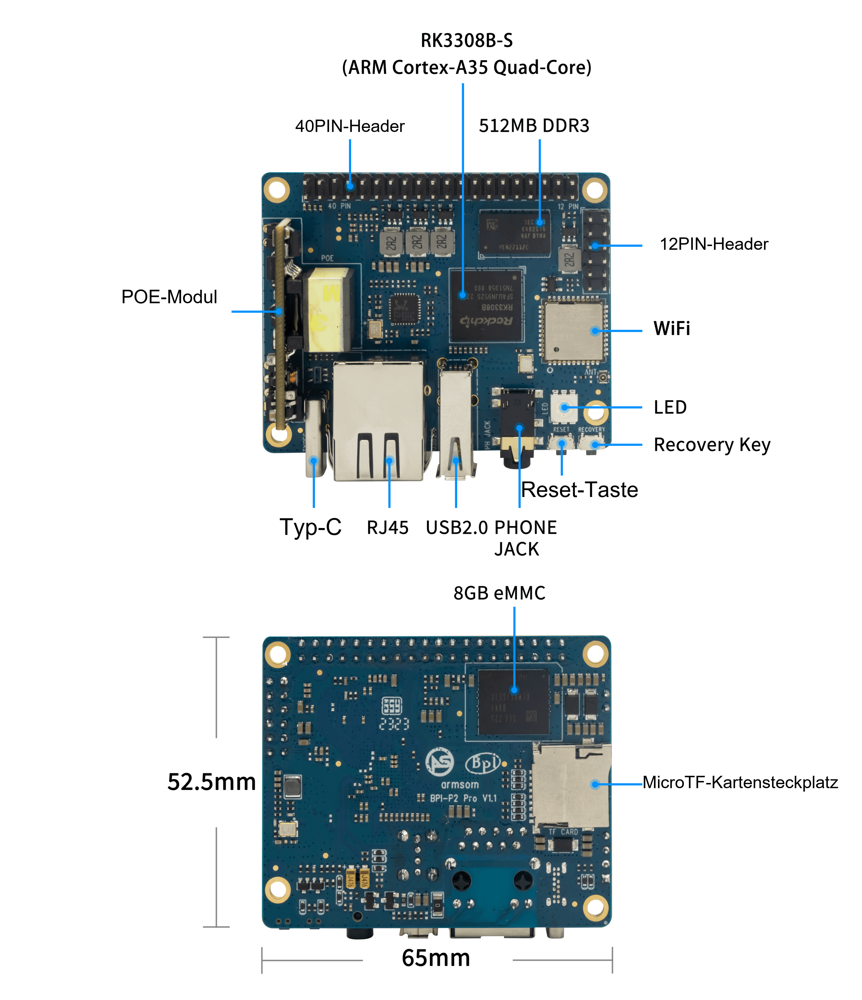

Eine Sprachentwicklungsplatine verbindet Mikrofone, Ausgabe, Netzwerk und Linux. ArmSoM P2 Pro mit RK3308B-S eignet sich für Sprachprototypen, Netzwerkaudio und Mehrkanalaufnahme. Zuerst eine stabile Signalkette aufbauen, danach komplexe Algorithmen ergänzen.

## Die Anschlüsse verstehen

Die Dokumentation nennt acht MIC-Eingänge, PDM/I2S, zwei Line-Ausgänge und SPDIF am 40-pin-Header sowie eine Audiobuchse. Das bedeutet kein fertig bestücktes Mikrofonarray. Mikrofone, Geometrie, Kabel und Aufnahmeparameter separat auswählen.

Dieser audioorientierte Header ist nicht allein wegen seiner Pinzahl Raspberry-Pi-kompatibel. Schaltplan, Spannung, MICBIAS und differenzielle Eingänge prüfen. Line-Out ist kein Lautsprecher-Leistungsausgang.

## Sprachbefehle

Aufnahme, Vorverarbeitung, Ereigniserkennung, Spracherkennung, Aktion und Rückmeldung trennen. VAD liefert Aktivitätsinformationen; Aktivierungswort und Erkennungssoftware werden separat gewählt. Lokale Erkennung mit begrenztem Wortschatz oder ein ausdrücklich ausgewählter externer Dienst sind mögliche Ansätze. Lokal CPU, Speicher und Genauigkeit testen; extern zusätzlich Netzwerk, Latenz und Datenverarbeitung betrachten.

Stille, Musik, mehrere Sprecher, Eigenwiedergabe und Netzausfall prüfen. Fehlaktivierungen, übersehene Befehle und Ende-zu-Ende-Latenz dokumentieren. Eine erfolgreiche Demonstration ist kein Reichweitentest und belegt keine mitgelieferte Algorithmuslizenz.

## Netzwerkplayer und Hinweise

Empfang, Pufferung, Dekodierung und Wiedergabe trennen. Pufferunterläufe, Wiederanlauf und Lautstärkewechsel testen. Bei Verstärkern Pegel und Masse prüfen; Kopfhörer-/Line-Werte sind keine Leistung eines fertigen Lautsprechers.

Hinweisterminals, Desktop-Player und gesprochene Gerätemeldungen sind mögliche Prototypen. Synchrone Wiedergabe auf mehreren Geräten benötigt zusätzlich Zeitsynchronisation, Driftbehandlung und Pufferstrategien; WLAN allein garantiert sie nicht.

## Mehrkanalaufnahme

Mit einem Mikrofon Polarität, Verstärkung und Format prüfen, dann Kanalzuordnung und gleichzeitige Aufnahme. Das Handbuch unterscheidet externe IO und interne Codec-Verbindungen. Controlleranzahl ist nicht externe Portanzahl; Kanal-/Abtastratenkombinationen separat prüfen.

Diese lesenden ALSA-Befehle nehmen nichts auf. Gerätenummern aus der Ausgabe ermitteln:

```sh
cat /proc/asound/cards
arecord -l
aplay -l
```

## Stabiler Betrieb

Hardwarestand, Image, Kernel, Soundkartenkonfiguration, Mikrofone und Versorgung festlegen. Unterbrechungen, verlorene Samples, Taktdrift, Rückkopplung und Wärme prüfen. Lange Aufnahmen brauchen Kapazitäts- und Flash-Lebensdauerplanung. Widersprüchliche Taktangaben belegen keine Algorithmusleistung. Offizielles BSP und Audio-Leitfaden bieten Vertiefung; dokumentierte Befehle sind keine hier durchgeführten Hardwaretests.

## Weitere Artikel und offizielle Unterlagen

- [RK3308B-S erklärt: Sprache, Audio und vernetzte Embedded-Geräte](/de/articles/rk3308bs-chip-guide/)
- [ArmSoM P2 Pro: IoT-Datenerfassung und kompakte Gateways entwickeln](/de/articles/p2pro-iot-lightweight-gateway/)
- [RK3308B-S Datasheet V1.0: Download, Audioarchitektur und elektrische Daten](/de/articles/rk3308bs-datasheet-v10/)
- [Rockchip Audio](/de/articles/023-rockchip-audio/)
- [Rockchip RK3308](https://www.rock-chips.com/a/cn/product/RK33xilie/2018/0614/908.html)
- [P2 Pro — Docs](https://docs.armsom.org/armsom-p2pro)
- [P2 Pro — ArmSoM](https://www.armsom.org/product-page/p2pro)
- [P2 Pro — BSP](https://github.com/ArmSoM/armsom-p2pro-bsp)
