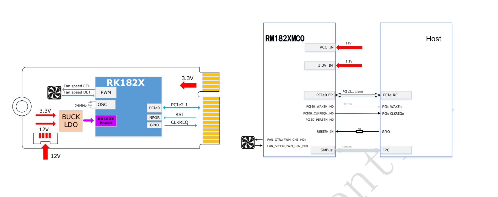
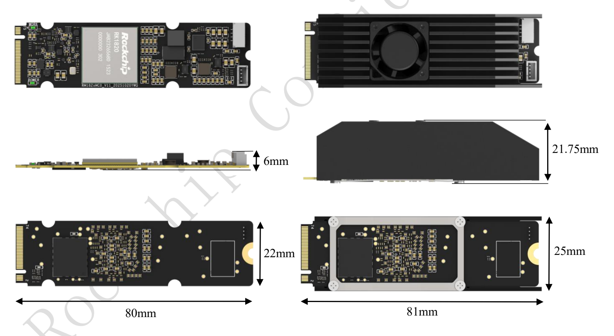

RM182XMC0 bezeichnet RK182X-KI-Coprozessormodule mit M.2 Key M: RM1820MC0 und RM1828MC0. Dieser Artikel ordnet Spezifikationen, Leistungsdaten, Versorgung, Abbildungen und Bestellangaben des bereitgestellten zweiseitigen Rev1.0-Briefs für ArmSoM-Evaluierungen. Quellenmessungen sind keine ArmSoM-Tests.

[Original-Brief herunterladen, 2 Seiten](/assets/rk182x/RK182X-M2-Brief-V1.0.pdf)

## 1. Modelle und Rechenleistung

| Bestellmodell | Chip | Integrierter DRAM | Einordnung | Schnittstelle |
|---|---|---|---|---|
| RM1820MC0 | RK1820 | 2.5GB | 3B | M.2 Key M, PCIe2.1 |
| RM1828MC0 | RK1828 | 5GB | 7B | M.2 Key M, PCIe2.1 |

20TOPS@INT8; INT4/INT8/INT16/FP8/FP16/BF16 werden genannt. Der chinesische Brief beschreibt DRAM-Bandbreite mit „hunderten GB“, ohne explizite Pro-Sekunde-Einheit, genauen Wert oder Messbedingungen. Hier wird kein GB/s-Wert erfunden. Modellgröße allein belegt weder Quantisierung noch Kontextlänge oder Laufzeitspeicherbedarf.

## 2. Modelle und Software der Quelle

Genannt sind Qwen2.5 0.5B/1.5B/3B, Qwen3 0.6B/1.7B, FastVLM, MobilnetV1, MobilnetV2, Resnet50V2, yolov5s, yolov6s, yolov8s. `Mobilnet` bleibt die Quellschreibweise. Qwen2.5 7B steht zusätzlich in der Leistungstabelle, trotz fehlendem Eintrag in dieser Liste; beides bleibt erhalten.

Software: RKNN3 Toolkit auf dem Entwicklungsrechner, RKNN3 Runtime auf dem Board und RKNN3 Model Zoo für Konvertierungs-/Bereitstellungsbeispiele. Versionen, Installationsbefehle, Host-OS-Matrix und Quantisierung fehlen. Für die Umsetzung passende Pakete und Anleitung beschaffen.

## 3. Leistungs- und Verbrauchsdaten

Beide Modi nennen **Input tokens: 128**. TTFT ist die Zeit zum ersten Token, TPS die Erzeugungsrate. Die Tabelle übernimmt die Quellwerte.

| Modell | Modus | TTFT (ms) | TPS (tokens/s) | Mittlere Leistung (W) | Spitzenleistung (W) |
|---|---|---|---|---|---|
| Qwen2.5 3B | Energiesparen | 144.455 | 54.537 | 5.35 | 15.14 |
| Qwen2.5 3B | Standard | 96.05 | 77.945 | 7.2 | 24.86 |
| Qwen2.5 7B | Energiesparen | 288.255 | 35.044 | 7.02 | 16.11 |
| Qwen2.5 7B | Standard | 186.435 | 51.476 | 10.4 | 27.28 |

Host, Firmware, Quantisierung, Ausgabelänge, Sampling, Kühlung und Messgrenzen sind nicht vollständig angegeben. Keine Geschwindigkeitsgarantie für beliebige3B/7B-Modelle; Mittelwert ist nicht Spitzenbedarf der Versorgung.

## 4. Versorgung und Host-Verbindung

**Zusätzlich zu3.3V am M.2-Slot ist12V erforderlich.** Das Diagramm verbindet PCIe0 EP mit Host-RC über PCIe2.1 x1 und zeigt CLKREQ, optionales WAKE, RESETN_IN/0Ω, optionales SMBus/I2C und Lüfter-PWM/Drehzahl. Key M macht das Modul weder zum NVMe-SSD noch garantiert es universelle Slot-/Softwarekompatibilität.

## 5. Bauraum

Ohne Kühler22×80mm, seitlich6mm markiert. Mit Kühler81mm Länge, 25mm Breite, 21.75mm Höhe. Stromleitung, Befestigung und Luftstrom zusätzlich zum2280-Umriss berücksichtigen. Dies ist keine vollständige Fertigungszeichnung mit Toleranzen.

## 6. Unterschied zur SO-DIMM-Ausführung

M.2: RM1820MC0/RM1828MC0; SO-DIMM: RM1820SA0/RM1828SA0. Gleiche Chipfamilie bedeutet nicht gleiche Schnittstellen, Versorgung, Mechanik oder Firmware.8–14.4V, 260-Pin-Belegung und Temperaturgrenzen von SO-DIMM nicht ungeprüft übernehmen.

## 7. Evaluierung mit ArmSoM

Host-RC/Slotverdrahtung prüfen →3.3V, zusätzliche12V und Spitzenreserve prüfen →Kühlraum klären →Treiber, Firmware, RKNN3 abstimmen →Genauigkeit, TTFT/TPS und Stabilität messen. Die PDFs bestätigen keine direkte Unterstützung einer bestimmten ArmSoM-Platine; die tatsächliche Revision muss geprüft werden.

## Weitere Dokumentation

- [RK182X-SO-DIMM-Modul: Architektur, 260 Pins, Versorgung und Integration](/de/articles/rk182x-sodimm-module-datasheet/)
- [ArmSoM Docs](https://docs.armsom.org/)
