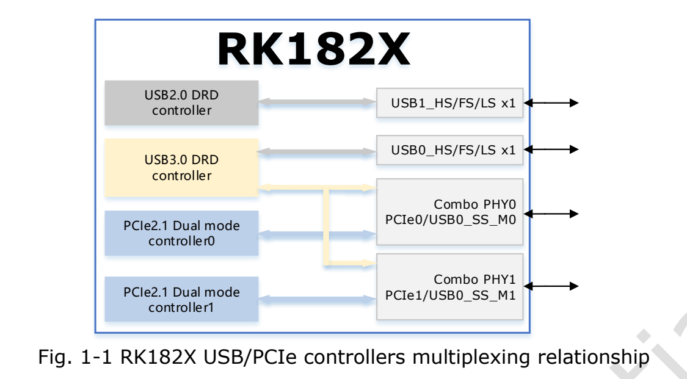
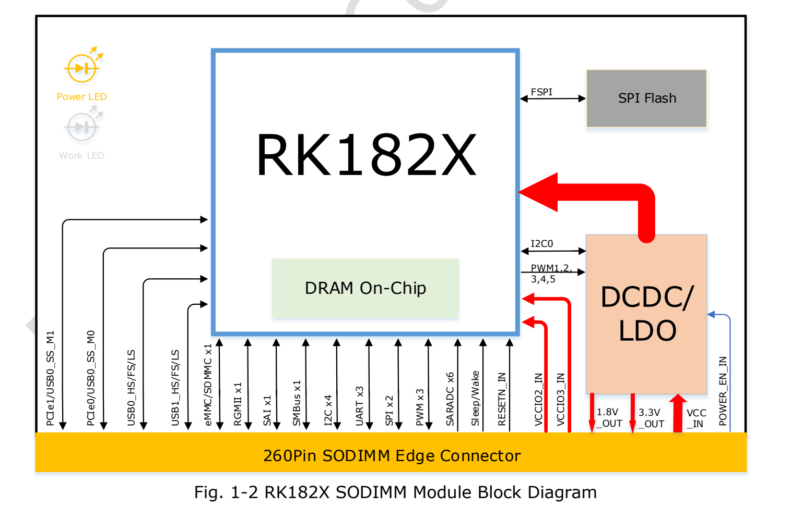
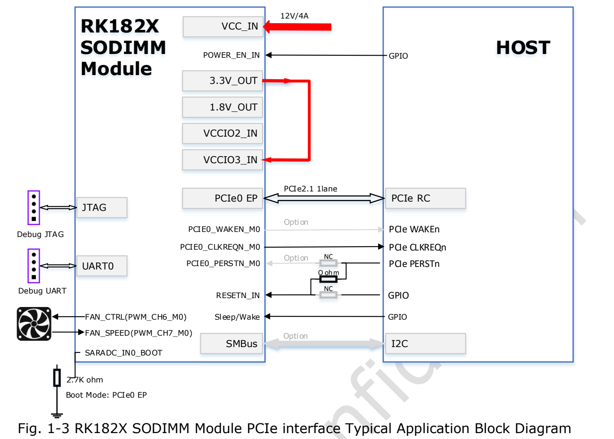
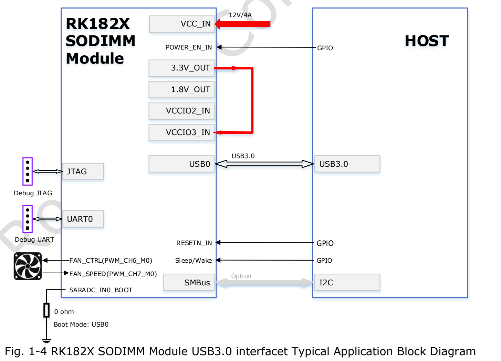
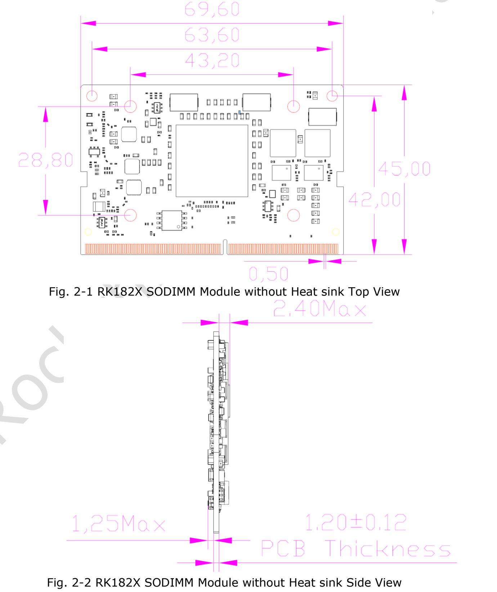
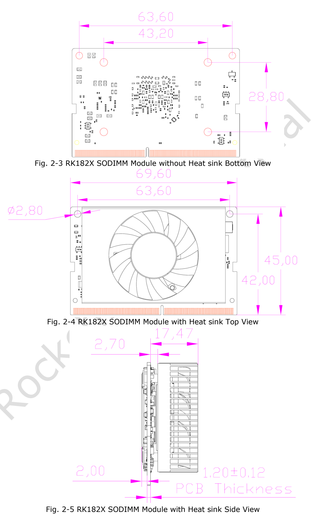
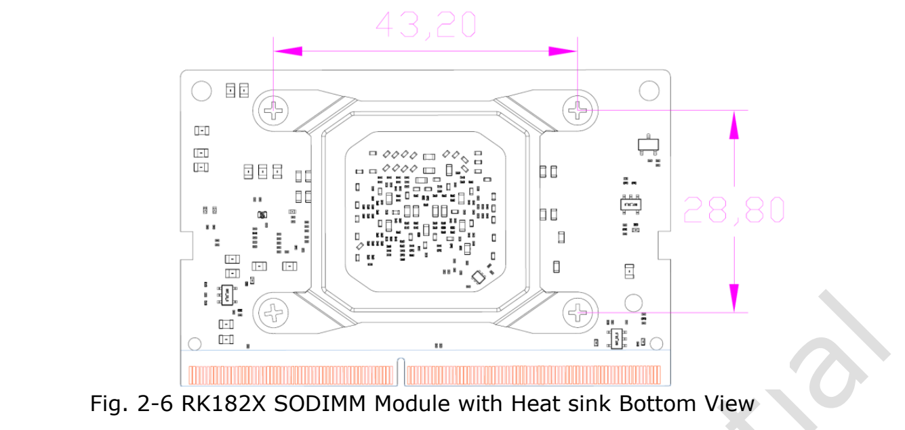

RK182X ist ein **KI-Coprozessor** für Inferenz und maschinelles Sehen. Grundlage ist das bereitgestellte RK182X SODIMM Module Datasheet Rev1.1. Der Leitfaden dient der Bewertung mit einem ArmSoM-Host oder eigenem Träger. Das Modul ersetzt keinen allgemeinen Host; 260-pin SO-DIMM bedeutet keine Austauschbarkeit mit AIM7, Jetson oder RAM-Steckplätzen.

[Vollständiges Original-PDF, 24 Seiten](/assets/rk182x/RK182X-SODIMM-Datasheet-V1.1.pdf)

Enthalten sind die vollständige260-Pin-Signalliste und wesentliche elektrische Grenzen. Sämtliche Funktionsdetails und Schnittstellen-Testbedingungen stehen im Original. ArmSoM-Kompatibilität und Modellleistung wurden nicht gemessen.

## 1. Modelle, Rechenkerne und Speicher

| Modul | Chip | Integrierter DRAM | Einordnung der Quelle |
|---|---|---|---|
| RM1820SA0 | RK1820 | 2.5GB | 3B |
| RM1828SA0 | RK1828 | 5GB | 7B |

Die drei unabhängigen64-bit-RISC-V-Kerne heißen SRV, VRV0 und VRV1. SRV verwendet RV64GCB, die Vektorkerne RV64GCBV. Jeder besitzt eine H/F/D-FPU, 32KB Instruktionscache, 32KB Datencache und128KB L2. VRV0/VRV1 haben128-bit-Vektoreinheiten. Eine Quellzeile schreibt VR0; hier wird entsprechend dem Kontext VRV0 verwendet und die Abweichung dokumentiert.

Die NPU ist mit bis zu **20 TOPS INT8** angegeben und unterstützt INT4/INT8/INT16/FP8/FP16/BF16. Die Quelle nennt TensorFlow, MXNet, PyTorch, Caffe, Tflite, Onnx NN und Android NN. Daraus folgt keine Unterstützung jeder Version, jedes Operators oder Modells.

BootROM unterstützt Start über FSPI/eMMC/SD/MMC und Download über USB0/UART0/PCIe0.512KB System-SRAM und SPI-Flash auf dem Modul sind vorhanden. Die kombinierten SDMMC-Modi schließen sich aus: eMMC4.51 mit HS200, 1/4/8-bit, ohne CMD Queue; SD3.0/MMC4.51 mit1/4-bit.

## 2. System und Bildverarbeitung

Vier PLLs, 24MHz-Eingang, einzelnes Clock-Gating und globale/lokale Soft-Resets bilden die Taktsteuerung. PMU-Domänen sind VDD_TOP, VDD_LOGIC, VDD_PMU. Hinzu kommen sechs64-bit-Timer, drei32-bit-Watchdogs und zwölf Mailboxen. DMA besitzt zwei physische und24 logische Kanäle sowie22 Peripherieanforderungsgruppen; Speicher-/Peripherie-, Listen- und Mehrblocktransfers werden genannt.

Interruptquellen: 160 für SRV, 64 für VRV; Softwareinterrupts in M/S-Modus, High-Level-Empfindlichkeit und programmierbare Prioritäten. Die Kryptoeinheit nennt AES-128/192/256, SM4, SHA-1, SHA-256/224, MD5, SM3, zugehörige HMAC, RSA bis4096-bit, ECC bis256-bit, SM2 und mehrstufige Key-ladder. Die Auflistung empfiehlt nicht sämtliche älteren Algorithmen für neue Systeme.

JPEG-Kodierung: Baseline/JFIF1.02, 16×16–65520×65520; Dekodierung ab48×48. `RG888` bleibt als Quellschreibweise erhalten und wird nicht stillschweigend zu `RGB888` geändert.

RGA nennt BT.601/709-Konvertierung, Dithering, 8192×8192 Quelle/4096×4096 Ziel, Skalierung1/16–16, Rotation0/90/180/270°, XY-Spiegelung, BitBLT, Alpha-Blending, YUV2YUV-CSC und OSD-Invertierung. Bikubische Vergrößerung wechselt laut Quelle bei source>1992 auf bilinear; diese Schwelle bleibt bis zur SDK-Prüfung erhalten. Mehrere10-bit-Eingabeformate werden auf8-bit beschnitten: keine Zusage einer durchgängigen10-bit-Ausgabe.

## 3. Schnittstellen und Multiplexing

Zwei Combo-PHYs bedienen zwei PCIe2.1-Controller und einen USB3.0-DRD-Controller. USB-SuperSpeed wird auf einen PHY multiplexiert. PCIe ist jeweils x1, RC/EP, 2.5/5.0Gbps pro Richtung. Nicht alle Funktionen sind gleichzeitig unabhängige Ports.

| Schnittstelle | Quellenangabe |
|---|---|
| Ethernet | Ein MAC, RGMII, 10/100/1000Mbps, Voll-/Halbduplex, TSO/USO, IEEE1588-2002/2008 |
| USB2.0 DRD | 480/12/1.5Mbps, EHCI1.0, OHCI1.0a |
| USB3.0 DRD | Statisches Device oder statischer xHCI-Host |
| SPI | Zwei Controller, zwei Chip-Selects, Master/Slave konfigurierbar |
| I2C | Vier Master, 7/10-bit-Adressen, 100k/400k/1M bit/s |
| SMBus | Ein Slave, Byte/Wort/32-bit/Block, PEC, Alert, UDID, Clock-Stretching |
| UART | Drei, TX/RX-FIFO je64 Byte, 5/6/7/8-bit, bis4Mbps; UART2 Flusskontrolle/RS485 |
| PWM | Drei, Erfassung, Dauer/Einzelimpuls, zweistufiger Teiler, Power-Key, Frequenzmesser, Zähler |
| SAI | Einmal, 4 TX+4 RX, I2S/PCM/TDM, bis128 Slots, Slot/Nutzdaten8–32bit |
| GPIO | Pegel/steigende/fallende/beide Flanken, Polarität, schwache Pulls, Treiberstärke |
| OTP | 8K bits, davon6.5K für Sicherheit; Program/Read/Idle |

## 4. Host-Verbindungen

Das PCIe-Beispiel nutzt Host-RC, Modul-PCIe0-EP, 12V/4A und2.7kΩ für die Boot-Auswahl. Das USB-Beispiel wählt USB0 mit0Ω. Reset, CLKREQ, optionales WAKE/PERST, SMBus, Debug-UART/JTAG und Lüfter-PWM/Drehzahl müssen mit Bildern und endgültigem Referenzdesign abgeglichen werden. Ein ungeprüfter Träger darf nicht allein nach diesem Fließtext eingeschaltet werden.

## 5. Mechanik und260 Pins

69.6×45mm, 260-pin SO-DIMM, 0.5mm Kontaktabstand. Die Zeichnungen nennen1.20±0.12mm PCB-Dicke sowie2.40mm/1.25mm maximale Bauteilhöhen der beiden Seiten. Kühlkörper und Sockel berücksichtigen; alle Maße in mm.

Vollständige260-Pin-Liste; Mux-Namen, RSVD, NC und doppelten Schrägstrich bei Pin195 beibehalten.

| Pin | Original-Signalname |
|---|---|
| 1 | `GND` |
| 2 | `GND` |
| 3 | `RSVD` |
| 4 | `RSVD` |
| 5 | `RSVD` |
| 6 | `RSVD` |
| 7 | `GND` |
| 8 | `GND` |
| 9 | `RSVD` |
| 10 | `RSVD` |
| 11 | `RSVD` |
| 12 | `RSVD` |
| 13 | `GND` |
| 14 | `GND` |
| 15 | `RSVD` |
| 16 | `RSVD` |
| 17 | `RSVD` |
| 18 | `RSVD` |
| 19 | `GND` |
| 20 | `GND` |
| 21 | `3.3V OUT` |
| 22 | `RSVD` |
| 23 | `3.3V OUT` |
| 24 | `RSVD` |
| 25 | `GND` |
| 26 | `GND` |
| 27 | `1.8V OUT` |
| 28 | `RSVD` |
| 29 | `1.8V OUT` |
| 30 | `RSVD` |
| 31 | `GND` |
| 32 | `GND` |
| 33 | `VCCIO2_IN` |
| 34 | `RSVD` |
| 35 | `VCCIO3_IN` |
| 36 | `RSVD` |
| 37 | `GND` |
| 38 | `GND` |
| 39 | `RSVD` |
| 40 | `RSVD` |
| 41 | `RSVD` |
| 42 | `RSVD` |
| 43 | `GND` |
| 44 | `GND` |
| 45 | `RSVD` |
| 46 | `RSVD` |
| 47 | `RSVD` |
| 48 | `RSVD` |
| 49 | `GND` |
| 50 | `GND` |
| 51 | `RSVD` |
| 52 | `RSVD` |
| 53 | `RSVD` |
| 54 | `RSVD` |
| 55 | `GND` |
| 56 | `GND` |
| 57 | `RSVD` |
| 58 | `RSVD` |
| 59 | `RSVD` |
| 60 | `RSVD` |
| 61 | `GND` |
| 62 | `GND` |
| 63 | `RSVD` |
| 64 | `RSVD` |
| 65 | `RSVD` |
| 66 | `RSVD` |
| 67 | `GND` |
| 68 | `GND` |
| 69 | `RSVD` |
| 70 | `RSVD` |
| 71 | `RSVD` |
| 72 | `RSVD` |
| 73 | `GND` |
| 74 | `GND` |
| 75 | `RSVD` |
| 76 | `RSVD` |
| 77 | `RSVD` |
| 78 | `RSVD` |
| 79 | `GND` |
| 80 | `GND` |
| 81 | `RSVD` |
| 82 | `RSVD` |
| 83 | `RSVD` |
| 84 | `RSVD` |
| 85 | `GND` |
| 86 | `GND` |
| 87 | `USB0_DRD_VBUSDET` |
| 88 | `RSVD` |
| 89 | `ETH_TXD0/PCIE1_WAKEN_M2/PWM_CH0_M1/SPI0_MOSI_M2/GPIO1_A6_d` |
| 90 | `RSVD` |
| 91 | `ETH_TXCTL/PCIE1_CLKREQN_M2/SPI0_CLK_M2/GPIO1_B2_d` |
| 92 | `RSVD` |
| 93 | `ETH_TXD1/PCIE1_PERSTN_M2/SPI0_MISO_M2/GPIO1_A7_d` |
| 94 | `RSVD` |
| 95 | `ETH_RXD0/SPI0_CS0N_M2/GPIO1_B4_d` |
| 96 | `RSVD` |
| 97 | `ETH_RXD1/SPI0_CS1N_M2/GPIO1_B5_d` |
| 98 | `RSVD` |
| 99 | `SARADC_IN6/PCIE0_PERSTN_M1/I2C4_SCL_M0/SAI_SDI2_M2/UART2_TX_M0/PWM_CH6_M2/GPIO1_D6_d` |
| 100 | `RSVD` |
| 101 | `SARADC_IN7/PCIE0_WAKEN_M1/I2C4_SDA_M0/SAI_SDI3_M2/UART2_RX_M0/PWM_CH7_M2/GPIO1_D7_d` |
| 102 | `GND` |
| 103 | `RSVD` |
| 104 | `ETH_TXD2/SPI1_MOSI_M2/GPIO1_B0_d` |
| 105 | `RSVD` |
| 106 | `ETH_TXCLK/I2C1_SCL_M1/SPI1_CLK_M2/GPIO1_B3_d` |
| 107 | `GND` |
| 108 | `ETH_TXD3/SPI1_MISO_M2/GPIO1_B1_d` |
| 109 | `USB0_DRD_DM` |
| 110 | `ETH_RXD2/I2C1_SDA_M1/SPI1_CS0N_M2/GPIO1_B6_d` |
| 111 | `USB0_DRD_DP` |
| 112 | `ETH_RXD3/I2C4_SCL_M1/SPI1_CS1N_M2/GPIO1_B7_d` |
| 113 | `GND` |
| 114 | `RSVD` |
| 115 | `USB1_DRD_DM` |
| 116 | `RSVD` |
| 117 | `USB1_DRD_DP` |
| 118 | `SARADC_IN5/PCIE0_CLKREQN_M1/SAI_SDI1_M2/SPI0_CS1N_M1/GPIO1_D5_d` |
| 119 | `GND` |
| 120 | `RSVD` |
| 121 | `RSVD` |
| 122 | `RSVD` |
| 123 | `RSVD` |
| 124 | `ETH_RXCTL/PCIE0_WAKEN_M2/GPIO1_C0_d` |
| 125 | `GND` |
| 126 | `ETH_RXCLK/I2C4_SDA_M1/GPIO1_C1_d` |
| 127 | `USB0_DRD_ID` |
| 128 | `ETH_MDC/PCIE0_PERSTN_M2/GPIO1_C2_d` |
| 129 | `GND` |
| 130 | `ETH_MDIO/PCIE0_CLKREQN_M2/GPIO1_C3_d` |
| 131 | `PCIE0_RXN/USB0_DRD_SSRXN_M0` |
| 132 | `GND` |
| 133 | `PCIE0_RXP/USB0_DRD_SSRXP_M0` |
| 134 | `PCIE0_TXN/USB0_DRD_SSTXN_M0` |
| 135 | `GND` |
| 136 | `PCIE0_TXP/USB0_DRD_SSTXP_M0` |
| 137 | `RSVD` |
| 138 | `GND` |
| 139 | `RSVD` |
| 140 | `RSVD` |
| 141 | `GND` |
| 142 | `RSVD` |
| 143 | `RSVD` |
| 144 | `GND` |
| 145 | `RSVD` |
| 146 | `GND` |
| 147 | `GND` |
| 148 | `RSVD` |
| 149 | `RSVD` |
| 150 | `RSVD` |
| 151 | `RSVD` |
| 152 | `GND` |
| 153 | `GND` |
| 154 | `RSVD` |
| 155 | `RSVD` |
| 156 | `RSVD` |
| 157 | `RSVD` |
| 158 | `GND` |
| 159 | `GND` |
| 160 | `PCIE0_REFCLKN` |
| 161 | `PCIE1_RXN/USB0_DRD_SSRXN_M1` |
| 162 | `PCIE0_REFCLKP` |
| 163 | `PCIE1_RXP/USB0_DRD_SSRXP_M1` |
| 164 | `GND` |
| 165 | `GND` |
| 166 | `PCIE1_TXN/USB0_DRD_SSTXN_M1` |
| 167 | `RSVD` |
| 168 | `PCIE1_TXP/USB0_DRD_SSTXP_M1` |
| 169 | `RSVD` |
| 170 | `GND` |
| 171 | `GND` |
| 172 | `RSVD` |
| 173 | `PCIE1_REFCLKN` |
| 174 | `RSVD` |
| 175 | `PCIE1_REFCLKP` |
| 176 | `GND` |
| 177 | `GND` |
| 178 | `RSVD` |
| 179 | `I2C2_SCL_M0/UART1_CTSN_M0/PCIE0_WAKEN_M0/SMBUS_ALERT_M0/SAI_SDI0_M0/SAI_SDO3_M0/GPIO0_B5_d` |
| 180 | `PCIE0_CLKREQN_M0/SAI_LRCK_M0/GPIO0_B7_d` |
| 181 | `I2C2_SDA_M0/UART1_RTSN_M0/PCIE0_PERSTN_M0/SAI_SCLK_M0/GPIO0_B6_d` |
| 182 | `RSVD` |
| 183 | `RSVD` |
| 184 | `RSVD` |
| 185 | `ETH_CLK_25M_OUT/I2C2_SCL_M1/SAI_SDO2_M2/UART2_CTSN_M0/SPI1_CS1N_M1/GPIO1_C4_d` |
| 186 | `RSVD` |
| 187 | `ETH_MCLK/I2C2_SDA_M1/SAI_SDO1_M2/UART2_RTSN_M0/PWM_CH0_M2/SPI1_MOSI_M1/GPIO1_C5_d` |
| 188 | `RSVD` |
| 189 | `SARADC_IN2/SMBUS_SCL_M1/I2C3_SCL_M1/SAI_SDO3_M2/UART1_TX_M1/PWM_CH6_M1/SPI0_MOSI_M1/GPIO1_D2_d` |
| 190 | `RSVD` |
| 191 | `SARADC_IN3/SMBUS_SDA_M1/I2C3_SDA_M1/UART1_RX_M1/PWM_CH7_M1/SPI0_MISO_M1/GPIO1_D3_d` |
| 192 | `RSVD` |
| 193 | `SARADC_IN4/SMBUS_ALERT_M1/SAI_SDO0_M2/UART1_CTSN_M1/SPI0_CS0N_M1/GPIO1_D4_d` |
| 194 | `RSVD` |
| 195 | `PCIE1_CLKREQN_M0/SAI_SDI0_M2/UART1_RTSN_M1//SPI0_CLK_M1/GPIO1_D1_d` |
| 196 | `RSVD` |
| 197 | `ETH_PPSTRIG/PCIE1_PERSTN_M0/SAI_LRCK_M2/SPI1_CLK_M1/GPIO1_D0_d` |
| 198 | `RSVD` |
| 199 | `ETH_PPSCLK/PCIE1_WAKEN_M0/SAI_SCLK_M2/SPI1_CS0N_M1/GPIO1_C7_d` |
| 200 | `GND` |
| 201 | `GND` |
| 202 | `RSVD` |
| 203 | `JTAG_TCK_M0/UART1_TX_M0_d` |
| 204 | `RSVD` |
| 205 | `JTAG_TMS_M0/UART1_RX_M0_d` |
| 206 | `I2C3_SCL_M0/PWM_CH6_M0/SPI1_CLK_M0/SMBUS_SCL_M0/SAI_SDI2_M0/SAI_SDO1_M0/GPIO0_B3_d` |
| 207 | `RSVD` |
| 208 | `I2C3_SDA_M0/PWM_CH7_M0/SPI1_MOSI_M0/SMBUS_SDA_M0/SAI_SDI1_M0/SAI_SDO2_M0/GPIO0_B4_d` |
| 209 | `RSVD` |
| 210 | `RSVD` |
| 211 | `ETH_PTP_REFCLK/SAI_MCLK_M2/SPI1_MISO_M1/GPIO1_C6_d` |
| 212 | `RSVD` |
| 213 | `RSVD` |
| 214 | `SARADC_IN0_BOOT` |
| 215 | `RSVD` |
| 216 | `RSVD` |
| 217 | `NC(MODULE_ID)` |
| 218 | `PWR_CTRL1/PWM_CH0_M0/SPI1_CS1N_M0/GPIO0_A3_d` |
| 219 | `SDMMC_D0/SAI_SDO2_M1/UART1_CTSN_M2/GPIO0_D2_u` |
| 220 | `SDMMC_D7/I2C2_SDA_M2/SAI_SDO0_M1/UART2_RTSN_M2/PCIE1_WAKEN_M1/GPIO1_A1_u` |
| 221 | `SDMMC_D1/SAI_SDO3_M1/UART1_RTSN_M2/GPIO0_D3_u` |
| 222 | `SDMMC_D6/I2C2_SCL_M2/SAI_SDI0_M1/UART2_CTSN_M2/SMBUS_ALERT_M2/GPIO1_A0_u` |
| 223 | `SDMMC_D2/SAI_SDI2_M1/UART1_TX_M2/GPIO0_D4_u` |
| 224 | `SDMMC_D5/I2C4_SDA_M2/SAI_LRCK_M1/UART2_RX_M2/SMBUS_SDA_M2/GPIO0_D7_u` |
| 225 | `SDMMC_D3/SAI_SDI3_M1/UART1_RX_M2/GPIO0_D5_u` |
| 226 | `SDMMC_D4/I2C4_SCL_M2/SAI_SCLK_M1/UART2_TX_M2/SMBUS_SCL_M2/GPIO0_D6_u` |
| 227 | `SDMMC_CMD/GPIO1_A2_u` |
| 228 | `RSVD` |
| 229 | `SDMMC_CLK_OUT/SAI_SDO1_M1/GPIO1_A3_d` |
| 230 | `RSVD` |
| 231 | `GND` |
| 232 | `SDMMC_RSTN/I2C3_SCL_M2/SAI_SDI1_M1/PCIE1_PERSTN_M1/GPIO1_A4_u` |
| 233 | `RSVD` |
| 234 | `SDMMC_DETN/I2C3_SDA_M2/SAI_MCLK_M1/PCIE1_CLKREQN_M1/GPIO1_A5_u` |
| 235 | `RSVD` |
| 236 | `JTAG_TCK_M1/UART0_TX_u` |
| 237 | `POWER_EN_IN` |
| 238 | `JTAG_TMS_M1/UART0_RX_u` |
| 239 | `RESETN_IN_u` |
| 240 | `Sleep/Wake(GPIO0_A0)_d` |
| 241 | `GND` |
| 242 | `GND` |
| 243 | `GND` |
| 244 | `GND` |
| 245 | `GND` |
| 246 | `GND` |
| 247 | `GND` |
| 248 | `GND` |
| 249 | `GND` |
| 250 | `GND` |
| 251 | `VCC_IN` |
| 252 | `VCC_IN` |
| 253 | `VCC_IN` |
| 254 | `VCC_IN` |
| 255 | `VCC_IN` |
| 256 | `VCC_IN` |
| 257 | `VCC_IN` |
| 258 | `VCC_IN` |
| 259 | `VCC_IN` |
| 260 | `VCC_IN` |

## 6. Versorgung, Steuerung und Betriebswerte

VCC_IN: 251–260. POWER_EN_IN237: High ein/Low aus, 100kΩ Pulldown, Eingangstyp1.5V bis VCC_IN. RESETN_IN239: aktiv Low, 1kΩ Pullup auf3.3V. Sleep/Wake240: optionales GPIO der3.3V-Domäne. SARADC_IN0_BOOT214: 10kΩ Pullup auf1.8V. MODULE_ID217: reserviert, ungenutzt.

21/23 liefern3.3V, 27/29 liefern1.8V, primär für VCCIO2/VCCIO3 und zugehörige Peripherie.33/35 sind deren Eingänge. Zusätzliche Last erhöht VCC_IN-Bedarf. Betreffende GPIO0-Pins liegen fest auf3.3V; SDMMC GPIO0_D2 bis GPIO1_A5 gehört zu VCCIO2, GPIO1_A6 bis GPIO1_D7 zu VCCIO3. Vollständige Zuordnung in Tabelle2-4 prüfen.

| Parameter/Bedingung | Min | Typ | Max | Einheit |
|---|---|---|---|---|
| Betriebs-Eingangsspannung | 8.0 | 12.0 | 14.4 | V |
| Versorgungsstrom | 4.0 | - | 5.0 | A |
| 3.3V Spitzen-Ausgangsstrom | - | - | 0.8 | A |
| 1.8V Spitzen-Ausgangsstrom | - | - | 0.3 | A |
| VCCIO1.8V-Domäne | 1.62 | 1.8 | 1.98 | V |
| VCCIO3.3V-Domäne | 2.97 | 3.3 | 3.63 | V |
| Lagertemperatur | -20 | - | 70 | °C |
| Lagerfeuchte, ohne Kondensation | 30 | - | 70 | % |
| Umgebungs-Betriebstemperatur | TBD | 25 | TBD | °C |
| Empfohlene Sperrschichttemperatur | - | - | 95 | °C |
| Absolut VCC_IN | -0.3 | - | 18 | V |
| Absolut VCCIO | -0.3 | - | 3.8 | V |
| Absolute Sperrschichttemperatur | NA | - | 105 | °C |
| Ausgangsspannungsgenauigkeit | -3 | - | 3 | % |

4–5A ist der Versorgungsstromeintrag der Quelle, kein Dauerverbrauch jedes Modus. Wegen üblicher0.5A je Sockelkontakt empfiehlt sie12V; auch bei einer Quelle über40W darf jeder Kontakt0.5A nicht überschreiten. Durchschnittliche Inferenzleistung reicht zur Netzteilauslegung nicht aus.

## 7. Offene Punkte, SARADC und Kühlung

- Dateiname20251016, Titel Rev1.1/August2025, Historie nur2025-08-20 Rev1.0: kein bestätigtes Veröffentlichungsdatum oder vollständiger Verlauf abgeleitet.
- SARADC-Funktionstext: sieben Kanäle einschließlich Boot, 13-bit, bis2MS/s; Diagramm×6; Tabelle3-6: acht Kanäle, typisch1MS/s, ENOB11.2 typisch/13 maximal. Angaben getrennt erhalten, Klärung nötig.
- Messbereich0–1.8V, separater Maximalwert3.3V ist kein garantierter Messbereich. DNL±1/±3LSB, INL±2/±6LSB typisch/maximal; SINAD69.2dB, THD77.3dB. Bedingungen: fS=1MS/s, fclk=24MHz; bei SINAD zusätzlich fOUT=1.17KHz.
- Tabelle3-7 kombiniert `Tx de-emphasis level ratio` mit80–120ohm: Bezeichnung/Einheit prüfen.75–200nF AC-Kopplung und399.88–400.12ps UI sind modusabhängig, nicht für alle Datenraten übertragbar.
- Empfohlene Sperrschichtgrenze95°C, absolut105°C; Umgebungs-Betriebsgrenzen TBD. Lager- und Betriebstemperatur unterscheiden.
- Kapitel4 verweist nur auf den separat nicht mitgelieferten Thermal Design Guide. Kühlerauslegung und vollständige Leistungsmodi fehlen daher.

## 8. ArmSoM-Integration vorbereiten

Zuerst Host-RC/USB-Host, Stecker und Pegel, dann Treiber, Firmware, RKNN3, Konvertierung und Kühlung prüfen. RKNN-Toolkit2 auf der RK3588-NPU ist nicht derselbe Bereitstellungsweg. AIM7/Sige7/LM7 sind mögliche Evaluierungsrichtungen, keine bestätigte Steckkompatibilität.

## Weitere Dokumentation

- [RK182X-M.2-Modul: 20 TOPS, 3B/7B-Modelle und zwei Versorgungseingänge](/de/articles/rk182x-m2-module-guide/)
- [ArmSoM Docs](https://docs.armsom.org/)
