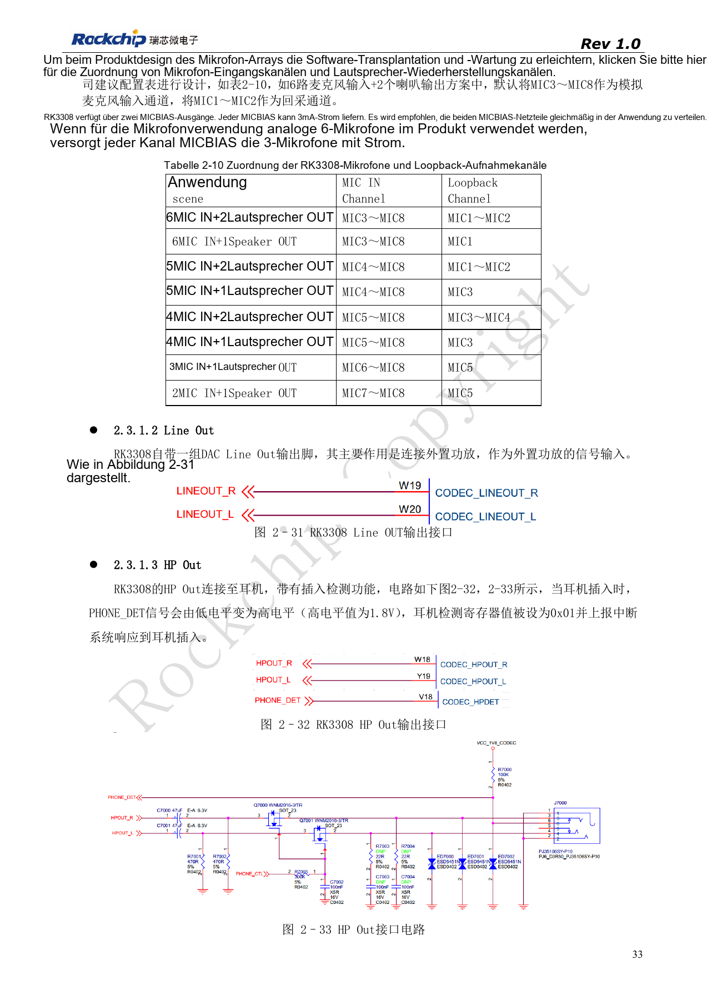
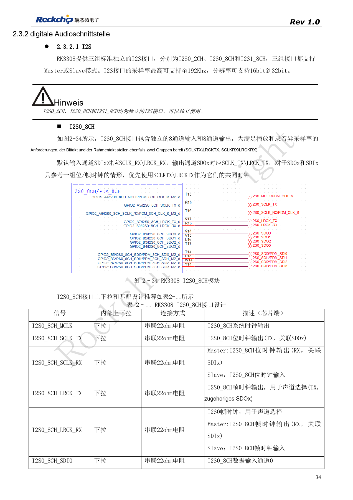
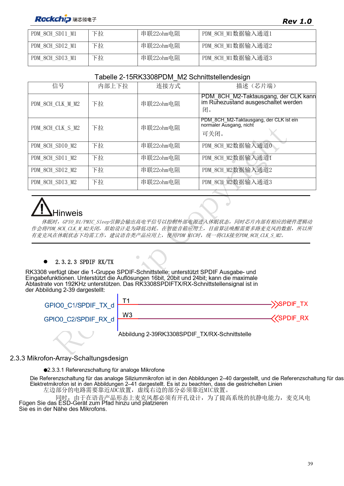
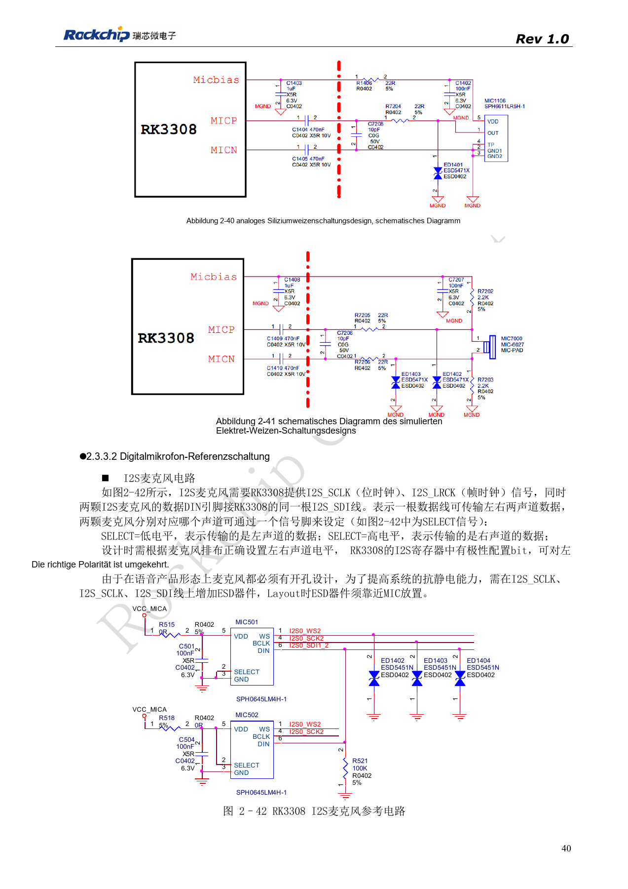
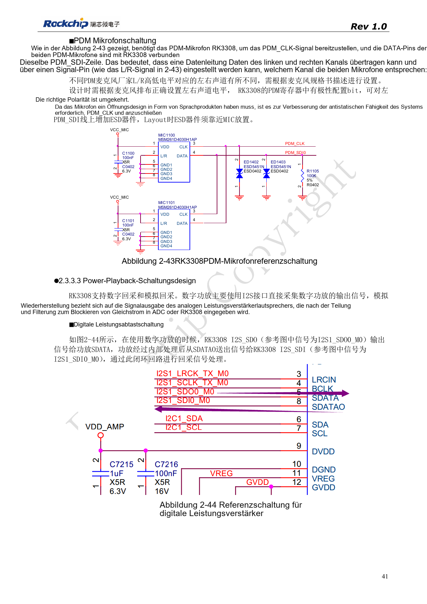
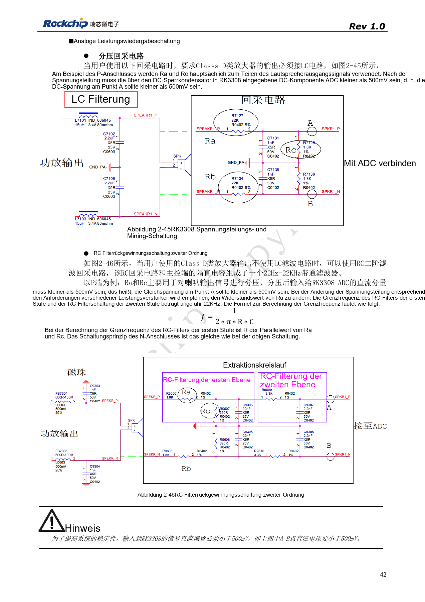

# RK3308-Mikrofonarrays: Analog, I2S, PDM und Rückführung

Nach RK3308 Hardware Design Guide V1.0 (2018-09-14), mit Variantenabgrenzung aus dem Kompatibilitätsdokument V1.1 von 2023. P2 Pro nutzt RK3308B-S; die historische Referenz ersetzt nicht dessen Schaltung. Dieser Themenartikel ist keine vollständige seitenweise Übersetzung. Quellenwerte sind keine ArmSoM-Messungen. Anschlüsse, SDK/BSP, Kernel und Firmware der Boardrevision prüfen.

**RK3308硬件设计指南_V1.0_20180914.pdf** · §2.3

## Analogkanäle mit dem Algorithmus abstimmen

Der ursprüngliche RK3308 bietet acht ADC- und zwei DAC-Kanäle. Das Beispiel mit sechs Mikrofonen und zwei Lautsprechern nutzt MIC3–MIC8 zur Aufnahme und MIC1–MIC2 zur Rückführung. Zwei MICBIAS-Ausgänge liefern jeweils 3mA; im Beispiel werden je drei Mikrofone angeschlossen, deren tatsächlicher Strom zu prüfen ist. Line Out speist einen externen Verstärker und ist kein Lautsprecher-Leistungsausgang. PHONE_DET liegt bei High auf 1.8V. Herausgeführte P2-Pro-Kanäle anhand des Schaltplans bestimmen.

## I2S- und PDM-Ressourcen nicht doppelt zählen

I2S0_2CH, I2S0_8CH und I2S1_8CH sind drei unabhängige Master/Slave-Interfaces, laut Quelle bis 192kHz und 16–32bit. M0/M1 von I2S1_8CH sind alternative Pins desselben Interfaces. PDM besitzt einen Controller; nur M0, M1 oder M2 wählen. Jede SDI trägt zwei Mikrofone, deren L/R-Polarität aus dem Datenblatt folgt. Für kontinuierliche Spracherfassung im Standby wird PDM_8CH_CLK_S_M2 empfohlen, nicht das im Schlaf abgeschaltete CLK_M_M2. Ein Dauertakt belegt noch keinen vollständigen Wake-Algorithmus im SDK.

## Rückführung passend zum Verstärker wählen

Digitale Verstärker können eine I2S-Ausgabe-/Rückführschleife bilden. Analoge Rückführung benötigt Teiler, Filter und DC-Sperre. Bei LC-gefiltertem Class-D-Ausgang die Teilerreferenz, ohne LC die zweistufige RC-Referenz verwenden. A/B müssen laut Quelle unter 500mV DC bleiben; Lautsprecherleistung niemals direkt an ADC anschließen. RC plus Koppelkondensator bilden ungefähr 22Hz–22kHz Bandpass; Werte am konkreten Verstärker prüfen. ESD nahe Mikrofonöffnungen platzieren. Erst Kanalreihenfolge, Polarität und Pegel prüfen, dann parallele Wiedergabe, Echokompensation und Schlaf/Wecken.

## Mikrofon- und Rückführzuordnung der Quelle

| Anwendung | Mikrofoneingang | Rückführung |
| --- | --- | --- |
| 6 MIC + 2 Speaker | MIC3–MIC8 | MIC1–MIC2 |
| 6 MIC + 1 Speaker | MIC3–MIC8 | MIC1 |
| 5 MIC + 2 Speaker | MIC4–MIC8 | MIC1–MIC2 |
| 5 MIC + 1 Speaker | MIC4–MIC8 | MIC3 |
| 4 MIC + 2 Speaker | MIC5–MIC8 | MIC3–MIC4 |
| 4 MIC + 1 Speaker | MIC5–MIC8 | MIC3 |
| 3 MIC + 1 Speaker | MIC6–MIC8 | MIC5 |
| 2 MIC + 1 Speaker | MIC7–MIC8 | MIC5 |

Quelle: Tabelle 2-10, PDF33. Unterschiedliche Rückführkanäle bleiben erhalten und werden nicht einheitlich auf MIC1/2 geändert. Dies ist eine Chipreferenz, keine Bestätigung sämtlicher P2-Pro-Kombinationen.

## Quellenbilder und Prüfseiten

Für diese Auswahl liegen nur chinesische Originale vor. Alle vier Sprachen verwenden dieselben Quellenbilder mit Abbildungskontext; Bildbeschriftungen wurden nicht übersetzt. Der Text ist editierbar. Seitenzahlen bezeichnen physische PDF-Seiten.

PDF 33

PDF 34

PDF 39

PDF 40

PDF 41

PDF 42

## ArmSoM-Produkte und Dokumentation

- [ArmSoM P2 Pro](https://www.armsom.org/product-page/p2pro) · [P2 Pro Docs](https://docs.armsom.org/armsom-p2pro)

## Weiterlesen

- [Serienübersicht](/de/articles/rk3308-hardware-design-series/)
- [RK3308-Boot und Speicher: Takt, FLASH_SEL und Wiederherstellung](/de/articles/rk3308-clock-boot-storage-design/)
- [RK3308: Versorgung, DDR, Standby und S-Varianten](/de/articles/rk3308-power-ddr-hardware-design/)
- [RK3308-Peripherie: USB, RMII, Display und Debug](/de/articles/rk3308-usb-network-peripheral-design/)
- [RK3308: Thermik, ESD und Fertigungsprüfung](/de/articles/rk3308-thermal-esd-production-design/)
