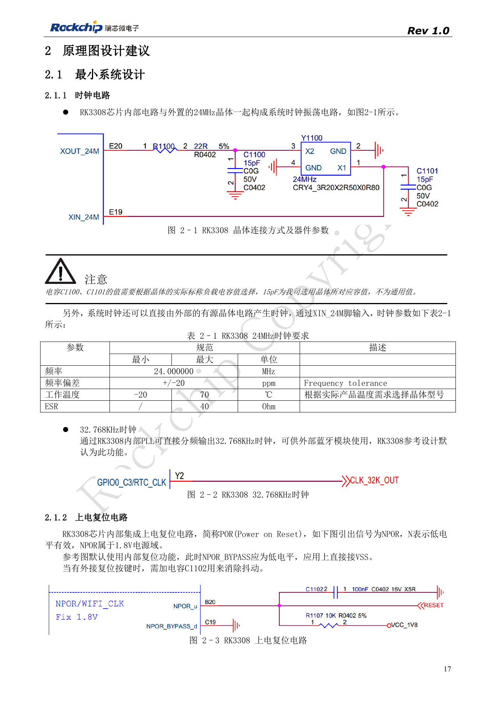
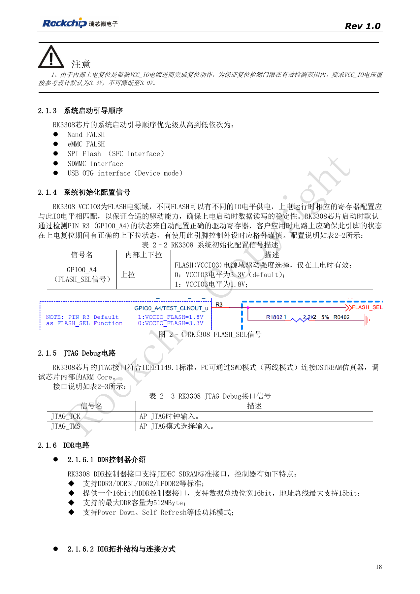
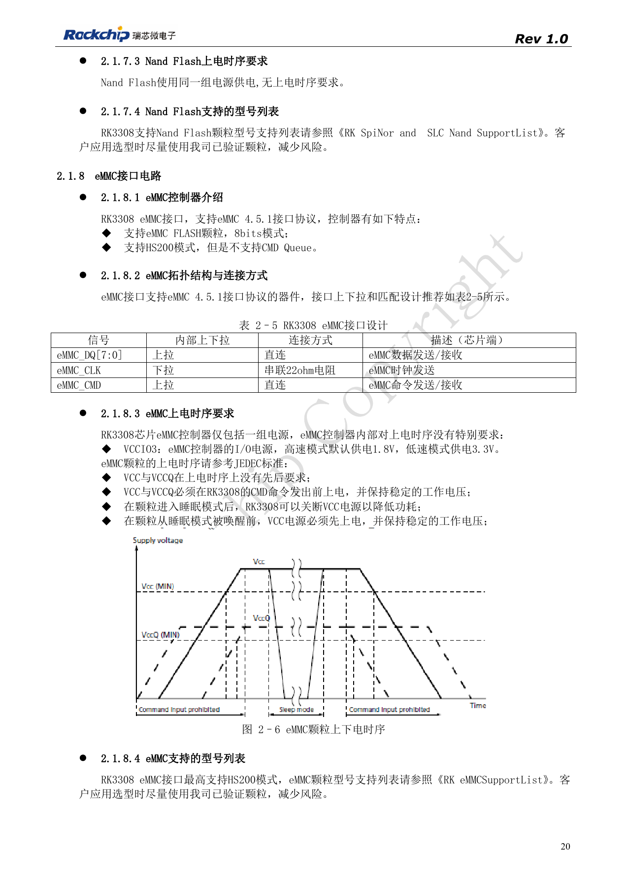
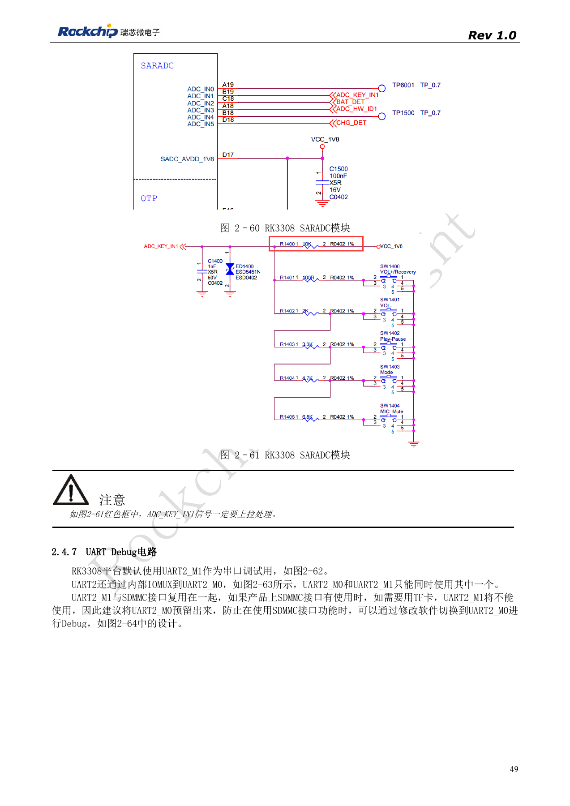
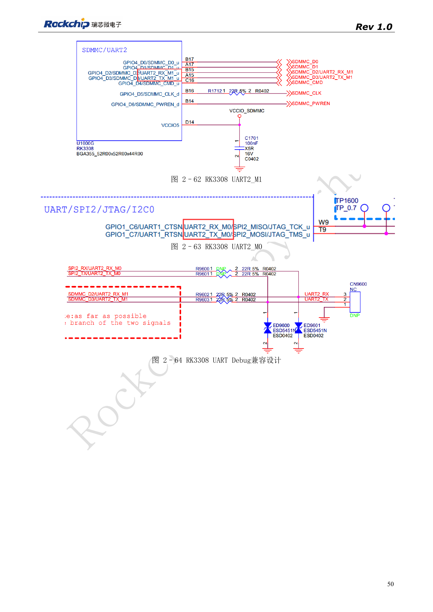

# RK3308-Boot und Speicher: Takt, FLASH_SEL und Wiederherstellung

Nach RK3308 Hardware Design Guide V1.0 (2018-09-14), mit Variantenabgrenzung aus dem Kompatibilitätsdokument V1.1 von 2023. P2 Pro nutzt RK3308B-S; die historische Referenz ersetzt nicht dessen Schaltung. Dieser Themenartikel ist keine vollständige seitenweise Übersetzung. Quellenwerte sind keine ArmSoM-Messungen. Anschlüsse, SDK/BSP, Kernel und Firmware der Boardrevision prüfen.

**RK3308硬件设计指南_V1.0_20180914.pdf** · §2.1; §2.4.1; §2.4.6–2.4.7

## Historischen Geltungsbereich erhalten

V1.0 von 2018 beschreibt RK3308/RK3308G und nicht sämtliche Anforderungen des RK3308B-S auf P2 Pro. Taktreferenz: 24MHz, ±20ppm und ESR≤40Ω. 15pF ist ein quarzspezifisches Beispiel. NPOR ist aktiv Low im 1.8V-Bereich; NPOR_BYPASS wird für internen Reset geerdet. Das überwachte VCC_IO muss laut Quelle bei 3.3V bleiben und darf nicht auf 3.0V sinken. Für S-Varianten zusätzlich die neuere Kompatibilitätsunterlage prüfen.

## Bootmedium und Pegel gemeinsam prüfen

Die Bootreihenfolge lautet NAND, eMMC, SPI Flash/SFC, SDMMC und USB OTG Device. FLASH_SEL ist GPIO0_A4 (R3) und wird beim Einschalten gelesen: 0 für VCCIO3=3.3V, 1 für 1.8V. Peripherie darf diesen Pegel während Reset nicht verfälschen. eMMC bietet 8bit, 4.5.1 und HS200 ohne CMD Queue; CLK erhält 22Ω, CMD/Daten werden direkt verbunden. SFC unterstützt NOR/NAND-Boot mit 22Ω in CLK. Baustein, Bootloader, DDR-Initialisierung und Supportliste müssen zusammenpassen.

## SD-Karte und UART-Debugging

UART2_M1 teilt seine Standardpins mit SDMMC. Bei TF-Karten UART2_M0 vorsehen und per Software umschalten. SARADC_IN1 dient zugleich Recovery: bei vorhandener Firmware während des Starts auf 0V, höchstens 100mV, halten und nach Rockusb-Erkennung am PC auf 1.8V zurückkehren lassen. Pull-up erhalten; ADC-Tastencodes mit Abstand größer 35 auslegen. Fehler bei ROM, DDR-Initialisierung, Speicherzugriff oder Kernel einordnen, bevor Bauteile ersetzt werden.

## Quellenbilder und Prüfseiten

Für diese Auswahl liegen nur chinesische Originale vor. Alle vier Sprachen verwenden dieselben Quellenbilder mit Abbildungskontext; Bildbeschriftungen wurden nicht übersetzt. Der Text ist editierbar. Seitenzahlen bezeichnen physische PDF-Seiten.

PDF 17

PDF 18

PDF 20

PDF 49

PDF 50

## ArmSoM-Produkte und Dokumentation

- [ArmSoM P2 Pro](https://www.armsom.org/product-page/p2pro) · [P2 Pro Docs](https://docs.armsom.org/armsom-p2pro)

## Weiterlesen

- [Serienübersicht](/de/articles/rk3308-hardware-design-series/)
- [RK3308: Versorgung, DDR, Standby und S-Varianten](/de/articles/rk3308-power-ddr-hardware-design/)
- [RK3308-Mikrofonarrays: Analog, I2S, PDM und Rückführung](/de/articles/rk3308-audio-array-hardware-design/)
- [RK3308-Peripherie: USB, RMII, Display und Debug](/de/articles/rk3308-usb-network-peripheral-design/)
- [RK3308: Thermik, ESD und Fertigungsprüfung](/de/articles/rk3308-thermal-esd-production-design/)
