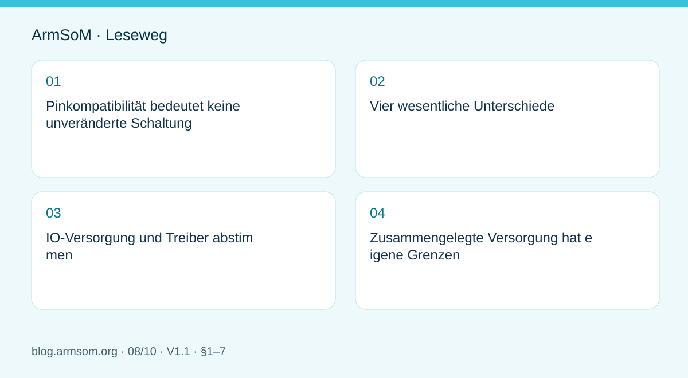
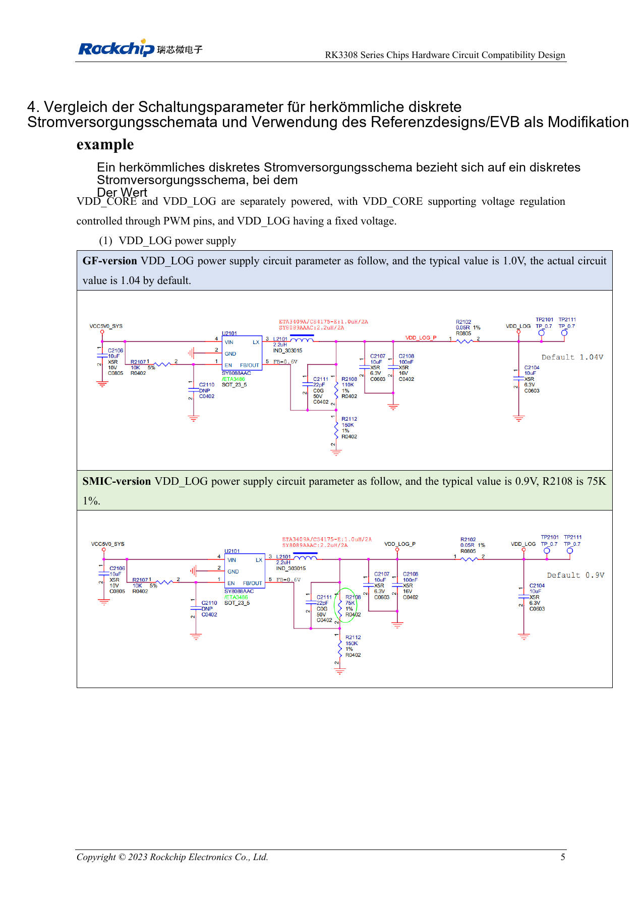

# RK3308-Varianten: Hardwarekompatibilität für P2-Pro-Audioprojekte

## Geltungsbereich und Quellen

Dies ist ein thematischer Engineering-Leitfaden, keine seitenweise Übersetzung des gesamten PDF. Quellenbeispiele sind keine ArmSoM-Messungen. Spannungen, Pins, SDK/BSP und Kernel mit der tatsächlichen Platinenrevision abgleichen.

**Rockchip:** `RK3308系列芯片硬件电路兼容设计与差异化说明_V1.1_20230728_CN.pdf` · V1.1 · §1–7

## Pinkompatibilität bedeutet keine unveränderte Schaltung

Die Quelle ordnet RK3308B/H den GF- und RK3308B-S/H-S den SMIC-Versionen zu. Gleiche Ballpositionen erfordern dennoch passende Schaltungs- und Softwareänderungen. P2 Pro nutzt RK3308B-S; der Beitrag erläutert Unterschiede und fordert keinen Umbau einer fertigen Platine.

## Vier wesentliche Unterschiede

| Bereich | Quellenangabe | Maßnahme |
| --- | --- | --- |
| Typische Spannungen | §1: 1.0V gegenüber 0.9V unter anderem bei VDD_LOG/VDD_CORE | Topologie, BOM und Frequenz-Spannungs-Tabellen abgleichen |
| IO-Treiber | GF: 4 Stufen; SMIC: 7 | Gleiche mA-Bezeichnungen bedeuten keine gleiche Treiberwirkung; unter Last messen |
| PMIC | RK816B-3 für GF; RK816B-6 für S-Referenzschaltungen | Suffix, Standardspannung und Sequenz prüfen |
| USB_EXTR | GF C15: 133R 1%; SMIC C15: NC | Referenz-R1400 bleibt unbestückt; Bezeichner nicht auf beliebige Platinen übertragen |

Typische Spannungen sind keine vollständigen Betriebsgrenzen. §4 nennt zusätzlich konkrete Schaltungswerte und Bauteiländerungen. Schaltplan, bestückte BOM und Software müssen übereinstimmen.

## IO-Versorgung und Treiber abstimmen

Vor der Softwareeinstellung die tatsächlich angeschlossene Versorgung prüfen. Optionale Widerstandspositionen bedeuten keine vollständige Bestückung aller Zweige. Zu schwache Treiber erzeugen langsame Flanken, zu starke können Überschwingen und Ringing verursachen. Nach Änderungen an Last, Leiterführung oder Chip erneut messen.

## Zusammengelegte Versorgung hat eigene Grenzen

Für die spezielle diskrete Schaltung mit verbundenen VDD_CORE/VDD_LOG nennt §6 maximal 1.1V und 912MHz bei GF sowie 1.0V und 816MHz bei SMIC. Diese Grenzen gelten für diese Topologie, nicht für jeden RK3308 oder P2 Pro. Nicht mit getrennten Schienen oder beworbenen Platinentakten verwechseln.

## Audiogerät validieren

Auf P2 Pro zunächst Aufnahme, Wiedergabe, Speicher und Netzwerk prüfen. Nach Hardwareänderungen Rauschen, Paralleltransfers, USB, Kaltstart und Standby-Rückkehr testen. Chipmarkierung, BOM, Firmware und Messkurven aufbewahren.

## Abbildung aus der Quelle

Original aus dem englischen Dokument, gemeinsam für EN/RU/DE. Referenzdesign, kein ArmSoM-Platinenschaltplan.

`RK3308 Series Chips Hardware Circuit Compatibility Design and Differentiation Explanation_V1.1_20230728_EN.pdf` · PDF p. 11.

## Produkte und Entwicklungsunterlagen

- **P2 Pro** — [Produktseite](https://www.armsom.org/product-page/p2pro) · [Dokumentation](https://docs.armsom.org/armsom-p2pro)

## Weitere Beiträge der Reihe

- [RK3576 in Betrieb nehmen: Minimalsystem und erste Einschaltprüfung](/de/articles/rk3576-hardware-bringup/)
- [ArmSoM CM5-Trägerplatine: Checkliste für Versorgung, Boot und Schnittstellen](/de/articles/019-cm5-carrier-production/)
- [RK3576-Hochgeschwindigkeitsschnittstellen: Schaltplan und PCB gemeinsam prüfen](/de/articles/rk3576-high-speed-interface-design/)
- [RK3588S-Hardwaredesign: vom Referenzschaltplan zur CM7s-Trägerplatine](/de/articles/rk3588s-cm7s-carrier-design/)
- [RK3588 für Edge-KI: Versorgung, Kühlung und Erweiterung gemeinsam planen](/de/articles/rk3588-edge-ai-hardware-design/)
- [RK3588-PCB-Prüfung: Lagenaufbau, Impedanz und Leiterführung](/de/articles/rk3588-high-speed-pcb-review/)
- [RK3506-HMI-Hardware: Entwicklung mit CM1 oder Forge1](/de/articles/rk3506-industrial-hmi-hardware/)
- [RK3588S und RK3588S2: Prüfungen vor einer Hardwareänderung](/de/articles/rk3588s-rk3588s2-hardware-differences/)
- [Vom Rockchip-Prototyp zur Serie: Prozessvorgaben und Prüfunterlagen](/de/articles/rockchip-hardware-production-checklist/)

## Weiterlesen

- [RK3308-Hardwaredesign-Serie](/de/articles/rk3308-hardware-design-series/)
