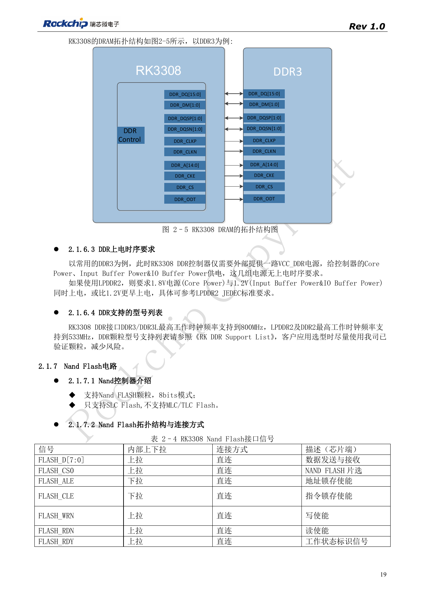
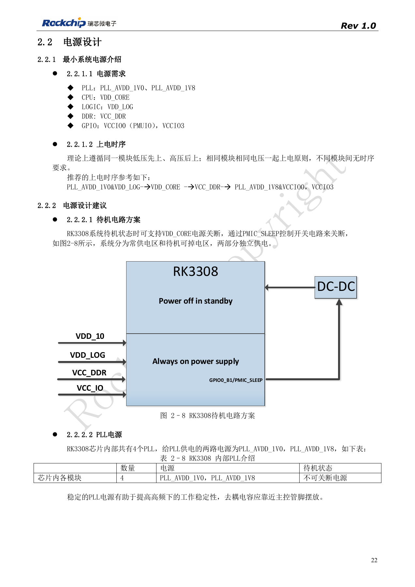
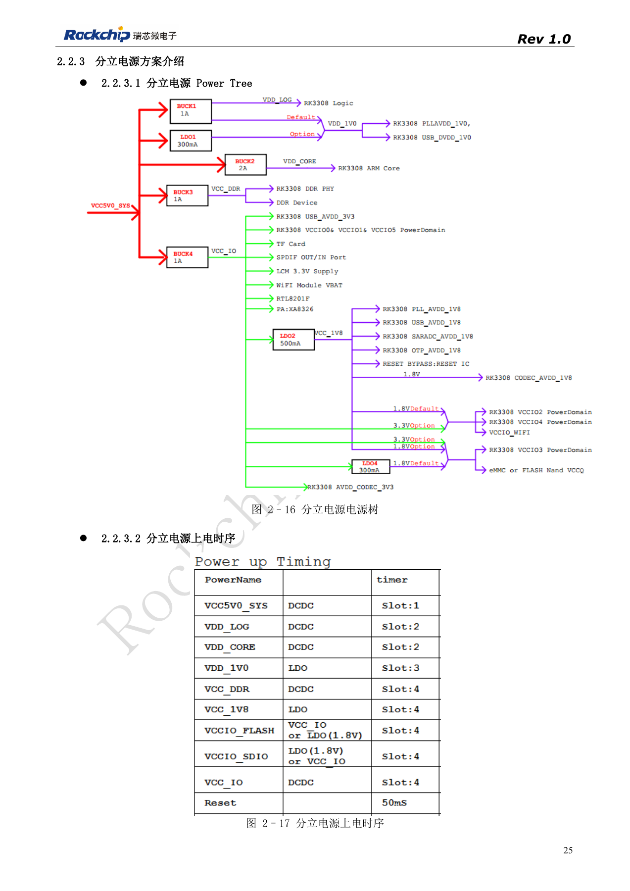
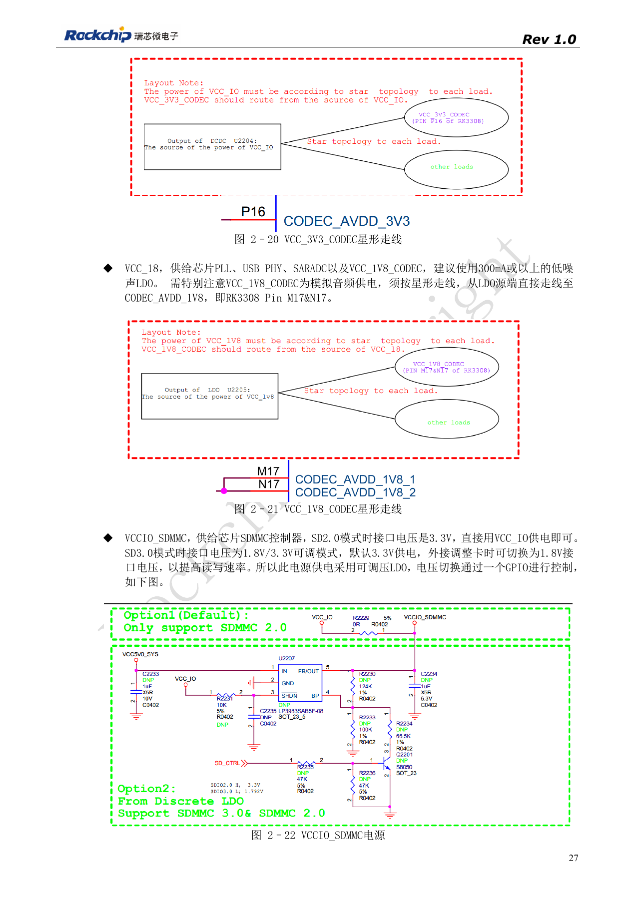
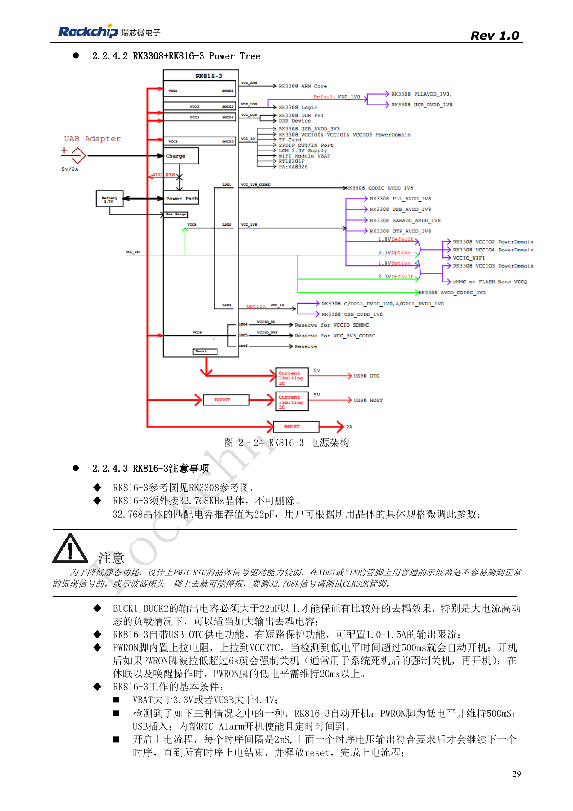

# RK3308: Versorgung, DDR, Standby und S-Varianten

Nach RK3308 Hardware Design Guide V1.0 (2018-09-14), mit Variantenabgrenzung aus dem Kompatibilitätsdokument V1.1 von 2023. P2 Pro nutzt RK3308B-S; die historische Referenz ersetzt nicht dessen Schaltung. Dieser Themenartikel ist keine vollständige seitenweise Übersetzung. Quellenwerte sind keine ArmSoM-Messungen. Anschlüsse, SDK/BSP, Kernel und Firmware der Boardrevision prüfen.

**RK3308硬件设计指南_V1.0_20180914.pdf** · §2.1.6; §2.2; compatibility V1.1

## DDR und Versorgung sind variantenabhängig

Der ursprüngliche RK3308 unterstützt DDR3/DDR3L/DDR2/LPDDR2 mit 16bit und bis 512MB; RK3308G integriert 64MB DDR2. Bei LPDDR2 muss 1.8V vor oder gleichzeitig mit 1.2V anliegen. Genannt werden bis 800MHz für DDR3/3L und 533MHz für DDR2/LPDDR2. Das sind historische Plattformwerte, keine Aussage über RAM und DDR-Takt des P2 Pro.

## CPU und analoge Sternpfade trennen

Die alte diskrete Referenz verwendet vier Bucks und einen LDO. VDD_CORE unterstützt DVFS; beim Buck-Wechsel werden 1.5–2A und 0.6V Feedbackreferenz empfohlen, ohne beliebige PWM-Änderungen. VDD_LOG und VDD_1V0 sind über Ferrit verbunden, daraus folgt keine CPU-Zusammenlegung. Analoge 3.3V vom Buck und 1.8V vom rauscharmen LDO sternförmig separat zum Codec führen, ohne WLAN-Laststrom in diesen Zweigen. PMIC_SLEEP trennt Dauer- und Schaltversorgung; PLL nicht zusammen mit CPU abschalten.

## Alte Referenz mit neueren Unterschieden abgleichen

Die RK816-3-Schaltung von 2018 benötigt einen externen 32.768kHz-Quarz. CLK32K messen; ein normaler Tastkopf am Quarz kann die Schwingung stoppen. Das Dokument von 2023 unterscheidet RK816B-3 für GF und RK816B-6 für SMIC S sowie Versorgung und Treiberstufen. Vollständige Suffixe beachten. EVB-Stromwerte stammen von CPU 1.3GHz, DDR 589MHz, 20MHz Oszilloskopbandbreite und festgelegter Audio/WLAN-Last, nicht von P2 Pro. Start, Spannungswechsel, Audiostörungen und Resume mit dokumentierten Bedingungen prüfen.

## RK3308-EVB-Spitzenströme und Bedingungen

| Netz | Spannung / V | Spitzenstrom / mA |
| --- | --- | --- |
| VDD_CORE | 0.95–1.34 | 1055 |
| VDD_LOG | 1.04 | 204 |
| VDD_1V0 | 1.04 | 9.8 |
| VCC_DDR | 1.5 | 289 |
| VCC_1V8 | 1.8 | 83.8 |
| VCC_IO (einschließlich WiFi) | 3.3 | 709 |

Quelle: Tabelle 2–9, PDF31. RK3308-EVB des Herstellers, CPU bis 1.3GHz, DDR fest 589MHz, Oszilloskop-Bandbreite auf 20MHz begrenzt. Tests: Speicher-stresstest, Sechs-Mikrofon-Abhöralgorithmus und gleichzeitige Online-Musik über WiFi. Die Quelle kennzeichnet die Werte als Referenz. Ströme, DDR-Spannung und Maximalfrequenz der alten EVB nicht direkt auf RK3308B-S/P2 Pro übertragen; Bauteil, Versorgung, Software und Last zuerst prüfen.

## Quellenbilder und Prüfseiten

Für diese Auswahl liegen nur chinesische Originale vor. Alle vier Sprachen verwenden dieselben Quellenbilder mit Abbildungskontext; Bildbeschriftungen wurden nicht übersetzt. Der Text ist editierbar. Seitenzahlen bezeichnen physische PDF-Seiten.

PDF 19

PDF 22

PDF 25

PDF 27

PDF 29

## ArmSoM-Produkte und Dokumentation

- [ArmSoM P2 Pro](https://www.armsom.org/product-page/p2pro) · [P2 Pro Docs](https://docs.armsom.org/armsom-p2pro)

## Weiterlesen

- [Serienübersicht](/de/articles/rk3308-hardware-design-series/)
- [RK3308-Boot und Speicher: Takt, FLASH_SEL und Wiederherstellung](/de/articles/rk3308-clock-boot-storage-design/)
- [RK3308-Mikrofonarrays: Analog, I2S, PDM und Rückführung](/de/articles/rk3308-audio-array-hardware-design/)
- [RK3308-Peripherie: USB, RMII, Display und Debug](/de/articles/rk3308-usb-network-peripheral-design/)
- [RK3308: Thermik, ESD und Fertigungsprüfung](/de/articles/rk3308-thermal-esd-production-design/)
