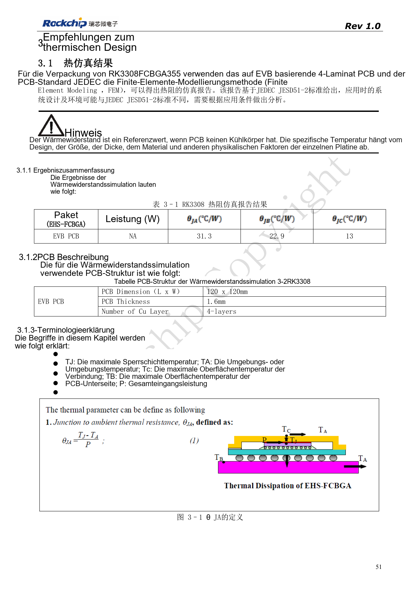
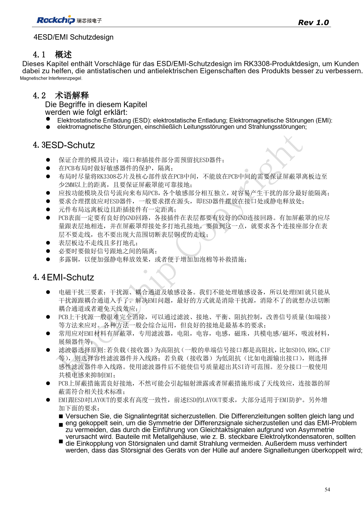
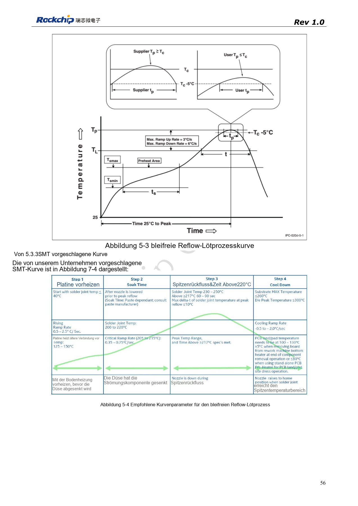
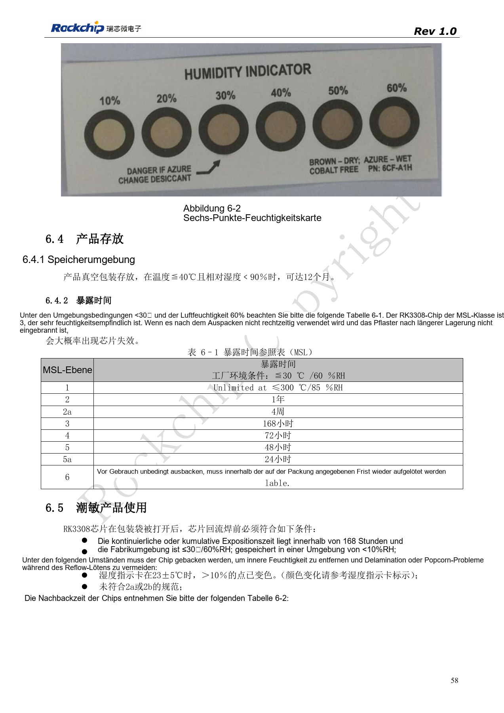
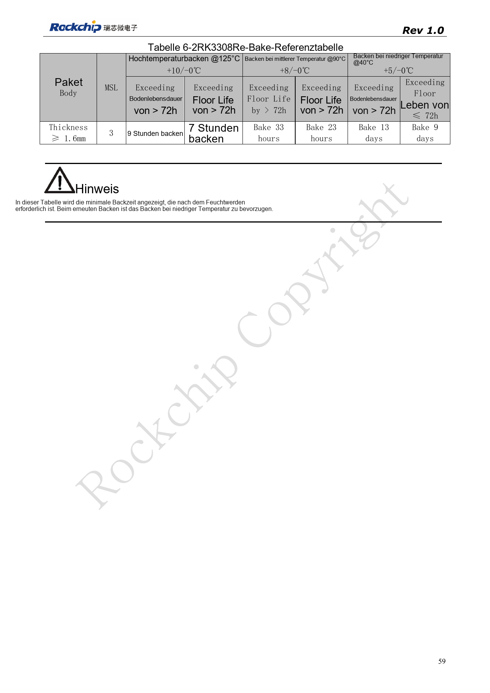

# RK3308: Thermik, ESD und Fertigungsprüfung

Nach RK3308 Hardware Design Guide V1.0 (2018-09-14), mit Variantenabgrenzung aus dem Kompatibilitätsdokument V1.1 von 2023. P2 Pro nutzt RK3308B-S; die historische Referenz ersetzt nicht dessen Schaltung. Dieser Themenartikel ist keine vollständige seitenweise Übersetzung. Quellenwerte sind keine ArmSoM-Messungen. Anschlüsse, SDK/BSP, Kernel und Firmware der Boardrevision prüfen.

**RK3308硬件设计指南_V1.0_20180914.pdf** · §3–6

## Thermische Daten gelten für einen Prüfaufbau

Wärmewiderstände der Quelle sind Simulationen für Gehäuse, PCB und Umgebung, keine ArmSoM-Messungen. Fläche, Kupfer, Luftführung, benachbarte Leistungsbauteile und Kühler beeinflussen Temperaturen; θJA allein bestimmt den Kühlbedarf nicht. Umgebung, Gehäuse, Last, Frequenz und Thermal-Policy dokumentieren sowie Die- und Bauteiltemperaturen messen. Drosselung, Notabschaltung und normale Wärmeabfuhr sind unterschiedliche Maßnahmen.

## ESD benötigt einen Entladepfad

Schutz nahe Steckern und Eintrittspunkten mit kurzem, geschlossenem Massepfad platzieren. Stecker und Schirme zuverlässig erden; Takt, Reset und Audio von Störquellen und Platinenrand fernhalten. Filterkapazität zur EMI-Verbesserung nicht zulasten schneller Signale erhöhen. Nach TVS-, Gleichtaktdrossel- oder Steckerwechsel Signalqualität erneut prüfen. Abnahme umfasst Hotplug, Erholung nach ESD und Dauerlast mit Protokollierung von Resets, Audiostörungen und Kommunikationsfehlern.

## Kumulative Feuchteexposition erfassen

Die Quelle nennt MSL3 mit 168 Stunden kumulativer Offenzeit bei ≤30°C/60%RH. Diese Zeit beginnt beim erneuten Linienstart nicht von vorn. Lagerreferenz in dichter Verpackung: ≤40°C, <90%RH, 12 Monate. Bei Überschreitung oder auffälliger Feuchtekarte Rebake nach Gehäusedicke, Überschreitungsdauer und Temperatur auswählen. Beide Tabellen enthalten ein fragliches „≤300°C“ für MSL1; niemals als Lagertemperatur übernehmen. Reflow für Paste, thermische Masse und Gehäuse qualifizieren und gemessene Profile sowie Chargen dokumentieren.

## Rebake-Referenztabelle

| Temperatur | Floor-Life-Überschreitung >72h | Floor-Life-Überschreitung ≤72h |
| --- | --- | --- |
| 125°C +10/-0°C | 9h | 7h |
| 90°C +8/-0°C | 33h | 23h |
| 40°C +5/-0°C | 13d | 9d |

Nur für die Quellenbedingungen: MSL3, Gehäusedicke ≥1.6mm. Angegeben sind Mindestzeiten, niedrige Temperatur wird bevorzugt. Temperaturgrenzen von Tray und Bauteilen prüfen; daraus kein Verfahren für andere Gehäuse oder bestückte Platinen ableiten.

## Quellenbilder und Prüfseiten

Für diese Auswahl liegen nur chinesische Originale vor. Alle vier Sprachen verwenden dieselben Quellenbilder mit Abbildungskontext; Bildbeschriftungen wurden nicht übersetzt. Der Text ist editierbar. Seitenzahlen bezeichnen physische PDF-Seiten.

PDF 51

PDF 54

PDF 56

PDF 58

PDF 59

## ArmSoM-Produkte und Dokumentation

- [ArmSoM P2 Pro](https://www.armsom.org/product-page/p2pro) · [P2 Pro Docs](https://docs.armsom.org/armsom-p2pro)

## Weiterlesen

- [Serienübersicht](/de/articles/rk3308-hardware-design-series/)
- [RK3308-Boot und Speicher: Takt, FLASH_SEL und Wiederherstellung](/de/articles/rk3308-clock-boot-storage-design/)
- [RK3308: Versorgung, DDR, Standby und S-Varianten](/de/articles/rk3308-power-ddr-hardware-design/)
- [RK3308-Mikrofonarrays: Analog, I2S, PDM und Rückführung](/de/articles/rk3308-audio-array-hardware-design/)
- [RK3308-Peripherie: USB, RMII, Display und Debug](/de/articles/rk3308-usb-network-peripheral-design/)
