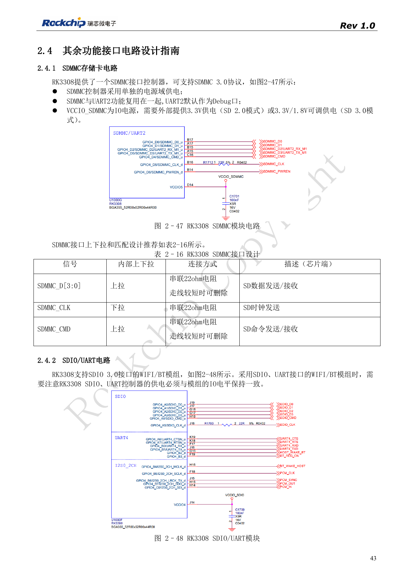
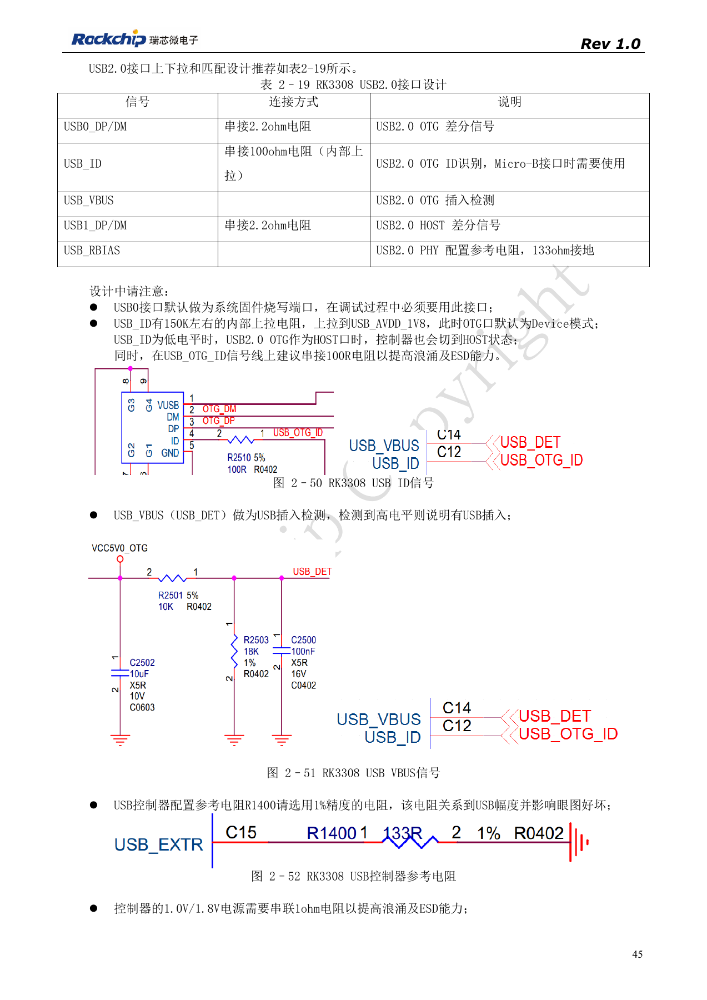
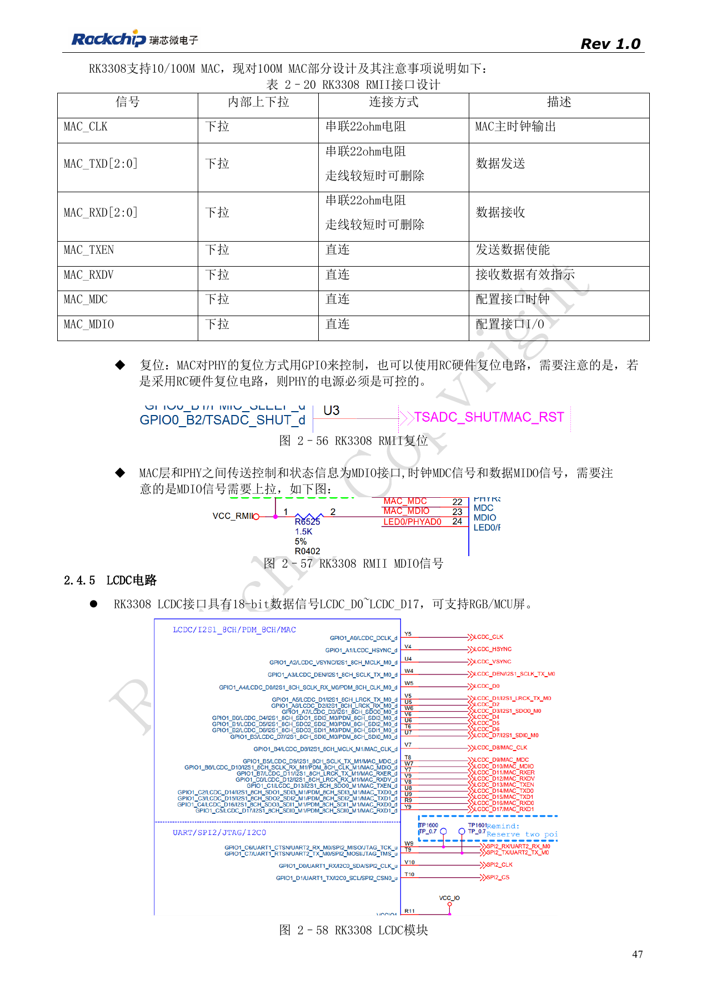
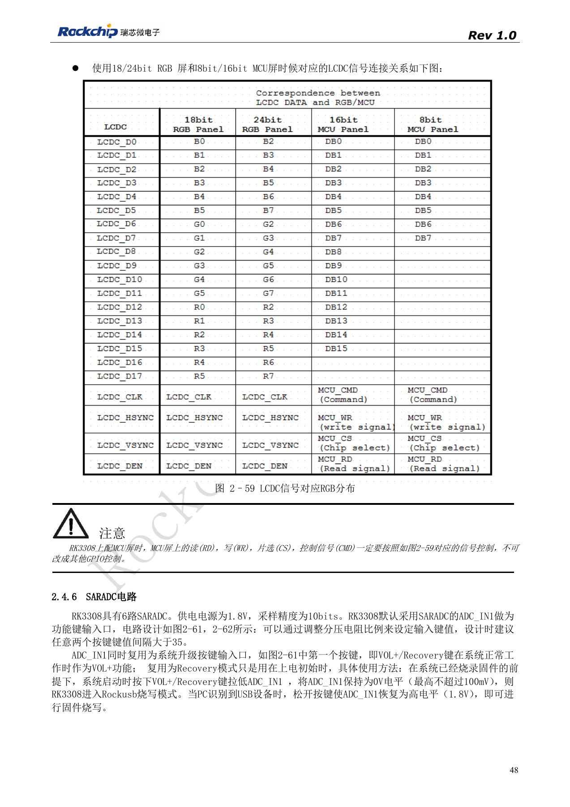

# RK3308-Peripherie: USB, RMII, Display und Debug

Nach RK3308 Hardware Design Guide V1.0 (2018-09-14), mit Variantenabgrenzung aus dem Kompatibilitätsdokument V1.1 von 2023. P2 Pro nutzt RK3308B-S; die historische Referenz ersetzt nicht dessen Schaltung. Dieser Themenartikel ist keine vollständige seitenweise Übersetzung. Quellenwerte sind keine ArmSoM-Messungen. Anschlüsse, SDK/BSP, Kernel und Firmware der Boardrevision prüfen.

**RK3308硬件设计指南_V1.0_20180914.pdf** · §2.4; compatibility V1.1 §7

## Vor USB das Suffix prüfen

Beim ursprünglichen RK3308 dient USB0 als OTG/Flashport, USB1 als Host. Die Referenz nutzt 2.2Ω in DP/DM und 100Ω in ID. USB_RBIAS mit 133Ω 1% aus 2018 gilt für älteres Silizium: die Unterlage von 2023 führt C15 bei SMIC S als NC, sodass die externe GF-Beschaltung anzupassen ist. P2 Pro nutzt B-S; tatsächlichen Schaltplan und Bestückung prüfen, statt einen Widerstand aus der alten Zeichnung nachzurüsten.

## Netzwerk als Gesamtsystem prüfen

100Mbps-RMII benötigt einen externen PHY. Sein Takt kommt je nach Referenz vom Quarz oder MAC_CLK; Richtung eindeutig festlegen. Bei RC-Reset verlangt der Leitfaden schaltbare PHY-Versorgung. MDIO benötigt weiterhin Pull-up. SDIO-3.0-WLAN/BT muss zu SDIO/UART-Pegeln, CTS/RTS-Richtung und PCM-Pfad passen. Tabelle 2-20 bezeichnet RMII-Daten als MAC_TXD[2:0]/RXD[2:0]. Das ist anhand PinOut/TRM zu klären und kein Anlass, eine dritte Datenleitung zu erfinden.

## Display und Servicezugang abstimmen

LCDC führt 18 Datensignale; RGB/MCU anhand der Quellgrafik zuordnen. RD, WR, CS und CMD eines MCU-Panels benötigen die festgelegten Funktionen statt beliebiger GPIOs. Bei SDMMC-Konflikt mit UART2_M1 UART2_M0 vorsehen. Externe Stecker benötigen Serienschutz, ESD-Rückstrom und Prüfung im stromlosen Zustand. Netzwerkdauerlast, USB-Hotplug, Display und Audio gemeinsam testen, denn ein einzelner erfolgreicher Interface-Test bestätigt keine Systemstabilität.

## Quellenbilder und Prüfseiten

Für diese Auswahl liegen nur chinesische Originale vor. Alle vier Sprachen verwenden dieselben Quellenbilder mit Abbildungskontext; Bildbeschriftungen wurden nicht übersetzt. Der Text ist editierbar. Seitenzahlen bezeichnen physische PDF-Seiten.

PDF 43

PDF 45

PDF 47

PDF 48

## ArmSoM-Produkte und Dokumentation

- [ArmSoM P2 Pro](https://www.armsom.org/product-page/p2pro) · [P2 Pro Docs](https://docs.armsom.org/armsom-p2pro)

## Weiterlesen

- [Serienübersicht](/de/articles/rk3308-hardware-design-series/)
- [RK3308-Boot und Speicher: Takt, FLASH_SEL und Wiederherstellung](/de/articles/rk3308-clock-boot-storage-design/)
- [RK3308: Versorgung, DDR, Standby und S-Varianten](/de/articles/rk3308-power-ddr-hardware-design/)
- [RK3308-Mikrofonarrays: Analog, I2S, PDM und Rückführung](/de/articles/rk3308-audio-array-hardware-design/)
- [RK3308: Thermik, ESD und Fertigungsprüfung](/de/articles/rk3308-thermal-esd-production-design/)
