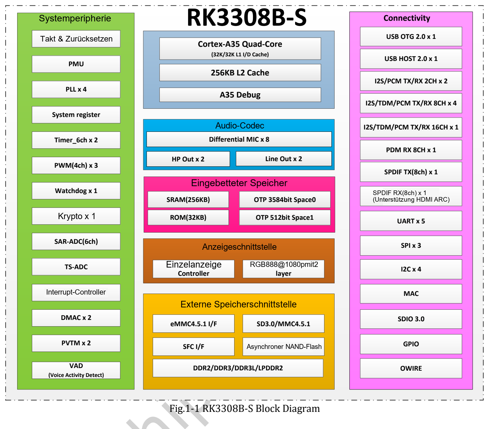

RK3308B-S konzentriert sich auf Audioaufnahme, Wiedergabe und Embedded-Kommunikation. Vier Cortex-A35, Audio-Codec und digitale Audioschnittstellen eignen sich für Sprachterminals, Netzwerkaudio und Geräte-Gateways. ArmSoM P2 Pro stellt Platinenschnittstellen und Linux-Ressourcen für den Weg zum Prototyp bereit.

## Architektur und Einsatzgebiet

| Block | RK3308B-S V1.0 | Bedeutung |
|---|---|---|
| CPU | Vier Cortex-A35, Armv8-A, NEON | Anwendungen, Protokolle, Audioverarbeitung |
| Cache | 32KB L1 Instruktionen, 32KB L1 Daten, 256KB L2 | Leistung hängt auch von der Software ab |
| Speicher | 16-bit DDR2/DDR3/DDR3L/LPDDR2, bis 512MB Adressraum | Begrenzten Speicherbedarf einplanen |
| Codec | Bis acht Mikrofon-ADC-Kanäle, Stereo-DAC | Aufnahme, Kopfhörer- und Line-Ausgang |
| Digitalaudio | I2S/PCM/TDM, PDM, SPDIF, auch interne Verbindungen | Tatsächliche Anschlüsse prüfen |
| VAD | Sprachaktivitätserkennung und Datenspeicherung | Ereignis für nachfolgende Erkennung |
| Netzwerk/USB | 10/100M MAC, USB2.0 | PHY, Funkmodul und Treiber ergänzen die Verbindung |

Keine CPU-, NPU-, Video- oder Erweiterungsdaten von RK3506J oder RK3588 übertragen. Eine 64-bit-CPU garantiert keinen 64-bit-Userspace in jedem Image. WLAN/Bluetooth des P2 Pro stammen aus einem separaten Modul, nicht aus integriertem SoC-Funk.

## Audio vor Taktfrequenz prüfen

Mikrofonarrays benötigen synchrone Abtastung, richtige Kanalreihenfolge, Takte, Verstärkung und geringes Rauschen. Analoge Mikrofone und PDM sind nicht automatisch addierbare Plug-and-play-Ressourcen. Bauteile, Pin-Multiplexing, Treiber und Bandbreite bestimmen die nutzbare Konfiguration.

VAD erkennt Aktivität, nicht die Bedeutung eines Befehls. Aktivierungswort, Spracherkennung, Echounterdrückung, Beamforming und Sprachsynthese brauchen Algorithmen und Integration. Ohne Tests lassen sich Reichweite, Genauigkeit und Standby-Verbrauch des Gesamtsystems nicht zusichern.

## Drei Entwicklungswege

**Sprachterminal:** Aufnahme → Vorverarbeitung → Aktivitäts-/Aktivierungsentscheidung → Befehl → Sprachausgabe. Mit einem Kanal beginnen, dann Array, reales Gehäuse und Umgebungsgeräusche testen.

**Netzwerkaudio:** Empfang → Puffer/Dekodierung → Ausgabe. Beispiele sind Hinweisterminals, Desktop-Player und Beschallungsprototypen. Codecs, Jitter, Lautstärke und Verstärker separat validieren.

**Kompaktes IoT-Gateway:** Sensor/serielle Daten → Prüfung/Pufferung → Upload. Dienste und Logs begrenzen. Fast Ethernet macht die Plattform nicht zum Gigabit-Router oder Hochgeschwindigkeitsspeicher.

## Unterschiede bei Takt und Anzeige

Die elektrische Tabelle des B-S V1.0 auf Seite 67 nennt **1.1GHz** als A35-Maximum. P2-Pro-Unterlagen nennen **1.2GHz und 1.3GHz**. Nicht stillschweigend den höchsten Wert übernehmen: Chiprevision, BSP und Betriebsbedingungen prüfen.

Die allgemeine RK3308-Webseite nennt RGB/MCU bis 720P, das B-S-Handbuch 1080p. Diese Quellen bleiben getrennt. Ein Displaycontroller im Chip ist kein HDMI-Videoanschluss auf P2 Pro; herausgeführte Signale prüfen.

## Mit P2 Pro beginnen

Mit passendem Image Audio, Netzwerk und Speicher prüfen, dann Softwarestände festlegen. Optionales eMMC und PoE anhand der gekauften Ausstattung kontrollieren. Die weiteren Artikel behandeln Audio, Gateway und Datenblatt. Szenarien sind Entwicklungsvorschläge, keine Kundeninstallationen oder Messergebnisse.

## Weitere Artikel und offizielle Unterlagen

- [ArmSoM P2 Pro: Mikrofonaufnahme, Sprachbedienung und Netzwerkaudio](/de/articles/p2pro-voice-audio-applications/)
- [ArmSoM P2 Pro: IoT-Datenerfassung und kompakte Gateways entwickeln](/de/articles/p2pro-iot-lightweight-gateway/)
- [RK3308B-S Datasheet V1.0: Download, Audioarchitektur und elektrische Daten](/de/articles/rk3308bs-datasheet-v10/)
- [Rockchip Audio](/de/articles/023-rockchip-audio/)
- [Rockchip RK3308](https://www.rock-chips.com/a/cn/product/RK33xilie/2018/0614/908.html)
- [P2 Pro — Docs](https://docs.armsom.org/armsom-p2pro)
- [P2 Pro — ArmSoM](https://www.armsom.org/product-page/p2pro)
- [P2 Pro — BSP](https://github.com/ArmSoM/armsom-p2pro-bsp)
