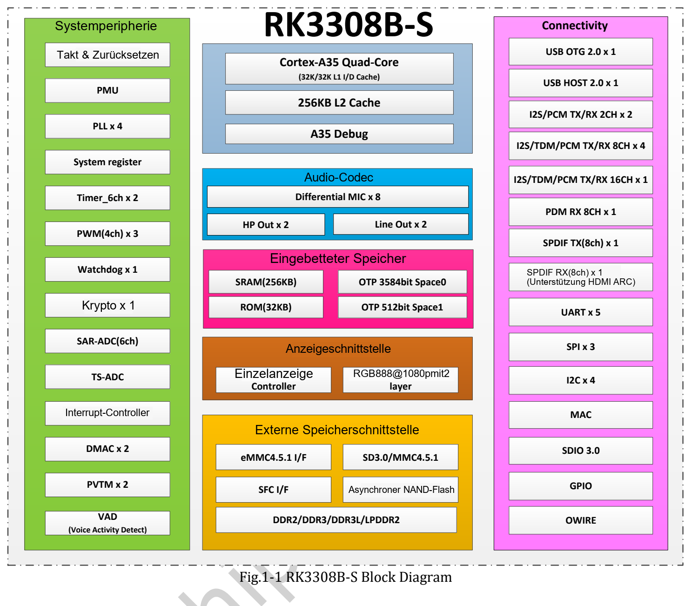
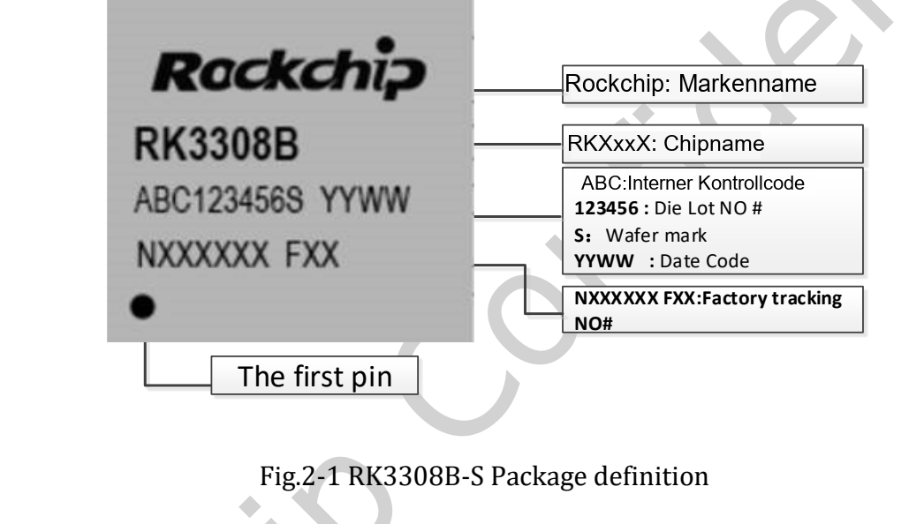
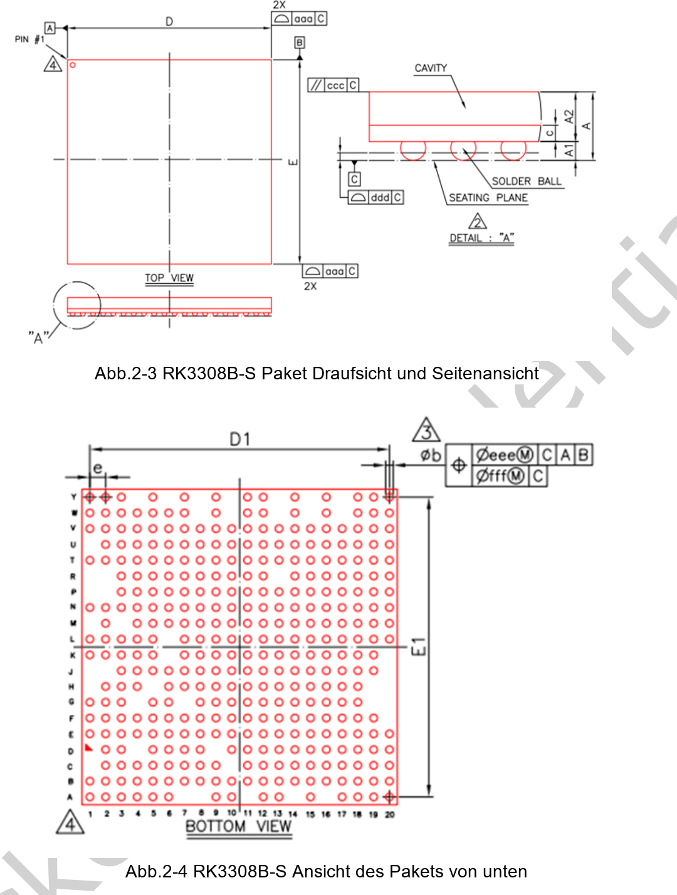

Hier steht das originale **RK3308B-S Datasheet V1.0 vom 2021-10-10 mit 72 Seiten** bereit. Die technische Lesehilfe behandelt Architektur, Audio, Gehäuse, elektrische Grenzen und Wärme. Sie ist keine zeilenweise Übersetzung; vollständige Ball-Maps, Multiplexing- und elektrische Tabellen bleiben im PDF.

## Download und Varianten

[Original RK3308B-S Datasheet V1.0 herunterladen](/assets/rk3308bs/Rockchip-RK3308B-S-Datasheet-V1.0-20211010.pdf)

Das Dokument umfasst **RK3308B-S und RK3308H-S**. Die integrierten 64MB DDR2 des H-S gehören nicht zum B-S. Variantenüberschriften bei Gehäuse, Balls und Wärme beachten. P2 Pro verwendet B-S; DDR und optionale Speicher hängen von der Ausstattung ab.

| Seiten | Inhalt |
|---|---|
| 7–14 | CPU, Speicher, Anzeige, Audio, Kommunikation |
| 15 / 16 | Blockdiagramme B-S / H-S |
| 17–20 | Markierungen, Gehäuse, Maße |
| 21–28 | Ball-Maps nach Variante |
| 29–33 | B-S-Pinliste |
| 34–65 | Versorgung, Funktions-IO, Multiplexing, IO-Typen |
| 66–71 | Grenzen, Betriebsbedingungen, Schnittstellen-/Audiodaten |
| 72 | Wärmereferenzen beider Varianten |

## Rechenwerk und Speicher

Vier Armv8-A Cortex-A35 unterstützen NEON. Genannt werden 32KB L1-Instruktionscache, 32KB L1-Datencache, 256KB L2 und 256KB SRAM. Der externe 16-bit-DDR2/DDR3/DDR3L/LPDDR2-Adressraum reicht bis 512MB.

eMMC unterstützt 4.41/4.51/5.0/5.1, 1/4/8-bit und bis HS200, ausdrücklich ohne CMD Queue. Asynchrones NAND, SPI NOR/NAND und SD sind weitere Chipoptionen, keine Zusage zur Bestückung jeder Platine.

## Audio nach Signalweg lesen

| Funktion | V1.0 und Einschränkung |
|---|---|
| Codec | 24-bit-ADC bis acht Mikrofonkanäle, 24-bit-Stereo-DAC |
| PDM | Bis acht Mono- oder vier Stereomikrofone |
| I2S_8CH | Vier Komponenten; 0/1 extern, 2/3 interner Codec |
| TDM | Geteilte I2S-Controller; 192kHz@2CH, 48kHz@8CH |
| VAD | Einkanal-Aktivitätserkennung mit Mehrkanalspeicherung vor/nach Ereignissen |
| SPDIF | TX/RX und HDMI ARC, kein HDMI-Videoanschluss auf der Platine |

Controller, interne Verbindungen und Platinenausgänge sind verschiedene Ebenen. Maximale Kanäle und Raten nicht einfach multiplizieren. VAD ist kein Aktivierungswort- oder Spracherkennungsalgorithmus.

## Originalabbildungen

Angegeben ist TFBGA355. Footprints anhand offizieller Maße und Toleranzen erstellen, nicht am Webbild messen. Benachbarte H-S-Zeichnungen nicht einsetzen.

## Elektrische und thermische Bedingungen

| Parameter | B-S V1.0 |
|---|---|
| A35-Maximum, Seite 67 | 1.1GHz |
| Empfohlene CPU-Versorgung | Min TBD, typ 0.90V, max TBD |
| Umgebung Ta | 0 / 25 / 85°C, min/typ/max |
| Maximale Sperrschichttemperatur | 125°C; Wärmekapitel fordert Unterschreitung |
| θJA / θJB / θJC | 45 / 35 / 15°C/W, Herstellerreferenz |

Bedingungen: vierlagige Testplatine, 101.6×114.3mm, Dicke 1.6mm, Umgebung 25°C. Keine P2-Pro-Messung und keine direkte Gehäusetemperaturprognose. Codec-Ströme gelten nur für die angegebene Domäne und Betriebsart, nicht für die gesamte Platine.

## Quellenunterschiede

P2-Pro-Seiten nennen 1.2GHz/1.3GHz, diese Tabelle 1.1GHz. Allgemeines RK3308-Webblatt: 720P; B-S-Handbuch: 1080p. Keine Variante für die gelieferte Hardware erraten. Den dokumentierten P2-Pro-Bereich 0–70°C nicht durch 0–85°C des Chips ersetzen.

Datei und Wasserzeichen bleiben unverändert. Chiprevision, Dokumentstand, BSP, Versorgung, Schaltplan und Messungen vor Umsetzung prüfen. Für diese Serie wurden keine Hardwaretests durchgeführt.

## Weitere Artikel und offizielle Unterlagen

- [RK3308B-S erklärt: Sprache, Audio und vernetzte Embedded-Geräte](/de/articles/rk3308bs-chip-guide/)
- [ArmSoM P2 Pro: Mikrofonaufnahme, Sprachbedienung und Netzwerkaudio](/de/articles/p2pro-voice-audio-applications/)
- [ArmSoM P2 Pro: IoT-Datenerfassung und kompakte Gateways entwickeln](/de/articles/p2pro-iot-lightweight-gateway/)
- [Rockchip Audio](/de/articles/023-rockchip-audio/)
- [Rockchip RK3308](https://www.rock-chips.com/a/cn/product/RK33xilie/2018/0614/908.html)
- [P2 Pro — Docs](https://docs.armsom.org/armsom-p2pro)
- [P2 Pro — ArmSoM](https://www.armsom.org/product-page/p2pro)
- [P2 Pro — BSP](https://github.com/ArmSoM/armsom-p2pro-bsp)
