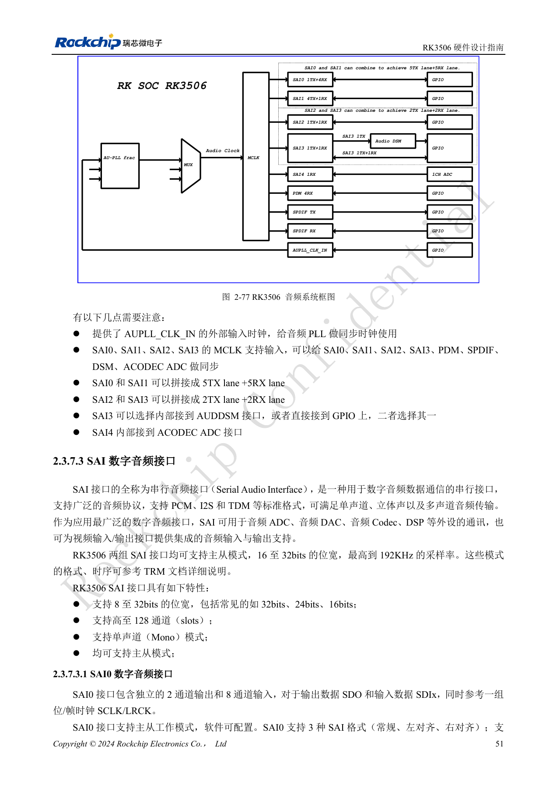
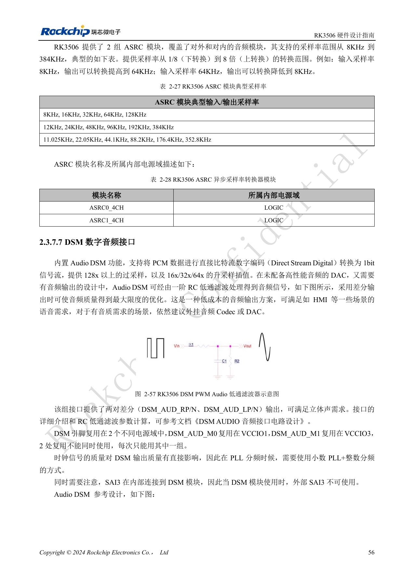
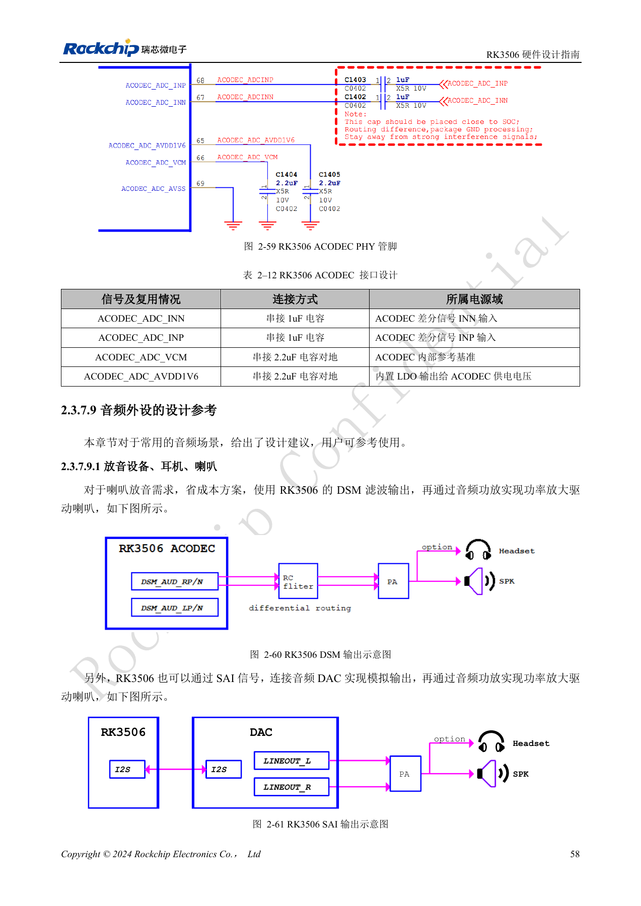
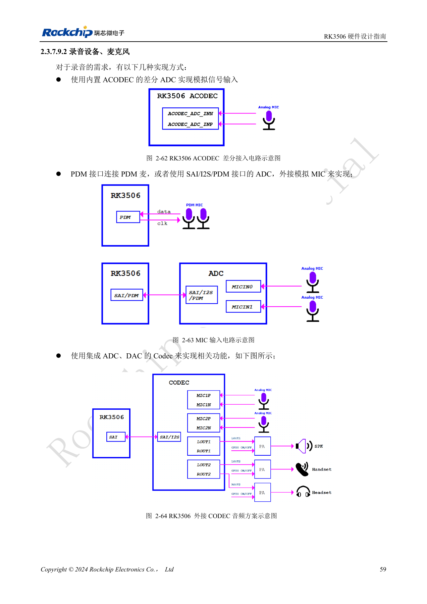

# RK3506-Audiodesign: SAI, PDM, ASRC und DSM

Nach RK3506 Hardware Design Guide V1.0 (2024-09) für G2 und B/J. Gehäuse, RAM, Versorgung und Pins variantenbezogen, CM1/Forge1-Anschlüsse anhand der Boardunterlagen prüfen. Dies ist ein technischer Themenartikel, keine vollständige seitenweise Übersetzung. Werte stammen aus der Quelle, nicht aus ArmSoM-Messungen. Tatsächliches SDK/BSP, Kernel und Firmware validieren.

**RK3506 Hardware Design Guide_V1.0_20240904_CN.pdf** · §2.3.7; §3.3.13

## Zuerst Takt- und Datenpfade zeichnen

Nur SAI0–3 sind extern; SAI4 ist intern mit ACODEC ADC verbunden. SAI0/1 können 5TX+5RX-Lanes bilden, SAI2/3 2TX+2RX. Diese Modi sind keine zusätzlichen Controller. SAI2 M0/M1 sind alternative Belegungen desselben Interfaces. SAI3 wählt internes DSM oder externe IO; DSM schließt externes SAI3 aus. Der Quelltext nennt zunächst 16–32bit, später 8–32bit für SAI. Den konkreten Modus mit TRM und SDK prüfen.

## Digitale Mikrofone und asynchrone Takte

PDM arbeitet als Master-Empfänger mit zwei Kanälen auf jeder von vier Datenleitungen: acht Mikrofone oder sechs Mikrofone plus zwei Rückführkanäle. Für PDM_CLK werden 33Ω empfohlen, für SAI MCLK/SCLK/LRCK meist 22Ω; unterschiedliche Regeln nicht vermischen. Zwei ASRC-Blöcke decken 8–384kHz und Verhältnisse 1/8–8 ab, auch für gleiche nominale Abtastraten aus unsynchronen Takten. ASRC ist interne Verarbeitung und kein zusätzlicher externer Port.

## Analogpfad nach Qualitätsziel wählen

Günstige HMI-Hinweistöne können DSM mit RC-Filter und Verstärker nutzen; höhere Qualität spricht für externen Codec/DAC. ACODEC bietet einen differentiellen Mikrofoneingang. Die 2.2µF an VCM und AVDD1V6 erhalten; die Eingangsreferenz verwendet 1µF in Serie. Mehrgeräte-SAI/PDM-Takte als Daisy-Chain planen, getrennt mit Masse abschirmen und Massevias höchstens 300mil auseinander setzen. Audio von LCD, DDR, Schaltreglern und RF fernhalten. Störpegel, Kanalzuordnung, parallele Aufnahme/Wiedergabe, Langzeitsynchronität und Aufwachen prüfen.

## Quellenbilder und Prüfseiten

Für diese Auswahl liegen nur chinesische Originale vor. Alle vier Sprachen verwenden dieselben Quellenbilder mit Abbildungskontext; Bildbeschriftungen wurden nicht übersetzt. Der Text ist editierbar. Seitenzahlen bezeichnen physische PDF-Seiten.

PDF 66

PDF 71

PDF 73

PDF 74

## ArmSoM-Produkte und Dokumentation

- [ArmSoM CM1](https://www.armsom.org/product-page/cm1) · [CM1 Docs](https://docs.armsom.org/armsom-cm1)
- [ArmSoM Forge1](https://www.armsom.org/armsom-forge1) · [Forge1 Docs](https://docs.armsom.org/armsom-forge1)

## Weiterlesen

- [Serienübersicht](/de/articles/rk3506-hardware-design-series/)
- [RK3506-Minimalsystem: Takt, Reset und Wiederherstellung](/de/articles/rk3506-clock-boot-reset-design/)
- [RK3506-Versorgung: G2, B/J und Trägerplatinen](/de/articles/rk3506-power-domains-design/)
- [RK3506 DDR, eMMC und FSPI: Schaltung und Routing](/de/articles/rk3506-ddr-storage-hardware-design/)
- [RK3506: Display, USB und RM_IO zuordnen](/de/articles/rk3506-display-usb-io-design/)
- [RK3506-Industrieschnittstellen: RMII, FlexBus und DSMC](/de/articles/rk3506-industrial-bus-hardware-design/)
- [RK3506: Thermik, ESD und Fertigungsprüfung](/de/articles/rk3506-thermal-esd-production-design/)
