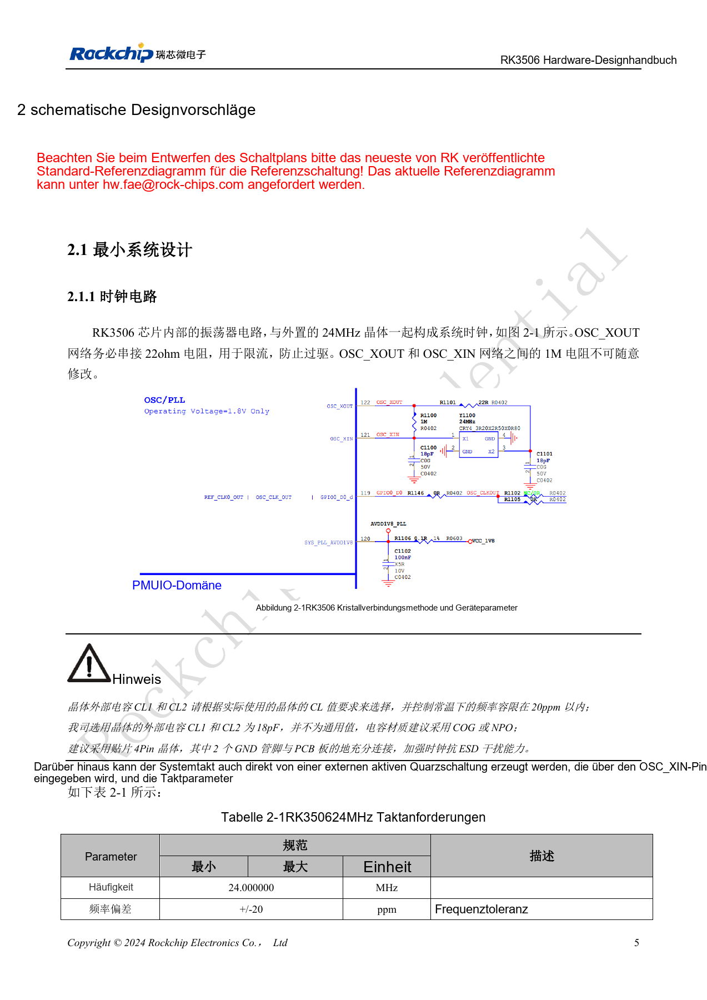
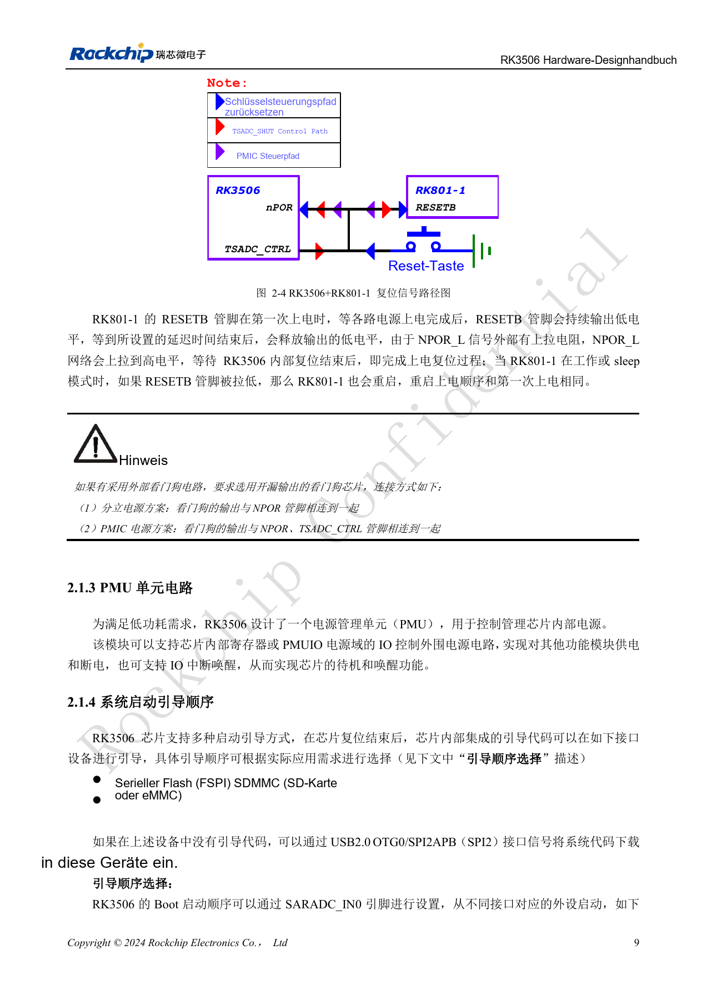
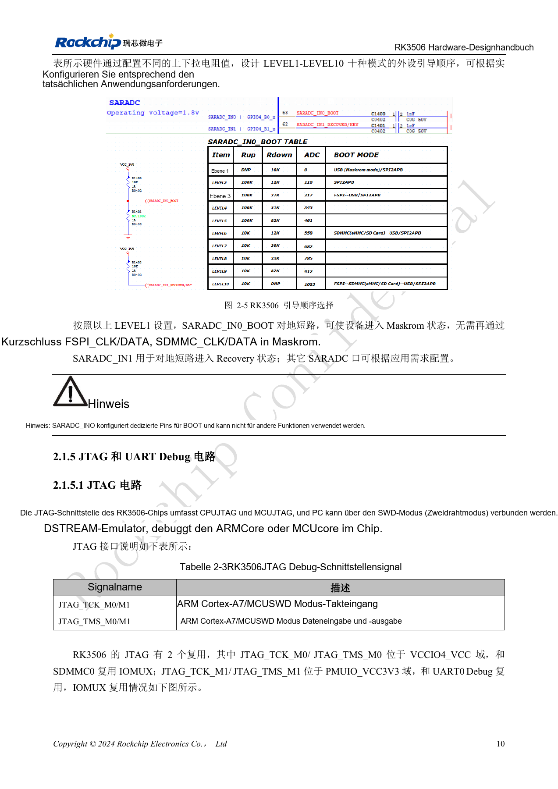
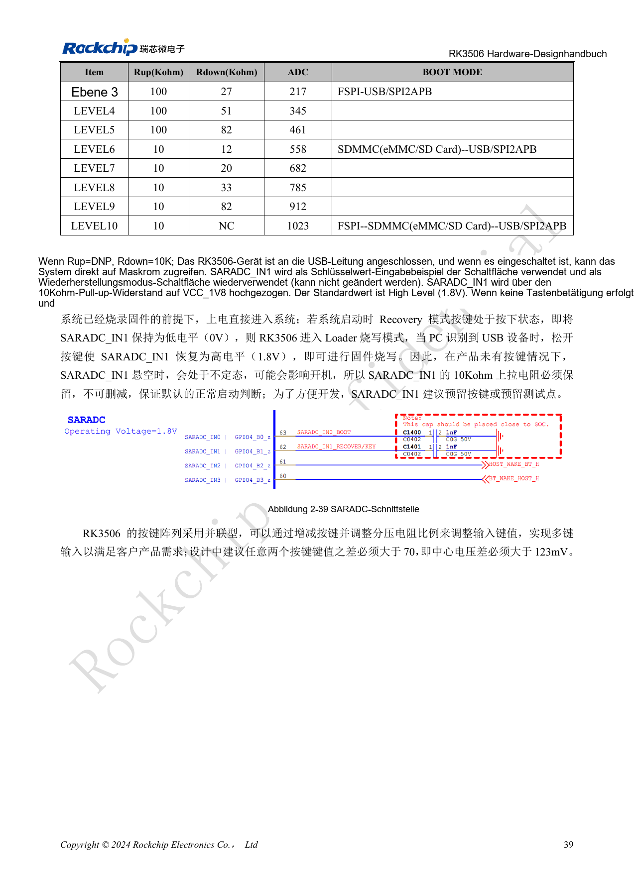
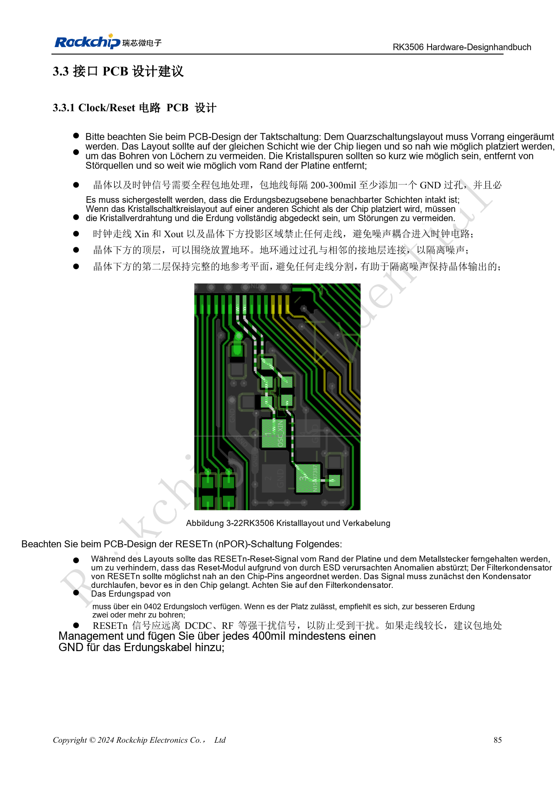

# RK3506-Minimalsystem: Takt, Reset und Wiederherstellung

Nach RK3506 Hardware Design Guide V1.0 (2024-09) für G2 und B/J. Gehäuse, RAM, Versorgung und Pins variantenbezogen, CM1/Forge1-Anschlüsse anhand der Boardunterlagen prüfen. Dies ist ein technischer Themenartikel, keine vollständige seitenweise Übersetzung. Werte stammen aus der Quelle, nicht aus ArmSoM-Messungen. Tatsächliches SDK/BSP, Kernel und Firmware validieren.

**RK3506 Hardware Design Guide_V1.0_20240904_CN.pdf** · §2.1.1–2.1.5; §2.3.2; §3.3.1

## 24MHz und Ruhetakt

Den 22Ω-Widerstand in OSC_XOUT erhalten und 1MΩ zwischen XOUT und XIN nicht beliebig ändern. Die gezeigten 18pF gehören zum Referenzquarz; Werte aus CL und parasitären Kapazitäten bestimmen. Bei Raumtemperatur ±20ppm einhalten; C0G/NP0 und ein Quarz mit vier Anschlüssen werden empfohlen. Quarz nahe am SoC auf derselben Seite platzieren, fremde Leiterzüge unter Quarz und XIN/XOUT vermeiden, benachbarte Masse geschlossen halten und Abschirmung alle 200–300mil anbinden.

## Reset an die Versorgung anpassen

NPOR ist aktiv Low; den 10nF-Filter direkt am Pin platzieren, nicht nur am entfernten Taster. Bei diskreter Versorgung wird ein externer Open-Drain-Watchdog an NPOR angeschlossen; im RK801-1-Aufbau gehört TSADC_CTRL dazu. Dieses Signal ist fest RM_IO21 zugeordnet. Taktpegel müssen zum IO-Bereich passen. Vor dem Abschalten von 24MHz prüfen, ob die Weckquelle davon abhängt. Externe 32.768kHz benötigen ±30ppm, 45–55% Tastverhältnis und 0.7×VDD…VDD Amplitude.

## Wiederherstellung zugänglich halten

SARADC_IN0 bleibt ausschließlich für die Bootwahl reserviert; die geerdete LEVEL1-Konfiguration startet Maskrom. SARADC_IN1 ist Recovery: 10kΩ nach 1.8V sowie Taster oder Testpunkt erhalten. Benutzte ADC-Pins benötigen 1nF am SoC; vom Taster führt der Pfad über ESD-Schutz und danach 100Ω. USB OTG0 ist der in dieser Fassung implementierte Downloadport. SPI2APB steht zwar in der Boottabelle, seine Software wird jedoch als noch nicht entwickelt beschrieben. Den USB-Zugang daher nicht ersetzen. Bei Erstinbetriebnahme Versorgung, 24MHz, NPOR, UART und USB-Erkennung protokollieren.

## Quellenbilder und Prüfseiten

Für diese Auswahl liegen nur chinesische Originale vor. Alle vier Sprachen verwenden dieselben Quellenbilder mit Abbildungskontext; Bildbeschriftungen wurden nicht übersetzt. Der Text ist editierbar. Seitenzahlen bezeichnen physische PDF-Seiten.

PDF 20

PDF 24

PDF 25

PDF 54

PDF 100

## ArmSoM-Produkte und Dokumentation

- [ArmSoM CM1](https://www.armsom.org/product-page/cm1) · [CM1 Docs](https://docs.armsom.org/armsom-cm1)
- [ArmSoM Forge1](https://www.armsom.org/armsom-forge1) · [Forge1 Docs](https://docs.armsom.org/armsom-forge1)

## Weiterlesen

- [Serienübersicht](/de/articles/rk3506-hardware-design-series/)
- [RK3506-Versorgung: G2, B/J und Trägerplatinen](/de/articles/rk3506-power-domains-design/)
- [RK3506 DDR, eMMC und FSPI: Schaltung und Routing](/de/articles/rk3506-ddr-storage-hardware-design/)
- [RK3506: Display, USB und RM_IO zuordnen](/de/articles/rk3506-display-usb-io-design/)
- [RK3506-Audiodesign: SAI, PDM, ASRC und DSM](/de/articles/rk3506-audio-hardware-design/)
- [RK3506-Industrieschnittstellen: RMII, FlexBus und DSMC](/de/articles/rk3506-industrial-bus-hardware-design/)
- [RK3506: Thermik, ESD und Fertigungsprüfung](/de/articles/rk3506-thermal-esd-production-design/)
