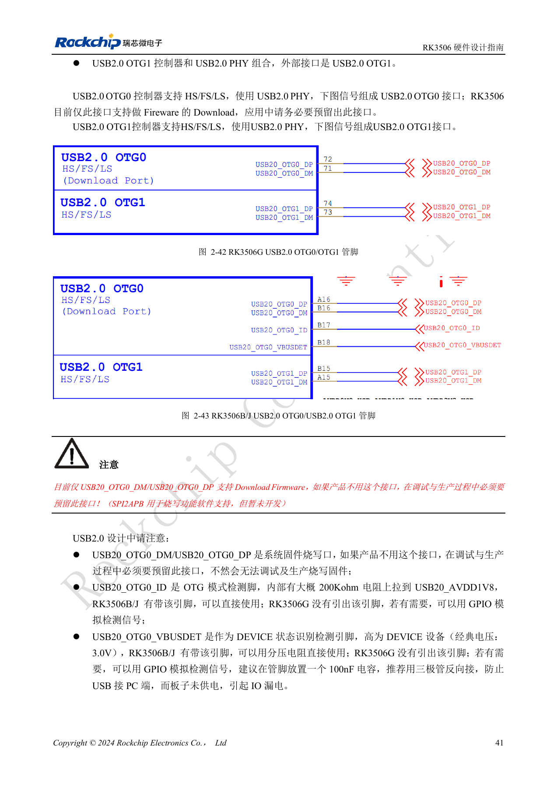
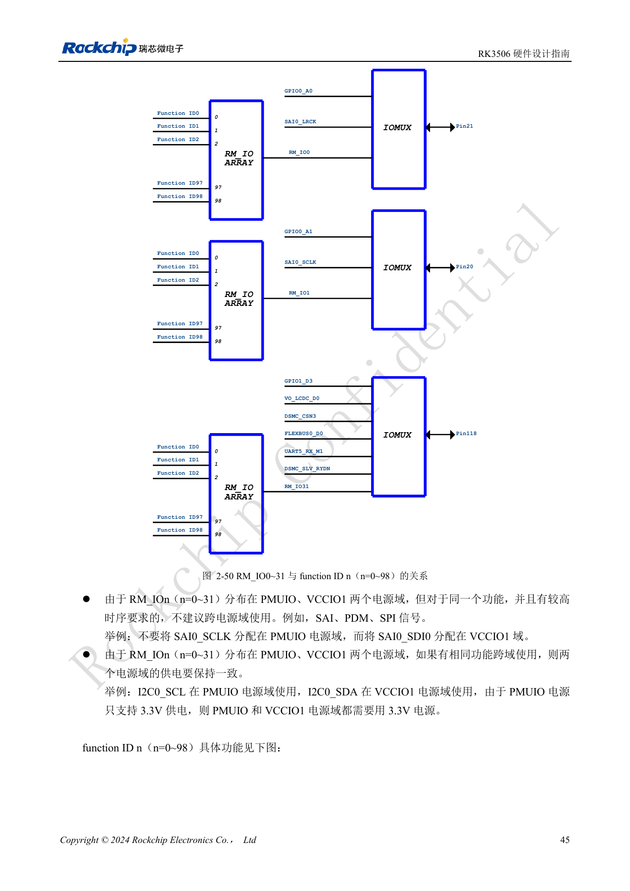
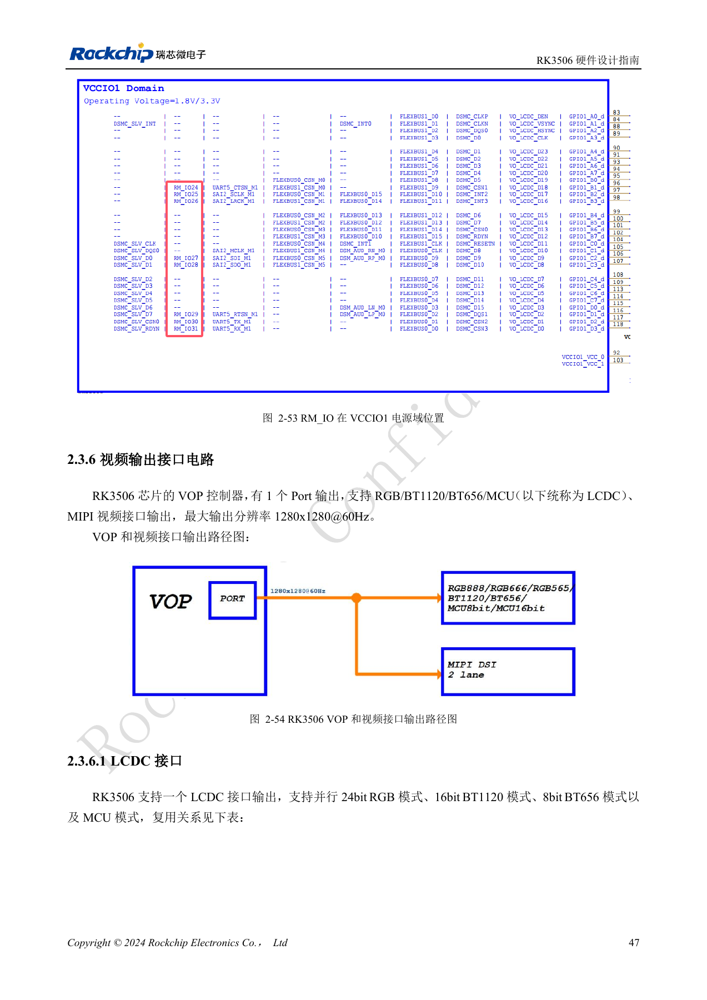
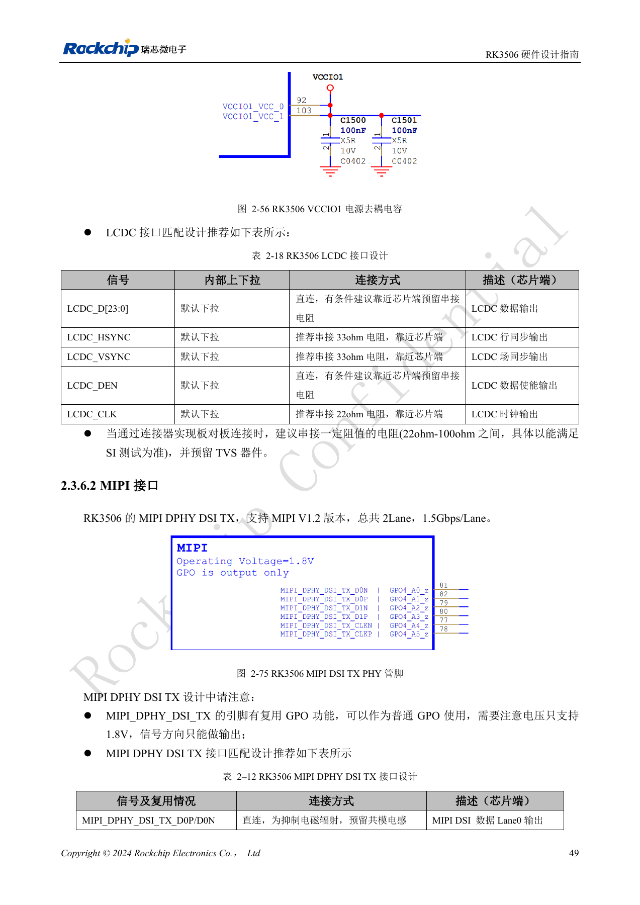
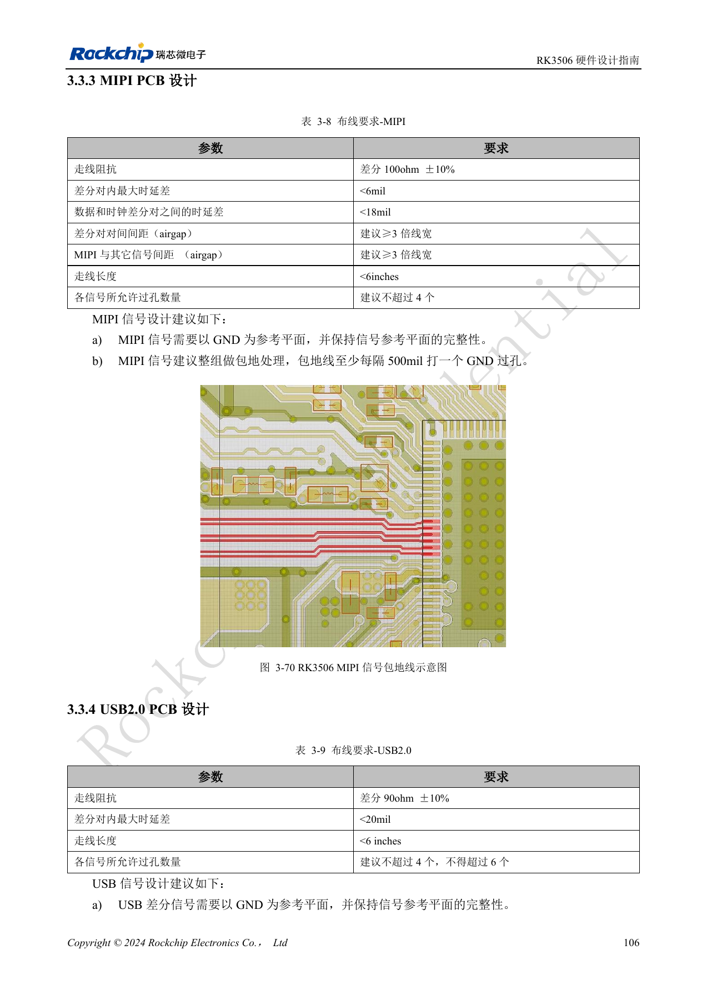
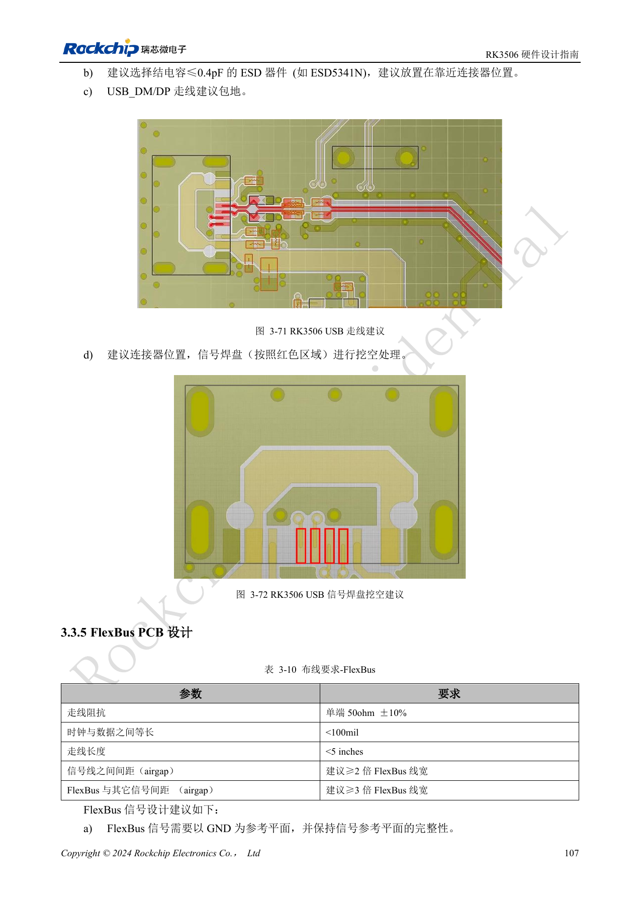

# RK3506: Display, USB und RM_IO zuordnen

Nach RK3506 Hardware Design Guide V1.0 (2024-09) für G2 und B/J. Gehäuse, RAM, Versorgung und Pins variantenbezogen, CM1/Forge1-Anschlüsse anhand der Boardunterlagen prüfen. Dies ist ein technischer Themenartikel, keine vollständige seitenweise Übersetzung. Werte stammen aus der Quelle, nicht aus ArmSoM-Messungen. Tatsächliches SDK/BSP, Kernel und Firmware validieren.

**RK3506 Hardware Design Guide_V1.0_20240904_CN.pdf** · §2.3.4–2.3.6; §3.3.3–3.3.4; §3.3.11

## Zuerst einen Displaypfad auswählen

VOP besitzt einen Port für RGB/BT1120/BT656/MCU oder MIPI, dokumentiert bis 1280×1280@60Hz. Die Schnittstellennamen bedeuten keine gleichzeitige Mehrschirmfähigkeit. LCDC liegt in VCCIO1 und muss zur Panelspannung passen; empfohlen sind 33Ω an HSYNC/VSYNC und 22Ω an CLK auf der Quellseite. MIPI DSI TX bietet zwei Daten-Lanes mit 1.5Gbps/Lane. Als GPO sind diese Pins reine 1.8V-Ausgänge, keine bidirektionalen GPIOs.

## USB und Schutz

Von zwei USB2.0-OTG-Ports muss OTG0 zum Flashen erreichbar bleiben. G2 führt OTG0-ID/VBUSDET nicht heraus, B/J dagegen schon. GPIO-Erkennung darf die ausgeschaltete Platine nicht vom PC rückspeisen. 2.2Ω in DP/DM und 100Ω in ID erhalten; Host-5V über einen strombegrenzten Schalter führen. Das Schaltungskapitel nennt bis 3pF ESD-Kapazität, das PCB-Kapitel empfiehlt ≤0.4pF. Beide Angaben erhalten und das strengere Budget durch Augenmessung prüfen. USB: 90Ω±10%, Paardifferenz <20mil, Länge <6in, möglichst höchstens vier Vias, maximal sechs.

## Auch RM_IO hat Grenzen

RM_IO0–31 können function ID0–98 auswählen, jede Funktion aber nur einen RM_IO-Pin belegen. Die Matrix verteilt sich auf PMUIO und VCCIO1; zeitkritische SAI/PDM/SPI möglichst nicht aufteilen. Domänenübergreifendes I2C benötigt gleiche Pegel, wobei PMUIO auf 3.3V festliegt. MIPI-PCB-Referenzen: differentiell 100Ω±10%, Paardifferenz <6mil, Datenpaar zu Taktpaar <18mil, Länge <6in und möglichst ≤4 Vias. Vor der Steckerbelegung eine Signal/Funktion/Versorgungstabelle erstellen und anschließend den vollständigen Kanal messen.

## Quellenbilder und Prüfseiten

Für diese Auswahl liegen nur chinesische Originale vor. Alle vier Sprachen verwenden dieselben Quellenbilder mit Abbildungskontext; Bildbeschriftungen wurden nicht übersetzt. Der Text ist editierbar. Seitenzahlen bezeichnen physische PDF-Seiten.

PDF 56

PDF 60

PDF 62

PDF 64

PDF 121

PDF 122

## ArmSoM-Produkte und Dokumentation

- [ArmSoM CM1](https://www.armsom.org/product-page/cm1) · [CM1 Docs](https://docs.armsom.org/armsom-cm1)
- [ArmSoM Forge1](https://www.armsom.org/armsom-forge1) · [Forge1 Docs](https://docs.armsom.org/armsom-forge1)

## Weiterlesen

- [Serienübersicht](/de/articles/rk3506-hardware-design-series/)
- [RK3506-Minimalsystem: Takt, Reset und Wiederherstellung](/de/articles/rk3506-clock-boot-reset-design/)
- [RK3506-Versorgung: G2, B/J und Trägerplatinen](/de/articles/rk3506-power-domains-design/)
- [RK3506 DDR, eMMC und FSPI: Schaltung und Routing](/de/articles/rk3506-ddr-storage-hardware-design/)
- [RK3506-Audiodesign: SAI, PDM, ASRC und DSM](/de/articles/rk3506-audio-hardware-design/)
- [RK3506-Industrieschnittstellen: RMII, FlexBus und DSMC](/de/articles/rk3506-industrial-bus-hardware-design/)
- [RK3506: Thermik, ESD und Fertigungsprüfung](/de/articles/rk3506-thermal-esd-production-design/)
