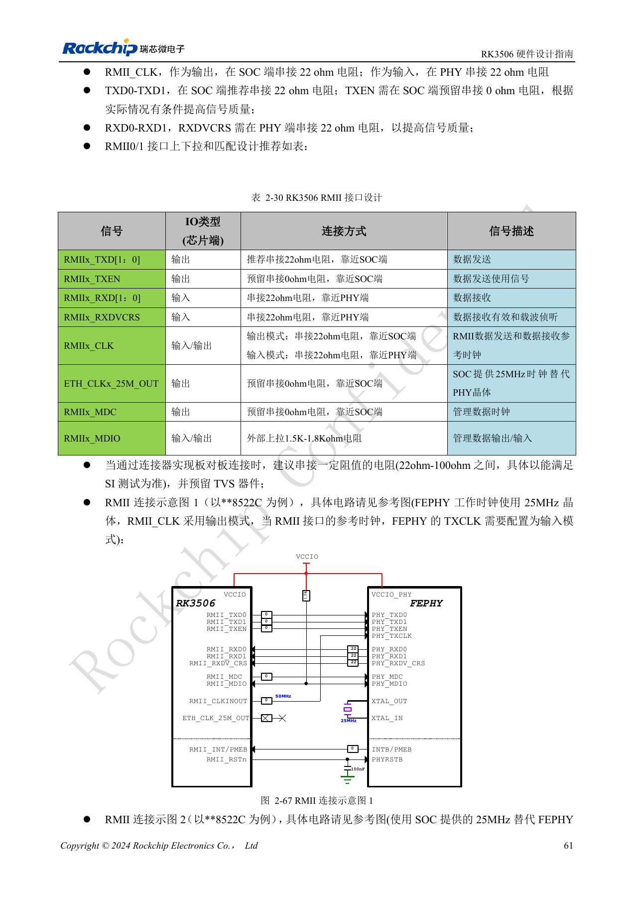
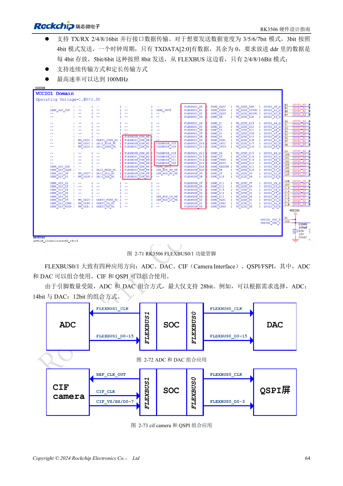
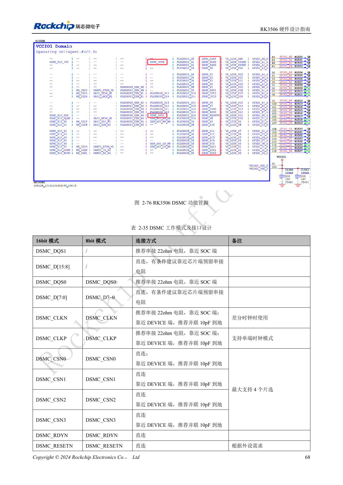
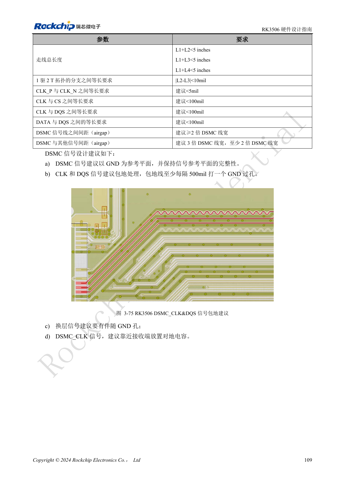
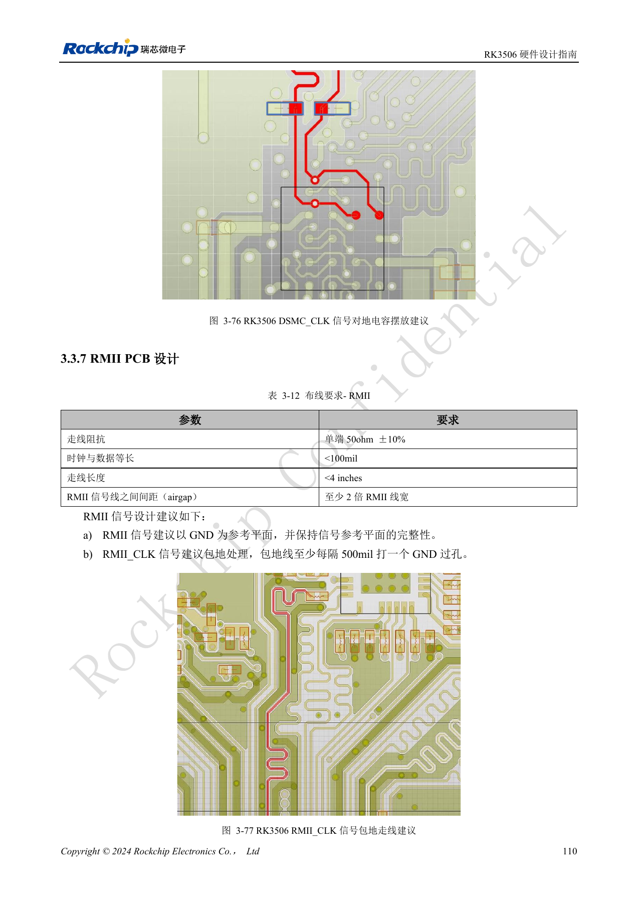

# RK3506-Industrieschnittstellen: RMII, FlexBus und DSMC

Nach RK3506 Hardware Design Guide V1.0 (2024-09) für G2 und B/J. Gehäuse, RAM, Versorgung und Pins variantenbezogen, CM1/Forge1-Anschlüsse anhand der Boardunterlagen prüfen. Dies ist ein technischer Themenartikel, keine vollständige seitenweise Übersetzung. Werte stammen aus der Quelle, nicht aus ArmSoM-Messungen. Tatsächliches SDK/BSP, Kernel und Firmware validieren.

**RK3506 Hardware Design Guide_V1.0_20240904_CN.pdf** · §2.3.8–2.3.17; §3.3.5–3.3.7

## Zwei MACs sind keine fertigen Netzwerkports

RK3506 integriert zwei 10/100Mbps-EMACs: RMII0 in VCCIO3 und RMII1 in VCCIO4. PHY, Übertrager, RJ45, Reset und Schutz gehören weiterhin zum Boarddesign. Für 50MHz einen eindeutigen Treiber wählen: 22Ω am SoC bei SoC-Ausgabe, am PHY bei PHY-Ausgabe. MDIO mit 1.5–1.8kΩ zur passenden IO-Versorgung hochziehen. PHY-Quarz mit 25MHz und RMII-Takt mit 50MHz sind verschiedene Signale. Bei PHY-Wechsel Mittelanzapfung, Strap-Pins und Tab-up/Tab-down-Steckerbelegung prüfen.

## Richtung und Datenpackung prüfen

FlexBus0-Daten sind bidirektional, CLK nur Ausgang; FlexBus1-Daten nur Eingang, CLK Ein-/Ausgang. Transfers verwenden 2/4/8/16bit: 3bit werden in 4bit gepackt, 5/6/7bit in 8bit. Weniger Leitungen erzeugen keinen beliebigen Breitenmodus. Die Quelle nennt maximal 100MHz; kombinierte ADC/DAC-Daten sind durch die Pins auf 28bit begrenzt. DSMC nach Topologie prüfen: T-Verzweigung 1:2 mit <10mil Differenz, CLK P/N bevorzugt <5mil, CLK zu CS/DQS und DATA zu DQS <100mil, Gesamtweg <5in.

## Die Trägerplatine mitprüfen

RMII-Referenzen: 50Ω±10%, Taktdaten-Differenz <100mil und Länge <4in; FlexBus: 50Ω±10%, <100mil und <5in. Für UART, SPI, I2C, PWM, Touch und CAN Multiplexing, Pegel und externe Bausteine separat prüfen. CAN-Controllerpins dürfen nicht direkt an den Feldbus. CM1-Träger anhand tatsächlich herausgeführter Funktionen entwickeln, Forge1 anhand ihrer realen Anschlüsse bewerten. Erst einzelne Busse, danach Display, Netzwerk und Felddaten gleichzeitig testen; Fehler und Wiederherstellung protokollieren.

## Anschlusstabelle für DSMC-Master

| Signal | Anschluss und Funktion |
| --- | --- |
| DSMC_DQS1 | Nur 16bit; empfohlen 22Ω am SoC |
| DSMC_D[15:8] | Nur 16bit; direkt, Serienwiderstandsplatz vorsehen |
| DSMC_DQS0 | 8/16bit; empfohlen 22Ω am SoC |
| DSMC_D[7:0] | Direkt, Serienwiderstandsplatz vorsehen |
| DSMC_CLKN | Nur differentiell; 22Ω am SoC, 10pF gegen Masse am Peripheriebaustein |
| DSMC_CLKP | Single-Ended möglich; 22Ω am SoC, 10pF gegen Masse an der Peripherie |
| DSMC_CSN0–3 | Bis vier Chip-Selects; direkt, 10pF gegen Masse an der Peripherie vorsehen |
| DSMC_RDYN / DSMC_RESETN | Direkt, je nach Peripherieanforderung |
| DSMC_INT0/1 | Hardwareinterrupt; direkt |
| DSMC_INT2/3 | Softwareinterrupt, langsamer; direkt |

Quelle: §2.3.8, Tabelle 2-35, PDF82–84. Der Master unterstützt x8/x16 DDR bis 150MHz Takt für Xccela-/Hyperbus-PSRAM oder FPGA. Der Slave unterstützt x8 DDR bis 100MHz; DQS0, D[7:0], CLKP, CSN0, RDYN und INT nach HOST-Anforderungen anschließen. Widerstands-/Kondensatorwerte sind Referenzempfehlungen und mit Baustein und Timing zu prüfen. Der Maximaltakt ist keine garantierte Betriebsfrequenz jeder Platine.

## Langsame Busse und Multiplex-Grenzen

| Schnittstelle | Quellenanforderungen |
| --- | --- |
| UART0–5 | UART0 nutzt PMUIO zur Diagnose; UART1–4 RM_IO; UART5 wahlweise M0/VCCIO4 oder M1/VCCIO1. UART3/4/5 mit zugehöriger Flusssteuerung. TX-/RX-FIFO 64-byte, Daten 5–8bit. |
| SPI0/1 | Master/Slave, Voll-/Halbduplex, 4/8/16bit, RM_IO auf PMUIO/VCCIO1; 22Ω an der Taktquelle, Daten/CS direkt. |
| SPI2APB | Nur Slave, Halbduplex, 8/16bit, VCCIO3, proprietäres Protokoll; kein allgemeiner SPI-Master. |
| I2C0–2 | Master, 7-/10bit-Adresse, bis 1Mbit/s; RM_IO, empfohlene 2.2kΩ-Pull-ups nach Buslast prüfen. Tabelle 2-42 lässt n=2 aus; Text und 2-43 nennen 0/1/2. |
| CAN0/1 | CAN 2.0B Standard-/Extended-Frames über RM_IO; externer 4.7kΩ-Pull-up an CANn_TX erforderlich, RX direkt zum Transceiver. |

Quelle: PDF85–90. PinMux, I/O-Spannung und DTS gemeinsam prüfen; ein Pin stellt nicht alle Alternativfunktionen gleichzeitig bereit. UART-Raten: 115.2kbps, 460.8kbps, 921.6kbps, 1.5Mbps, 3Mbps, 4Mbps; abhängig von Takt und Gegenstelle wählen. Unversorgte analoge PHY-Funktionen im DTS deaktivieren, damit Software keine unversorgten Blöcke aktiviert.

## Quellenbilder und Prüfseiten

Für diese Auswahl liegen nur chinesische Originale vor. Alle vier Sprachen verwenden dieselben Quellenbilder mit Abbildungskontext; Bildbeschriftungen wurden nicht übersetzt. Der Text ist editierbar. Seitenzahlen bezeichnen physische PDF-Seiten.

PDF 76

PDF 79

PDF 83

PDF 124

PDF 125

## ArmSoM-Produkte und Dokumentation

- [ArmSoM CM1](https://www.armsom.org/product-page/cm1) · [CM1 Docs](https://docs.armsom.org/armsom-cm1)
- [ArmSoM Forge1](https://www.armsom.org/armsom-forge1) · [Forge1 Docs](https://docs.armsom.org/armsom-forge1)

## Weiterlesen

- [Serienübersicht](/de/articles/rk3506-hardware-design-series/)
- [RK3506-Minimalsystem: Takt, Reset und Wiederherstellung](/de/articles/rk3506-clock-boot-reset-design/)
- [RK3506-Versorgung: G2, B/J und Trägerplatinen](/de/articles/rk3506-power-domains-design/)
- [RK3506 DDR, eMMC und FSPI: Schaltung und Routing](/de/articles/rk3506-ddr-storage-hardware-design/)
- [RK3506: Display, USB und RM_IO zuordnen](/de/articles/rk3506-display-usb-io-design/)
- [RK3506-Audiodesign: SAI, PDM, ASRC und DSM](/de/articles/rk3506-audio-hardware-design/)
- [RK3506: Thermik, ESD und Fertigungsprüfung](/de/articles/rk3506-thermal-esd-production-design/)
