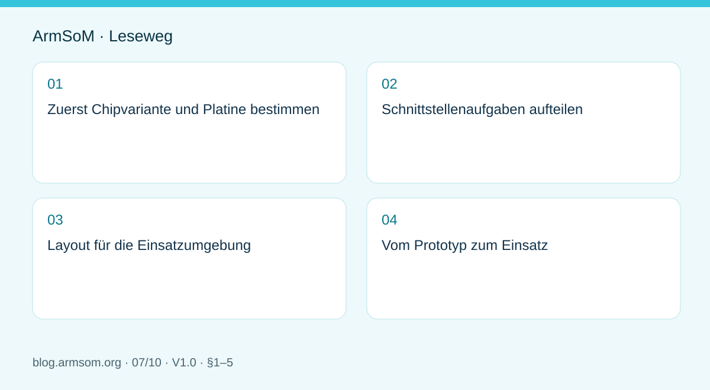
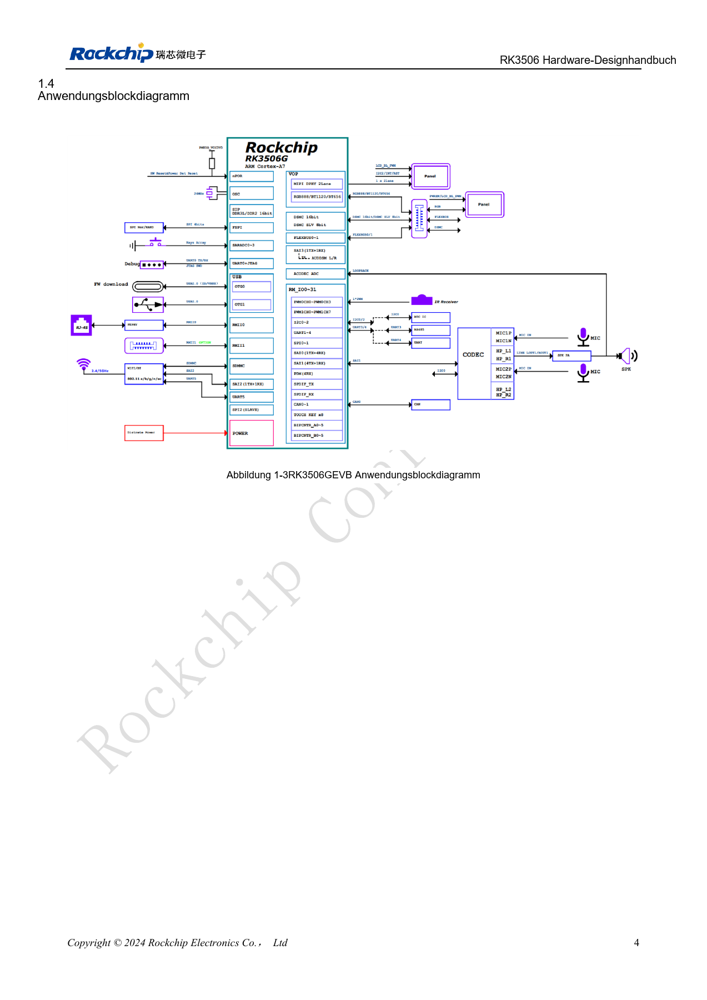

# RK3506-HMI-Hardware: Entwicklung mit CM1 oder Forge1

## Geltungsbereich und Quellen

Dies ist ein thematischer Engineering-Leitfaden, keine seitenweise Übersetzung des gesamten PDF. Quellenbeispiele sind keine ArmSoM-Messungen. Spannungen, Pins, SDK/BSP und Kernel mit der tatsächlichen Platinenrevision abgleichen.

**Rockchip:** `RK3506 Hardware Design Guide_V1.0_20240904_CN.pdf` · V1.0 · §1–5

## Zuerst Chipvariante und Platine bestimmen

PDF-Seite 3 von V1.0 nennt ausdrücklich RK3506G2 und RK3506B/J, also auch J. Der Ablageordner B/G begrenzt nicht den gesamten Leitfaden. Pins, Versorgung, DDR und Boardanschlüsse müssen weiterhin variantenbezogen geprüft werden.

CM1 bietet einen Modulansatz für eigene Schnittstellen und Mechanik, Forge1 eine Plattform für industrielle Anwendungen. Display, Touch, Netzwerk, Feldkommunikation, Audio und Gehäuse vor der Auswahl festlegen.

## Schnittstellenaufgaben aufteilen

| Funktion | Gemeinsam prüfen |
| --- | --- |
| Display und Touch | Videoschnittstelle, Timing, Beleuchtung, Controller, Treiber |
| Ethernet | MAC/PHY-Takt, Versorgung, Reset, Stecker, Isolation |
| Feldkommunikation | Transceiver, Isolation, Terminierung, Erdung |
| Audio | Pegel, Masseschleifen, analoge und digitale Störkopplung |
| Wartung | UART, Programmierung, Versionskennung, Gehäusezugang |

Kapitel 3 beschreibt MIPI, USB2.0, FlexBus, DSMC, RMII, Speicher und Audio getrennt. Das bedeutet nicht, dass jede Platine sämtliche Funktionen herausführt.

## Layout für die Einsatzumgebung

Externe Stecker, Schutzbauteile und empfindliche Schaltungen als vollständige Wege betrachten. ESD-Schutz benötigt geeignete Rückwege; Displaykabel, Schaltregler und Audioleitungen eine bewusste Anordnung. Kapitel 4–5 liefern Prüfpunkte für Wärme und ESD/EMI, aber keine Gerätezertifizierung.

## Vom Prototyp zum Einsatz

Schnittstellen einzeln prüfen, danach Bildschirmaktualisierung, Netzwerk und Datenerfassung kombinieren. Startzeit, Reaktion, Kommunikationsfehler und Erwärmung dokumentieren. Start und Wiederherstellung im spezifizierten Versorgungsbereich testen. Ein unbelegtes Industrie-Label ersetzt diese Nachweise nicht.

Beim CM1 Software und Peripherie zunächst auf der IO-Platine prüfen; beim Forge1 die vorhandenen Schnittstellen abgleichen. Eigene Träger brauchen weiterhin Prüfungen ihrer Versorgung, Schutzschaltung und Stecker.

## Abbildung aus der Quelle

Chinesisches Original; keine entsprechende englische Abbildung in den Materialien gefunden. RK3506G EVB ≠ RK3506J / CM1 / Forge1. Referenzdesign, kein ArmSoM-Platinenschaltplan.

`RK3506 Hardware Design Guide_V1.0_20240904_CN.pdf` · PDF p. 19.

## Produkte und Entwicklungsunterlagen

- **CM1** — [Produktseite](https://www.armsom.org/product-page/cm1) · [Dokumentation](https://docs.armsom.org/armsom-cm1)
- **Forge1** — [Produktseite](https://www.armsom.org/armsom-forge1) · [Dokumentation](https://docs.armsom.org/armsom-forge1)

## Weitere Beiträge der Reihe

- [RK3576 in Betrieb nehmen: Minimalsystem und erste Einschaltprüfung](/de/articles/rk3576-hardware-bringup/)
- [ArmSoM CM5-Trägerplatine: Checkliste für Versorgung, Boot und Schnittstellen](/de/articles/019-cm5-carrier-production/)
- [RK3576-Hochgeschwindigkeitsschnittstellen: Schaltplan und PCB gemeinsam prüfen](/de/articles/rk3576-high-speed-interface-design/)
- [RK3588S-Hardwaredesign: vom Referenzschaltplan zur CM7s-Trägerplatine](/de/articles/rk3588s-cm7s-carrier-design/)
- [RK3588 für Edge-KI: Versorgung, Kühlung und Erweiterung gemeinsam planen](/de/articles/rk3588-edge-ai-hardware-design/)
- [RK3588-PCB-Prüfung: Lagenaufbau, Impedanz und Leiterführung](/de/articles/rk3588-high-speed-pcb-review/)
- [RK3308-Varianten: Hardwarekompatibilität für P2-Pro-Audioprojekte](/de/articles/rk3308-hardware-variant-compatibility/)
- [RK3588S und RK3588S2: Prüfungen vor einer Hardwareänderung](/de/articles/rk3588s-rk3588s2-hardware-differences/)
- [Vom Rockchip-Prototyp zur Serie: Prozessvorgaben und Prüfunterlagen](/de/articles/rockchip-hardware-production-checklist/)

## Weiterlesen

- [RK3506-Hardwaredesign-Serie](/de/articles/rk3506-hardware-design-series/)
