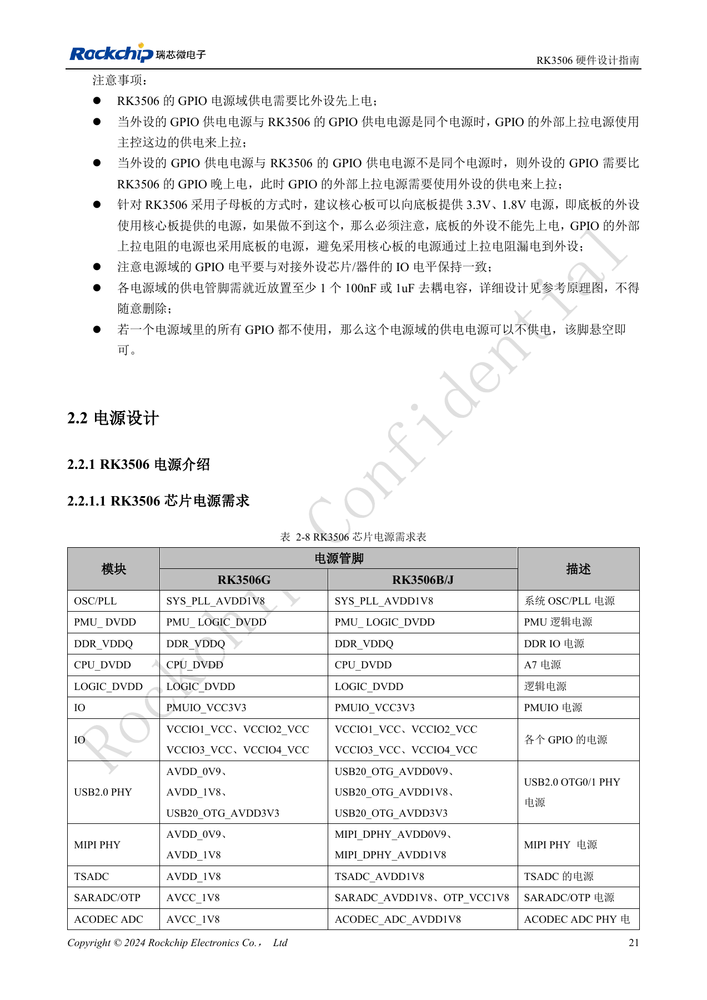
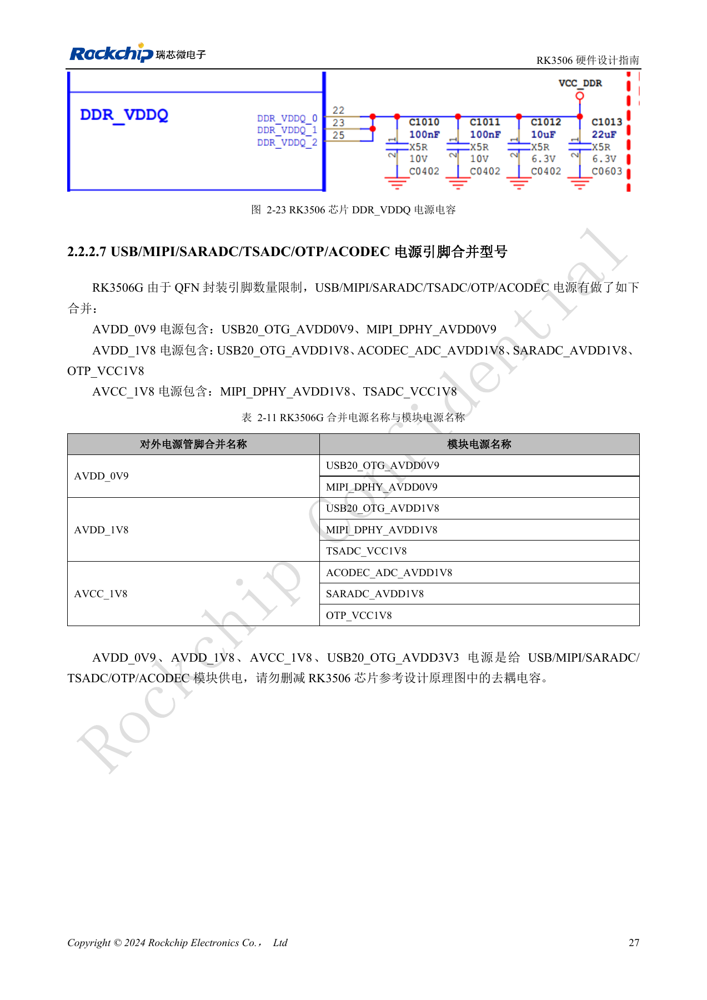
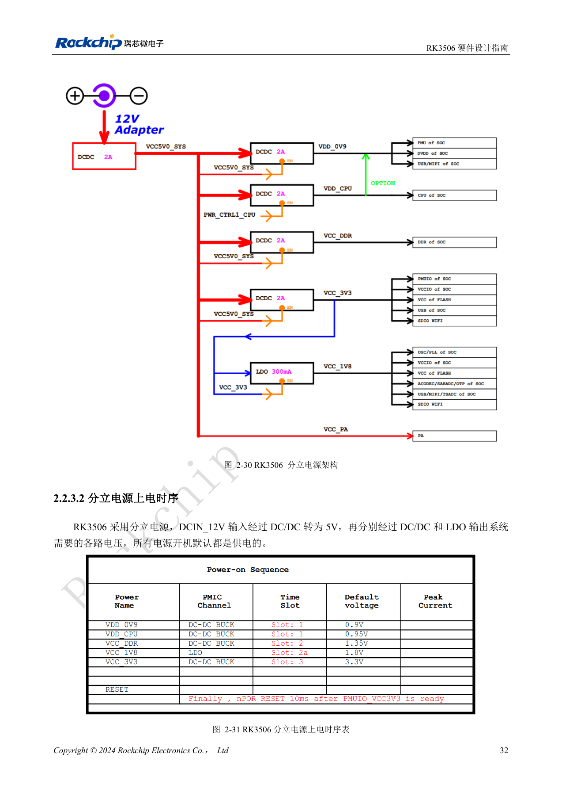
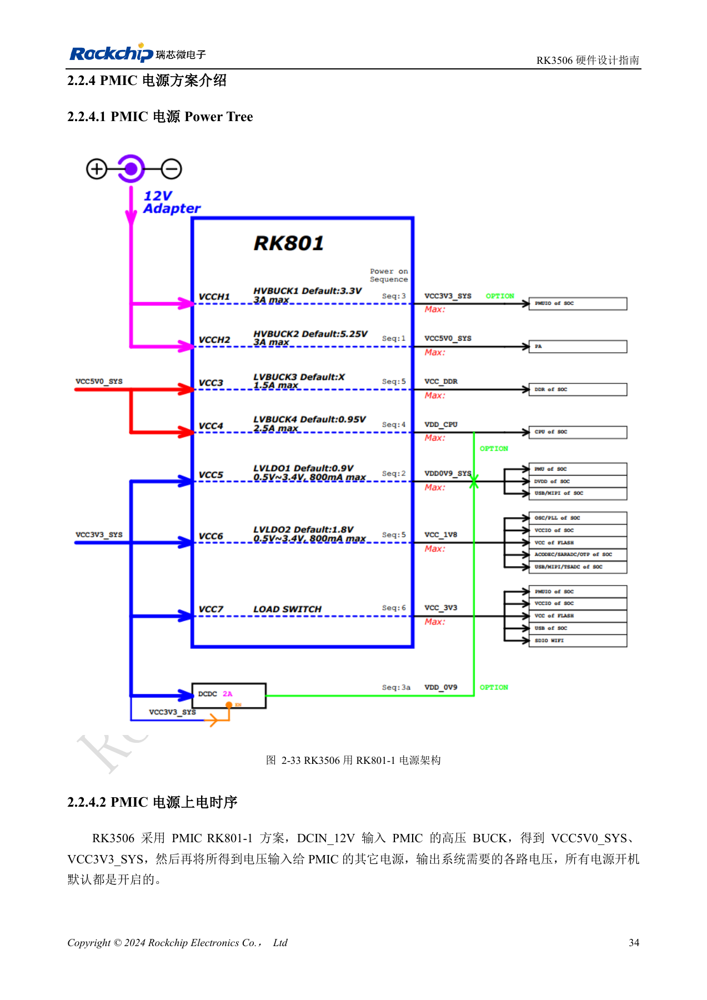

# RK3506-Versorgung: G2, B/J und Trägerplatinen

Nach RK3506 Hardware Design Guide V1.0 (2024-09) für G2 und B/J. Gehäuse, RAM, Versorgung und Pins variantenbezogen, CM1/Forge1-Anschlüsse anhand der Boardunterlagen prüfen. Dies ist ein technischer Themenartikel, keine vollständige seitenweise Übersetzung. Werte stammen aus der Quelle, nicht aus ArmSoM-Messungen. Tatsächliches SDK/BSP, Kernel und Firmware validieren.

**RK3506 Hardware Design Guide_V1.0_20240904_CN.pdf** · §1.2; §2.1.9; §2.2; §3.3.2

## Zuerst das Gehäuse bestimmen

Der Leitfaden umfasst ausdrücklich RK3506G2 und RK3506B/J. G2 verwendet QFN128L mit internen 128MB DDR3L; B/J nutzt FBGA333L mit externem DDR. G2 fasst einige Analogversorgungen zusammen, B/J besitzt getrennte Pins für USB, MIPI, SARADC, OTP und ACODEC. Gleiche Blocknamen erlauben keine Übernahme der Versorgungsnetze eines anderen Gehäuses. Bei CM1 und Forge1 mit J-Variante gelten zusätzlich die tatsächlichen Produktschaltpläne und Steckerdefinitionen.

## Reihenfolge und Rückspeisung

Innerhalb eines Blocks wird die niedrigere Spannung zuerst eingeschaltet, gleiche Spannungen gemeinsam. Daraus folgt keine Erlaubnis, Peripherie vor den SoC-GPIOs zu versorgen. Bei getrennten Versorgungen Pull-ups an die Peripherieversorgung legen, um Rückspeisung zu vermeiden. PMUIO ist auf 3.3V festgelegt; VCCIO1–4 erlauben laut Leitfaden 1.8V/3.3V mit Hardwareerkennung. Pegel, Einschaltfolge und stromlose Zustände trotzdem prüfen. Pro Versorgungspin des Bereichs mindestens einen lokalen 100nF- oder 1µF-Kondensator erhalten.

## Dynamische Versorgung prüfen

Diskrete Versorgung und RK801-1 haben eigene Einschalt- und Resetfolgen; die passende Referenz vollständig übernehmen. LOGIC_DVDD und DDR_VDDQ benötigen jeweils mehr als 30µF Gesamtkapazität. Das DDR-Buck-Beispiel fordert mindestens 1000mA, ±1.5% Genauigkeit und ±5% Ripple bei einem 10%→80%-Lastsprung mit 1A/µs. USB-B/J-AC-Grenzen: 0.9V <25mV, 1.8V <50mV und 3.3V <200mV. Das sind Quellenanforderungen, keine Produktmessungen. Auf Druckseite 27 widerspricht der G2-Versorgungstext Tabelle 2-11; Zuordnung anhand von PinOut und Referenzschaltplan klären.

## Sieben PDN-Zielimpedanzgruppen

| Quelltabelle / Ziel | 100kHz–1MHz / Ω | 1–30MHz / Ω | 30–100MHz / Ω |
| --- | --- | --- | --- |
| 3-1 RK3506B VDD_CPU | ≤0.045 | ≤0.08 | ≤0.25 |
| 3-2 RK3506G VDD_CPU | ≤0.045 | ≤0.08 | ≤0.25 |
| 3-3 RK3506B VDD_0V9 | ≤0.05 | ≤0.06 | ≤0.15 |
| 3-4 RK3506G VDD_0V9 | ≤0.05 | ≤0.1 | ≤0.35 |
| 3-5 RK3562B VCC_DDR * | ≤0.045 | ≤0.1 | ≤0.3 |
| 3-6 RK3562G VCC_DDR * | ≤0.06 | ≤0.09 | ≤0.25 |
| 3-7 VCC_DDR des DDR-Bausteins | ≤0.04 | ≤0.04 | ≤0.08 |

Quelle: PDF107–108, 113, 118–119. * Tabellen 3-5/3-6 und Einleitung nennen RK3562B/G, die benachbarten Kurven 3-65/3-66 dagegen RK3506B/G. Dieser Modellwiderspruch bleibt mit Originalwerten und -titeln dokumentiert; die beiden Zeilen sind keine bestätigten RK3506-DDR-Abnahmekriterien. RK3506G in anderen Tabellen wird ebenfalls nicht stillschweigend in G2 geändert. Zielimpedanzen sind Empfehlungen für das Versorgungsnetz und mit Lagenaufbau, Gehäuse, Entkopplung und Lastspektrum zu prüfen; sie messen weder Platinenverbrauch noch CPU-Leistung.

## Versorgungskupfer und Entkopplungsabstände

| Versorgung | Breite DCDC–SoC | Wirksame Breite unter SoC | DCR |
| --- | --- | --- | --- |
| VDD_CPU | ≥160mil | ≥55mil | ≤30mΩ |
| VDD_0V9 | ≥100mil | ≥30mil | ≤30mΩ |
| VCC_DDR | ≥80mil | ≥30mil | ≤30mΩ |

Quelle: §3.3.2. Am DCDC-Ausgang mindestens vier 0503-Lagenwechselvias vorsehen, empfohlen ≥6. Jeder Versorgungspin erhält ein Versorgungsvia. Abstand von der Padkante des 100nF-Entkopplers zur Mitte des Versorgungsvias ≤12mil, bei 1µF ≤50mil. Jedem Massepad ein Massevia zuordnen. Kritische Kondensatoren des B-Typs hinter den zugehörigen Versorgungspins platzieren und Referenzentkopplung nicht ungeprüft entfernen. Der Text fordert teils GND-Vias innerhalb 40mil, Bildtitel 3-44 und 3-58 nennen 50mil. Widerspruch dokumentieren und bestätigte Vorlage verwenden.

## Spitzenstromdaten der Hersteller-Entwicklungsplatine

| Netz | Spannung / V | Spitzenstrom / A | Quellen-Spitzenleistung / W | Frequenz |
| --- | --- | --- | --- | --- |
| VDD_CPU | 0.95 | 0.7 | 0.76 | 1.5GHz |
| VDD_0V9 | 0.9 | 0.5 | 0.54 | — |
| VCC_DDR | 1.35 | 0.6 | 0.945 | 800MHz |

Quelle: Tabelle 2-12, PDF51. RK3506G2 bei 100°C Sperrschichttemperatur, ungekühlte Platine, Messung nach 15 Minuten stabilem Betrieb. Jeder Block lief unter eigener Maximallast; die Zeilensumme ist kein gleichzeitiger Platinenverbrauch. `VCC_DDR` umfasst `DDR_VDDQ` und integrierten DDR-Speicher. Die Leistungswerte entsprechen nicht Spannung × Strom der Tabelle; die Quelle erklärt die Bezugsbasis nicht. Werte beibehalten und zur Klärung markieren, nicht selbst „korrigieren“. Dies sind keine ArmSoM-Messungen oder endgültig garantierten Chipgrenzen.

## Quellenbilder und Prüfseiten

Für diese Auswahl liegen nur chinesische Originale vor. Alle vier Sprachen verwenden dieselben Quellenbilder mit Abbildungskontext; Bildbeschriftungen wurden nicht übersetzt. Der Text ist editierbar. Seitenzahlen bezeichnen physische PDF-Seiten.

PDF 36

PDF 42

PDF 47

PDF 49

## ArmSoM-Produkte und Dokumentation

- [ArmSoM CM1](https://www.armsom.org/product-page/cm1) · [CM1 Docs](https://docs.armsom.org/armsom-cm1)
- [ArmSoM Forge1](https://www.armsom.org/armsom-forge1) · [Forge1 Docs](https://docs.armsom.org/armsom-forge1)

## Weiterlesen

- [Serienübersicht](/de/articles/rk3506-hardware-design-series/)
- [RK3506-Minimalsystem: Takt, Reset und Wiederherstellung](/de/articles/rk3506-clock-boot-reset-design/)
- [RK3506 DDR, eMMC und FSPI: Schaltung und Routing](/de/articles/rk3506-ddr-storage-hardware-design/)
- [RK3506: Display, USB und RM_IO zuordnen](/de/articles/rk3506-display-usb-io-design/)
- [RK3506-Audiodesign: SAI, PDM, ASRC und DSM](/de/articles/rk3506-audio-hardware-design/)
- [RK3506-Industrieschnittstellen: RMII, FlexBus und DSMC](/de/articles/rk3506-industrial-bus-hardware-design/)
- [RK3506: Thermik, ESD und Fertigungsprüfung](/de/articles/rk3506-thermal-esd-production-design/)
