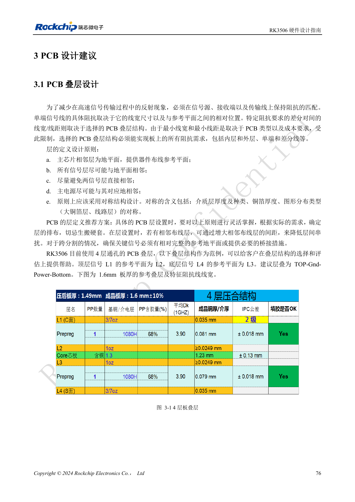
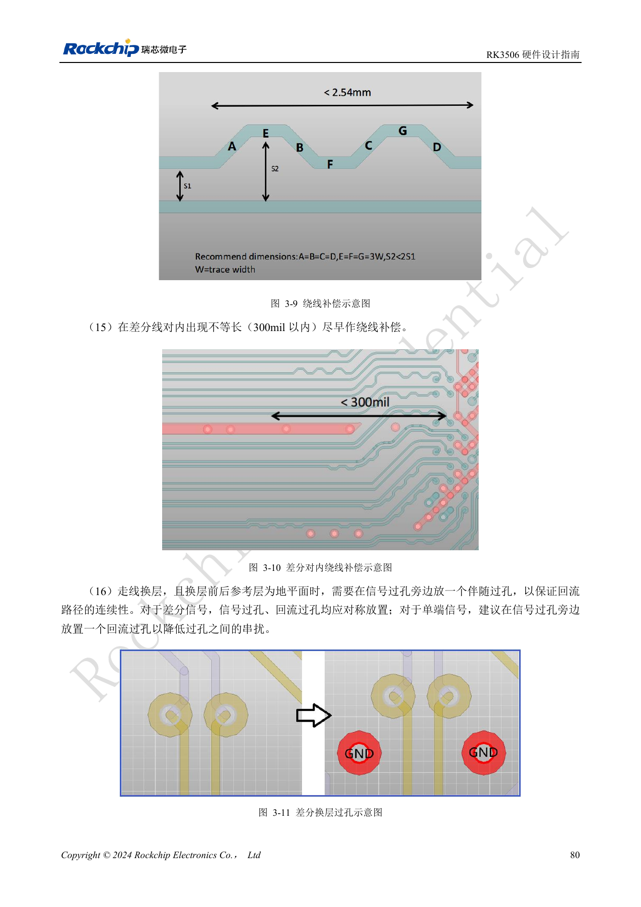
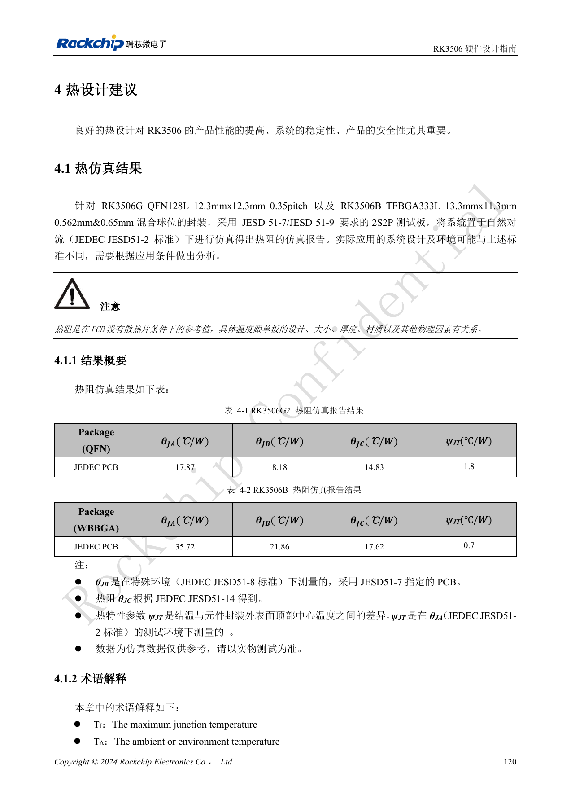
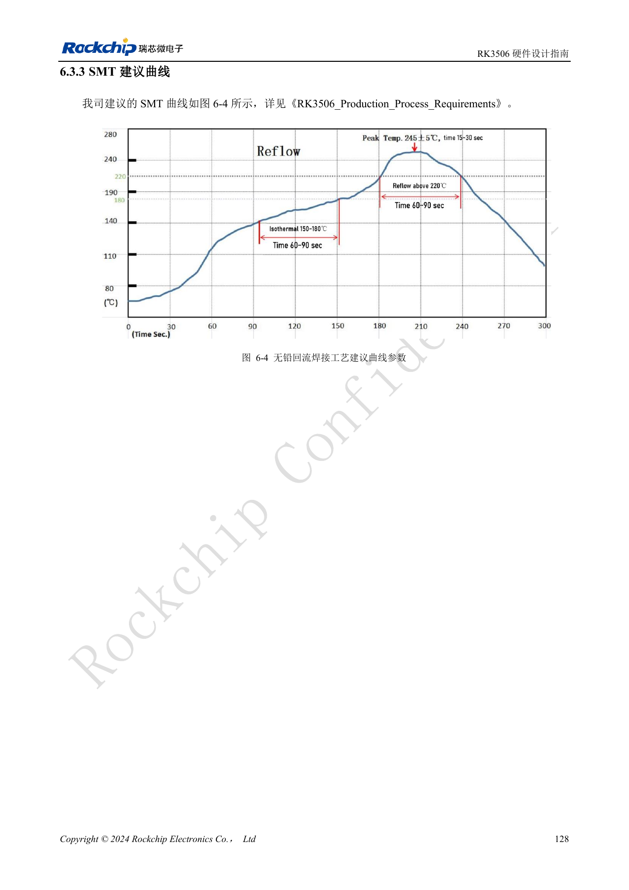
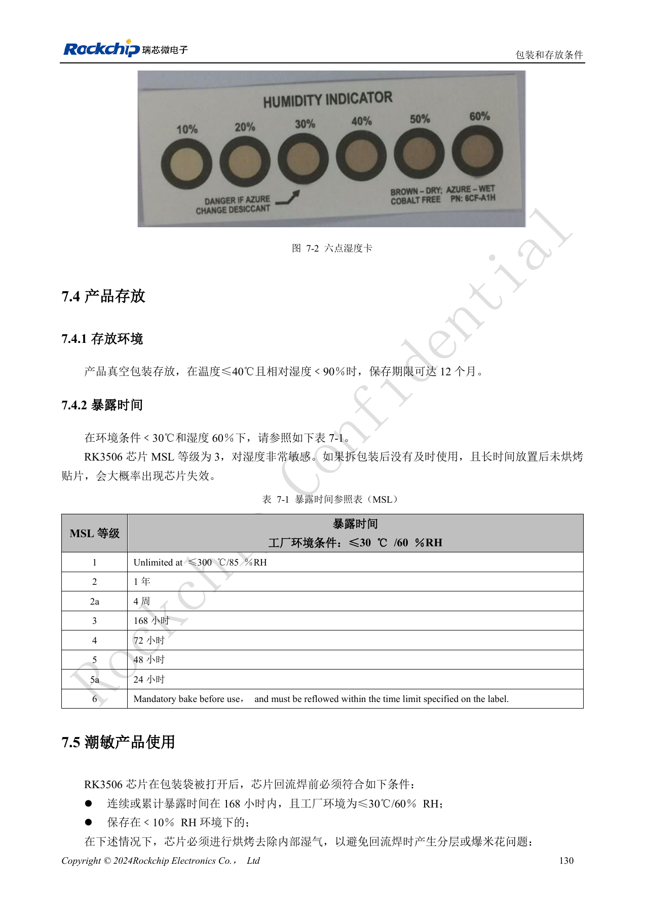
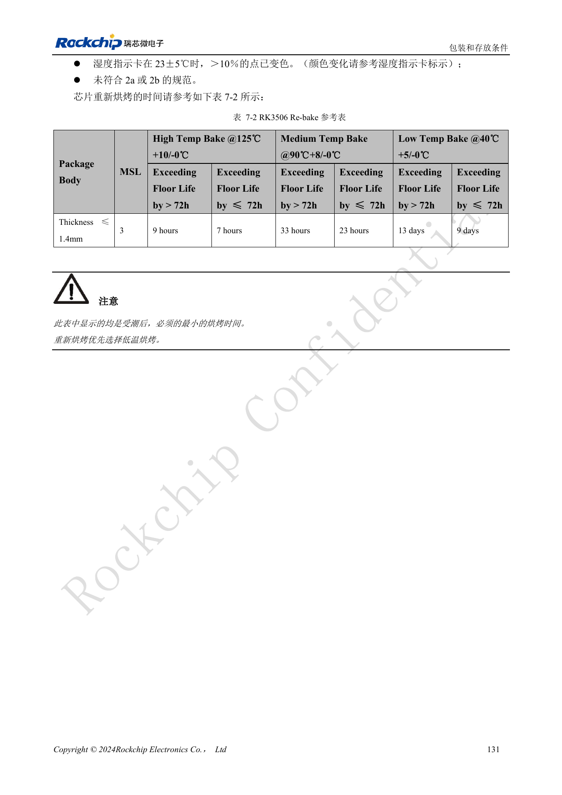

# RK3506: Thermik, ESD und Fertigungsprüfung

Nach RK3506 Hardware Design Guide V1.0 (2024-09) für G2 und B/J. Gehäuse, RAM, Versorgung und Pins variantenbezogen, CM1/Forge1-Anschlüsse anhand der Boardunterlagen prüfen. Dies ist ein technischer Themenartikel, keine vollständige seitenweise Übersetzung. Werte stammen aus der Quelle, nicht aus ArmSoM-Messungen. Tatsächliches SDK/BSP, Kernel und Firmware validieren.

**RK3506 Hardware Design Guide_V1.0_20240904_CN.pdf** · §3.1–3.2; §4–7

## Thermische Daten gelten für einen Prüfaufbau

Wärmewiderstände der Quelle sind Simulationen für Gehäuse, PCB und Umgebung, keine ArmSoM-Messungen. Fläche, Kupfer, Luftführung, benachbarte Leistungsbauteile und Kühler beeinflussen Temperaturen; θJA allein bestimmt den Kühlbedarf nicht. Umgebung, Gehäuse, Last, Frequenz und Thermal-Policy dokumentieren sowie Die- und Bauteiltemperaturen messen. Drosselung, Notabschaltung und normale Wärmeabfuhr sind unterschiedliche Maßnahmen.

## ESD benötigt einen Entladepfad

Schutz nahe Steckern und Eintrittspunkten mit kurzem, geschlossenem Massepfad platzieren. Stecker und Schirme zuverlässig erden; Takt, Reset und Audio von Störquellen und Platinenrand fernhalten. Filterkapazität zur EMI-Verbesserung nicht zulasten schneller Signale erhöhen. Nach TVS-, Gleichtaktdrossel- oder Steckerwechsel Signalqualität erneut prüfen. Abnahme umfasst Hotplug, Erholung nach ESD und Dauerlast mit Protokollierung von Resets, Audiostörungen und Kommunikationsfehlern.

## Kumulative Feuchteexposition erfassen

Die Quelle nennt MSL3 mit 168 Stunden kumulativer Offenzeit bei ≤30°C/60%RH. Diese Zeit beginnt beim erneuten Linienstart nicht von vorn. Lagerreferenz in dichter Verpackung: ≤40°C, <90%RH, 12 Monate. Bei Überschreitung oder auffälliger Feuchtekarte Rebake nach Gehäusedicke, Überschreitungsdauer und Temperatur auswählen. Beide Tabellen enthalten ein fragliches „≤300°C“ für MSL1; niemals als Lagertemperatur übernehmen. Reflow für Paste, thermische Masse und Gehäuse qualifizieren und gemessene Profile sowie Chargen dokumentieren.

## Rebake-Referenztabelle

| Temperatur | Floor-Life-Überschreitung >72h | Floor-Life-Überschreitung ≤72h |
| --- | --- | --- |
| 125°C +10/-0°C | 9h | 7h |
| 90°C +8/-0°C | 33h | 23h |
| 40°C +5/-0°C | 13d | 9d |

Nur für die Quellenbedingungen: MSL3, Gehäusedicke ≤1.4mm. Angegeben sind Mindestzeiten, niedrige Temperatur wird bevorzugt. Temperaturgrenzen von Tray und Bauteilen prüfen; daraus kein Verfahren für andere Gehäuse oder bestückte Platinen ableiten.

## Quellenbilder und Prüfseiten

Für diese Auswahl liegen nur chinesische Originale vor. Alle vier Sprachen verwenden dieselben Quellenbilder mit Abbildungskontext; Bildbeschriftungen wurden nicht übersetzt. Der Text ist editierbar. Seitenzahlen bezeichnen physische PDF-Seiten.

PDF 91

PDF 95

PDF 135

PDF 143

PDF 145

PDF 146

## ArmSoM-Produkte und Dokumentation

- [ArmSoM CM1](https://www.armsom.org/product-page/cm1) · [CM1 Docs](https://docs.armsom.org/armsom-cm1)
- [ArmSoM Forge1](https://www.armsom.org/armsom-forge1) · [Forge1 Docs](https://docs.armsom.org/armsom-forge1)

## Weiterlesen

- [Serienübersicht](/de/articles/rk3506-hardware-design-series/)
- [RK3506-Minimalsystem: Takt, Reset und Wiederherstellung](/de/articles/rk3506-clock-boot-reset-design/)
- [RK3506-Versorgung: G2, B/J und Trägerplatinen](/de/articles/rk3506-power-domains-design/)
- [RK3506 DDR, eMMC und FSPI: Schaltung und Routing](/de/articles/rk3506-ddr-storage-hardware-design/)
- [RK3506: Display, USB und RM_IO zuordnen](/de/articles/rk3506-display-usb-io-design/)
- [RK3506-Audiodesign: SAI, PDM, ASRC und DSM](/de/articles/rk3506-audio-hardware-design/)
- [RK3506-Industrieschnittstellen: RMII, FlexBus und DSMC](/de/articles/rk3506-industrial-bus-hardware-design/)
