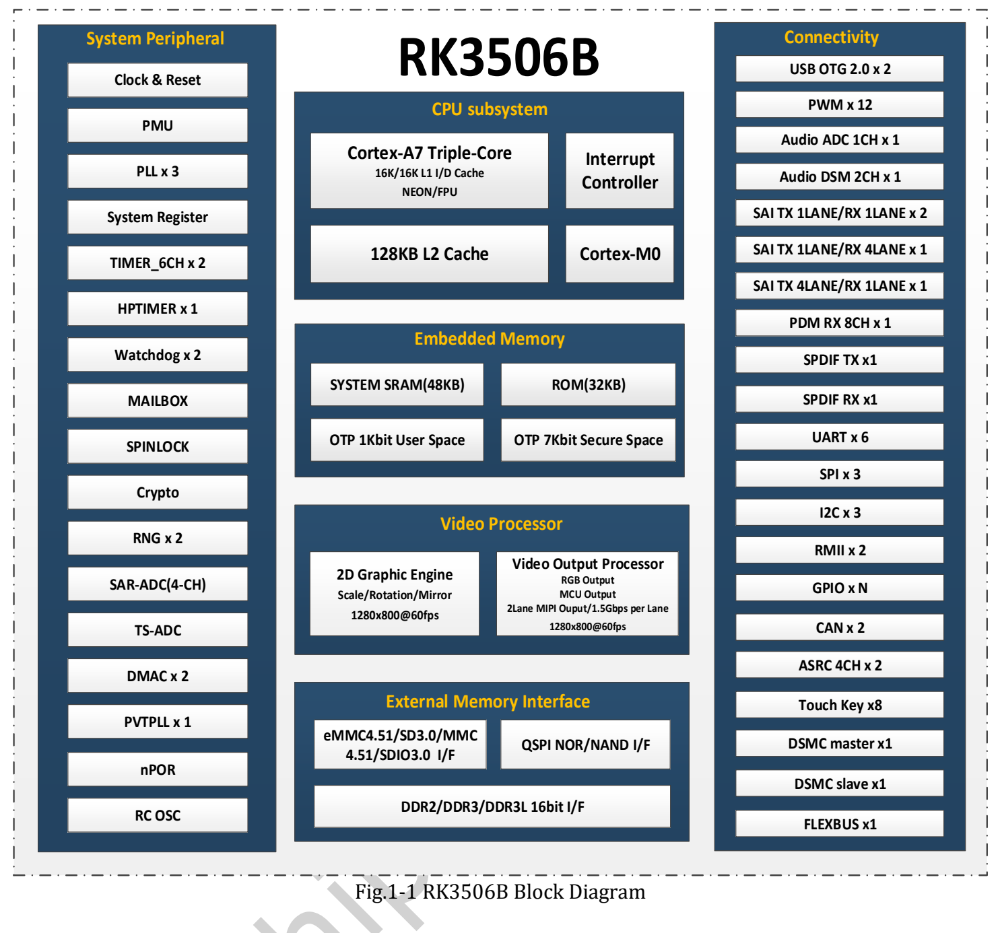
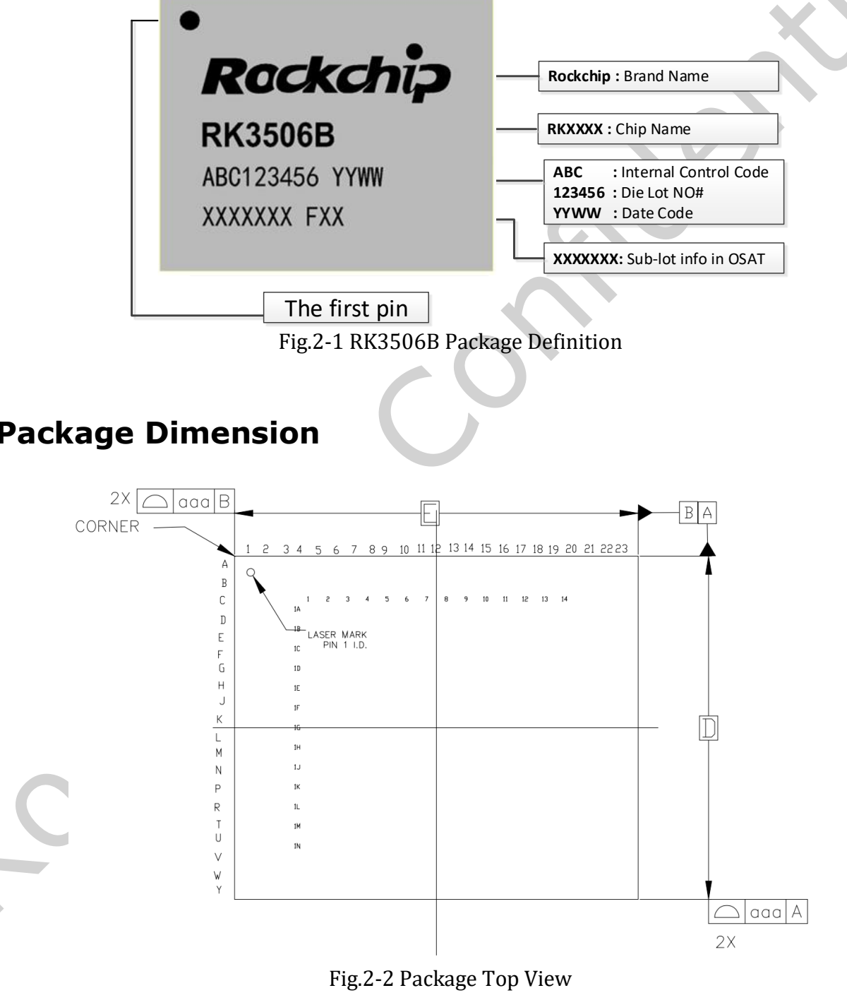
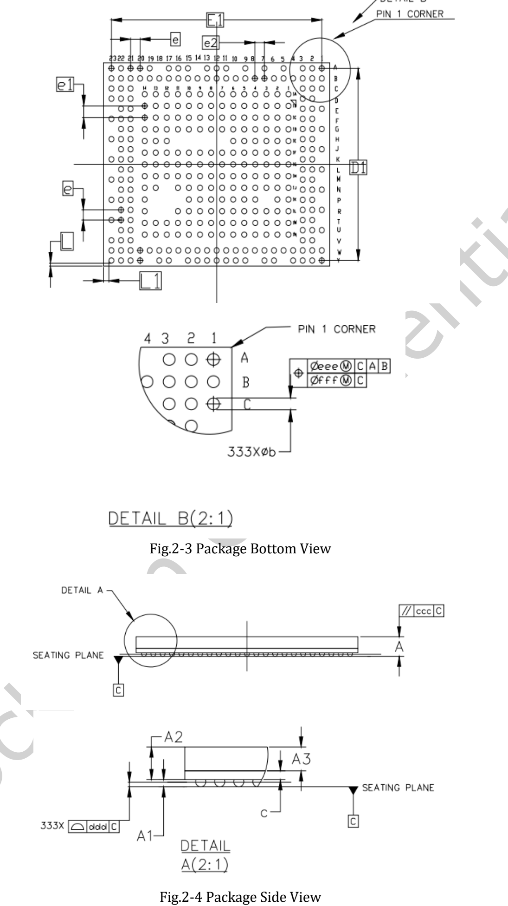

Hier stehen das bereitgestellte **RK3506B Datasheet V1.0 vom 2024-08-16 mit 50 Seiten** und eine technische Lesehilfe zu Architektur, Gehäuse, Anschlüssen, Elektrik und Wärme bereit. Dies ist keine zeilenweise Übersetzung; vollständige Multiplexing- und elektrische Tabellen stehen im Original-PDF.

**CM1 und Forge1 verwenden RK3506J. Das B-Dokument bestätigt keine Spannungs-, Temperatur-, Takt- oder Pin-Kompatibilität der J-Variante.**

## Download und Kapitel

[Original-PDF RK3506B Datasheet V1.0 herunterladen](/assets/rk3506/Rockchip-RK3506B-Datasheet-V1.0-20240816.pdf)

| Seiten | Inhalt | Prüfung |
|---|---|---|
| 7–14 | Architektur/Funktionen | CPU, Speicher, Anzeige, Audio, Peripherie |
| 15–17 | Gehäuse/Markierung | FBGA333L, Orientierung, Maße, Toleranzen |
| 17–26 | Pinliste | Balls und Mehrfachfunktionen |
| 26–41 | Versorgungs-/Funktions-IO | Domänen, Pulls, Multiplexing |
| 41–44 | Matrix IO/FLEXBUS | ADC/DAC/DVP/QSPI-LCD-Beispiele |
| 45–49 | Elektrische Daten | Grenzwerte, Empfehlungen, Pegel |
| 50 | Wärme | Sperrschichttemperatur, offene Angaben |

## Architektur des RK3506B

Drei Armv7-A Cortex-A7 unterstützen NEON und VFPv4-D32. Genannt werden 16KB L1-Instruktionscache, 16KB L1-Datencache und 128KB L2 sowie Cortex-M0, Mailbox, Spinlock und DMA. Aufgabenverteilung anhand des passenden SDK prüfen.

16-bit DDR2/DDR3/DDR3L adressiert bis 1024MB. Speicheroptionen umfassen SPI NOR/NAND und SD/MMC; genannt sind eMMC 4.51, SD3.0, SDIO3.0 und ein 4-bit-Bus. Eine Platine muss nicht jedes Medium bestücken.

Anzeige: bis 1280×1280@60fps, MIPI mit zwei Lanes zu je 1.5Gbps, RGB/MCU und BT.656/BT.1120. Die 2D-Engine unterstützt Skalierung, Rotation, Spiegelung und Alpha-Blending. Gleichzeitige Nutzung und Pinbelegung separat prüfen.

## Gehäuse und Leiterplatte

FBGA333L, Feuchtigkeitsempfindlichkeitsstufe 3, Ballmaterial SnAgCu. Abbildungen erläutern die Orientierung. Footprints aus Maßtabellen und aktuellen Gehäusedaten erstellen, nicht aus Messungen an Webbildern.

## Empfehlungen und Grenzwerte trennen

| Parameter | RK3506B V1.0 |
|---|---|
| Empfohlene Umgebung Ta | −20 / 25 / 80°C, min/typ/max |
| Lagerung | −40 bis 125°C |
| Maximale Sperrschichttemperatur | 125°C; Wärmekapitel fordert Unterschreitung |
| CPU-Versorgung | min 0.81V, typ 0.9V, max TBD |
| θJA, θJB, θJC, ψJT | Alle TBD |

TBD nicht durch Schätzungen ersetzen. Sperrschichtgrenze und Lagerbedingungen sind keine Umgebungstemperatur im Betrieb. Die offene maximale CPU-Spannung nicht von anderen Varianten übernehmen.

## Offene Punkte im Original

Seite 49 nennt für CODEC ADC Resolution den Wert 24 mit Einheit °C; der Funktionsteil beschreibt einen 24-bit-ADC. Als Einheitenfehler zur Klärung dokumentieren, nicht als Temperaturangabe verwenden. Fünf SAI-Komponenten enthalten interne Verbindungen und bedeuten keine fünf unabhängigen externen Audioports.

Vor Umsetzung Chip, freigegebene Dokumentation, BSP, Einschaltfolge, Multiplexing, Schaltplan und Messungen prüfen. Für diesen Artikel wurden keine elektrischen oder thermischen ArmSoM-Hardwaretests durchgeführt.

## Weitere Artikel und offizielle Unterlagen

- [RK3506J erklärt: industrielle HMI und vernetzte Geräte](/de/articles/rk3506j-chip-guide/)
- [ArmSoM CM1: RK3506J-Modul für eigene Industrieterminals](/de/articles/cm1-rk3506j-industrial-module/)
- [ArmSoM Forge1: Gateways, HMI und Datenerfassung entwickeln](/de/articles/forge1-industrial-hmi-gateway/)
- [Rockchip RK3506](https://www.rock-chips.com/a/cn/product/RK35xilie/2025/1208/2125.html)
- [ArmSoM CM1](https://docs.armsom.org/armsom-cm1)
- [ArmSoM Forge1](https://docs.armsom.org/armsom-forge1)
- [ArmSoM](https://www.armsom.org/)

<!-- datasheet-related-20261110 -->
## Weitere Chipdatenblätter

Diese Links dienen der plattformübergreifenden Recherche; elektrische Bedingungen und Pins sind nicht austauschbar.

- [RK3576](/de/articles/rk3576-datasheet-v10/)
- [RK3588](/de/articles/rk3588-datasheet-v14/)
- [RK3528](/de/articles/rk3528-datasheet-v10/)
- [RK3568](/de/articles/rk3568-datasheet-v12/)
- [RK730](/de/articles/rk730-audio-codec-design/)
