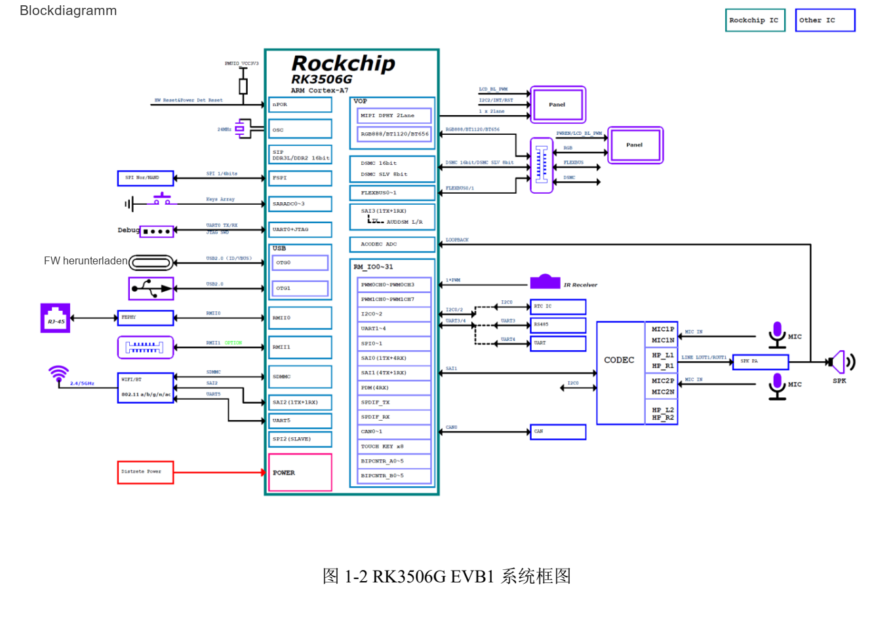
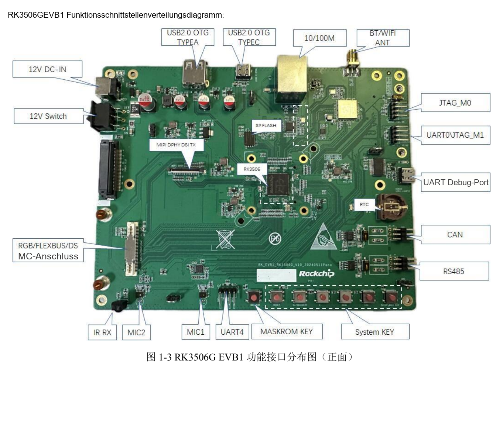

Dieser thematische Leitfaden erläutert das Quelldokument mit wichtigen Daten, Grenzen und Originalabbildungen. Er ist keine seitenweise Übersetzung und kein vollständiges Pin- oder Registerhandbuch. Herstellerbeispiele sind keine ArmSoM-Messungen. Vor der Anwendung sind Platinenrevision, Schaltplan, SDK/BSP, Kernel und Treiber zu prüfen; für diesen Artikel wurden keine neuen Hardwaretests durchgeführt.

**Hauptquelle：** `Rockchip_RK3506G_EVB1_User_Guide_V1.0_20240719_CN.pdf` · PDF 40 Seiten.

## G-Referenz und J-Produkte unterscheiden

Das Handbuch gilt für `RK_EVB1_RK3506G_V10_20240511Pana.brd`. Die Tabelle nennt 128MB DDR3L und optionale eMMC; zum Kit gehören 12V/3A und ein MIPI-Panel mit 1280×720. CM1 und Forge1 sind als RK3506J dokumentiert. Speicher, Temperaturklasse, Versorgung und Pins des G-EVB sind nicht direkt übertragbar.


[](/assets/localized/figures/de/95e4112a34243ececb6a.png)

*RK3506G-EVB1-Systemdiagramm — Chinesische Originalabbildung; in dieser Auswahl liegt keine entsprechende englische Abbildung vor. `Rockchip_RK3506G_EVB1_User_Guide_V1.0_20240719_CN.pdf`, PDF p. 12.*


## Entwicklungswege der Referenzplatine

| Weg | Umsetzung | Vor Anschluss prüfen |
| --- | --- | --- |
| HMI | 2-lane MIPI DSI sowie RGB-Erweiterung | Timing, Beleuchtung, Touch und Kabel |
| Gerätenetz | 1 Fast-Ethernet-RJ45; zweiter FEPHY über 60pin | PHY, Versorgung, Multiplexing und Treiber |
| Steuerungserweiterung | RGB/FLEXBUS/DSMC teilen 60pin | Widerstände und Pinmux für die Funktion |
| Feldkommunikation | CAN und RS485 | Transceiver, Terminierung, Leitung und Massebezug |
| Audio | 1 Lautsprecher, 2 analoge MICs, Codec | Signalwege, Takte und Mixer |
| USB | OTG0 Type-C für Download; OTG1 Type-A | Rolle, Versorgung und Treiber statt Steckerform |


[](/assets/localized/figures/de/403248eb99b7bf940fbb.png)

*RK3506G-EVB1-Anschlüsse — Chinesische Originalabbildung; in dieser Auswahl liegt keine entsprechende englische Abbildung vor. `Rockchip_RK3506G_EVB1_User_Guide_V1.0_20240719_CN.pdf`, PDF p. 14.*


## Download und UART zuerst sichern

Die Quelle nutzt Tool v3.28 oder neuer. MASKROM beziehungsweise V+(RECOVERY) wählt den Modus; nach Erkennung passende Loader-, Parameter-, Uboot- und weitere Dateien wählen. Loader verlangt Low an `SARADC_IN1`. Versorgung und Tasten laut konkretem Boardhandbuch verwenden, Daten vor dem Schreiben sichern.

Debug-Type-C ist USB-UART mit `1500000` (1.5M) Baud und vom OTG0-Download getrennt. Logs vom Einschalten bis Userspace speichern. Vor Kernelanalyse Versorgung, Kabel und Ports prüfen. Ein ADB-fähiges Image erlaubt zusätzlich:

```sh
adb devices
adb shell
```

## eMMC ist eine Bestückungsoption

S. 27 gibt diese Tabelle nur für die genannte Referenz an:

| Netz | Umsteckrichtung der Quelle |
| --- | --- |
| eMMC_CLKOUT | `R1614→R1644` |
| eMMC_CMD | `R1615→R1639` |
| eMMC_D0 | `R1616→R1640` |
| eMMC_D1 | `R1617→R1641` |
| eMMC_D2 | `R1645→R1642` |
| eMMC_D3 | `R1146→R1143` |

Die letzte Nummerierung weicht ab und bleibt erhalten, statt auf R16xx korrigiert zu werden. Vor Änderung Schaltplan, BOM, Montage und Loader/Partitionen prüfen. Dies fordert keine entsprechenden Umbauten an CM1 oder Forge1.

## I2C, Terminierung und JTAG sind bedingt

I2C0 enthält HYM8563TS `0x51` und ES8388 `0x11`, beide 3.3V. Touch nutzt I2C2, `0x28/0x29`, 3.3V. Dieser EVB-Audioteil ist daher nicht automatisch eine RK730-Anschlussanleitung.

RS485 bietet zuschaltbare 120Ω. Die gesamte Bustopologie bestimmt die Terminierung, nicht pauschal jeder Knoten. CAN/RS485 und Versorgung bei ausgeschalteter Platine anhand der Schaltung prüfen.

JTAG_M0 teilt Wi-Fi-SDIO-Ressourcen und benötigt die entsprechende Schalterstellung. Die beiden JTAG-Leisten vertauschen TMS/TCK: M0 ist GND, TMS, TCK, VCC; M1 GND, TCK, TMS, VCC. Gleiche Form genügt nicht.

## Quellenfehler und Produktübertragung

Die Wi-Fi-Tabelle druckt `1T21`, die Übersicht nennt 1T1R. Auf der letzten Seite stehen noch RK3576 im Kopf und JTAG unter einer UART-Abbildung. Diese Abweichungen werden dokumentiert, nicht als zusätzliche Fähigkeit interpretiert.

Forge1 lässt sich für HMI, Gateways und Anschlüsse evaluieren, CM1 für eigene Träger. Speicher, Bootmedium, Versorgung, Display, Busse und Softwareversionen neu erfassen. Nach Einzel- und Recoverytests UI, Netzwerk, Speicher und Feldbus zusammen belasten, anschließend Temperatur und Langzeitstabilität prüfen.


## Produkte und Entwicklungsunterlagen

- **CM1** — [Produkt](https://www.armsom.org/cm1) · [Dokumentation](https://docs.armsom.org/armsom-cm1)
- **Forge1** — [Produkt](https://www.armsom.org/forge1) · [Dokumentation](https://docs.armsom.org/armsom-forge1)


## Weiterführende Artikel

- [Forge1-Anwendungsplanung](/de/articles/forge1-industrial-hmi-gateway/)
- [RK730-Audiocodec](/de/articles/rk730-audio-codec-design/)
