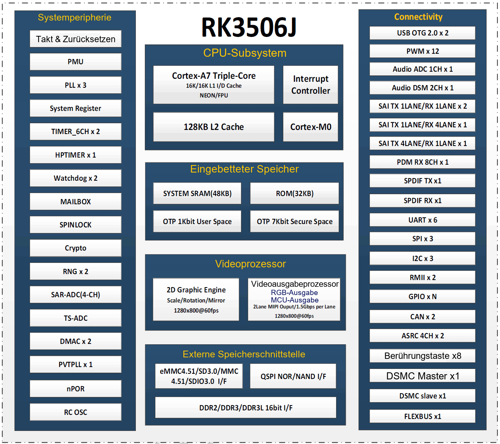

RK3506J verbindet Anzeige, Gerätekommunikation und Steuerungssoftware in kompakten Embedded-Terminals. ArmSoM CM1 bietet den Modulweg für eigene Produkte; Forge1 ist eine vollständige Entwicklungsplatine zur Prüfung von Displays, Protokollen und Anwendungen. Ausgangspunkt sollten Datenfluss und Schnittstellen sein, nicht allein die CPU-Frequenz.

## Aufgaben der Funktionsblöcke

| Block | Öffentlich dokumentiert | Bedeutung |
|---|---|---|
| CPU | Drei Cortex-A7; ArmSoM zeigt zusätzlich Cortex-M0 | Linux-Anwendungen; M0-Nutzung abhängig vom BSP |
| Grafik | 2D-Engine und Anzeigeprozessor | Komposition, Skalierung, Rotation |
| Speicher | RK3506B/J: 16-bit DDR2/DDR3/DDR3L | Bestückung bestimmt die Kapazität |
| Netzwerk | Zwei RMII | Externe PHYs und Platinenanschlüsse nötig |
| Kommunikation | USB2.0 OTG, UART, SPI, I2C, CAN, PWM | Displays, Sensoren, Geräte |
| Erweiterung | DSMC, FLEXBUS, Matrix IO | Multiplexing, Timing und Treiber prüfen |

Drei Cortex-A7 und ein Cortex-M0 sind keine vier gleichwertigen Linux-Kerne. Die 2D-Engine ist keine universelle 3D-GPU. Die offizielle Produktseite nennt keine NPU-Rechenleistung; als Plattform für große Sprachmodelle wird der Chip daher nicht beworben.

## Fünf Anwendungsrichtungen

### Industrielle Touch-HMI

Status, Einstellungen, Trends und Alarme auf einem Panel zusammenführen. Zunächst die Bedienreaktion mit einer schlanken Oberfläche wie LVGL prüfen, danach das reale Geräteprotokoll anbinden. Auflösung, Aktualisierung, Schriften und Bilder bestimmen Speicherbedarf und Latenz. Animationen unter echter Last testen.

### Protokoll-Gateway

Serielle oder CAN-Daten erfassen und über Ethernet übertragen. Erfassung, Prüfung, Pufferung und Versand trennen; Wiederverbindung und Duplikate behandeln. Zwei Fast-Ethernet-Schnittstellen belegen weder volle Weiterleitungsrate noch Protokollzertifizierung oder harte Echtzeit.

### Hausgeräte und Gebäudesteuerung

Temperatur, Licht, Lüfter und lokale Bedienung verwalten. Wichtige Funktionen auch offline erhalten. NAND-Verschleiß und Wiederanlauf nach Stromausfall berücksichtigen. Relais, analoge Eingänge und Feldspannungen benötigen externe Schaltungen statt direkter GPIO-Verbindungen.

### Produktionsdatenterminal

Zähler, Betriebszustände und Alarme lokal anzeigen und periodisch übertragen. Abtastrate, Zeitstempel, Offline-Aufbewahrung und Speicherbudget vor der Datenbankauswahl festlegen. Dies ist ein Anwendungsvorschlag, kein bereits umgesetzter ArmSoM-Kundenfall.

### Sprach- und Audiobedienung

Rockchip nennt Audio-ADC, DSM, SAI und PDM. Mikrofonarrays, Echobearbeitung, Spracherkennung und Audiobauteile erfordern zusätzliche Integration. Schnittstellen allein liefern keine fertige Offline-Spracherkennung.

## Von Forge1 zu CM1

Mit Forge1 zunächst Schnittstellen, Oberfläche und Kommunikation validieren. CM1 mit eigener Trägerplatine ist interessant, wenn Form, Anschlüsse oder Versorgung angepasst werden müssen. Derselbe RK3506J macht Images nicht austauschbar: Device Tree, Speicherlayout, Display und Stromversorgung prüfen.

## Takt und Modellgrenzen

Veröffentlichte Platinenfrequenzen unterscheiden sich. Für CM1 und Forge1 wird hier kein fester Maximaltakt zugesichert. Maßgeblich sind Frequenztabelle des ausgelieferten Images, Betriebsmodus und Temperaturbedingungen. Das beigefügte PDF ist **RK3506B V1.0**, keine elektrische Spezifikation für RK3506J.

## Weitere Artikel und offizielle Unterlagen

- [ArmSoM CM1: RK3506J-Modul für eigene Industrieterminals](/de/articles/cm1-rk3506j-industrial-module/)
- [ArmSoM Forge1: Gateways, HMI und Datenerfassung entwickeln](/de/articles/forge1-industrial-hmi-gateway/)
- [RK3506B Datasheet V1.0: Architektur, Anschlüsse und elektrische Auslegung](/de/articles/rk3506b-datasheet-v10/)
- [Rockchip RK3506](https://www.rock-chips.com/a/cn/product/RK35xilie/2025/1208/2125.html)
- [ArmSoM CM1](https://docs.armsom.org/armsom-cm1)
- [ArmSoM Forge1](https://docs.armsom.org/armsom-forge1)
- [ArmSoM](https://www.armsom.org/)
