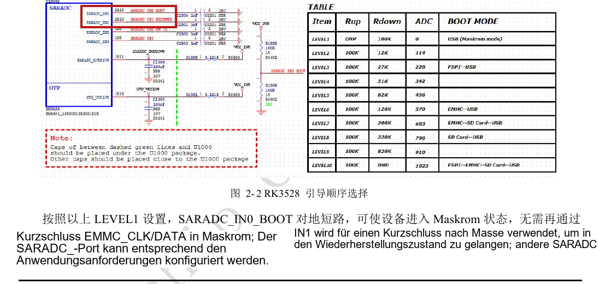
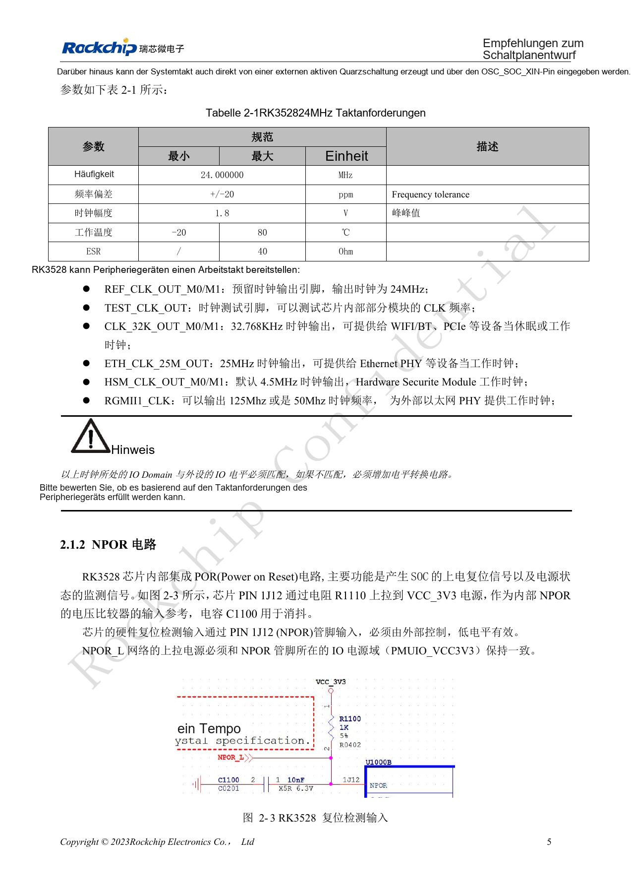
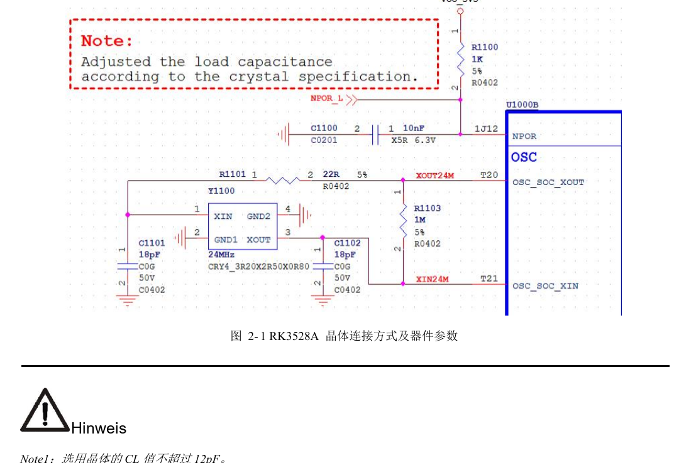
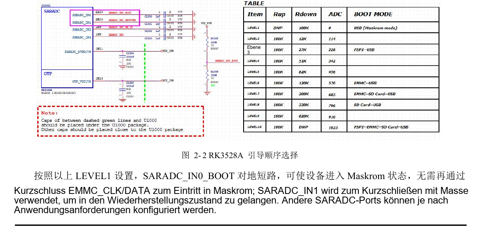
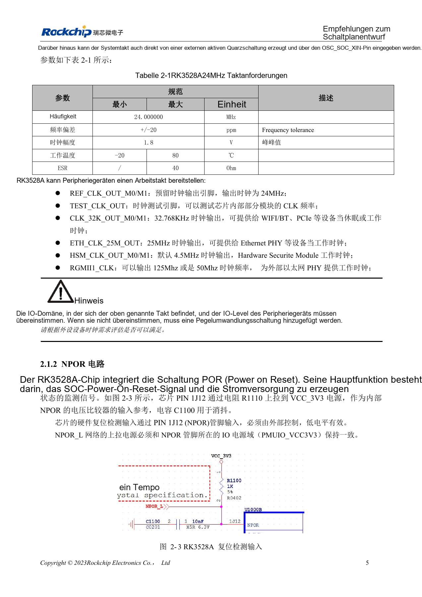

# RK3528 / RK3528A: Takt, Reset, Maskrom und Debug-UART

Dieses Entwicklungsthema basiert auf den chinesischen Hardwarehandbüchern RK3528 V1.0 (2023-05-25) und RK3528A V1.0 (2023-07-12), nicht auf einer vollständigen wörtlichen PDF-Übersetzung. Ähnliche Kapitel belegen keine direkte Austauschbarkeit der Chips. Die offizielle [Sige1-Dokumentation](https://docs.armsom.org/armsom-sige1) nennt RK3528 für ArmSoM [Sige1](https://www.armsom.org/sige1), das zur Bewertung entsprechender Anwendungen dienen kann. Daraus folgt weder, dass Sige1 RK3528A verwendet, noch dass beide Chips austauschbar sind. SoC-Referenzschaltungen sind nicht der Sige1-Schaltplan; Pins, Gehäuse, BSP/SDK, Kernel und Boardrevision am tatsächlichen Produkt prüfen. Werte stammen aus den Quellen, nicht aus ArmSoM-Hardwaremessungen.

**§2.1.1–2.1.5; §2.3.2; PDF 18–23, 54–55**

## Bei 24MHz genügt die Startprüfung nicht

Den 22Ω-Strombegrenzungswiderstand an XOUT24M erhalten und den 1MΩ-Widerstand zwischen XOUT24M und XIN24M nicht beliebig ändern. Crystal-CL darf 12pF nicht überschreiten. Die gezeigten 18pF gelten für den Referenzquarz; die Last anhand des gewählten Quarzes und der PCB-Parasiten neu berechnen. Empfohlen werden C0G/NP0 und ein Vierpadquarz mit gut angeschlossenen Massepads. Start, Frequenz, Amplitude und Temperaturverhalten prüfen; auch die Tastkopflast verändert das Ergebnis.

## Bootkonfiguration bis zur Serienfertigung erhalten

NPOR ist aktiv low; der externe Pull-up muss zum Versorgungsbereich PMUIO_VCC3V3 passen. FSPI, eMMC und SDMMC dienen als Bootmedien; ohne gültigen Bootcode erfolgt der Download über USB2 OTG. SARADC_IN0 bleibt für die Bootreihenfolge reserviert. LEVEL1 zieht ihn für Maskrom auf low; SARADC_IN1 dient Recovery und benötigt den 10kΩ-Pull-up auf 1.8V. Diese Signale sowie OTG und VBUSDET als nach der Gehäusemontage erreichbaren Wiederherstellungspfad erhalten.

## SD-Erkennung bestimmt auch die Debugfunktion

Bei der Resetfreigabe wählt SDMMC_DETN low SDMMC und high CPU JTAG; der Pegel muss vor dem Einschalten stabil sein. Später kann Software den IOMUX steuern. Standard-Debugport ist UART0_RX_M0 / UART0_TX_M0 mit 1500000bps; beide Signale aus derselben M0-Gruppe verwenden. Empfohlen sind 100Ω in Serie und ein 2.54mm-Header, alternativ Testpunkte größer als 0.7mm. MCU JTAG ist in diesen Handbuchversionen nicht zur externen Nutzung freigegeben.

## Referenzparameter

| Punkt | Quellenwert |
| --- | --- |
| Quarz-CL-Grenze | 12pF |
| 24MHz-Toleranz | ±20ppm |
| SARADC-Eingangsbereich | 0–1.8V; 10bit; 1MS/s |
| Debug-UART | UART0_M0; 1500000bps |

## Quellenabbildungen und Seiten

Es liegen keine entsprechenden englischen Originale vor. Alle vier Sprachen nutzen chinesische PDF-Abbildungen mit Chip- und physischer Seitenangabe; RK3528-Bilder werden nicht als RK3528A-Bilder ausgegeben.

RK3528 · CN · PDF 18

RK3528 · CN · PDF 20

RK3528 · CN · PDF 19

RK3528A · CN · PDF 18

RK3528A · CN · PDF 20

RK3528A · CN · PDF 19

## Entwicklung und Dokumentation

ArmSoM-Produkte anhand ihrer eigenen Dokumentation wählen; die Serie behauptet kein ArmSoM-Board mit RK3528/RK3528A. Schnittstellen- und Softwareerfahrung anderer Boards hilft methodisch, macht Spannungen, Pins oder PCB-Regeln aber nicht austauschbar.

- [ArmSoM](https://www.armsom.org/) · [ArmSoM Docs](https://docs.armsom.org/)
- [RK3528 / RK3528A: neun Hardware-Entwicklungsthemen](/de/articles/rk3528-rk3528a-hardware-design-series/)
- [RK3528 / RK3528A: diskrete Versorgung, Sequenzierung und Lastprüfung](/de/articles/rk3528-rk3528a-power-sequencing/)
