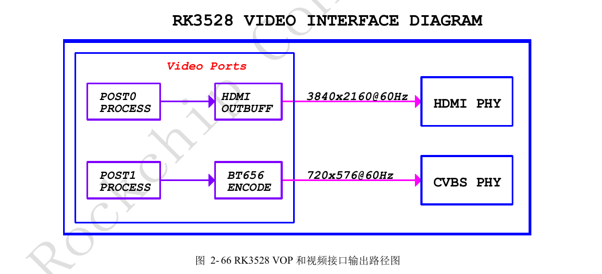
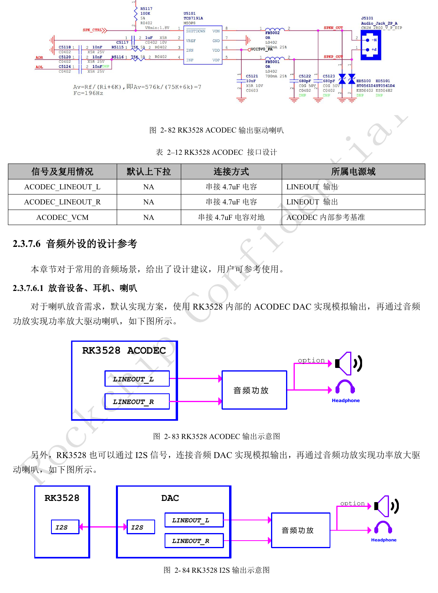
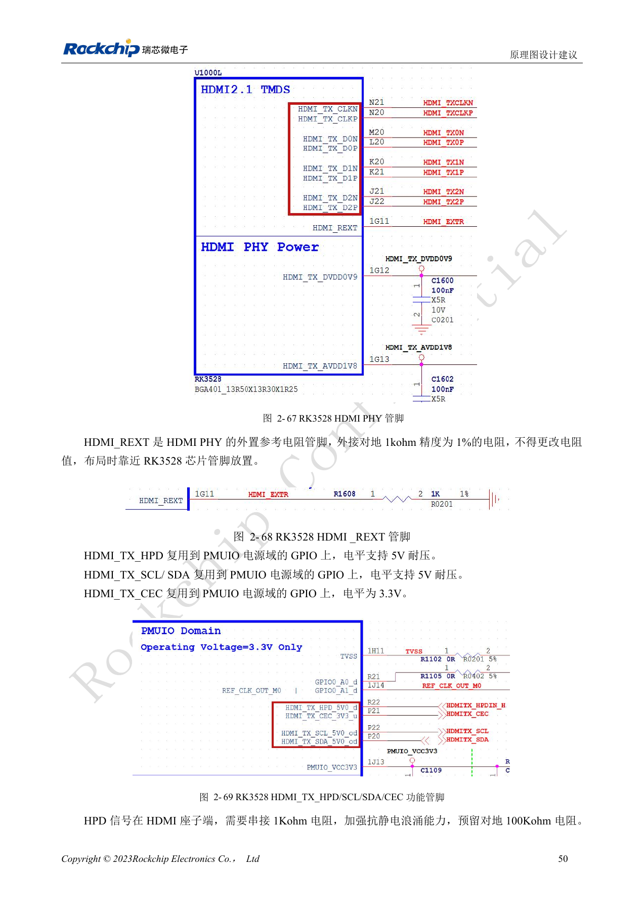
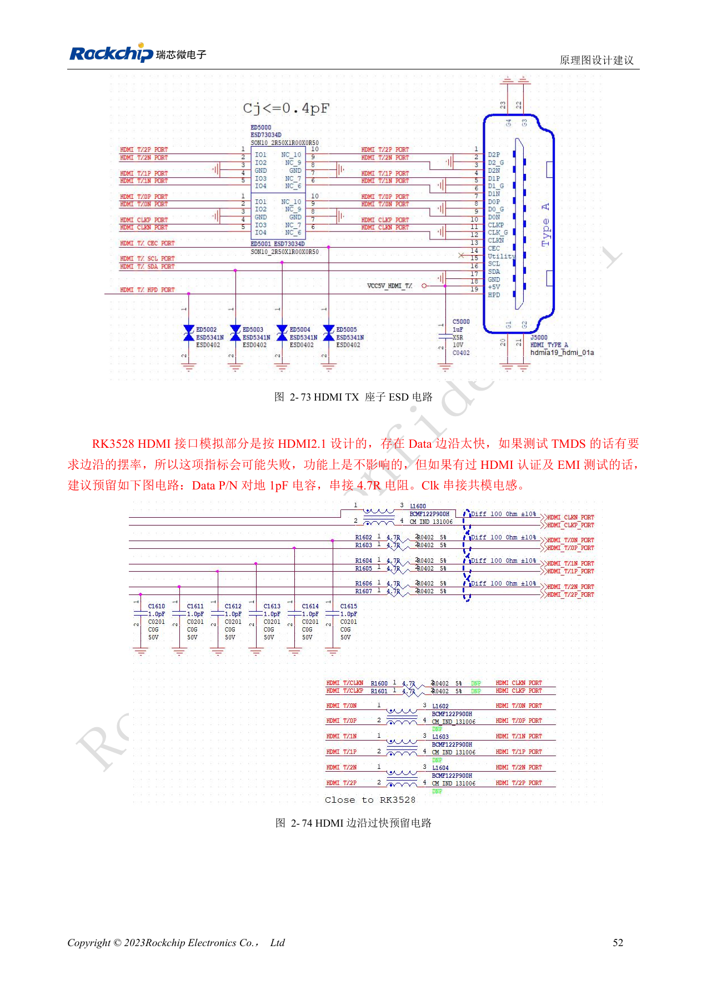
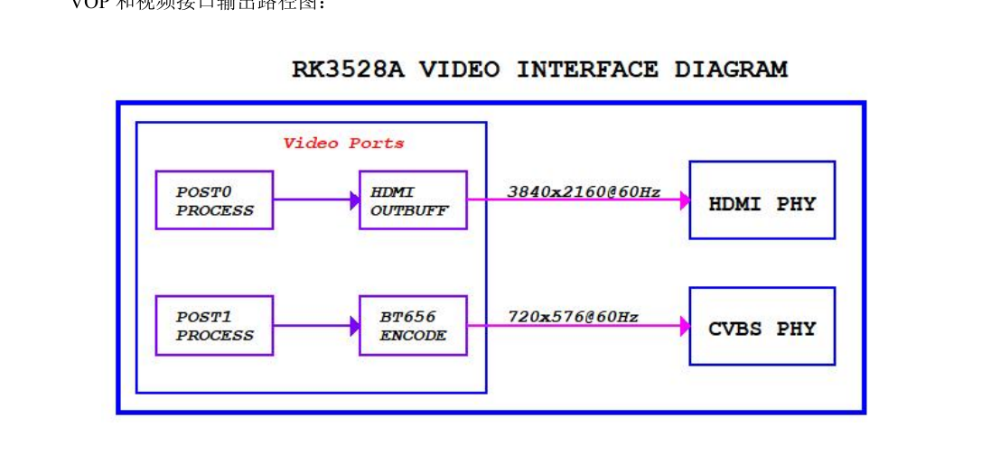
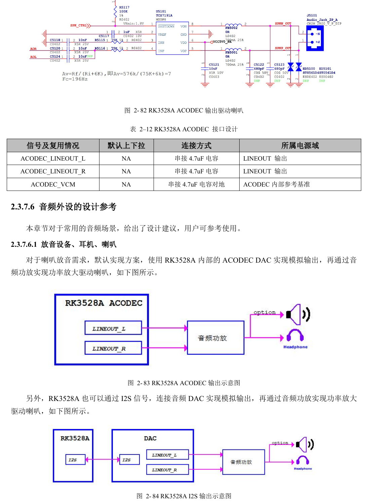
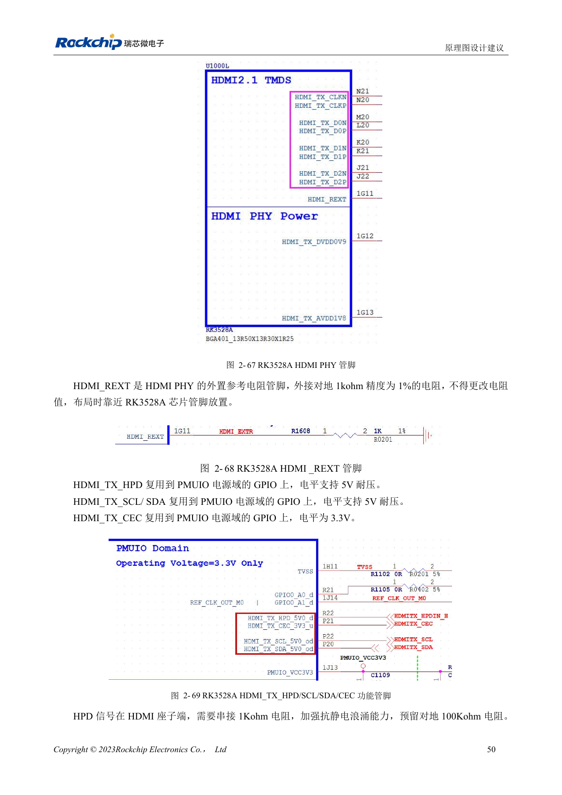
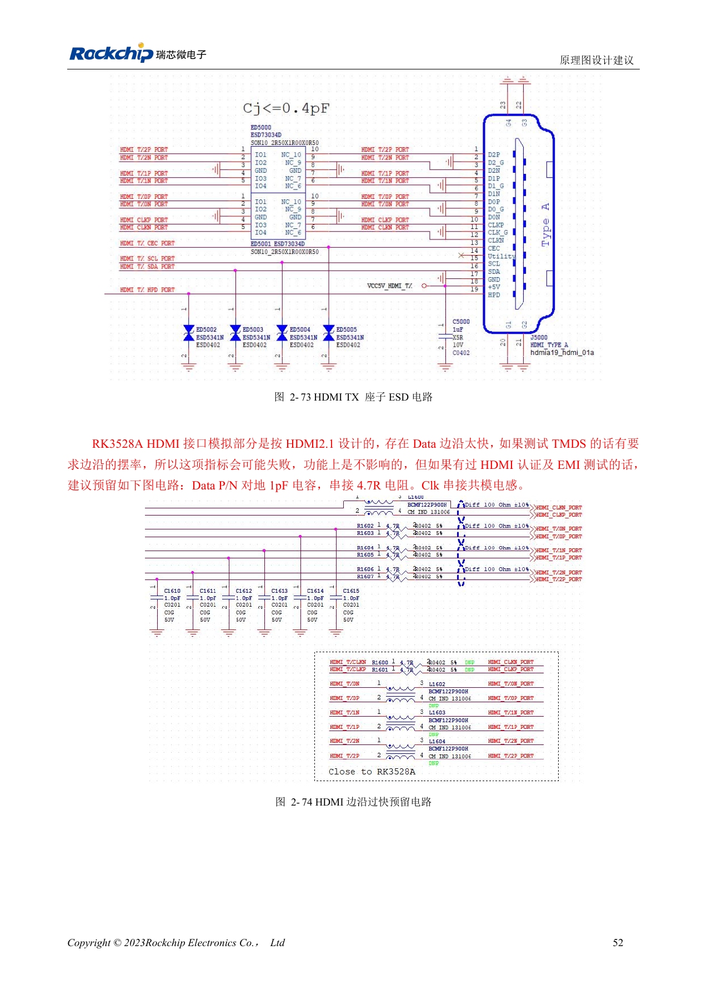

# RK3528 / RK3528A: HDMI, CVBS, TSI und analoges Audiolayout

Dieses Entwicklungsthema basiert auf den chinesischen Hardwarehandbüchern RK3528 V1.0 (2023-05-25) und RK3528A V1.0 (2023-07-12), nicht auf einer vollständigen wörtlichen PDF-Übersetzung. Ähnliche Kapitel belegen keine direkte Austauschbarkeit der Chips. Die offizielle [Sige1-Dokumentation](https://docs.armsom.org/armsom-sige1) nennt RK3528 für ArmSoM [Sige1](https://www.armsom.org/sige1), das zur Bewertung entsprechender Anwendungen dienen kann. Daraus folgt weder, dass Sige1 RK3528A verwendet, noch dass beide Chips austauschbar sind. SoC-Referenzschaltungen sind nicht der Sige1-Schaltplan; Pins, Gehäuse, BSP/SDK, Kernel und Boardrevision am tatsächlichen Produkt prüfen. Werte stammen aus den Quellen, nicht aus ArmSoM-Hardwaremessungen.

**§2.3.5–2.3.7; §3.3 HDMI/ACODEC/audio; PDF 62–75, 143, 148–149**

## HDMI-Fähigkeit zusammen mit der Schaltung lesen

Der VOP besitzt zwei Ausgangsports; die Handbücher zeigen HDMI- und CVBS-Pfade. HDMI2.0 TX erreicht 4K@60Hz mit RGB/YCbCr444/YCbCr420 bis 10bit. HDMI_REXT benötigt 1kΩ, 1%, gegen Masse nahe dem SoC. HPD und DDC werden als 5V-tolerant beschrieben, CEC dagegen als 3.3V; nicht alle beteiligten IOs sind deshalb 5V-kompatibel. HPD am Stecker mit 1kΩ und vorgesehenem 100kΩ-Pull-down beschalten; Versorgung und Hotplug prüfen.

## Anpassungen für Konformitätstests vorsehen

Die Quelle bezeichnet den analogen HDMI-Teil als für HDMI2.1 ausgelegt, beschreibt die externe Funktion aber als HDMI2.0; daraus folgen keine HDMI2.1-Funktionen. Bei schnellen TMDS-Flanken sind optionale 1pF gegen Masse an Daten-P/N, 4.7Ω in Serie und eine Gleichtaktdrossel im Takt vorgesehen; Bestückung anhand Eye-/EMI-Messung wählen. PCB: 100Ω±10%, Paardifferenz <6mil, zwischen Paaren <480mil, Länge <5in, ESD ≤0.2pF, möglichst zwei Vias. TSI ist ein Transportstromeingang; der falsche Tabellentitel CIF belegt keine Kameraschnittstelle.

## Analoge und digitale Audiowege getrennt prüfen

ACODEC-Ausgänge benötigen einen Verstärker für Lautsprecher. Aufnahme ist über PDM-Mikrofone, externe I2S/PDM-ADCs oder einen separaten Codec möglich. ACODEC-/CVBS-Leitungen möglichst breiter als 12mil mit durchgehender benachbarter Masse und Abstand zu DDR, Schaltinduktivitäten und RF führen. CVBS-75Ω nahe dem SoC, Filter nahe dem AV-Stecker; Audiokanäle einzeln abschirmen. Digitale Takte nutzen 22Ω am Sender und Daisy-Chain für mehrere Geräte; beide PDM-Gruppentakte können Verzweigungen verringern. Erst einzelne Kanäle, dann Störungen bei Display- und Funkaktivität messen.

## Referenzparameter

| Punkt | Quellenwert |
| --- | --- |
| HDMI_REXT | 1kΩ ±1% |
| HDMI-Differenzimpedanz | 100Ω ±10% |
| HDMI-Länge | <5in |
| CVBS-Terminierung | 75Ω |

## Quellenabbildungen und Seiten

Es liegen keine entsprechenden englischen Originale vor. Alle vier Sprachen nutzen chinesische PDF-Abbildungen mit Chip- und physischer Seitenangabe; RK3528-Bilder werden nicht als RK3528A-Bilder ausgegeben.

RK3528 · CN · PDF 63

RK3528 · CN · PDF 74

RK3528 · CN · PDF 64

RK3528 · CN · PDF 66

RK3528A · CN · PDF 63

RK3528A · CN · PDF 74

RK3528A · CN · PDF 64

RK3528A · CN · PDF 66

## Entwicklung und Dokumentation

ArmSoM-Produkte anhand ihrer eigenen Dokumentation wählen; die Serie behauptet kein ArmSoM-Board mit RK3528/RK3528A. Schnittstellen- und Softwareerfahrung anderer Boards hilft methodisch, macht Spannungen, Pins oder PCB-Regeln aber nicht austauschbar.

- [ArmSoM](https://www.armsom.org/) · [ArmSoM Docs](https://docs.armsom.org/)
- [RK3528 / RK3528A: neun Hardware-Entwicklungsthemen](/de/articles/rk3528-rk3528a-hardware-design-series/)
- [RK3528 / RK3528A: gemeinsamer USB-/PCIe-PHY und Kanalprüfung](/de/articles/rk3528-rk3528a-usb-pcie-design/)
- [RK3528 / RK3528A: RGMII, PHY, UART, I2C und PWM](/de/articles/rk3528-rk3528a-ethernet-control-interfaces/)
