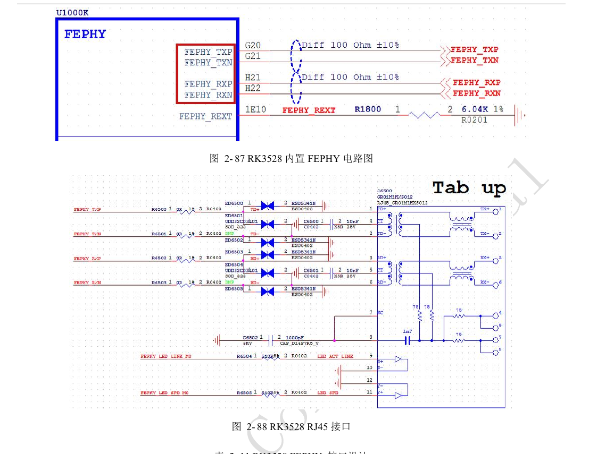
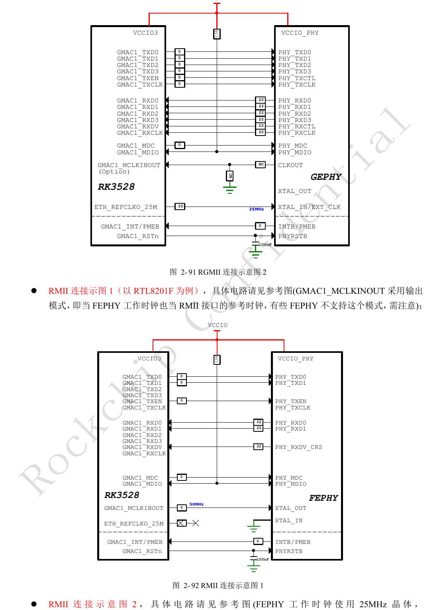
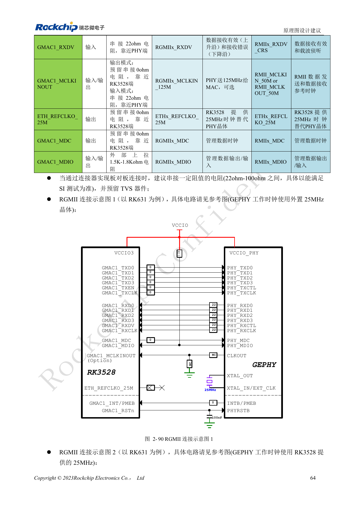
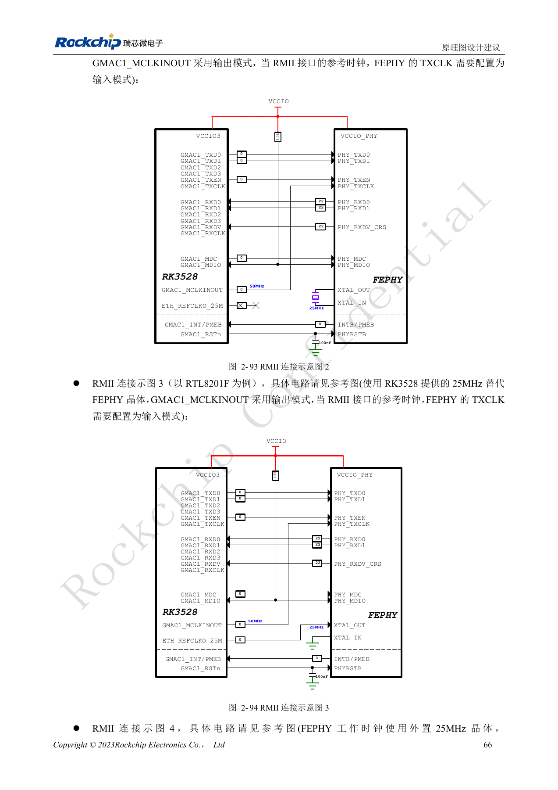
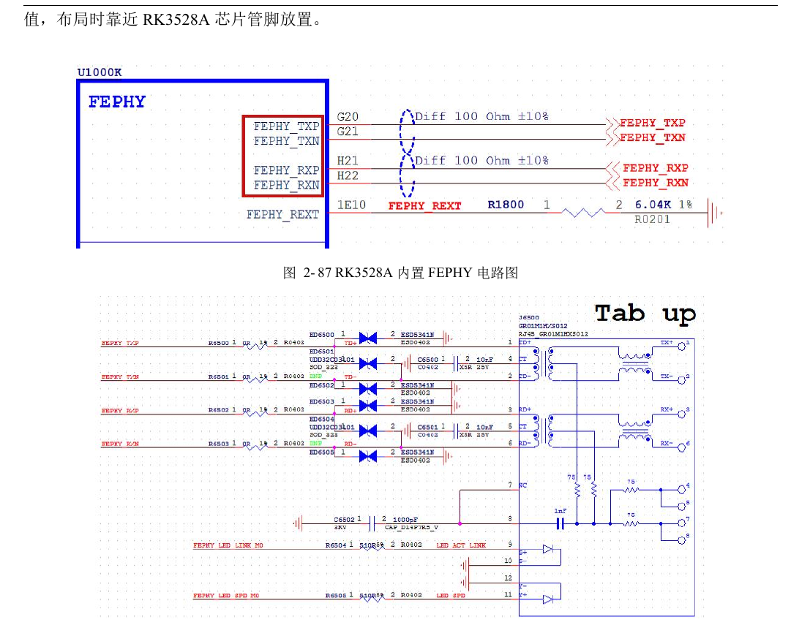
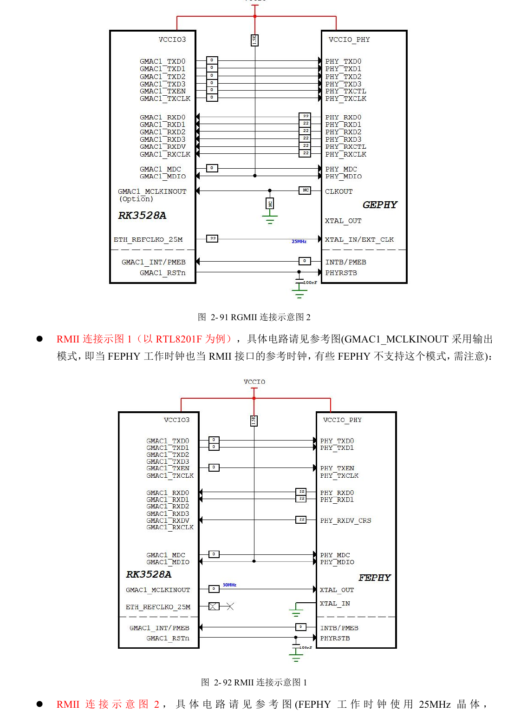
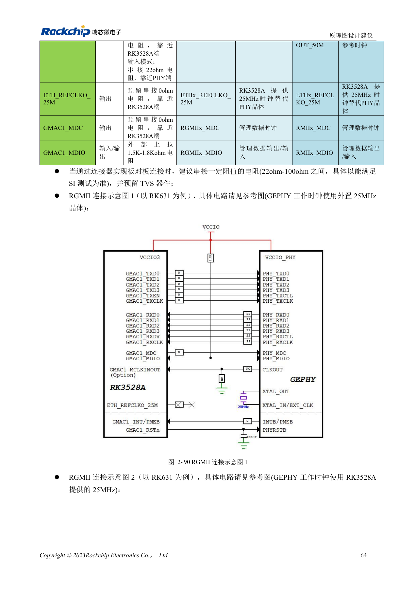
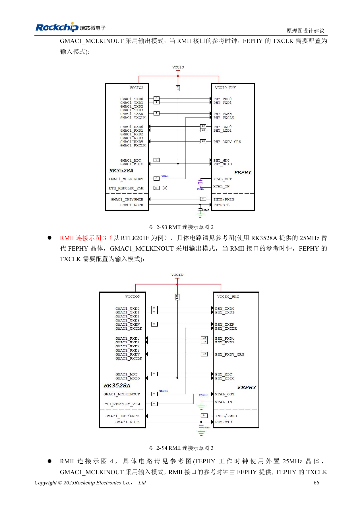

# RK3528 / RK3528A: RGMII, PHY, UART, I2C und PWM

Dieses Entwicklungsthema basiert auf den chinesischen Hardwarehandbüchern RK3528 V1.0 (2023-05-25) und RK3528A V1.0 (2023-07-12), nicht auf einer vollständigen wörtlichen PDF-Übersetzung. Ähnliche Kapitel belegen keine direkte Austauschbarkeit der Chips. Die offizielle [Sige1-Dokumentation](https://docs.armsom.org/armsom-sige1) nennt RK3528 für ArmSoM [Sige1](https://www.armsom.org/sige1), das zur Bewertung entsprechender Anwendungen dienen kann. Daraus folgt weder, dass Sige1 RK3528A verwendet, noch dass beide Chips austauschbar sind. SoC-Referenzschaltungen sind nicht der Sige1-Schaltplan; Pins, Gehäuse, BSP/SDK, Kernel und Boardrevision am tatsächlichen Produkt prüfen. Werte stammen aus den Quellen, nicht aus ArmSoM-Hardwaremessungen.

**§2.3.8–2.3.13; PDF 75–87, 147–148**

## Integriertes Fast Ethernet und externe PHYs sind getrennte Wege

Genannt werden ein GMAC, ein EMAC und integrierter FEPHY. Der FEPHY führt über MDI zu Übertrager und RJ45; REXT beträgt 6.04kΩ, 1%, nahe dem SoC, vorgesehene 0Ω-Positionen in den Differenzleitungen bleiben erhalten. GMAC unterstützt RGMII mit 10/100/1000Mbps oder RMII mit 10/100Mbps in VCCIO3. Externen PHY anhand seiner Pegel, Reset-, Strap- und Übertragervorgaben prüfen. RJ45 tab-up/tab-down verändert die Pinreihenfolge: Symbol und Footprint gemeinsam kontrollieren.

## Taktrichtung und Delay gemeinsam festlegen

Die Referenz weist TXCLK-Daten-Delay dem MAC und RXCLK-Daten-Delay dem PHY zu; RK631 aktiviert im Beispiel 2ns RX-Delay. Beim PHY-Wechsel doppelte Verzögerung an beiden Enden vermeiden. RMII bietet mehrere 50MHz-Ein-/Ausgangsvarianten; 25MHz-PHY-Betriebstakt nicht mit 50MHz-Busreferenz verwechseln. MDIO benötigt extern 1.5–1.8kΩ zur IO-Versorgung; 100nF am PHY-Reset vorsehen. RGMII-PCB: 50Ω±10%, TX-/RX-Daten jeweils zum eigenen Takt <120mil abgleichen, Länge <6in.

## Steuerbusse nach IO-Domäne und Mux-Gruppe zuordnen

Acht UARTs, acht I2Cs, zwei allgemeine SPIs und bis zu acht PWMs garantieren keine gleichzeitige Pinverfügbarkeit. UART-TX/RX müssen derselben Mx-Gruppe entstammen. Bei UART7 stehen M1/M2 in der Mux-Spalte, aber M0/M1 in der Versorgungsspalte; vor Umsetzung mit dem PinOut klären. SPI0 gehört zu VCCIO4, SPI1 zu VCCIO0. I2C erreicht laut Quelle 400Kbit/s; 2.2kΩ-Pull-ups anhand der Buskapazität prüfen. PWM3/PWM7 können IR empfangen, standardmäßig 38kHz. Empfänger von Antennen und direktem LED-Licht fernhalten und Ausgangspegel anpassen.

## Referenzparameter

| Punkt | Quellenwert |
| --- | --- |
| Integrierter PHY REXT | 6.04kΩ ±1% |
| MDIO-Pull-up | 1.5–1.8kΩ |
| I2C-Referenzrate | ≤400Kbit/s |
| I2C-Pull-up-Referenz | 2.2kΩ |

## Mux- und Versorgungstabellen der Steuerinterfaces

Quelltabellen 2-24, 2-25, 2-27, 2-29 und 2-31, PDF-Seiten 82–86. Alle Interfacezeilen bleiben erhalten; der Stern markiert den UART7-Widerspruch. Bezeichner einschließlich PMUIO0 bei HDMI_TX_I2C werden unverändert übernommen.

### UART

| Schnittstelle | Mux-Gruppe: Versorgung |
| --- | --- |
| UART0 | M0: VCCIO0; M1: VCCIO1 |
| UART1 | M0: VCCIO4; M1: VCCIO4 |
| UART2 | M0: VCCIO3; M1: VCCIO0 |
| UART3 | M0: VCCIO4; M1: VCCIO4 |
| UART4 | VCCIO2 |
| UART5 | M0: VCCIO0; M1: VCCIO1 |
| UART6 | M0: VCCIO3; M1: VCCIO3 |
| UART7 | M1/M2 ↔ M0: VCCIO3; M1: VCCIO0 * |

### UART RTSN / CTSN

| Schnittstelle | Mux-Gruppe: Versorgung |
| --- | --- |
| UART0_RTSN / UART0_CTSN | -- |
| UART1_RTSN / UART1_CTSN | VCCIO4 |
| UART2_RTSN / UART2_CTSN | M0: VCCIO3; M1: VCCIO0 |
| UART3_RTSN / UART3_CTSN | VCCIO4 |
| UART4_RTSN / UART4_CTSN | VCCIO2 |
| UART5_RTSN / UART5_CTSN | M0: VCCIO0; M1: VCCIO1 |
| UART6_RTSN / UART6_CTSN | VCCIO3 |
| UART7_RTSN / UART7_CTSN | M0: VCCIO3; M1: VCCIO0 |

### SPI

| Schnittstelle | Mux-Gruppe: Versorgung |
| --- | --- |
| SPI0 | VCCIO4 |
| SPI1 | VCCIO0 |

### I2C

| Schnittstelle | Mux-Gruppe: Versorgung |
| --- | --- |
| I2C0 | M0: VCCIO4; M1: VCCIO4 |
| I2C1 | M0: VCCIO4; M1: VCCIO4 |
| I2C2 | M1: VCCIO0 |
| I2C3 | M0: VCCIO0; M1: VCCIO3 |
| I2C4 | VCCIO2 |
| I2C5 | M0: VCCIO0; M1: VCCIO1 |
| I2C6 | M0: VCCIO3; M1: VCCIO1 |
| I2C7 | VCCIO2 |
| HDMI_TX_I2C | PMUIO0 |

### PWM

| Schnittstelle | Mux-Gruppe: Versorgung |
| --- | --- |
| PWM0 | M0: VCCIO4; M1: VCCIO0 |
| PWM1 | M0: VCCIO4; M1: VCCIO0 |
| PWM2 | M0: VCCIO4; M1: VCCIO0 |
| PWM3 | M0: VCCIO4; M1: VCCIO2 |
| PWM4 | M0: VCCIO4; M1: VCCIO0 |
| PWM5 | M0: VCCIO4; M1: VCCIO3 |
| PWM6 | M0: VCCIO4; M1: VCCIO0; M2: VCCIO3 |
| PWM7 | M0: VCCIO4; M1: VCCIO0 |

## Quellenabbildungen und Seiten

Es liegen keine entsprechenden englischen Originale vor. Alle vier Sprachen nutzen chinesische PDF-Abbildungen mit Chip- und physischer Seitenangabe; RK3528-Bilder werden nicht als RK3528A-Bilder ausgegeben.

RK3528 · CN · PDF 76

RK3528 · CN · PDF 79

RK3528 · CN · PDF 78

RK3528 · CN · PDF 80

RK3528A · CN · PDF 76

RK3528A · CN · PDF 79

RK3528A · CN · PDF 78

RK3528A · CN · PDF 80

## Entwicklung und Dokumentation

ArmSoM-Produkte anhand ihrer eigenen Dokumentation wählen; die Serie behauptet kein ArmSoM-Board mit RK3528/RK3528A. Schnittstellen- und Softwareerfahrung anderer Boards hilft methodisch, macht Spannungen, Pins oder PCB-Regeln aber nicht austauschbar.

- [ArmSoM](https://www.armsom.org/) · [ArmSoM Docs](https://docs.armsom.org/)
- [RK3528 / RK3528A: neun Hardware-Entwicklungsthemen](/de/articles/rk3528-rk3528a-hardware-design-series/)
- [RK3528 / RK3528A: HDMI, CVBS, TSI und analoges Audiolayout](/de/articles/rk3528-rk3528a-display-audio-design/)
- [RK3528 / RK3528A PCB: Lagen, Fanout, Rückstrompfade und Schutz](/de/articles/rk3528-rk3528a-pcb-stackup-signal-integrity/)
