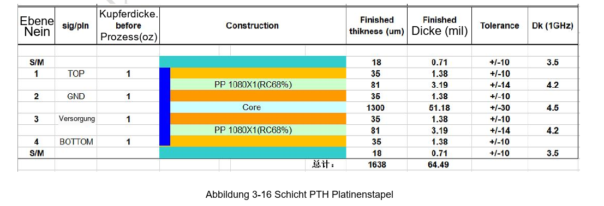
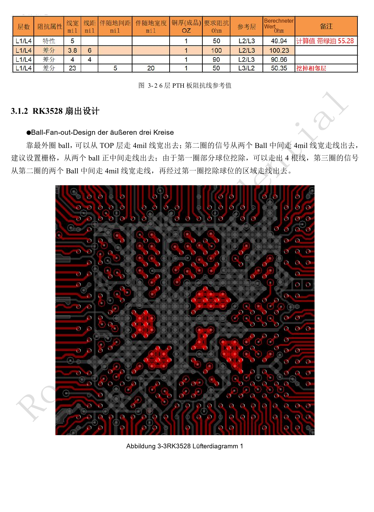
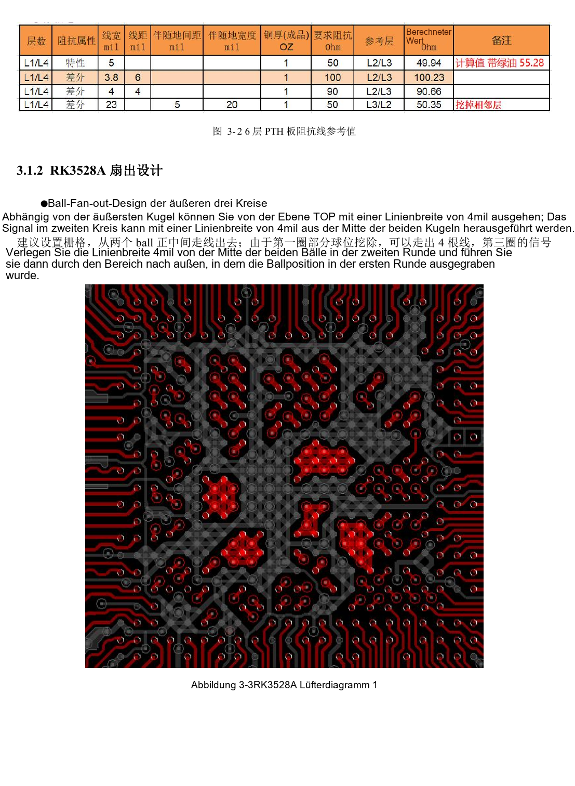

# RK3528 / RK3528A PCB: Lagen, Fanout, Rückstrompfade und Schutz

Dieses Entwicklungsthema basiert auf den chinesischen Hardwarehandbüchern RK3528 V1.0 (2023-05-25) und RK3528A V1.0 (2023-07-12), nicht auf einer vollständigen wörtlichen PDF-Übersetzung. Ähnliche Kapitel belegen keine direkte Austauschbarkeit der Chips. Die offizielle [Sige1-Dokumentation](https://docs.armsom.org/armsom-sige1) nennt RK3528 für ArmSoM [Sige1](https://www.armsom.org/sige1), das zur Bewertung entsprechender Anwendungen dienen kann. Daraus folgt weder, dass Sige1 RK3528A verwendet, noch dass beide Chips austauschbar sind. SoC-Referenzschaltungen sind nicht der Sige1-Schaltplan; Pins, Gehäuse, BSP/SDK, Kernel und Boardrevision am tatsächlichen Produkt prüfen. Werte stammen aus den Quellen, nicht aus ArmSoM-Hardwaremessungen.

**§3.1–3.3.2; §5; PDF 88–126, 156–158**

## Den Lagenaufbau zuerst mit dem Fertiger abstimmen

Der Text nennt ausdrücklich vierlagiges PTH mit TOP–GND–POWER–BOTTOM, 1.6mm Dicke und 1oz Kupfer. Die Bildtitel 3-1 und 3-2 nennen jedoch sechs Lagen. Diesen Quellenwiderspruch erhalten; die Titel beweisen keinen sechslagigen Aufbau. Bei Material- oder Lagenänderungen muss der Fertiger Single-ended- und Differenzimpedanz neu berechnen. Masse neben dem SoC, Signallagen möglichst neben Masse, Versorgung neben Masse sowie symmetrischen Aufbau und Kupferverteilung vorsehen.

## Fanout muss den Rückstrompfad erhalten

Das Beispiel der drei äußeren BGA-Reihen nutzt 4mil-Leitungen und freie Positionen im äußeren Ballmuster. Dies ist eine gehäuse-, pad- und prozessabhängige Vorlage, keine universelle Leiterbreite. Flächentrennungen, Lagenwechsel und Vias verändern den Hochfrequenz-Rückstrom. Bei Versorgung zuerst DC-Abfall, Stromtragfähigkeit und Abblockschleifen prüfen; bei Differenzpaaren zunächst durchgehende Masse, danach Längen und Abstände. Stecker, Filter und ESD-Pads gehören zum Impedanzkanal.

## ESD und EMI lassen sich nicht durch ein letztes Bauteil erledigen

Schutz nahe dem Stecker platzieren, sodass der Entladestrom zuerst den TVS erreicht. Masseschleifen kurz halten und ausreichend Vias vorsehen. Reset, Takt und Interrupt mindestens 5mm vom Rand führen. Taktserienwiderstände am Sender platzieren; SoC-Abstand laut Quelle <400mil. Versorgungskupfer um 20H zurückziehen, H ist der Abstand zur Masse. Das allgemeine ESD-Kapitel nennt 2.2–10Ω zwischen Platinen, Schnittstellenkapitel 22–100Ω: keinen globalen Wert übernehmen. Auswahl durch Signalform-, Surge- und Fehlertests bestätigen. Schirme und Kühlkörper benötigen ebenfalls System-EMI-Prüfungen.

## Referenzparameter

| Punkt | Quellenwert |
| --- | --- |
| Referenzaufbau im Text | 4-layer PTH; 1.6mm; 1oz |
| Äußerer Fanout-Beispielwert | 4mil |
| Randabstand empfindlicher Signale | ≥5mm |
| Takt-Sender-Widerstandsabstand | <400mil |

## Quellenabbildungen und Seiten

Es liegen keine entsprechenden englischen Originale vor. Alle vier Sprachen nutzen chinesische PDF-Abbildungen mit Chip- und physischer Seitenangabe; RK3528-Bilder werden nicht als RK3528A-Bilder ausgegeben.

RK3528 · CN · PDF 88

RK3528 · CN · PDF 89

RK3528A · CN · PDF 88

RK3528A · CN · PDF 89

## Entwicklung und Dokumentation

ArmSoM-Produkte anhand ihrer eigenen Dokumentation wählen; die Serie behauptet kein ArmSoM-Board mit RK3528/RK3528A. Schnittstellen- und Softwareerfahrung anderer Boards hilft methodisch, macht Spannungen, Pins oder PCB-Regeln aber nicht austauschbar.

- [ArmSoM](https://www.armsom.org/) · [ArmSoM Docs](https://docs.armsom.org/)
- [RK3528 / RK3528A: neun Hardware-Entwicklungsthemen](/de/articles/rk3528-rk3528a-hardware-design-series/)
- [RK3528 / RK3528A: RGMII, PHY, UART, I2C und PWM](/de/articles/rk3528-rk3528a-ethernet-control-interfaces/)
- [RK3528 / RK3528A: Kühlung, Reflow und Feuchtemanagement](/de/articles/rk3528-rk3528a-thermal-assembly-storage/)
