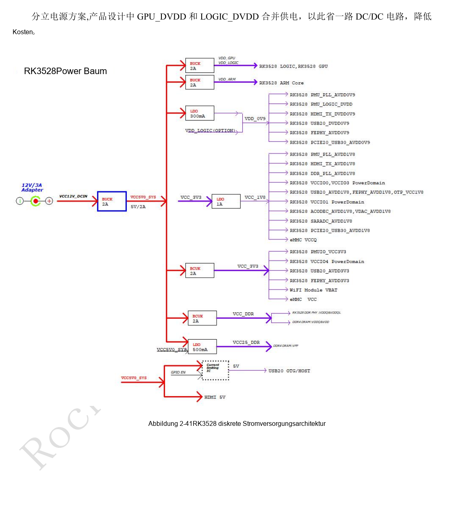
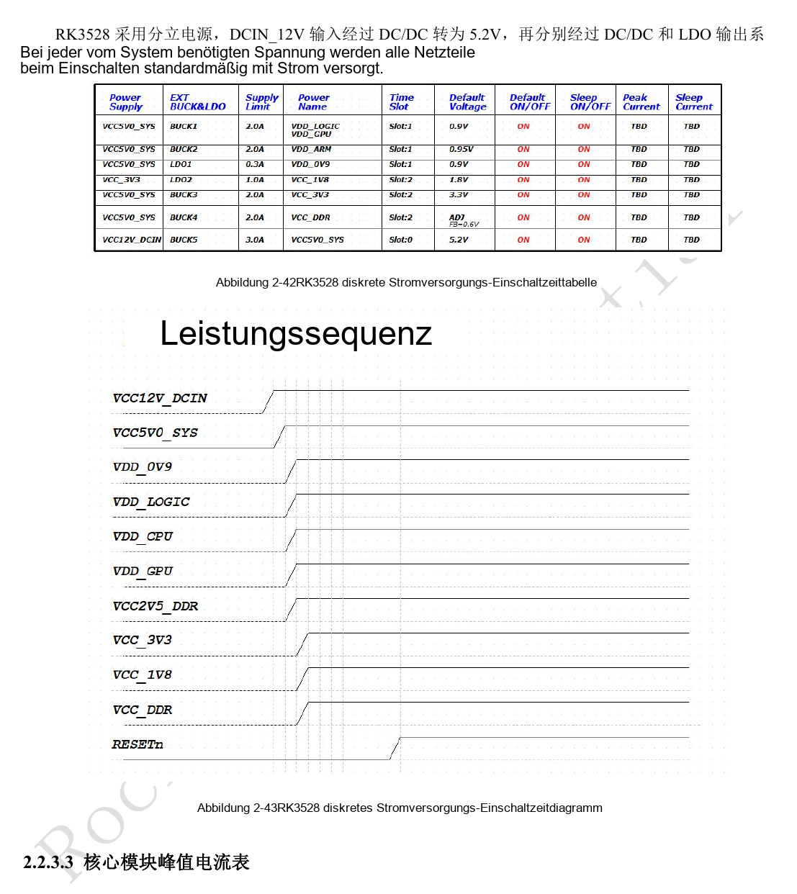
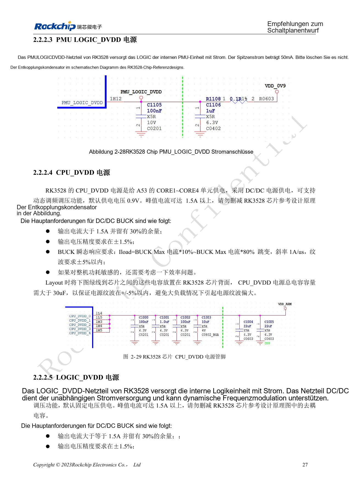
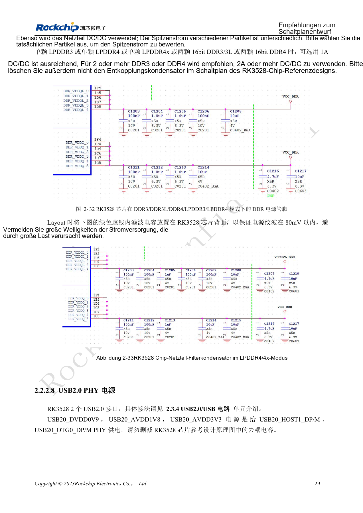
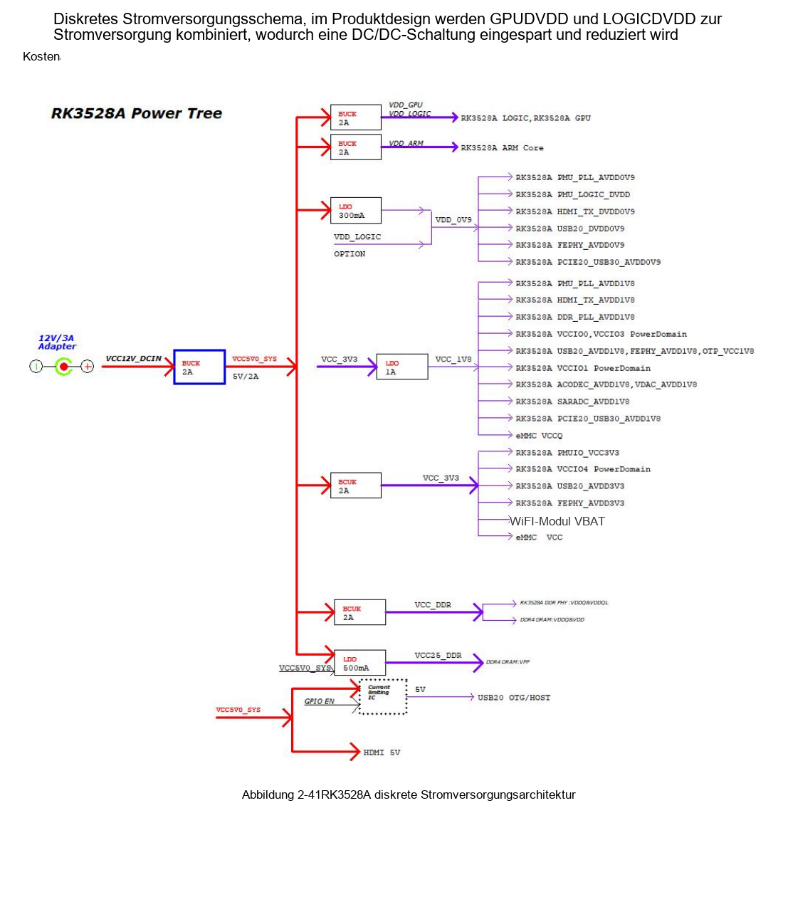
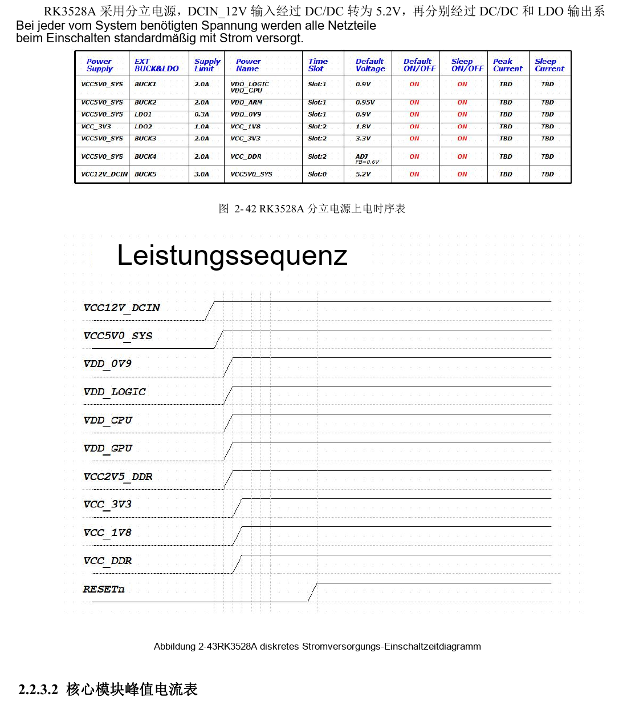
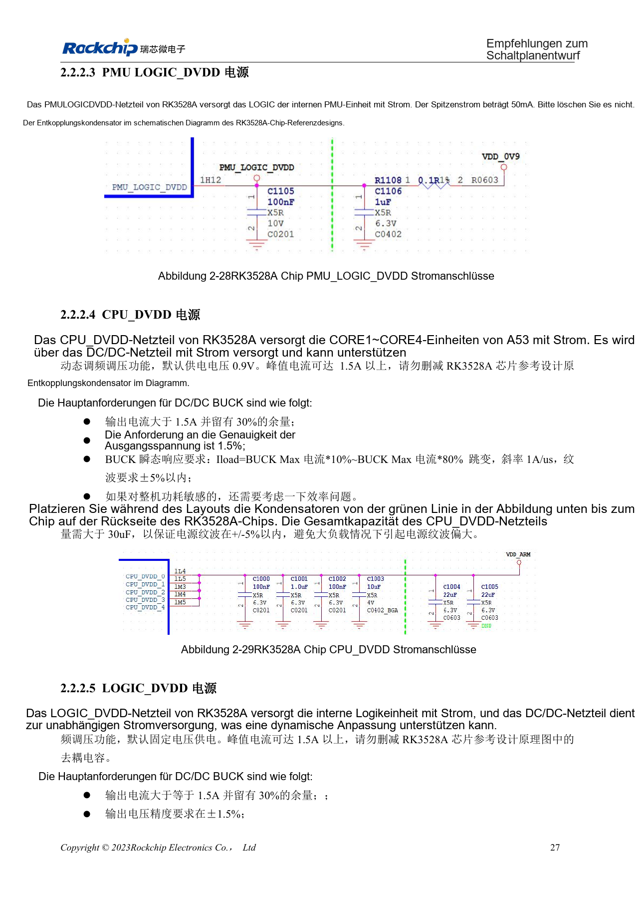
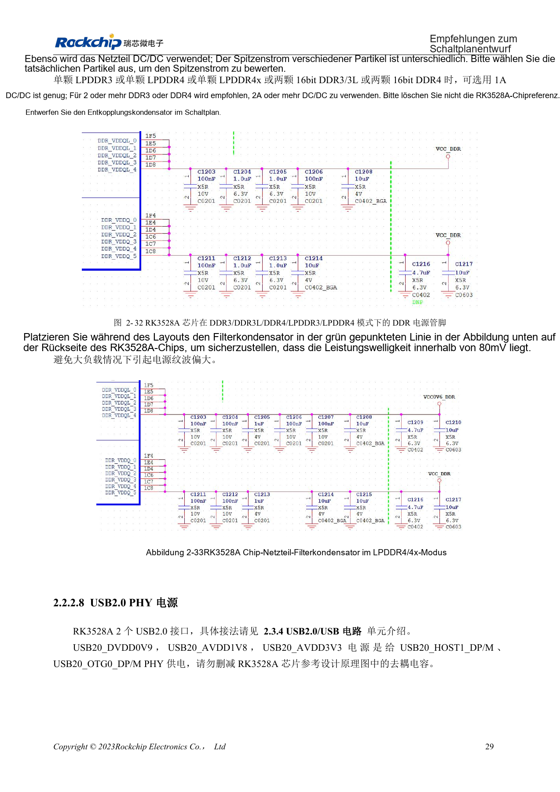

# RK3528 / RK3528A: diskrete Versorgung, Sequenzierung und Lastprüfung

Dieses Entwicklungsthema basiert auf den chinesischen Hardwarehandbüchern RK3528 V1.0 (2023-05-25) und RK3528A V1.0 (2023-07-12), nicht auf einer vollständigen wörtlichen PDF-Übersetzung. Ähnliche Kapitel belegen keine direkte Austauschbarkeit der Chips. Die offizielle [Sige1-Dokumentation](https://docs.armsom.org/armsom-sige1) nennt RK3528 für ArmSoM [Sige1](https://www.armsom.org/sige1), das zur Bewertung entsprechender Anwendungen dienen kann. Daraus folgt weder, dass Sige1 RK3528A verwendet, noch dass beide Chips austauschbar sind. SoC-Referenzschaltungen sind nicht der Sige1-Schaltplan; Pins, Gehäuse, BSP/SDK, Kernel und Boardrevision am tatsächlichen Produkt prüfen. Werte stammen aus den Quellen, nicht aus ArmSoM-Hardwaremessungen.

**§2.2; PDF 37–49; §3.3.2**

## Zuerst die Versorgungsdomänen erfassen

Die Handbücher unterscheiden PLL, Logik, CPU, GPU, DDR, IO und analoge PHYs. VCCIO0–4 erlauben 1.8V oder 3.3V mit Hardwareerkennung; PMUIO hat einen festen Pegel. Unterschiedliche Peripheriepegel innerhalb einer Domäne werden dadurch nicht zulässig. Versorgung, Pull-ups, Reset und Ausschaltzustand jedes Geräts erfassen, um Rückspeisung über Signale zu erkennen.

## Versorgung vor der Resetfreigabe stabilisieren

Innerhalb eines Moduls die niedrigere vor der höheren Spannung und gleiche Spannungen gemeinsam einschalten. RESETn mindestens 10ms nach Stabilisierung der letzten Schiene halten. Beim Abschalten zuerst RESETn aktivieren, dann die Versorgungen entfernen. Das Beispiel gruppiert 0.9V, 1.8V, 3.3V, DDR und Reset; reale Reglerabhängigkeiten anhand der Abbildungen 2-41 bis 2-43 prüfen. Eine beim ersten Einschalten optionale Domäne erlaubt keine beliebigen Spannungen an ihren Pins.

## Der Nennstrom eines Reglers genügt nicht

Die Referenz verbindet GPU_DVDD mit LOGIC_DVDD, um einen Wandler einzusparen; Änderungen erfordern eine Prüfung dynamischer Last, Spannungsabfälle und Software-DVFS. CPU-Referenzwert ist anfangs 0.9V, der Spitzenstrom kann 1.5A überschreiten. Für CPU und LOGIC sind jeweils mehr als 30µF Gesamtabblockung nahe dem Chip bei erhaltenen Strompfaden vorgesehen. Der ungenutzte PCIe2.0/USB3 Combo PHY benötigt wegen interner PLL-Abhängigkeiten weiterhin Versorgung. Lastsprünge und Sequenzen am Chip messen, nicht nur am Reglerausgang.

## Referenzparameter

| Punkt | Quellenwert |
| --- | --- |
| Reset-Haltezeit | ≥10ms |
| CPU-Referenzstartwert | 0.9V |
| CPU-/LOGIC-Abblockung | >30µF each |
| DDR-Ripple-Referenz | <80mV |

## Versorgung beim ersten Einschalten

Quelltabelle 2-9, PDF-Seite 39. Optionalität gilt nur für die genannte erste Einschaltphase, nicht für den Betrieb des Moduls. Standby und Abschalten separat prüfen.

| Modul | Versorgungspins | Erstes Einschalten |
| --- | --- | --- |
| PLL | PMU_PLL_AVDD0V9, PMU_PLL_AVDD1V8 | Erforderlich |
| PMU_DVDD | PMU_LOGIC_DVDD | Erforderlich |
| DDR PLL | DDR_PLL_AVDD1V8 | Erforderlich |
| DDR VDDQ | DDR VDDQ | Erforderlich |
| DDR VDDQL | DDR VDDQL | Erforderlich |
| CPU | CPU_DVDD | Beim ersten Einschalten optional |
| GPU | GPU_DVDD | Beim ersten Einschalten optional |
| LOGIC | LOGIC_DVDD | Erforderlich |
| IO | VCCIO0_VCC, VCCIO2_VCC, VCCIO3_VCC, VCCIO4_VCC | Beim ersten Einschalten optional |
| PMUIO | PMUIO_VCC3V3 | Erforderlich |
| EMMCIO | VCCIO1_VCC | Erforderlich |
| USB2.0 PHY | USB20_DVDD0V9, USB20_AVDD1V8, USB20_AVDD3V3 | Erforderlich |
| PCIe2.0 / USB3 Combo PHY | PCIE20_USB30_AVDD0V9, PCIE20_USB30_AVDD1V8 | Erforderlich |
| SARADC | SARADC_AVDD1V8 | Erforderlich |
| OTP | OTP_VCC1V8 | Erforderlich |
| HDMI TX PHY | HDMI_TX_DVDD0V9, HDMI_TX0_AVDD1V8 | Beim ersten Einschalten optional |
| ACODEC PHY | ACODEC_AVDD1V8 | Beim ersten Einschalten optional |
| VDAC PHY | VDAC_AVDD1V8 | Beim ersten Einschalten optional |
| FEPHY | FEPHY_AVDD0V9, FEPHY_AVDD1V8, FEPHY_AVDD3V3 | Beim ersten Einschalten optional |

### PLL

| Schiene | Referenz-Spitzenstrom | AC-Referenzanforderung |
| --- | --- | --- |
| PMU_PLL_AVDD0V9 | 10mA | <20mV |
| PMU_PLL_AVDD1V8 | 10mA | <50mV |
| DDR_PLL_AVDD1V8 | 5mA | <50mV |

## Quellenabbildungen und Seiten

Es liegen keine entsprechenden englischen Originale vor. Alle vier Sprachen nutzen chinesische PDF-Abbildungen mit Chip- und physischer Seitenangabe; RK3528-Bilder werden nicht als RK3528A-Bilder ausgegeben.

RK3528 · CN · PDF 48

RK3528 · CN · PDF 49

RK3528 · CN · PDF 41

RK3528 · CN · PDF 43

RK3528A · CN · PDF 48

RK3528A · CN · PDF 49

RK3528A · CN · PDF 41

RK3528A · CN · PDF 43

## Entwicklung und Dokumentation

ArmSoM-Produkte anhand ihrer eigenen Dokumentation wählen; die Serie behauptet kein ArmSoM-Board mit RK3528/RK3528A. Schnittstellen- und Softwareerfahrung anderer Boards hilft methodisch, macht Spannungen, Pins oder PCB-Regeln aber nicht austauschbar.

- [ArmSoM](https://www.armsom.org/) · [ArmSoM Docs](https://docs.armsom.org/)
- [RK3528 / RK3528A: neun Hardware-Entwicklungsthemen](/de/articles/rk3528-rk3528a-hardware-design-series/)
- [RK3528 / RK3528A: Takt, Reset, Maskrom und Debug-UART](/de/articles/rk3528-rk3528a-boot-clock-debug/)
- [RK3528 / RK3528A DDR: Topologie, Versorgung, Pin-Swaps und PCB](/de/articles/rk3528-rk3528a-ddr-circuit-routing/)
