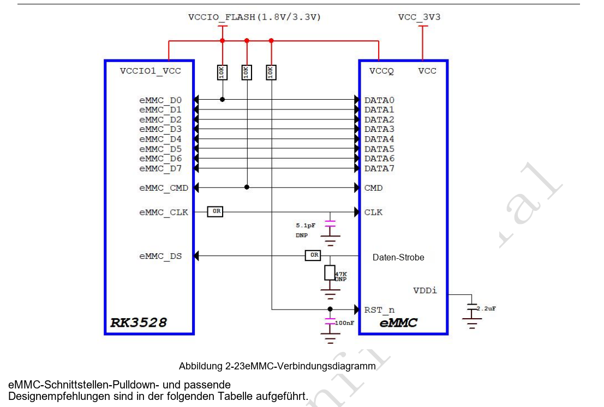
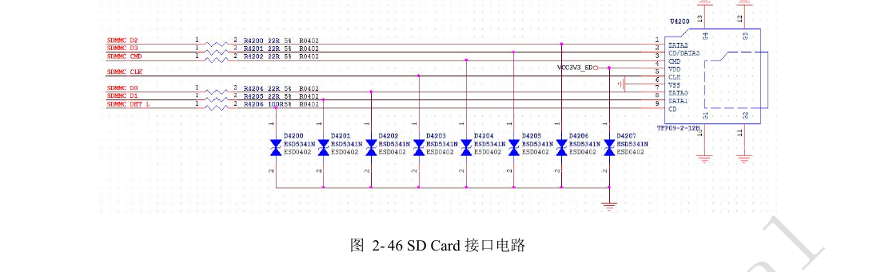
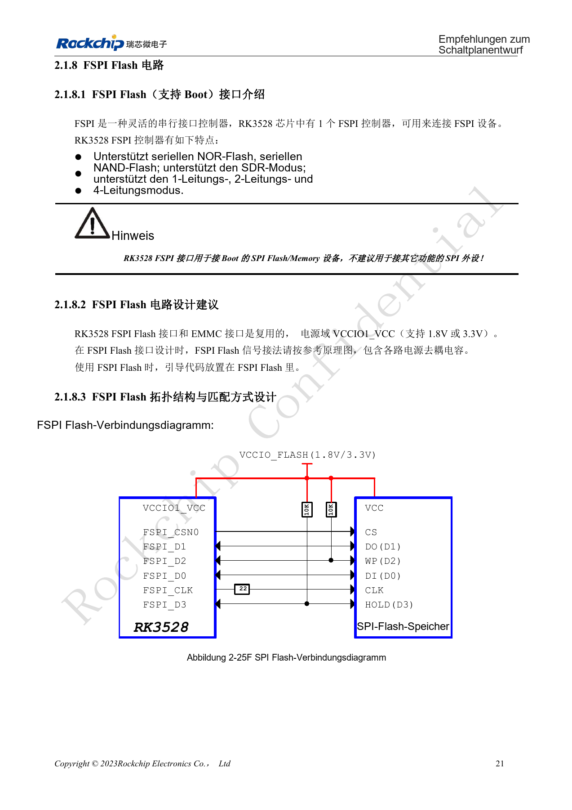
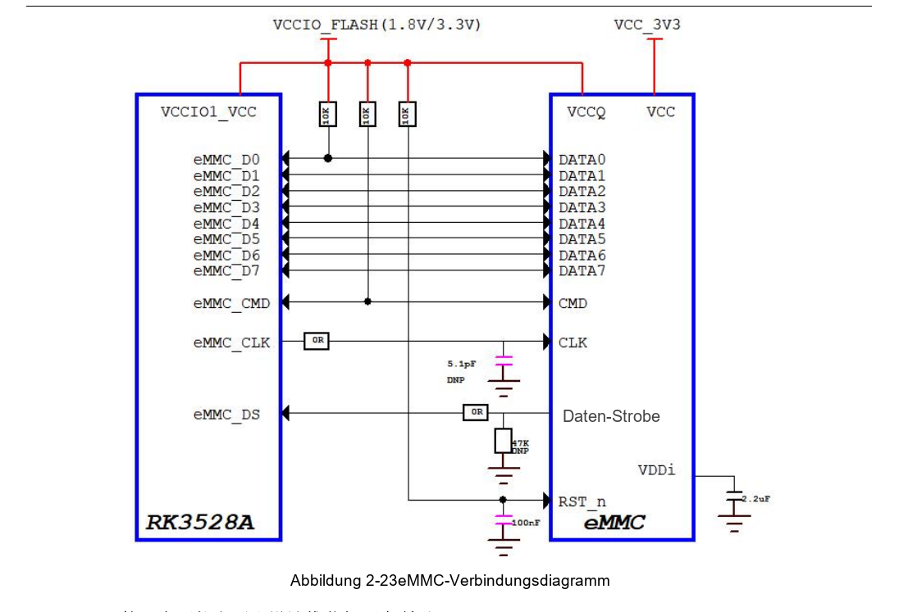
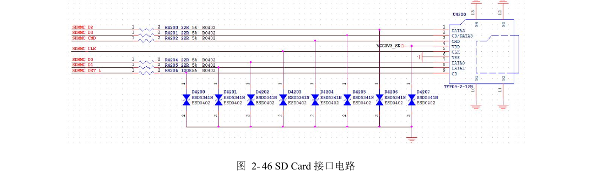
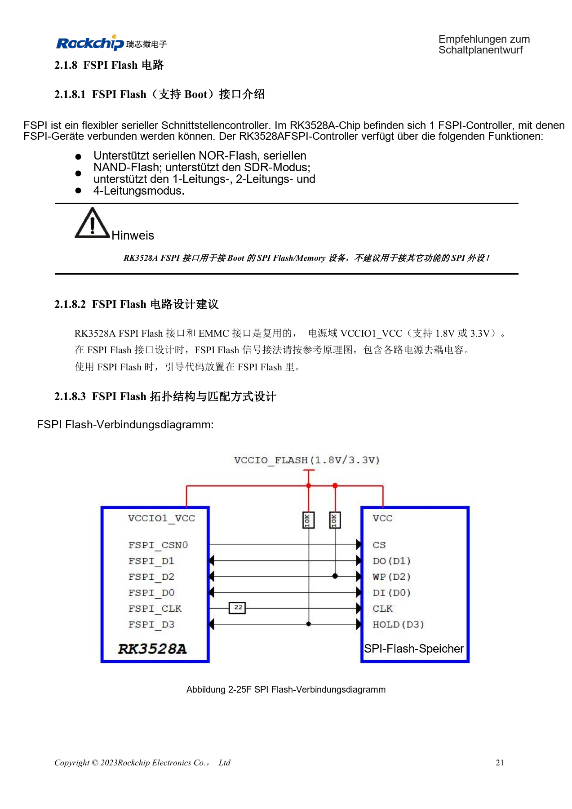

# RK3528 / RK3528A: eMMC, FSPI, SDMMC und SDIO

Dieses Entwicklungsthema basiert auf den chinesischen Hardwarehandbüchern RK3528 V1.0 (2023-05-25) und RK3528A V1.0 (2023-07-12), nicht auf einer vollständigen wörtlichen PDF-Übersetzung. Ähnliche Kapitel belegen keine direkte Austauschbarkeit der Chips. Die offizielle [Sige1-Dokumentation](https://docs.armsom.org/armsom-sige1) nennt RK3528 für ArmSoM [Sige1](https://www.armsom.org/sige1), das zur Bewertung entsprechender Anwendungen dienen kann. Daraus folgt weder, dass Sige1 RK3528A verwendet, noch dass beide Chips austauschbar sind. SoC-Referenzschaltungen sind nicht der Sige1-Schaltplan; Pins, Gehäuse, BSP/SDK, Kernel und Boardrevision am tatsächlichen Produkt prüfen. Werte stammen aus den Quellen, nicht aus ArmSoM-Hardwaremessungen.

**§2.1.7–2.1.8; §2.3.1; PDF 32–36, 50–54, 145–147**

## eMMC und FSPI teilen Ressourcen

eMMC und FSPI teilen Pins in VCCIO1_VCC (1.8V/3.3V); sie sind keine uneingeschränkt parallel verfügbaren Anschlüsse. eMMC unterstützt 5.1, 1/4/8bit und HS400. Externe 10kΩ-Pull-ups an CMD und D0, 22Ω im CLK am SoC sowie 0Ω im Strobe am eMMC mit vorgesehenem 47kΩ-Pull-down erhalten. Eine einzelne SoC-IO-Versorgung hebt die VCC/VCCQ-Sequenzierung des Speichers nicht auf. Bauteiltausch erfordert auch Prüfung der Supportliste und Bootfirmware.

## FSPI für Bootspeicher verwenden

FSPI unterstützt serielles NOR/NAND, SDR und 1/2/4 Leitungen; gewöhnliche SPI-Peripherie wird dafür nicht empfohlen. Die Flashversorgung muss zur IO-Domäne passen. 10kΩ-Pull-ups an D2/D3 und 22Ω im CLK am SoC vorsehen. eMMC-Referenzen: 50Ω±10%, CLK/STRB-zu-Daten-Differenz <120mil, Länge <3in, möglichst höchstens zwei Vias. FSPI: 50Ω±10%, CLK-zu-Daten-Differenz <200mil und Länge <4in. Den gesamten Kanal einschließlich Steckern und Tochterkarten berücksichtigen.

## SDMMC-Boot und SDIO-Funk trennen

SDIO0/1 gehören zu VCCIO0/VCCIO3 und unterstützen keinen System Boot; SDMMC hängt zusätzlich vom eingelesenen SDMMC_DET ab. SDMMC-Daten, -Kommando und -Takt erhalten 22Ω, DET 100Ω. 22Ω im SDIO-CLK erhalten; Daten-/Kommandowiderstände anhand der Signalintegrität kurzer Leitungen wählen. SDMMC/SDIO: 50Ω±10%, Takt-Daten-Differenz <120mil; Länge <4in bei 50MHz<CLK≤200MHz und <6in bei CLK≤50MHz. UART-/PCM-Richtung, 32.768kHz-Amplitude, Antennenanpassung und Keepouts ebenfalls prüfen.

## Widerspruch beim eMMC-Taktwiderstand

Abbildung 2-23 auf PDF-Seite 33 nennt 0Ω im CLK, Tabelle 2-5 derselben Seite empfiehlt 22Ω. Der Text erhält die Tabellenempfehlung, das Bild bleibt unverändert. Die Bestückung anhand Speicherbaustein, BSP und Messkurven festlegen, statt das Quellbild stillschweigend anzupassen.

## Referenzparameter

| Punkt | Quellenwert |
| --- | --- |
| eMMC-Länge | <3in |
| FSPI-Länge | <4in |
| CMD-/D0-Pull-up | 10kΩ |
| SDIO-Boot | Nicht unterstützt |

## Quellenabbildungen und Seiten

Es liegen keine entsprechenden englischen Originale vor. Alle vier Sprachen nutzen chinesische PDF-Abbildungen mit Chip- und physischer Seitenangabe; RK3528-Bilder werden nicht als RK3528A-Bilder ausgegeben.

RK3528 · CN · PDF 33

RK3528 · CN · PDF 52

RK3528 · CN · PDF 35

RK3528A · CN · PDF 33

RK3528A · CN · PDF 52

RK3528A · CN · PDF 35

## Entwicklung und Dokumentation

ArmSoM-Produkte anhand ihrer eigenen Dokumentation wählen; die Serie behauptet kein ArmSoM-Board mit RK3528/RK3528A. Schnittstellen- und Softwareerfahrung anderer Boards hilft methodisch, macht Spannungen, Pins oder PCB-Regeln aber nicht austauschbar.

- [ArmSoM](https://www.armsom.org/) · [ArmSoM Docs](https://docs.armsom.org/)
- [RK3528 / RK3528A: neun Hardware-Entwicklungsthemen](/de/articles/rk3528-rk3528a-hardware-design-series/)
- [RK3528 / RK3528A DDR: Topologie, Versorgung, Pin-Swaps und PCB](/de/articles/rk3528-rk3528a-ddr-circuit-routing/)
- [RK3528 / RK3528A: gemeinsamer USB-/PCIe-PHY und Kanalprüfung](/de/articles/rk3528-rk3528a-usb-pcie-design/)
