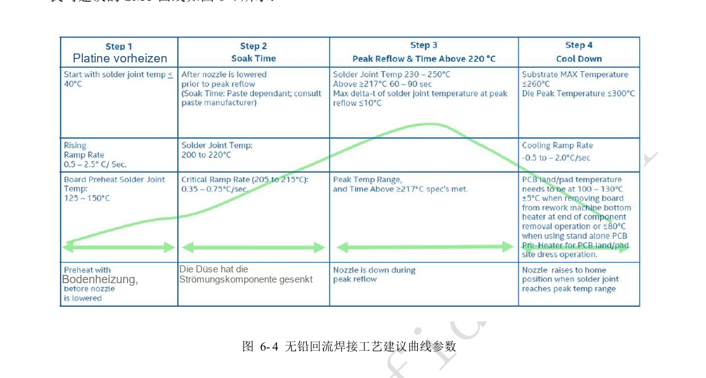
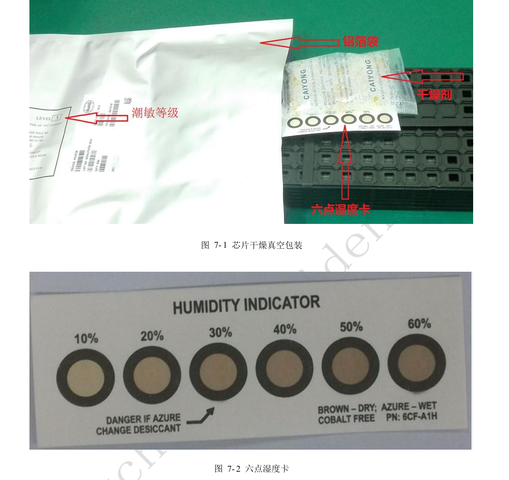
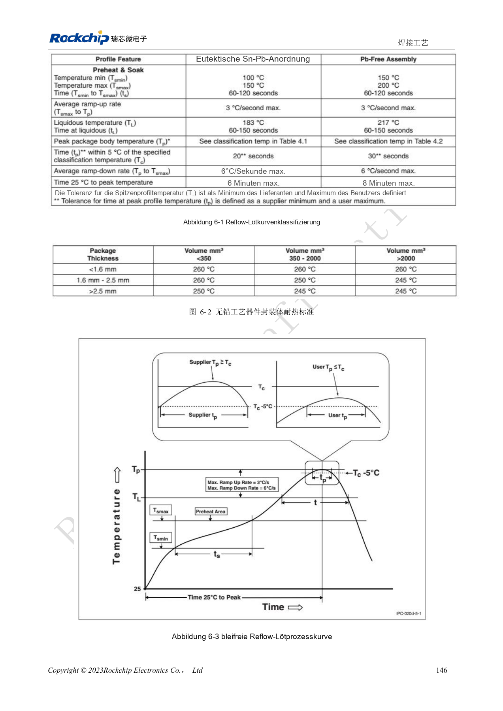
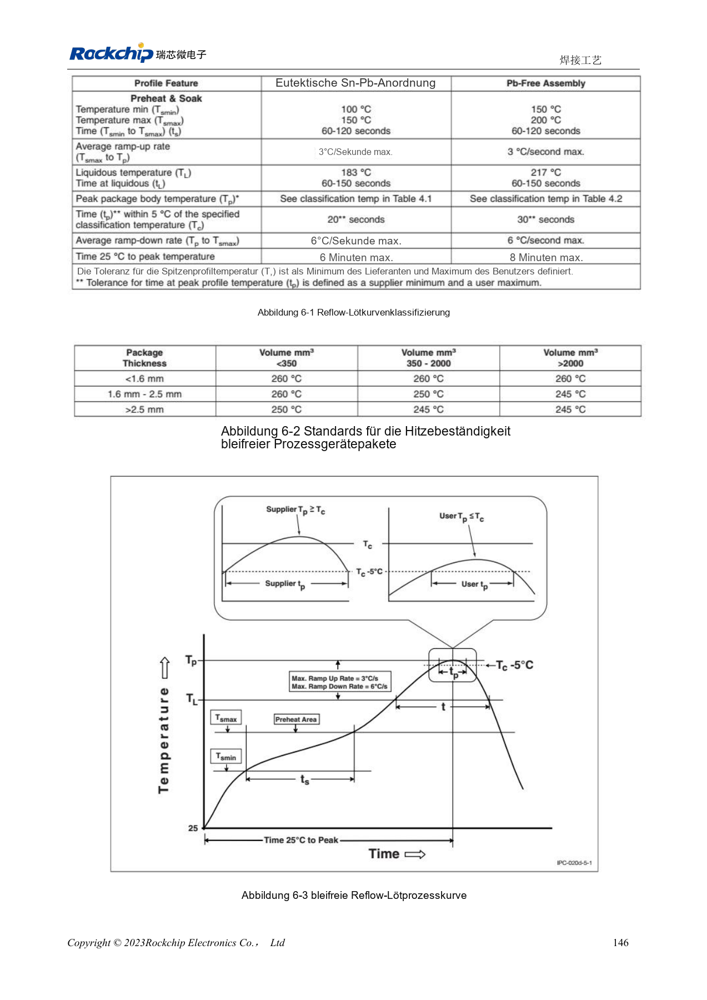

# RK3528 / RK3528A: Kühlung, Reflow und Feuchtemanagement

Dieses Entwicklungsthema basiert auf den chinesischen Hardwarehandbüchern RK3528 V1.0 (2023-05-25) und RK3528A V1.0 (2023-07-12), nicht auf einer vollständigen wörtlichen PDF-Übersetzung. Ähnliche Kapitel belegen keine direkte Austauschbarkeit der Chips. Die offizielle [Sige1-Dokumentation](https://docs.armsom.org/armsom-sige1) nennt RK3528 für ArmSoM [Sige1](https://www.armsom.org/sige1), das zur Bewertung entsprechender Anwendungen dienen kann. Daraus folgt weder, dass Sige1 RK3528A verwendet, noch dass beide Chips austauschbar sind. SoC-Referenzschaltungen sind nicht der Sige1-Schaltplan; Pins, Gehäuse, BSP/SDK, Kernel und Boardrevision am tatsächlichen Produkt prüfen. Werte stammen aus den Quellen, nicht aus ArmSoM-Hardwaremessungen.

**§4, §6–7; PDF 152–164**

## Thermische Simulation ist keine ArmSoM-Messung

Die Quelle verwendet FEM auf einer 140×180mm großen, 1.6mm dicken, vierlagigen JEDEC-Platine ohne Kühlkörper. Reale Gehäuse, Kupferflächen, Luftströmung und Last unterscheiden sich; simulierte Widerstände belegen weder reale Sperrschichttemperatur noch Dauerleistung. Linux-Strategien sind Power allocator, Step wise, Fair share und Userspace, standardmäßig Power_allocator. Schwellen, Drosselung und Erholung im tatsächlichen BSP prüfen; Dauerfrequenz, Umgebungstemperatur und Hotspots aufzeichnen.

## Layout und Montage beeinflussen die Zuverlässigkeit

Empfohlen sind etwa 20–50mm zwischen SoC und DC/DC gegen lokale Wärmekonzentration. Hochstromkupfer passend auslegen; möglichst je Masseball ein Via, als Mindestreferenz eines je 1.5 Balls. Reflowprofile sind anhand thermischer Masse, Ofen und Paste anzupassen. Die Quelle nennt Pastenlagerung bei 2–10°C, Aufwärmen 3–4h, manuelles Mischen 3–5min oder maschinell 3min. Das sind keine allgemeinen Freigabekriterien für jede Paste; Fertigungsunterlagen müssen Material und qualifizierten Prozess identifizieren.

## MSL3 nach kumulierter Offenzeit verwalten

Beide Handbücher klassifizieren den Chip als MSL3. Vom Öffnen bis Reflow sind kumuliert 168h bei ≤30°C/60%RH zulässig; außerdem wird Trockenlagerung unter 10%RH genannt. Vakuumverpackte Referenzlagerung: ≤40°C und <90%RH für 12 Monate. Bei Überschreitung oder auffälliger Feuchtekarte Re-bake-Tabelle und Verpackungslabel beachten. Die MSL1-Zeile enthält auffällige „≤300°C“; dieser Wert bleibt im Prüfprotokoll und wird nicht als Lageranweisung verwendet. Die Tabelle enthält Mindestzeiten für ≤1.4mm Gehäusedicke, MSL3, nicht für beliebige Baugruppen oder Akkus.

## Referenzparameter

| Punkt | Quellenwert |
| --- | --- |
| Backen 125°C +10/−0°C: Überschreitung >72h / ≤72h | 9h / 7h |
| Backen 90°C +8/−0°C: Überschreitung >72h / ≤72h | 33h / 23h |
| Backen 40°C +5/−0°C: Überschreitung >72h / ≤72h | 13 Tage / 9 Tage |

## Quellenabbildungen und Seiten

Es liegen keine entsprechenden englischen Originale vor. Alle vier Sprachen nutzen chinesische PDF-Abbildungen mit Chip- und physischer Seitenangabe; RK3528-Bilder werden nicht als RK3528A-Bilder ausgegeben.

RK3528 · CN · PDF 161

RK3528 · CN · PDF 163

RK3528 · CN · PDF 160

RK3528A · CN · PDF 161

RK3528A · CN · PDF 163

RK3528A · CN · PDF 160

## Entwicklung und Dokumentation

ArmSoM-Produkte anhand ihrer eigenen Dokumentation wählen; die Serie behauptet kein ArmSoM-Board mit RK3528/RK3528A. Schnittstellen- und Softwareerfahrung anderer Boards hilft methodisch, macht Spannungen, Pins oder PCB-Regeln aber nicht austauschbar.

- [ArmSoM](https://www.armsom.org/) · [ArmSoM Docs](https://docs.armsom.org/)
- [RK3528 / RK3528A: neun Hardware-Entwicklungsthemen](/de/articles/rk3528-rk3528a-hardware-design-series/)
- [RK3528 / RK3528A PCB: Lagen, Fanout, Rückstrompfade und Schutz](/de/articles/rk3528-rk3528a-pcb-stackup-signal-integrity/)
