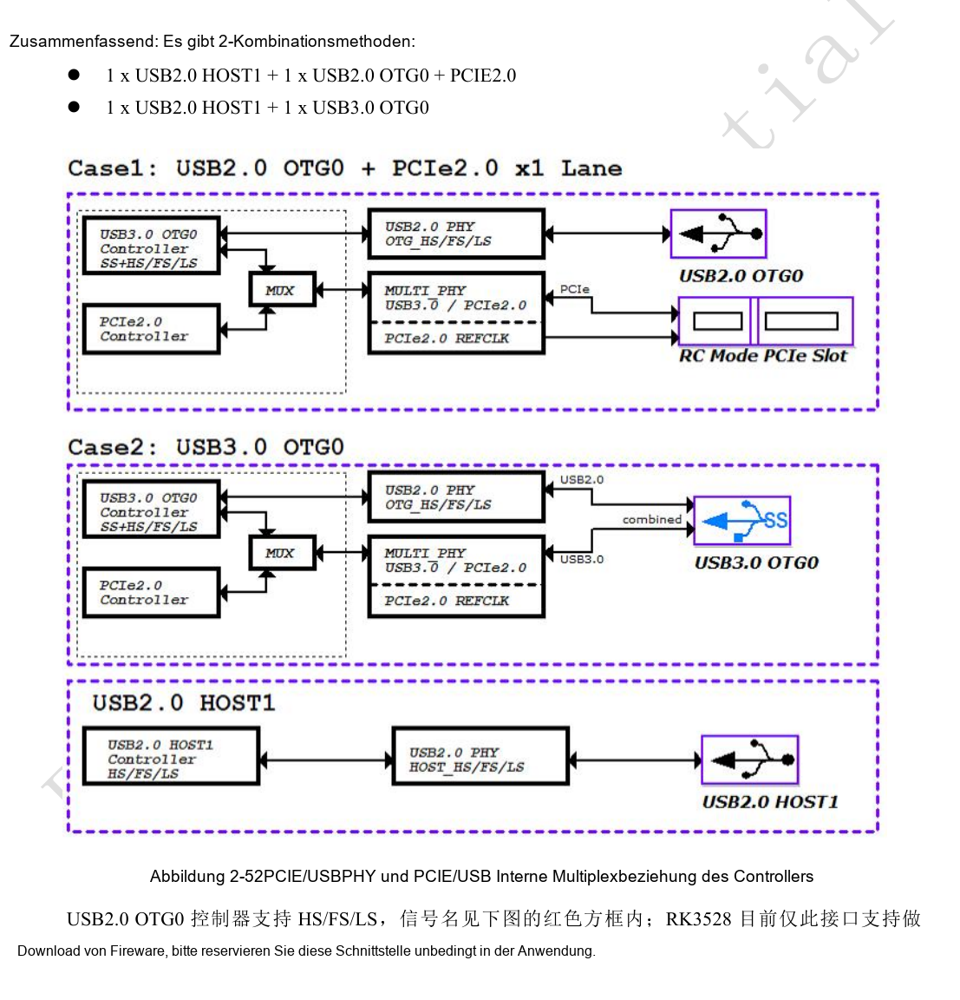
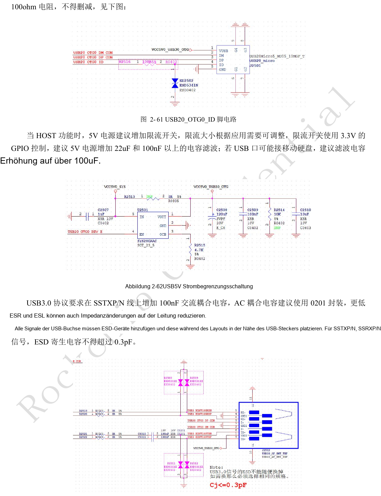
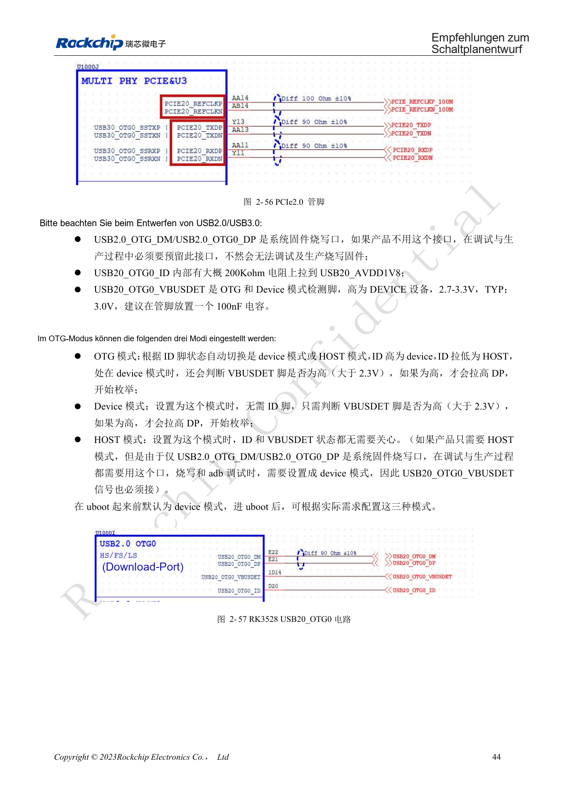
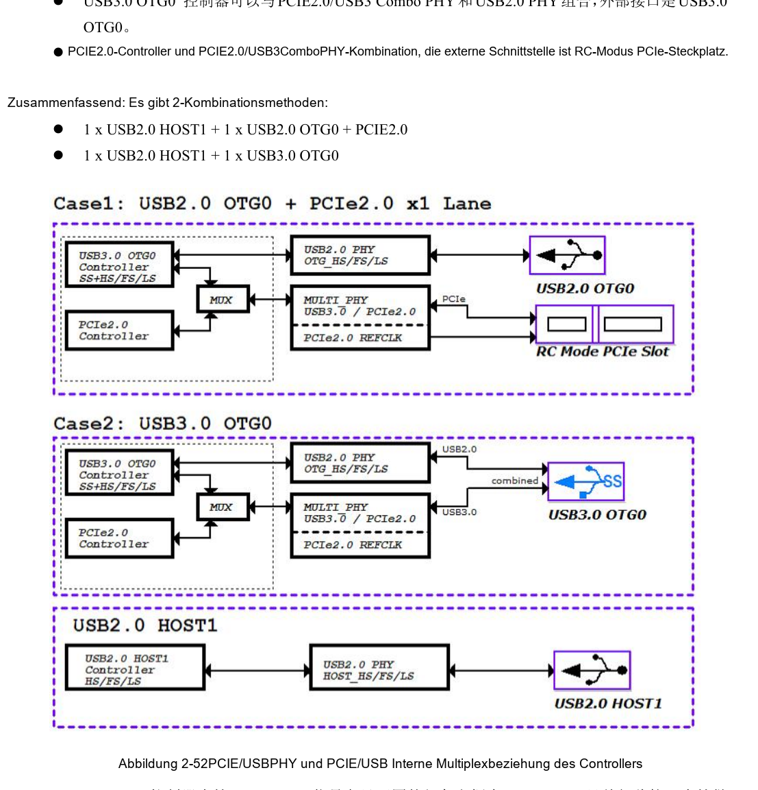
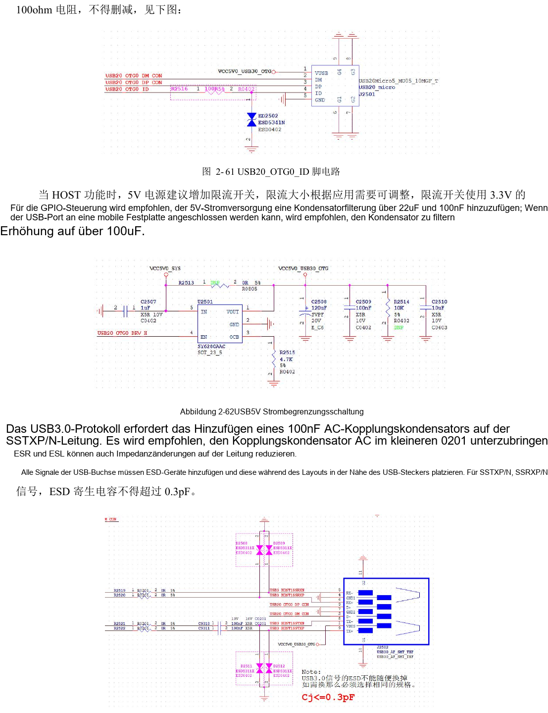
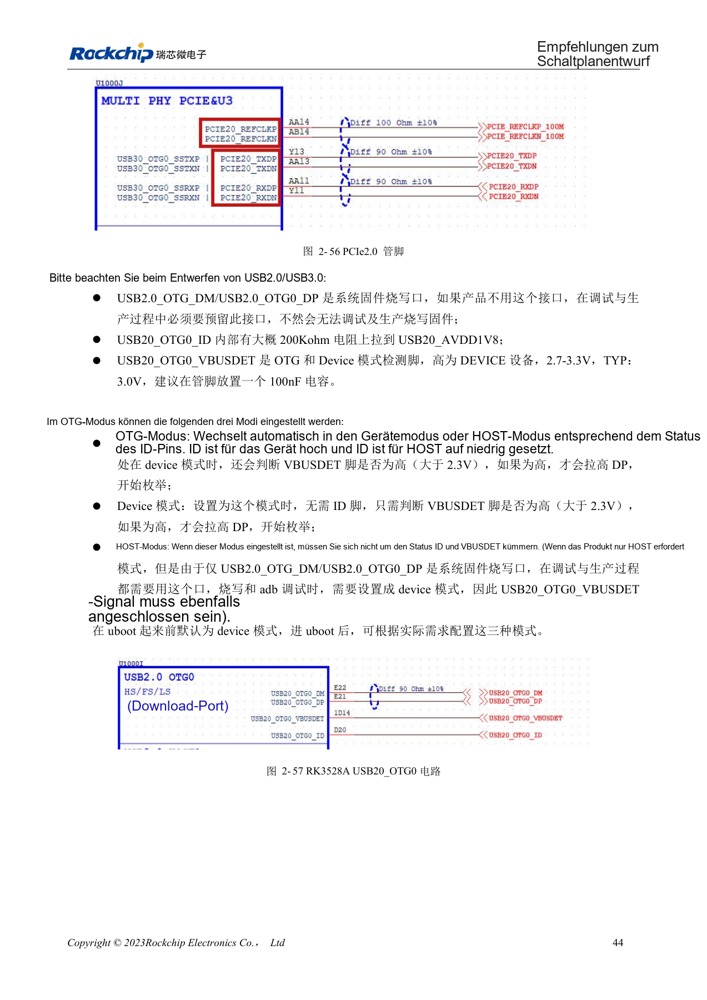

# RK3528 / RK3528A: gemeinsamer USB-/PCIe-PHY und Kanalprüfung

Dieses Entwicklungsthema basiert auf den chinesischen Hardwarehandbüchern RK3528 V1.0 (2023-05-25) und RK3528A V1.0 (2023-07-12), nicht auf einer vollständigen wörtlichen PDF-Übersetzung. Ähnliche Kapitel belegen keine direkte Austauschbarkeit der Chips. Die offizielle [Sige1-Dokumentation](https://docs.armsom.org/armsom-sige1) nennt RK3528 für ArmSoM [Sige1](https://www.armsom.org/sige1), das zur Bewertung entsprechender Anwendungen dienen kann. Daraus folgt weder, dass Sige1 RK3528A verwendet, noch dass beide Chips austauschbar sind. SoC-Referenzschaltungen sind nicht der Sige1-Schaltplan; Pins, Gehäuse, BSP/SDK, Kernel und Boardrevision am tatsächlichen Produkt prüfen. Werte stammen aus den Quellen, nicht aus ArmSoM-Hardwaremessungen.

**§2.3.4; PDF 55–61, 141–145**

## Kombination vor den Steckern festlegen

Zwei USB2-PHYs und ein PCIe2.0/USB3-Combo-PHY bedeuten nicht gleichzeitige Verfügbarkeit aller Ports. Genannt werden USB2 HOST1 + USB2 OTG0 + PCIe2.0 oder USB2 HOST1 + USB3 OTG0. PCIe arbeitet als RC. USB2 OTG0 ist der Firmware-Downloadpfad: D+/D− und VBUSDET für Fertigung und Debug erhalten, auch ohne Benutzer-USB. Firmware, Device Tree und Schaltplan sollen dieselbe Ressourcenmatrix verwenden.

## Versorgung, Terminierung und Schutz gemeinsam prüfen

USB-HOST-5V sollte einen strombegrenzten Schalter mit mindestens 22µF und 100nF Filterung verwenden. Für mobile Festplatten empfiehlt die Quelle mehr als 100µF; Einschaltstrom und Schalterfähigkeit anschließend prüfen. USB2-Daten: 2.2Ω; USB3-TX: 100nF, vorzugsweise 0201; RX: 0Ω vorsehen. Verwendetes OTG ID benötigt 100Ω und ESD-Schutz. Das Schaltungskapitel nennt ≤0.3pF ESD-Kapazität, die PCB-Tabelle ≤0.2pF. Beide Angaben erhalten, das engere Budget prüfen und das gewählte Bauteil validieren.

## PCB-Werte als konkrete Regeln hinterlegen

PCIe-Daten: differentiell 90Ω±10%, Paardifferenz <6mil, Länge <6in; REFCLK: 100Ω±10%, Paardifferenz <12mil, möglichst höchstens zwei Vias. USB3: 90Ω±10%, Paardifferenz <6mil, HOST <6in, Device/OTG <5in, möglichst zwei Vias. USB2: 90Ω±10%, Paardifferenz <20mil, Länge <6in; möglichst vier, niemals mehr als sechs Vias. Die PCIe-Zeile zum Paarabgleich nennt <6in ohne sinnvolle Timing-Erklärung und darf nicht als präzises Skew-Budget gelten. Guard-Masse alle ≤300mil anbinden und eine durchgehende Referenzmasse erhalten.

## Referenzparameter

| Punkt | Quellenwert |
| --- | --- |
| USB3-/PCIe-Datenimpedanz | 90Ω ±10% |
| PCIe-REFCLK-Impedanz | 100Ω ±10% |
| USB3-ESD: zwei Quellwerte | ≤0.3pF / ≤0.2pF |

## Quellenabbildungen und Seiten

Es liegen keine entsprechenden englischen Originale vor. Alle vier Sprachen nutzen chinesische PDF-Abbildungen mit Chip- und physischer Seitenangabe; RK3528-Bilder werden nicht als RK3528A-Bilder ausgegeben.

RK3528 · CN · PDF 56

RK3528 · CN · PDF 60

RK3528 · CN · PDF 58

RK3528A · CN · PDF 56

RK3528A · CN · PDF 60

RK3528A · CN · PDF 58

## Entwicklung und Dokumentation

ArmSoM-Produkte anhand ihrer eigenen Dokumentation wählen; die Serie behauptet kein ArmSoM-Board mit RK3528/RK3528A. Schnittstellen- und Softwareerfahrung anderer Boards hilft methodisch, macht Spannungen, Pins oder PCB-Regeln aber nicht austauschbar.

- [ArmSoM](https://www.armsom.org/) · [ArmSoM Docs](https://docs.armsom.org/)
- [RK3528 / RK3528A: neun Hardware-Entwicklungsthemen](/de/articles/rk3528-rk3528a-hardware-design-series/)
- [RK3528 / RK3528A: eMMC, FSPI, SDMMC und SDIO](/de/articles/rk3528-rk3528a-storage-sdio-design/)
- [RK3528 / RK3528A: HDMI, CVBS, TSI und analoges Audiolayout](/de/articles/rk3528-rk3528a-display-audio-design/)
