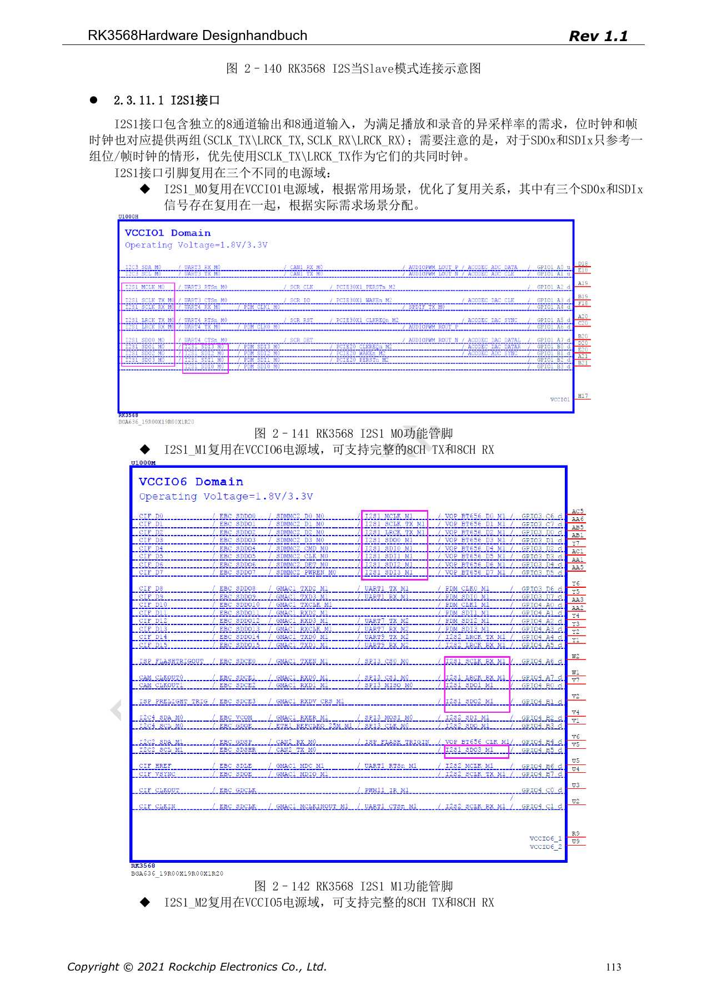
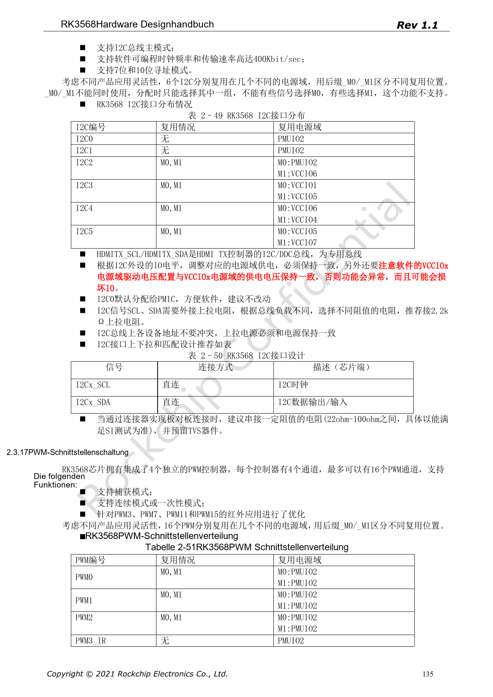

# RK3568-Audio und Steuerung: I2S, UART, SPI, CAN und I2C

Die Reihe ordnet RK3568 Hardware Design Guide V1.1 (Chinesisch, 2021-06-08) und den separaten High Speed PCB Design Guide V1.0.0 (Englisch, 2021-04-12) nach Entwicklungsfragen. ArmSoM [Sige3](https://www.armsom.org/sige3) verwendet RK3568B2. Die [Boarddokumentation](https://docs.armsom.org/armsom-sige3) bietet einen Produktbezug zum Lernen und Bewerten dieser Entwurfsfragen. SoC-Referenzschaltungen beschreiben nicht alle tatsächlichen Schaltungen und herausgeführten Schnittstellen des Sige3. SDK/BSP, Kernel, Chiprevision, Firmware und Peripheriekombination prüfen. Werte sind Quellenreferenzen, keine ArmSoM-Messungen.

**CN V1.1 §2.3.11; §2.3.13–2.3.17 · PDF 111–125,132–137**

## Internes Audio ist keine externe Pingruppe

I2S0 ist intern mit HDMI2.0 TX verbunden und nicht nach außen gemultiplext. I2S1 bietet 8 TX + 8 RX mit I2S/PCM/TDM; I2S2 und I2S3 je 2 TX + 2 RX mit I2S/PCM. Genannt sind 16–32-bit, bis 192kHz und Master/Slave, doch Protokollmodi desselben Controllers schließen sich aus. Codec-Rollen, MCLK/BCLK/LRCK, Analogversorgung und IO-Pegel gemeinsam festlegen.

## Muxgruppen vollständig auswählen

M0/M1/M2 bei UART, SPI und CAN sind alternative Positionen einer Funktion: TX_M0 nicht mit RX_M1 kombinieren. Die Quelle zählt 10 UARTs, vier allgemeine SPI, drei CAN, sechs I2C und bis zu 16 PWM-Kanäle. Dies sind Controllerressourcen, keine zugesicherten Boardanschlüsse. _u/_d/_z kennzeichnen Reset-Pull-up/-down/hochohmig; auch Reset- und Peripheriestartzustände prüfen.

## I2C, SPI und Boardverbindungen

I2C0 ist standardmäßig für den PMIC vorgesehen. SCL/SDA-Pull-ups werden mit 2.2kΩ empfohlen, abhängig von Buslast und passender IO-Schiene. Adresskonflikte vermeiden; HDMI-DDC ist dediziert. Allgemeines SPI verwendet 22Ω am Takt und unterstützt 4/8/16-bit, Master/Slave und Voll-/Halbduplex. Serienwiderstände, TVS, Masse und Kabel gemeinsam prüfen; SoC-IO ist kein industrieller Feldbuspegel.

## CAN-Geschwindigkeitsangabe klären

Seite 134 nennt CAN 2.0B zusammen mit 1Mbps und 8Mbps ohne klare Trennung von Protokoll und Phasen. Daraus folgen weder klassisches CAN bei 8Mbps noch verifiziertes CAN FD. TRM, Treiber, Transceiver und Buskonfiguration prüfen. Bei PWM-Infrarotempfang sicherstellen, dass die gewählte IO-Domäne im Standby versorgt bleibt und aufwecken kann.

## Quellenparameter und Vorgaben

| Punkt | Quellenreferenz |
| --- | --- |
| I2S0 | internal HDMI |
| I2S1 | 8 TX + 8 RX |
| I2S2 / I2S3 | 2 TX + 2 RX each |
| I2C | ≤400Kbit/sec; 7-bit / 10-bit |
| SPI | 4 / 8 / 16-bit; CLK 22Ω |

## Quellenabbildungen

Die Quellenseiten erhalten Schaltungsbeschriftung und Kontext; Text und Tabellen bleiben editierbar. Eine passende englische Ausgabe des chinesischen Haupthandbuchs liegt nicht vor, daher bleiben dessen Abbildungen in allen Sprachen chinesisch. Bilder des separaten englischen PCB-Handbuchs sind entsprechend markiert. Seitenzahlen beziehen sich auf physische PDF-Seiten.

Chinesisches Hardwarehandbuch · PDF 113

Chinesisches Hardwarehandbuch · PDF 135

## Weiterlesen und Entwicklungsunterlagen

- [RK3568-Hardwaredesign: 10 Themen zu Schaltung, PCB und Fertigung](/de/articles/rk3568-hardware-design-series/)
- [RK3568-Display und Kamera: VOP, MIPI, HDMI und Versorgung](/de/articles/rk3568-display-camera-hardware/)
- [RK3568-PCB-Design: Stackup, Fanout und Rückstrompfade](/de/articles/rk3568-pcb-stackup-return-path-design/)
- [ArmSoM Docs](https://docs.armsom.org/)
- [ArmSoM](https://www.armsom.org/)
