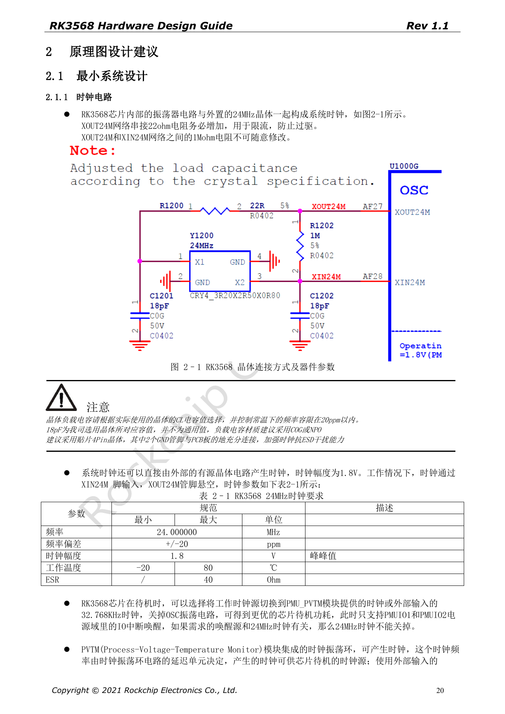
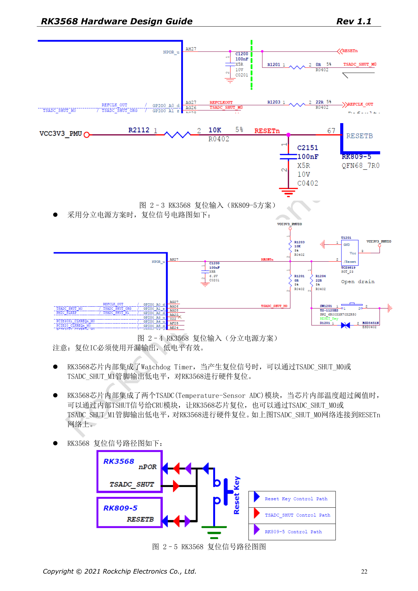

# RK3568-Minimalsystem: Takt, Reset, Boot und Debug

Die Reihe ordnet RK3568 Hardware Design Guide V1.1 (Chinesisch, 2021-06-08) und den separaten High Speed PCB Design Guide V1.0.0 (Englisch, 2021-04-12) nach Entwicklungsfragen. ArmSoM [Sige3](https://www.armsom.org/sige3) verwendet RK3568B2. Die [Boarddokumentation](https://docs.armsom.org/armsom-sige3) bietet einen Produktbezug zum Lernen und Bewerten dieser Entwurfsfragen. SoC-Referenzschaltungen beschreiben nicht alle tatsächlichen Schaltungen und herausgeführten Schnittstellen des Sige3. SDK/BSP, Kernel, Chiprevision, Firmware und Peripheriekombination prüfen. Werte sind Quellenreferenzen, keine ArmSoM-Messungen.

**CN V1.1 §2.1.1–2.1.6; §2.3.2; §3.2.1 · PDF 20–25, 72, 141–142**

## Ein wiederherstellbares System aufbauen

24MHz-Takt, Reset, Versorgung, Bootspeicher, Download-USB und Debug-UART als zusammenhängende Kette prüfen. Die Quelle nennt Serial NOR (FSPI), Serial NAND (FSPI), NAND, eMMC und SDMMC0 als Bootreihenfolge. Ohne gültigen Bootcode erfolgt der Download über USB3_OTG0_DP/DM; auch VBUSDET erhalten. Dieser Pfad bleibt für Fertigung und Wiederherstellung erforderlich, selbst ohne externen USB-Datenanschluss.

## Quarzlast nicht blind übernehmen

XOUT24M erhält 22Ω zur Strombegrenzung, zwischen XOUT24M und XIN24M liegen 1MΩ. Die gezeigten 18pF gelten für den Referenzquarz; anhand von CL und Parasiten auswählen, vorzugsweise C0G/NP0. Ein aktiver 1.8V-Takt wird an XIN24M eingespeist, XOUT24M bleibt offen. Quarz nahe am SoC auf derselben Seite platzieren, benachbarte Masse durchgehend halten und fremde Signale unter Quarz und Taktleitungen vermeiden. Referenzabstand der Massevias: 200–300mil.

## Reset und Straps vor dem Boot stabilisieren

NPOR liegt an AH27, ist low-aktiv und benötigt 100nF am Pin. Reset-Pull-up an PMUIO1 anpassen und Open-Drain-Supervisor verwenden. Die Quelle nennt „100 Perioden bei 24MHz, mindestens 4µs“; rechnerisch sind es etwa 4.17µs. Die Periodenvorgabe erfüllen, nicht abrunden. FLASH_VOL_SEL=1 gilt für VCCIO2=1.8V, 0 für 3.3V. SDMMC0_DET=0 wählt SDMMC0, 1 ARM JTAG.

## Debug- und Standby-Grenzen beachten

100Ω und TVS an UART2_RX_M0/TX_M0 erhalten. Seite 25 nennt „1500000M“ als Baudrate; dies ist ein dokumentierter Quellenfehler, keine verwendbare Porteinstellung. Loader/U-Boot-Konfiguration prüfen. Vor dem Abschalten von 24MHz die Abhängigkeit der Aufweckquellen klären. Den 10kΩ-Pull-up von SARADC_VIN0 nach 1.8V erhalten. Recovery-Tastenstart in Loader benötigt entsprechende Firmware und ist nicht gleich Maskrom.

## Quellenparameter und Vorgaben

| Punkt | Quellenreferenz |
| --- | --- |
| 24MHz | ±20ppm; 1.8V; ESR ≤40Ω |
| 32.768kHz | ±30ppm; 50%; 0.65×VDD … VDD+0.3V (PMUIO2) |
| NPOR | 100 × (1/24MHz) ≈4.17µs; 100nF |
| FLASH_VOL_SEL | 1 → 1.8V; 0 → 3.3V |

## Quellenabbildungen

Die Quellenseiten erhalten Schaltungsbeschriftung und Kontext; Text und Tabellen bleiben editierbar. Eine passende englische Ausgabe des chinesischen Haupthandbuchs liegt nicht vor, daher bleiben dessen Abbildungen in allen Sprachen chinesisch. Bilder des separaten englischen PCB-Handbuchs sind entsprechend markiert. Seitenzahlen beziehen sich auf physische PDF-Seiten.

Chinesisches Hardwarehandbuch · PDF 20

Chinesisches Hardwarehandbuch · PDF 22

## Weiterlesen und Entwicklungsunterlagen

- [RK3568-Hardwaredesign: 10 Themen zu Schaltung, PCB und Fertigung](/de/articles/rk3568-hardware-design-series/)
- [RK3568-Versorgung und IO-Domänen: RK809-5 und Standby](/de/articles/rk3568-power-io-domain-hardware/)
- [ArmSoM Docs](https://docs.armsom.org/)
- [ArmSoM](https://www.armsom.org/)
