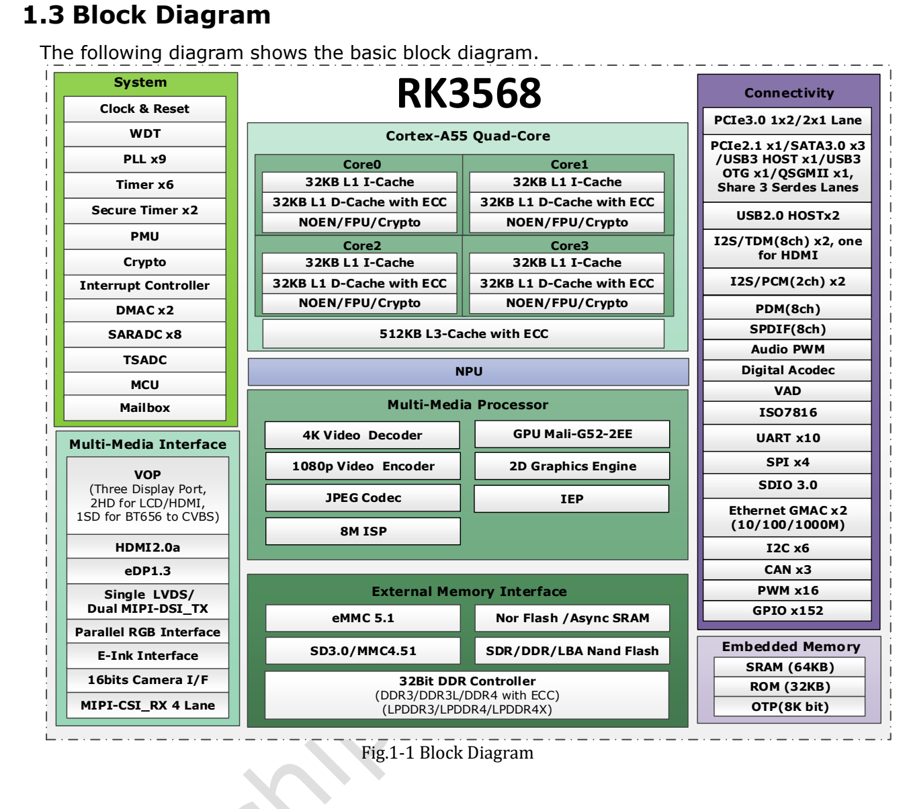

Dieser thematische Leitfaden erläutert das Quelldokument mit wichtigen Daten, Grenzen und Originalabbildungen. Er ist keine seitenweise Übersetzung und kein vollständiges Pin- oder Registerhandbuch. Herstellerbeispiele sind keine ArmSoM-Messungen. Vor der Anwendung sind Platinenrevision, Schaltplan, SDK/BSP, Kernel und Treiber zu prüfen; für diesen Artikel wurden keine neuen Hardwaretests durchgeführt.

**Hauptquelle：** `Rockchip RK3568 Datasheet V1.2-20210601.pdf` · PDF 62 Seiten.

## Erst die Aufgabe, dann die Schnittstellen planen

RK3568 kombiniert vier Cortex-A55-Kerne, spezialisierte Medienblöcke und zahlreiche Embedded-Schnittstellen. Netzwerk, Display, Speicher und Inferenz sollten gemeinsam geplant werden. ArmSoM nennt für Sige3 den RK3568B2. Das ältere Datasheet V1.2 dient hier als Architekturreferenz; B2-Revision, bestückter Speicher und herausgeführte Anschlüsse sind anhand der Sige3-Unterlagen zu prüfen.

*RK3568-Blockdiagramm des Herstellers — Englische Originalabbildung. `Rockchip RK3568 Datasheet V1.2-20210601.pdf`, PDF p. 19.*

## Entscheidende Spezifikationen

| Block | Angabe im Quelldokument | Bedeutung für das Projekt |
| --- | --- | --- |
| CPU | 4× Cortex-A55; ARMv8; Neon und TrustZone | Anwendung, Kommunikation und Medienverarbeitung getrennt budgetieren |
| NPU | Bis 1 TOPS; INT8/INT16/FP16/BFP16 | Operatoren, Quantisierung und Toolchain prüfen; TOPS ergibt keine Bildrate |
| GPU | Mali-G52 1-Core-2EE; OpenGL ES 1.1/2.0/3.2, OpenCL 2.0, Vulkan 1.1 | Nutzbare APIs hängen von Image und Treiber ab |
| Speicher | 32-bit; DDR3/DDR3L/DDR4/LPDDR3/LPDDR4/LPDDR4X; bis 8GB Adressraum | Speichertypen sind Alternativen; Adressraum ist keine Bestückungsangabe |
| Video | H.264/H.265-Decoding bis 4096×2304@60fps; Encoding 1920×1080@60fps | Codec-Grenzen beschreiben keinen gleichzeitigen Mehrkanaldurchsatz |
| Kamera | MIPI CSI als 1×4-lane oder 2×2-lane; bis 2.5Gbps je Lane | Sensor, Stecker, Takt, Versorgung und Treiber müssen passen |
| Ethernet | 2 MACs; Gigabit-RGMII oder Fast-Ethernet-RMII | PHY, Übertrager und geeignete Leiterführung bleiben erforderlich |

Die maximalen CPU/GPU-Frequenzen stehen auf PDF-S. 56 noch auf `TBD`. Eine Produktangabe einer anderen Platine darf diese Lücke nicht als angebliche Datasheet-Aussage füllen. Manche Funktionen hängen außerdem von Produktkonfiguration und Drittlizenzen ab.

## SATA, USB und PCIe sind keine addierbaren Summen

S. 16–17 beschreiben drei Multi-PHY-Ressourcen. Zeichnen Sie vor der Boardauswahl die gleichzeitig benötigten Verbindungen auf.

| Ressource | Alternative Funktionen innerhalb dieser Ressource |
| --- | --- |
| Multi-PHY0 | USB3.0 OTG / SATA0 |
| Multi-PHY1 | USB3.0 Host / SATA1 / QSGMII/SGMII |
| Multi-PHY2 | PCIe2.1 / SATA2 / QSGMII/SGMII |
| Separater PCIe3.0 PHY | 2 Lanes; Controller-Anordnung 1×x2 oder 2×x1 |

Ein Projekt mit schnellem USB, SATA-Datenträger und PCIe-Erweiterung muss die tatsächliche Verdrahtung und den PHY-Modus im Device Tree prüfen. Eine vorhandene SoC-Schnittstelle bedeutet nicht, dass Sige3 jede Kombination herausführt.

## Drei sinnvolle Einsatzfelder

**Gerätegateway und leichte Dienste.** Datenerfassung, Protokollumsetzung, Pufferung und Bedienoberfläche getrennt entwickeln. Paketverluste, Wiederanlauf des Speichers nach Stromausfall und Daueraufzeichnung zuerst einzeln, anschließend mit mehreren Diensten prüfen. Transceiver und Isolation richten sich nach der Installation.

**Informationsanzeigen und Bedienterminals.** HDMI, MIPI DSI, LVDS, eDP, RGB und EBC bieten verschiedene Wege. Die Quelle nennt drei gleichzeitige Displays, schließt LVDS bei Dual-MIPI jedoch aus. Neben der Auflösung zählen Timing, Touch, Rotation, Ebenen und Rendering-Backend.

**Kompakte Bildverarbeitung am Netzwerkrand.** Aufnahme, Skalierung, Farbumwandlung, NPU-Inferenz und Ergebnisübertragung als gesamte Pipeline messen. Ein erfolgreicher Modellexport am PC belegt keine Beschleunigung aller Operatoren. Gesamtlatenz, CPU-Fallback und verlorene Frames sind aussagekräftiger als eine einzelne Inferenzzeit.

## Elektrische und thermische Grenzen

Laut S. 56 muss die GPIO-Konfiguration zur realen Versorgung passen. Gleiche Steckerformen machen 1.8V und 3.3V nicht austauschbar. Die Quelle nennt 0–80℃ Umgebungstemperatur; das Wärmekapitel verlangt eine Sperrschichttemperatur unter 125℃. Beide Größen sind verschieden und begründen keine industrielle Temperaturfreigabe des fertigen Geräts.

Die Wärmewiderstände gelten für definierte Referenz-PCB- und Simulationsbedingungen. Mit Gehäuse, Erweiterung und Wärmeleitpad sind Temperatur und Drosselung erneut zu messen. USB-Geräte, Datenträger und Display gehören ins Leistungsbudget.

## Reproduzierbar mit Sige3 prüfen

Platinenrevision, Image-Prüfsumme, Kernel, Device Tree, Treiber und Anwendungsversion dokumentieren. Kaltstart, Einzelschnittstellen, kombinierte Last, thermisch eingeschwungenen Betrieb und unerwarteten Stromausfall testen. Sige3 ist ein RK3568B2-Entwicklungseinstieg; seine Ergebnisse qualifizieren keine andere RK3568-Platine automatisch.

## Produkte und Entwicklungsunterlagen

- **Sige3** — [Produkt](https://www.armsom.org/sige3) · [Dokumentation](https://docs.armsom.org/armsom-sige3)

## Weiterführende Artikel

<!-- datasheet-series-20261110 -->

## Datenblattserie und Original-PDF

- [RK3568 Übersicht](/de/articles/rk3568-datasheet-v12/)
- [RK3568: Gehäuse und vollständige Tabelle der 636 Balls](/de/articles/rk3568-package-pin-reference/)
- [RK3568: DDR, Displays und PCIe/SATA/USB-Zuordnung](/de/articles/rk3568-architecture-phy-resource-planning/)
- [RK3568: Versorgung, I/O und Wärmewiderstand](/de/articles/rk3568-electrical-power-thermal/)
- [Vollständiges Original-PDF herunterladen](/assets/datasheet-series-20261110/Rockchip-RK3568-Datasheet-V1.2-20210601.pdf)

<!-- datasheet-related-20261110 -->
## Weitere Chipdatenblätter

Diese Links dienen der plattformübergreifenden Recherche; elektrische Bedingungen und Pins sind nicht austauschbar.

- [RK3506B](/de/articles/rk3506b-datasheet-v10/)
- [RK3576](/de/articles/rk3576-datasheet-v10/)
- [RK3588](/de/articles/rk3588-datasheet-v14/)
- [RK3528](/de/articles/rk3528-datasheet-v10/)
- [RK730](/de/articles/rk730-audio-codec-design/)
