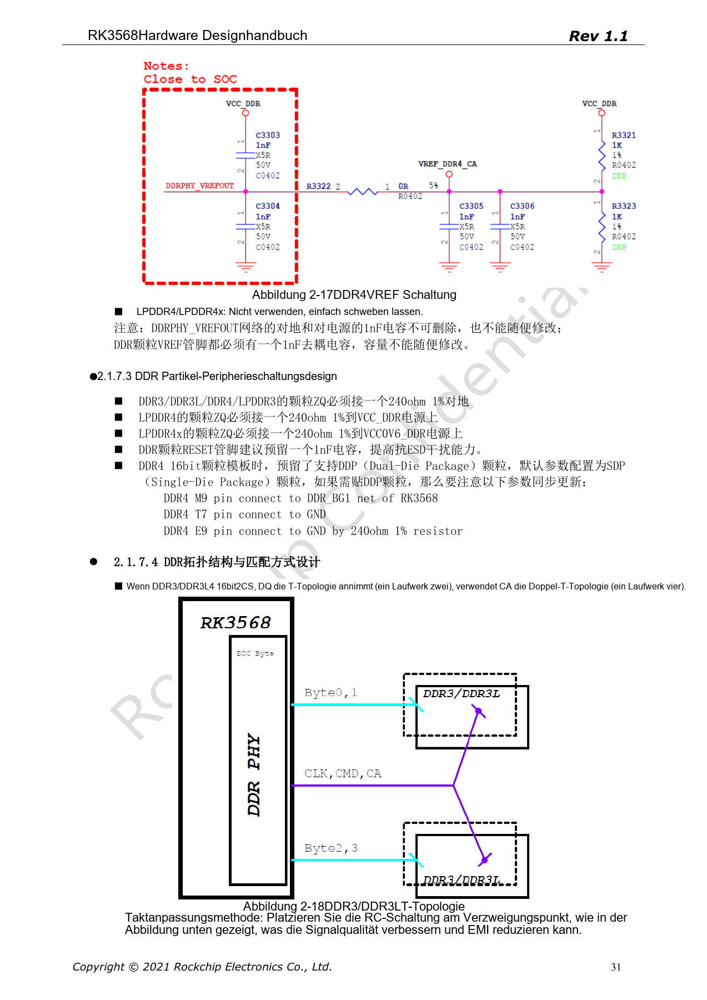
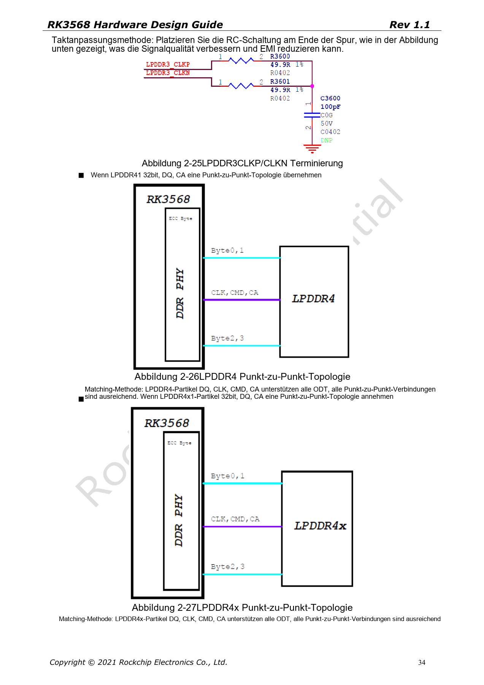
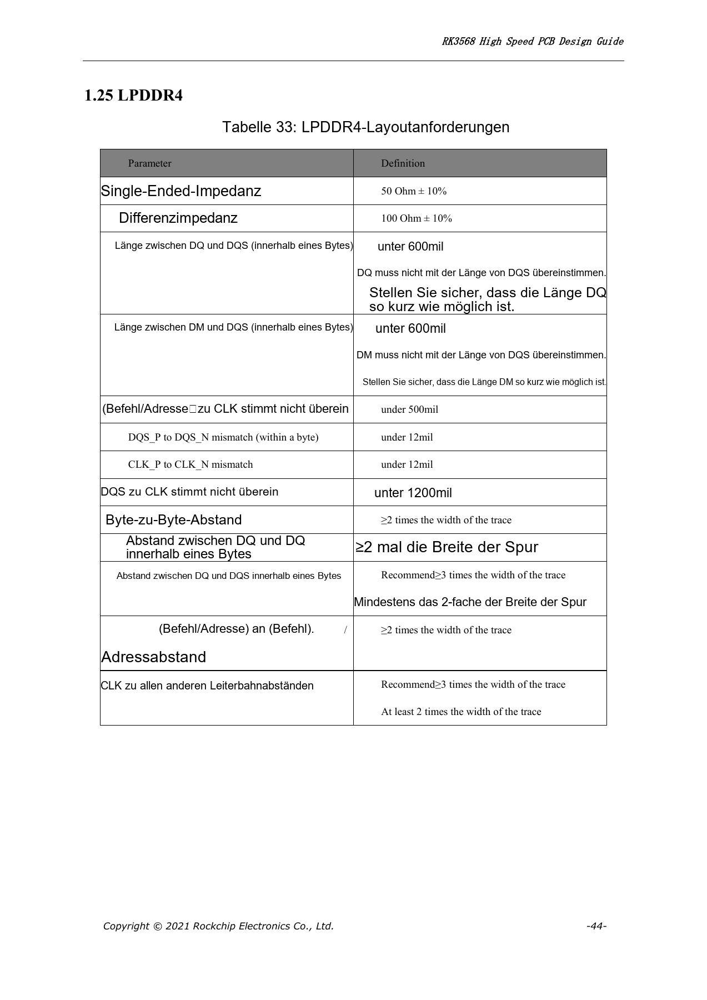
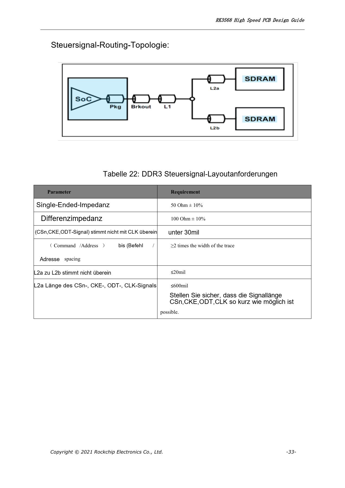
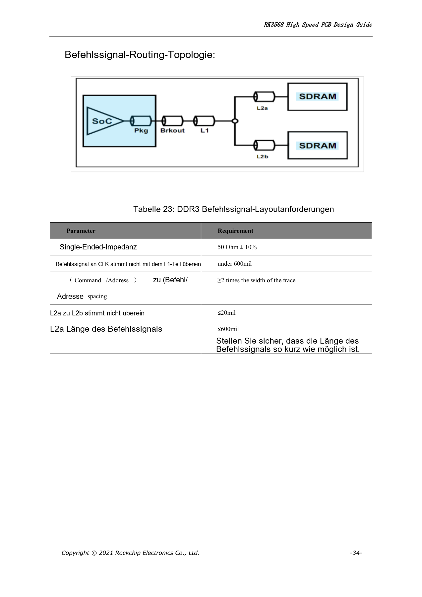
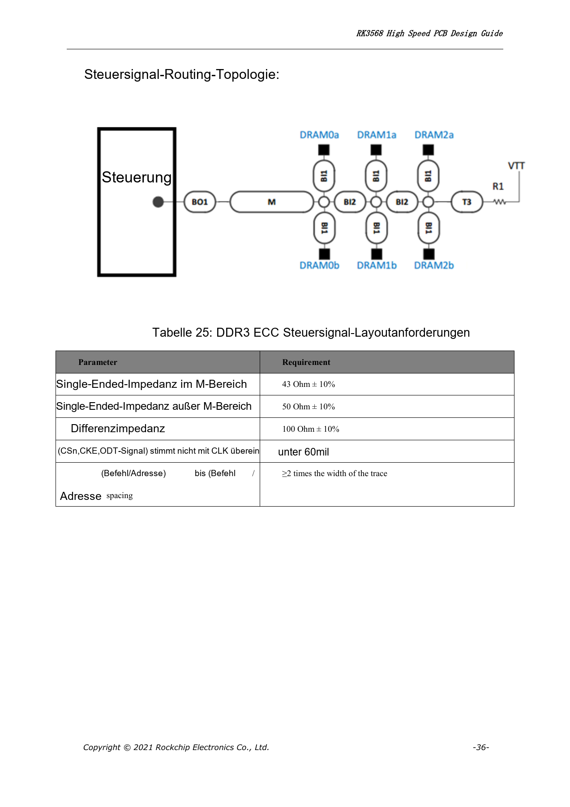
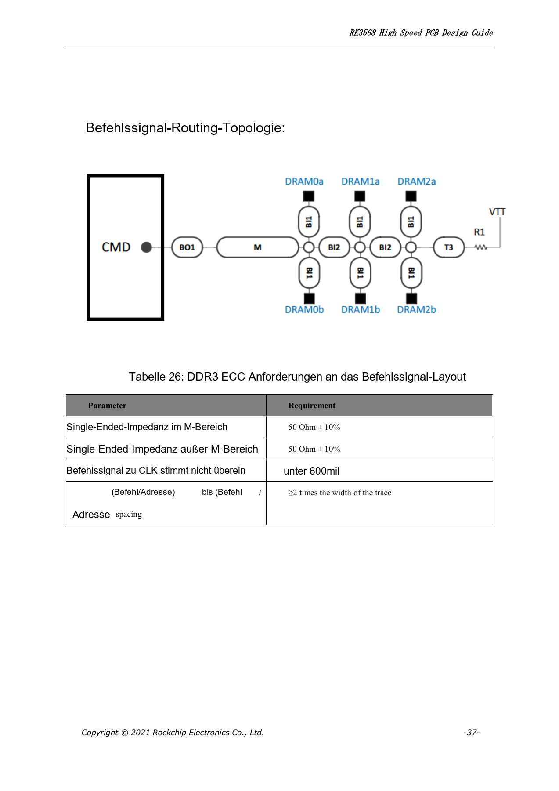

# RK3568-DDR-Design: Bausteine, Topologie, ECC und Routing

Die Reihe ordnet RK3568 Hardware Design Guide V1.1 (Chinesisch, 2021-06-08) und den separaten High Speed PCB Design Guide V1.0.0 (Englisch, 2021-04-12) nach Entwicklungsfragen. ArmSoM [Sige3](https://www.armsom.org/sige3) verwendet RK3568B2. Die [Boarddokumentation](https://docs.armsom.org/armsom-sige3) bietet einen Produktbezug zum Lernen und Bewerten dieser Entwurfsfragen. SoC-Referenzschaltungen beschreiben nicht alle tatsächlichen Schaltungen und herausgeführten Schnittstellen des Sige3. SDK/BSP, Kernel, Chiprevision, Firmware und Peripheriekombination prüfen. Werte sind Quellenreferenzen, keine ArmSoM-Messungen.

**CN V1.1 §2.1.7; §3.2.2 · EN PCB V1.0.0 §1.20–1.26**

## Speichertyp und Mapping zuerst festlegen

Das Handbuch nennt DDR3/DDR3L/LPDDR3/DDR4/LPDDR4/LPDDR4X, 32-bit-Bus, zwei Ranks und bis zu 8GB Adressierung. 8-bit-ECC gilt für die genannten DDR3/DDR3L/DDR4-Modi, nicht für alle Typen. Das PHY-Mapping auf PDF-Seiten 26–28 hängt vom Speichertyp ab. DDR4-Netznamen nicht als LPDDR4 übernehmen; Schaltplan, Training, Topologie und Bausteinfreigabe müssen zusammenpassen.

## Topologie ist mehr als bequemes Routing

Die chinesische Quelle zeigt T- und Fly-by-Topologien für DDR3/DDR3L und DDR4 sowie Punkt-zu-Punkt für LPDDR3/4/4X. Terminierung, VREF, RZQ, Entkopplung und Einschaltfolge gemeinsam prüfen. LPDDR4/4X-Kompatibilität erfordert passende DDRPHY_VDDQ/VDDQL- und DRAM-Schienen; ein Softwarewechsel reicht nicht. Kapazität, Temperaturklasse, Ranks und Platzierung in Training und Belastungstests berücksichtigen.

## LPDDR-Längenregeln richtig lesen

Die englischen PCB-Tabellen erlauben DQ/DM zu DQS innerhalb eines Bytes <600mil bei LPDDR3/4/4X und verlangen ausdrücklich keine Verlängerung allein auf DQS-Länge: DQ/DM kurz halten. LPDDR3: CA–CLK <30mil und DQS–CLK <1500mil; LPDDR4/4X: <500mil beziehungsweise <1200mil. DQS- und CLK-Paardifferenz jeweils <12mil. Dies ersetzt nicht die segmentierten T-/Fly-by-Regeln für DDR3/DDR4.

## Regeln in wiederholbare Prüfungen überführen

Referenzimpedanz: 50Ω±10% single-ended und 100Ω±10% differenziell. Zwischen Bytes, DQ eines Bytes und CA mindestens 2W; DQ–DQS und CLK zu anderen Signalen vorzugsweise 3W, mindestens 2W. Pro Netzgruppe einen Constraint-Bericht mit Topologie, Stackup und Vias erstellen. Kaltstart, Stromzyklen, Temperaturgrenzen und Zielfrequenzlast prüfen. ArmSoM-Messwerte für Bandbreite oder Fehlerraten werden nicht behauptet.

## Pin-Swapping und RZQ-Grenzen

DDR3/DDR3L und DDR4 erlauben ganze Byte-Tausche und DQ-Tausche im Byte, jedoch keinen CA-Tausch. Das ECC-Byte darf kein normales Byte ersetzen; bei DDR4-ECC ist auch die DQ-Reihenfolge fest. LPDDR3 muss das erste Byte D0–D7 samt DQS/DM erhalten; weitere Bytes folgen den Quellenvorgaben. LPDDR4/4X erlauben weder DQ- noch CA-Tausch. DDR_RZQ (H7) nutzt 120Ω, 1% nach Masse bei DDR3/DDR3L/DDR4/LPDDR3, aber nach DDRPHY_VDDQ bei LPDDR4/4X. Gleicher Widerstand bedeutet keine gleiche Beschaltung.

## Quellenproblem bei ECC-Beschaltung

Seite 28 verbindet DDR3/DDR3L-DQSU textlich sowohl mit Versorgung als auch Masse und wiederholt den Netznamen. Daraus wird keine Verdrahtungsanweisung erzeugt; Polarität anhand Abbildung 2–12 und DRAM-Datenblatt prüfen. Die folgende Tabelle erhält alle 85 PHY-Zeilen aus Tabelle 2–5 zur Netzprüfung, nicht als universellen DRAM-Schaltplan.

| PHY | DDR4 | LPDDR4/LPDDR4x | DDR3 | LPDDR3 |
| --- | --- | --- | --- | --- |
| DDR_DQ0_A | DDR4_DQL0_A | LPDDR4_DQ0_A | DDR3_DQ0 | LPDDR3_D15 |
| DDR_DQ1_A | DDR4_DQL2_A | LPDDR4_DQ1_A | DDR3_DQ1 | LPDDR3_D14 |
| DDR_DQ2_A | DDR4_DQL4_A | LPDDR4_DQ2_A | DDR3_DQ2 | LPDDR3_D10 |
| DDR_DQ3_A | DDR4_DQL6_A | LPDDR4_DQ3_A | DDR3_DQ3 | LPDDR3_D9 |
| DDR_DQ4_A | DDR4_DQL7_A | LPDDR4_DQ4_A | DDR3_DQ4 | LPDDR3_D13 |
| DDR_DQ5_A | DDR4_DQL5_A | LPDDR4_DQ5_A | DDR3_DQ5 | LPDDR3_D12 |
| DDR_DQ6_A | DDR4_DQL3_A | LPDDR4_DQ6_A | DDR3_DQ6 | LPDDR3_D8 |
| DDR_DQ7_A | DDR4_DQL1_A | LPDDR4_DQ7_A | DDR3_DQ7 | LPDDR3_D11 |
| DDR_DM0_A | DDR4_DML_A | LPDDR4_DM0_A | DDR3_DM0 | LPDDR3_DM1 |
| DDR_DQS0P_A | DDR4_DQSL_P_A | LPDDR4_DQS0P_A | DDR3_DQS0P | LPDDR3_DQS1P |
| DDR_DQS0N_A | DDR4_DQSL_N_A | LPDDR4_DQS0N_A | DDR3_DQS0N | LPDDR3_DQS1N |
| DDR_DQ8_A | DDR4_DQU3_A | LPDDR4_DQ8_A | DDR3_DQ8 | LPDDR3_D25 |
| DDR_DQ9_A | DDR4_DQU1_A | LPDDR4_DQ9_A | DDR3_DQ9 | LPDDR3_D24 |
| DDR_DQ10_A | DDR4_DQU7_A | LPDDR4_DQ10_A | DDR3_DQ10 | LPDDR3_D28 |
| DDR_DQ11_A | DDR4_DQU5_A | LPDDR4_DQ11_A | DDR3_DQ11 | LPDDR3_D29 |
| DDR_DQ12_A | DDR4_DQU2_A | LPDDR4_DQ12_A | DDR3_DQ12 | LPDDR3_D26 |
| DDR_DQ13_A | DDR4_DQU4_A | LPDDR4_DQ13_A | DDR3_DQ13 | LPDDR3_D31 |
| DDR_DQ14_A | DDR4_DQU6_A | LPDDR4_DQ14_A | DDR3_DQ14 | LPDDR3_D30 |
| DDR_DQ15_A | DDR4_DQU0_A | LPDDR4_DQ15_A | DDR3_DQ15 | LPDDR3_D27 |
| DDR_DM1_A | DDR4_DMU_A | LPDDR4_DM1_A | DDR3_DM1 | LPDDR3_DM3 |
| DDR_DQS1P_A | DDR4_DQSU_P_A | LPDDR4_DQS1P_A | DDR3_DQS1P | LPDDR3_DQS3P |
| DDR_DQS1N_A | DDR4_DQSU_N_A | LPDDR4_DQS1N_A | DDR3_DQS1N | LPDDR3_DQS3N |
| DDR_DQ0_B | DDR4_DQU7_B | LPDDR4_DQ0_B | DDR3_DQ16 | LPDDR3_D1 |
| DDR_DQ1_B | DDR4_DQU5_B | LPDDR4_DQ1_B | DDR3_DQ17 | LPDDR3_D5 |
| DDR_DQ2_B | DDR4_DQU3_B | LPDDR4_DQ2_B | DDR3_DQ18 | LPDDR3_D6 |
| DDR_DQ3_B | DDR4_DQU1_B | LPDDR4_DQ3_B | DDR3_DQ19 | LPDDR3_D4 |
| DDR_DQ4_B | DDR4_DQU0_B | LPDDR4_DQ4_B | DDR3_DQ20 | LPDDR3_D2 |
| DDR_DQ5_B | DDR4_DQU6_B | LPDDR4_DQ5_B | DDR3_DQ21 | LPDDR3_D3 |
| DDR_DQ6_B | DDR4_DQU4_B | LPDDR4_DQ6_B | DDR3_DQ22 | LPDDR3_D7 |
| DDR_DQ7_B | DDR4_DQU2_B | LPDDR4_DQ7_B | DDR3_DQ23 | LPDDR3_D0 |
| DDR_DM0_B | DDR4_DMU_B | LPDDR4_DM0_B | DDR3_DM2 | LPDDR3_DM0 |
| DDR_DQS0P_B | DDR4_DQSU_P_B | LPDDR4_DQS0P_B | DDR3_DQS2P | LPDDR3_DQS0P |
| DDR_DQS0N_B | DDR4_DQSU_N_B | LPDDR4_DQS0N_B | DDR3_DQS2N | LPDDR3_DQS0N |
| DDR_DQ8_B | DDR4_DQL0_B | LPDDR4_DQ8_B | DDR3_DQ24 | LPDDR3_D18 |
| DDR_DQ9_B | DDR4_DQL2_B | LPDDR4_DQ9_B | DDR3_DQ25 | LPDDR3_D19 |
| DDR_DQ10_B | DDR4_DQL4_B | LPDDR4_DQ10_B | DDR3_DQ26 | LPDDR3_D22 |
| DDR_DQ11_B | DDR4_DQL6_B | LPDDR4_DQ11_B | DDR3_DQ27 | LPDDR3_D23 |
| DDR_DQ12_B | DDR4_DQL7_B | LPDDR4_DQ12_B | DDR3_DQ28 | LPDDR3_D16 |
| DDR_DQ13_B | DDR4_DQL5_B | LPDDR4_DQ13_B | DDR3_DQ29 | LPDDR3_D17 |
| DDR_DQ14_B | DDR4_DQL1_B | LPDDR4_DQ14_B | DDR3_DQ30 | LPDDR3_D20 |
| DDR_DQ15_B | DDR4_DQL3_B | LPDDR4_DQ15_B | DDR3_DQ31 | LPDDR3_D21 |
| DDR_DM1_B | DDR4_DML_B | LPDDR4_DM1_B | DDR3_DM3 | LPDDR3_DM2 |
| DDR_DQS1P_B | DDR4_DQSL_P_B | LPDDR4_DQS1P_B | DDR3_DQS3P | LPDDR3_DQS2P |
| DDR_DQS1N_B | DDR4_DQSL_N_B | LPDDR4_DQS1N_B | DDR3_DQS3N | LPDDR3_DQS2N |
| DDR_ECC_DQ0 | DDR4_ECC_DQ7 | - | DDR3_ECC_DQ0 | - |
| DDR_ECC_DQ1 | DDR4_ECC_DQ0 | - | DDR3_ECC_DQ1 | - |
| DDR_ECC_DQ2 | DDR4_ECC_DQ2 | - | DDR3_ECC_DQ2 | - |
| DDR_ECC_DQ3 | DDR4_ECC_DQ1 | - | DDR3_ECC_DQ3 | - |
| DDR_ECC_DQ4 | DDR4_ECC_DQ6 | - | DDR3_ECC_DQ4 | - |
| DDR_ECC_DQ5 | DDR4_ECC_DQ4 | - | DDR3_ECC_DQ5 | - |
| DDR_ECC_DQ6 | DDR4_ECC_DQ3 | - | DDR3_ECC_DQ6 | - |
| DDR_ECC_DQ7 | DDR4_ECC_DQ5 | - | DDR3_ECC_DQ7 | - |
| DDR_ECC_DM | DDR4_ECC_DM | - | DDR3_ECC_DM | - |
| DDR_ECC_DQSP | DDR4_ECC_DQSP | - | DDR3_ECC_DQSP | - |
| DDR_ECC_DQSN | DDR4_ECC_DQSN | - | DDR3_ECC_DQSN | - |
| AC0 | DDR4_A0 | LPDDR4_CLKP_B | DDR3_A9 | - |
| AC1 | DDR4_A1 | - | DDR3_A2 | - |
| AC2 | DDR4_A2 | LPDDR4_A1_A | DDR3_A4 | LPDDR3_A6 |
| AC3 | DDR4_A3 | LPDDR4_CKE1_A | DDR3_A3 | - |
| AC4 | DDR4_A4 | LPDDR4_A3_B | DDR3_BA1 | LPDDR3_A3 |
| AC5 | DDR4_A5 | LPDDR4_A5_B | DDR3_A11 | LPDDR3_A2 |
| AC6 | DDR4_A6 | LPDDR4_A1_B | DDR3_A13 | LPDDR3_A1 |
| AC7 | DDR4_A7 | LPDDR4_ODT0_CA_B | DDR3_A8 | - |
| AC8 | DDR4_A8 | LPDDR4_ODT0_CA_A | DDR3_A6 | LPDDR3_A9 |
| AC9 | DDR4_A9 | LPDDR4_CLKN_B | DDR3_A5 | - |
| AC10 | DDR4_A10 | LPDDR4_CKE0_B | DDR3_A10 | - |
| AC11 | DDR4_A11 | LPDDR4_A0_A | DDR3_A7 | LPDDR3_A8 |
| AC12 | DDR4_A12 | LPDDR4_A3_A | DDR3_BA2 | - |
| AC13 | DDR4_A13 | LPDDR4_A0_B | DDR3_A14 | LPDDR3_A0 |
| AC14 | DDR4_A14_WEN | LPDDR4_A4_A | DDR3_A15 | LPDDR3_A5 |
| AC15 | DDR4_A15_CASN | LPDDR4_A2_A | DDR3_A0 | - |
| AC16 | DDR4_A16_RASN | LPDDR4_A5_A | DDR3_RASN | LPDDR3_A7 |
| AC17 | DDR4_ACTN | LPDDR4_CKE1_B | DDR3_CASN | - |
| AC18 | DDR4_BA0 | LPDDR4_A2_B | DDR3_A1 | - |
| AC19 | DDR4_BA1 | LPDDR4_A4_B | DDR3_A12 | LPDDR3_A4 |
| AC20 | DDR4_BG0 | LPDDR4_ODT1_CA_B | DDR3_WEN | - |
| AC21 | DDR4_BG1 | LPDDR4_ODT1_CA_A | DDR3_BA0 | - |
| AC22 | DDR4_CKE | LPDDR4_CKE0_A | DDR3_CKE | LPDDR3_CKE |
| AC23 | DDR4_CLKP | LPDDR4_CLKP_A | DDR3_CLKP | LPDDR3_CLKP |
| AC24 | DDR4_CLKN | LPDDR4_CLKN_A | DDR3_CLKN | LPDDR3_CLKN |
| AC25 | DDR4_CS0N | LPDDR4_CS0N_A | DDR3_ODT1 | LPDDR3_ODT0 |
| AC26 | DDR4_CS1N | LPDDR4_CS1N_A | DDR3_CS1N | LPDDR3_ODT1 |
| AC27 | DDR4_ODT0 | LPDDR4_CS1N_B | DDR3_ODT0 | LPDDR3_CS1N |
| AC28 | DDR4_ODT1 | LPDDR4_CS0N_B | DDR3_CS0N | LPDDR3_CS0N |
| AC29 | DDR4_RESETN | LPDDR4_RESETN | DDR3_RESETN | - |

## Segmentierte DDR3/DDR4- und ECC-Regeln

Die englischen PCB-Seiten 32–43 trennen Daten, Steuerung und Befehle. DDR3/DDR4 und ECC teilen die folgenden Datenregeln; die M-Region der ECC-Steuertopologie hat jedoch 43Ω±10% statt gewöhnlicher 50Ω. M, L1, L2a und L2b anhand des jeweiligen Bildes zuordnen; Grenzen nicht auf falsche Zweige anwenden. Steuer- und Befehlswege kurz halten, CA-Abstand ≥2W.

| Modus | Impedanz | Längenvorgaben |
| --- | --- | --- |
| DDR3 / DDR3 ECC / DDR4 / DDR4 ECC: data | 50Ω±10% / 100Ω±10% | DQ–DQS <600mil; DM–DQS <600mil; DQS–CLK <1500mil; P/N <12mil |
| DDR3 control | 50Ω±10% / 100Ω±10% | CSn/CKE/ODT–CLK <30mil; L2a–L2b ≤20mil; L2a(CSn/CKE/ODT/CLK) ≤600mil |
| DDR4 control | 50Ω±10% / 100Ω±10% | CSn/CKE/ODT–CLK <30mil; L2a–L2b ≤20mil; L2a(CSn/CKE/ODT) ≤600mil |
| DDR3 / DDR4 command | 50Ω±10% | L1(command–CLK) <600mil; L2a–L2b ≤20mil; L2a(command) ≤600mil |
| DDR3 ECC / DDR4 ECC control | M:43Ω±10%; outside M:50Ω±10%; differential:100Ω±10% | CSn/CKE/ODT–CLK <60mil |
| DDR3 ECC / DDR4 ECC command | M:50Ω±10%; outside M:50Ω±10% | command–CLK <600mil |

## Quellenparameter und Vorgaben

| Punkt | Quellenreferenz |
| --- | --- |
| LPDDR3 CA–CLK / DQS–CLK | <30mil / <1500mil |
| LPDDR4/4X CA–CLK / DQS–CLK | <500mil / <1200mil |
| DQ/DM–DQS | <600mil |
| DQS P/N; CLK P/N | <12mil |

## Quellenabbildungen

Die Quellenseiten erhalten Schaltungsbeschriftung und Kontext; Text und Tabellen bleiben editierbar. Eine passende englische Ausgabe des chinesischen Haupthandbuchs liegt nicht vor, daher bleiben dessen Abbildungen in allen Sprachen chinesisch. Bilder des separaten englischen PCB-Handbuchs sind entsprechend markiert. Seitenzahlen beziehen sich auf physische PDF-Seiten.

Chinesisches Hardwarehandbuch · PDF 31

Chinesisches Hardwarehandbuch · PDF 34

Englischer High-Speed-PCB-Leitfaden · PDF 44

Englischer High-Speed-PCB-Leitfaden · PDF 33

Englischer High-Speed-PCB-Leitfaden · PDF 34

Englischer High-Speed-PCB-Leitfaden · PDF 36

Englischer High-Speed-PCB-Leitfaden · PDF 37

## Weiterlesen und Entwicklungsunterlagen

- [RK3568-Hardwaredesign: 10 Themen zu Schaltung, PCB und Fertigung](/de/articles/rk3568-hardware-design-series/)
- [RK3568-Versorgung und IO-Domänen: RK809-5 und Standby](/de/articles/rk3568-power-io-domain-hardware/)
- [RK3568-Bootspeicher: eMMC-, FSPI-, NAND- und SDMMC-Schaltungen](/de/articles/rk3568-storage-emmc-fspi-sdmmc-hardware/)
- [ArmSoM Docs](https://docs.armsom.org/)
- [ArmSoM](https://www.armsom.org/)
