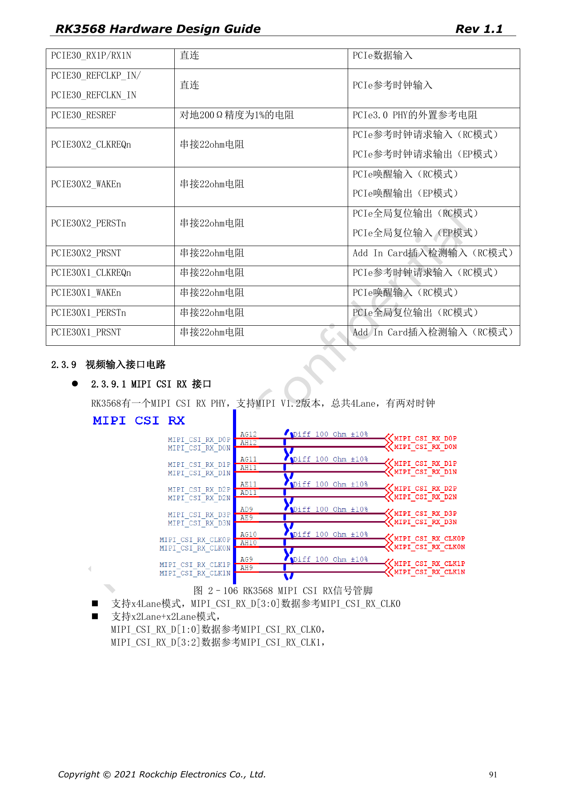
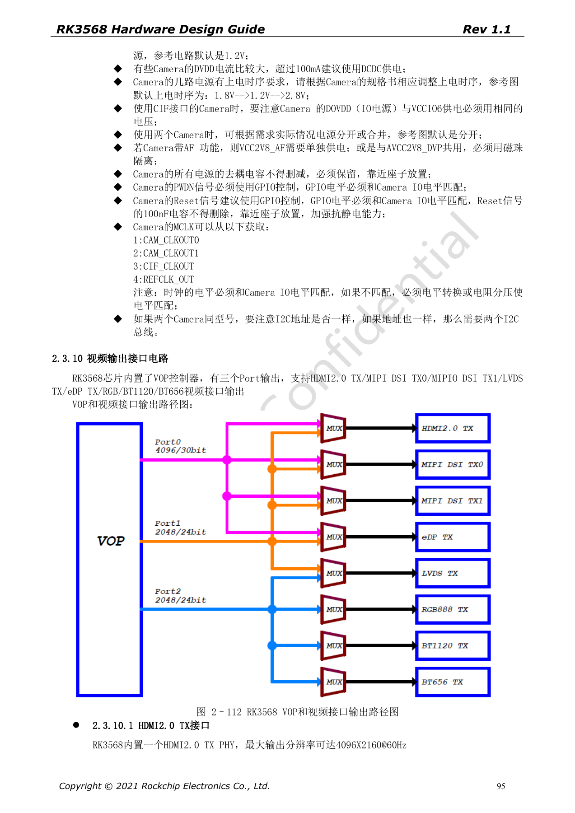
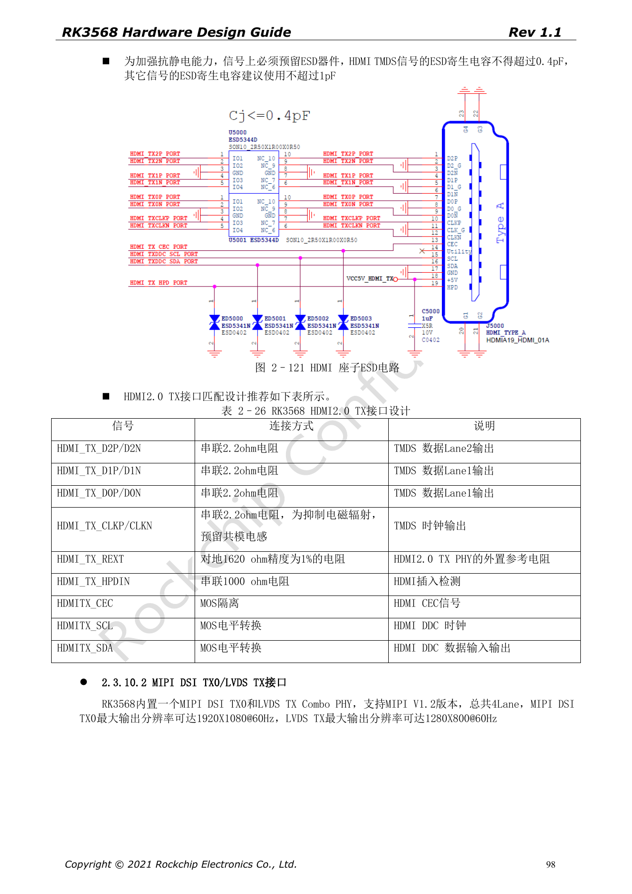

# RK3568-Display und Kamera: VOP, MIPI, HDMI und Versorgung

Die Reihe ordnet RK3568 Hardware Design Guide V1.1 (Chinesisch, 2021-06-08) und den separaten High Speed PCB Design Guide V1.0.0 (Englisch, 2021-04-12) nach Entwicklungsfragen. ArmSoM [Sige3](https://www.armsom.org/sige3) verwendet RK3568B2. Die [Boarddokumentation](https://docs.armsom.org/armsom-sige3) bietet einen Produktbezug zum Lernen und Bewerten dieser Entwurfsfragen. SoC-Referenzschaltungen beschreiben nicht alle tatsächlichen Schaltungen und herausgeführten Schnittstellen des Sige3. SDK/BSP, Kernel, Chiprevision, Firmware und Peripheriekombination prüfen. Werte sind Quellenreferenzen, keine ArmSoM-Messungen.

**CN V1.1 §2.3.9–2.3.10; §3.2.25–3.2.26 · EN PCB §1.4, §1.7, §1.9–1.10, §1.16–1.18**

## Displaycontroller sind keine Anschlusszählung

Der VOP besitzt drei Ausgangsports für HDMI2.0, MIPI DSI, LVDS, eDP, RGB und BT1120/656 mit Multiplexgrenzen. HDMI2.0 ist bis 4096×2160@60Hz genannt. DSI TX0 liefert 1920×1080@60Hz und teilt den Combo-PHY mit LVDS TX bei 1280×800@60Hz. Gleichzeitige Ausgänge anhand von VOP-Routing und BSP prüfen, nicht alle Schnittstellen addieren.

## Kameradaten, Takt und Versorgung gemeinsam prüfen

Der Vier-Lane-CSI-RX-PHY erlaubt 1×4 oder 2×2 Lanes; geteilt gehören D[1:0] zu CLK0 und D[3:2] zu CLK1. AVDD/DOVDD/DVDD, PWDN, Reset, I2C und MCLK gemäß Sensordatenblatt wählen. 1.8V→1.2V→2.8V ist nur eine Referenzsequenz. Zwei Sensoren mit gleicher I2C-Adresse benötigen eine Konfliktlösung; das Handbuch empfiehlt getrennte I2C-Busse.

## Schutz und High-Speed-Vorgaben

HDMI-TMDS-ESD-Kapazität ≤0.4pF, andere Signale empfohlen ≤1pF; REXT: 1620Ω, 1%. HDMI-Paardifferenz <12mil, Takt-/Datenpaardifferenz <480mil. MIPI: Paar <12mil, Daten zu Takt <36mil. Benachbarte Paare im Stecker durch Massepins trennen, Testpunkte nahe am Stecker mit kurzen Stubs. Hintergrundbeleuchtung, Touch und Sensorversorgung in die Prüfung einschließen.

## VGA benötigt eine Bridge

RK3568 hat keinen nativen VGA-Ausgang; die Quelle nutzt etwa RTD2166. Aus der Displayliste folgt kein nativer VGA-Port. Versorgung, Reset, HPD, 5V-Synchronisation, 75Ω-Terminierung und TVS nach Bridge-Referenzdesign auslegen. Beispielsweise den 100kΩ-Pull-down an RTD2166 Pin32 nicht beiläufig entfernen.

## Quellenparameter und Vorgaben

| Punkt | Quellenreferenz |
| --- | --- |
| HDMI | 100Ω±10%; intra <12mil; CLK/data <480mil |
| MIPI | 100Ω±10%; intra <12mil; data/CLK <36mil |
| LVDS | 100Ω±10%; intra <20mil; data/CLK 60mil |
| eDP | 100Ω±10%; intra <12mil; 100nF±20% |

## Quellenabbildungen

Die Quellenseiten erhalten Schaltungsbeschriftung und Kontext; Text und Tabellen bleiben editierbar. Eine passende englische Ausgabe des chinesischen Haupthandbuchs liegt nicht vor, daher bleiben dessen Abbildungen in allen Sprachen chinesisch. Bilder des separaten englischen PCB-Handbuchs sind entsprechend markiert. Seitenzahlen beziehen sich auf physische PDF-Seiten.

Chinesisches Hardwarehandbuch · PDF 91

Chinesisches Hardwarehandbuch · PDF 95

Chinesisches Hardwarehandbuch · PDF 98

## Weiterlesen und Entwicklungsunterlagen

- [RK3568-Hardwaredesign: 10 Themen zu Schaltung, PCB und Fertigung](/de/articles/rk3568-hardware-design-series/)
- [RK3568-Ethernet: zwei GMACs, RGMII und QSGMII](/de/articles/rk3568-ethernet-rgmii-qsgmii-hardware/)
- [RK3568-Audio und Steuerung: I2S, UART, SPI, CAN und I2C](/de/articles/rk3568-audio-control-interfaces-hardware/)
- [ArmSoM Docs](https://docs.armsom.org/)
- [ArmSoM](https://www.armsom.org/)
