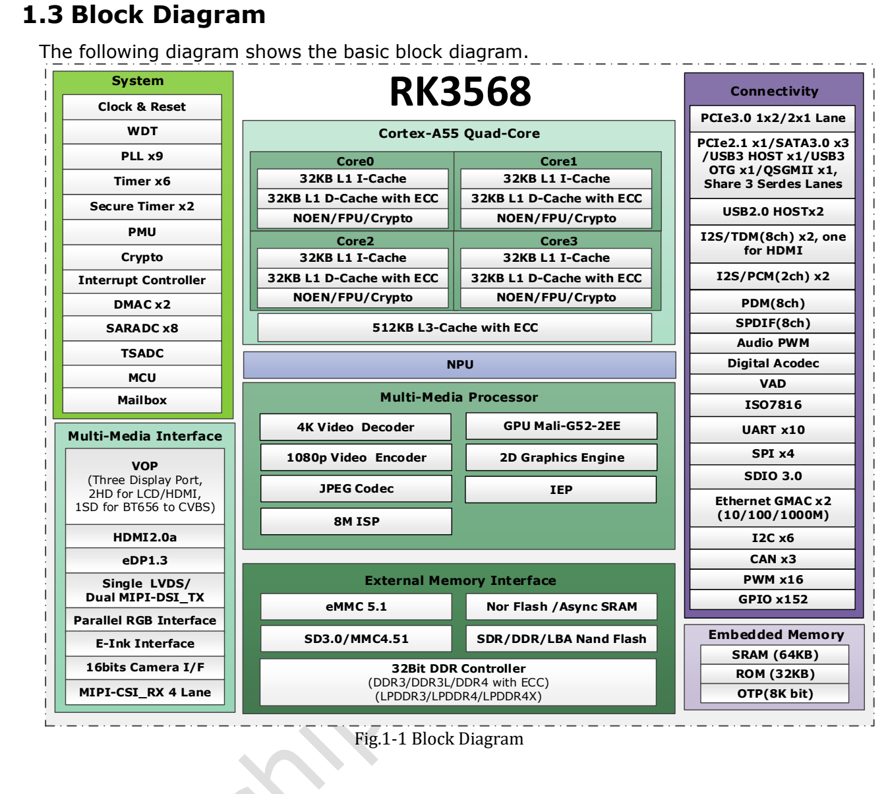

Dieser Artikel basiert auf der angegebenen Datenblattrevision. Die Werte sind Herstellerspezifikationen und keine ArmSoM-Messungen; neue Hardwaretests wurden nicht durchgeführt. Prüfen Sie Siliziumrevision, Schaltplan, SDK/BSP, Kernel und Treiber. Erläuterungen und editierbare Tabellen helfen beim Lesen; die vollständige Spezifikation und hier nicht vertiefte Bitdefinitionen stehen im Original-PDF.

**RK3568 · Rockchip RK3568 Datasheet V1.2-20210601.pdf · PDF 54–62.**

*Englische Originalabbildung, PDF S. 19.*

## Grenzwerte und Betriebspunkte

Absolute Maxima sind keine Reglersollwerte. Min/Typ/Max ersetzen weder Sequenzierung noch Transientenanalyse oder Spannungs-/Frequenztabellen. Messen Sie am Chip bei Start, Leerlauf und Lastwechseln, nicht nur am Regler.

## Empfohlene Versorgung und Takte

### PDF 55

| Versorgung / Takt | Min | Typ | Max | Einheit |
|---|---|---|---|---|
| VDD_CPU | 0.8 | 0.9 | 1.2 | V |
| VDD_GPU | 0.8 | 0.9 | 1.1 | V |
| VDD_NPU | 0.8 | 0.9 | 1.1 | V |
| VDD_LOGIC | 0.81 | 0.9 | 0.99 | V |
| PMU_VDD_LOGIC_0V9 | 0.81 | 0.9 | 0.99 | V |
| PMUIO1 | 2.97 | 3.3 | 3.63 | V |
| VCCIO1,VCCIO2, VCCIO3, VCCIO4VCCIO5, VCCIO6, VCCIO7, PMUIO2 | 2.97 1.62 | 3.3 1.8 | 3.63 1.98 | V |
| DDR3 / DDRPHY_VDDQ/DDRPHY_VDDQL | 1.425 | 1.5 | 1.575 | V |
| DDR3L / DDRPHY_VDDQ/DDRPHY_VDDQL | 1.283 | 1.35 | 1.417 | V |
| LPDDR3 / DDRPHY_VDDQ/DDRPHY_VDDQL | 0.994 | 1.2 | 1.3 | V |
| DDR4 / DDRPHY_VDDQ/DDRPHY_VDDQL | 0.994 | 1.2 | 1.3 | V |
| LPDDR4 / DDRPHY_VDDQ/DDRPHY_VDDQL | 1.0 | 1.1 | 1.21 | V |
| LPDDR4X / DDRPHY_VDDQ | 1.0 | 1.1 | 1.21 | V |
| LPDDR4X / DDRPHY_VDDQL | 0.54 | 0.6 | 0.66 | V |
| PMUPLL_AVDD_0V9 | 0.81 | 0.9 | 0.99 | V |
| PMUPLL_AVDD_1V8 | 1.62 | 1.8 | 1.98 | V |
| SYSPLL_AVDD_0V9 | 0.81 | 0.9 | 0.99 | V |
| SYSPLL_AVDD_1V8 | 1.62 | 1.8 | 1.98 | V |
| USB2_AVDD_0V9 | 0.81 | 0.9 | 0.99 | V |
| USB2_AVDD_1V8 | 1.62 | 1.8 | 1.98 | V |
| USB2_AVDD_3V3 | 2.97 | 3.3 | 3.63 | V |
| USB3_AVDD_0V9 | 0.81 | 0.9 | 0.99 | V |
| USB3_AVDD_1V8 | 1.62 | 1.8 | 1.98 | V |
| USB3_AVDD_3V3 | 2.97 | 3.3 | 3.63 | V |
| MULTI_PHY_AVDD_0V9 | 0.81 | 0.9 | 0.99 | V |
| MULTI_PHY_AVDD_1V8 | 1.62 | 1.8 | 1.98 | V |
| PCIE30_AVDD_0V9 | 0.81 | 0.9 | 0.99 | V |
| PCIE30_AVDD_1V8 | 1.62 | 1.8 | 1.98 | V |
| MIPI_CSI_RX_AVDD_0V9 | 0.81 | 0.9 | 0.99 | V |
| MIPI_CSI_RX_AVDD_1V8 | 1.62 | 1.8 | 1.98 | V |
| MIPI_DSI_TX0/LVDS_TX0_AVDD_0V9 | 0.81 | 0.9 | 0.99 | V |
| MIPI_DSI_TX0/LVDS_TX0_AVDD_1V8 | 1.62 | 1.8 | 1.98 | V |
| MIPI_DSI_TX1_AVDD_0V9 | 0.81 | 0.9 | 0.99 | V |
| MIPI_DSI_TX1_AVDD_1V8 | 1.62 | 1.8 | 1.98 | V |
| EDP/DP_TX_AVDD_0V9 | 0.81 | 0.9 | 0.99 | V |
| EDP/DP_TX_AVDD_1V8 | 1.62 | 1.8 | 1.98 | V |
| HDMI_TX_AVDD_0V9 | 0.81 | 0.9 | 0.99 | V |
| HDMI_TX_AVDD_1V8 | 1.62 | 1.8 | 1.98 | V |
| SARADC_AVDD_1V8 | 1.62 | 1.8 | 1.98 | V |

### PDF 56

| Versorgung / Takt | Min | Typ | Max | Einheit |
|---|---|---|---|---|
| OTP_VCC_1V8 | 1.62 | 1.8 | 1.98 | V |
| OSC | NA | 24 | NA | MHz |
| CPU | NA | NA | TBD | GHz |
| GPU | NA | NA | TBD | MHz |
| NPU | NA | NA | 1.0 | GHz |
| TA | 0 | NA | 80 | ℃ |

## GPIO-Pegel und interne Widerstände

| Merkmal | Spezifikation / Quellenhinweis |
|---|---|
| 3.3 V I/O: VIL | −0.3…0.8 V |
| 3.3 V I/O: VIH | 2.0…VDDO+0.3 V |
| 3.3 V I/O: VOL | −0.3…0.4 V |
| 3.3 V I/O: VOH | 2.4…VDDO+0.3 V |
| 1.8 V I/O: VIL max | 0.35 × VDDO |
| 1.8 V I/O: VIH min | 0.65 × VDDO |
| 1.8 V I/O: VOH min | 1.4 V |
| Interne Pulls | 16 / NA / 43 kΩ (Min/Typ/Max) |

## PLL- und USB-Parameter

| Merkmal | Spezifikation / Quellenhinweis |
|---|---|
| PLL integer: Fin / Fvco / Fout | 10–800 / 475–1900 / 9–1900 MHz |
| PLL integer: lock | 1000 typ / 1500 max input-clock cycles |
| PLL fractional: Fin / Fvco / Fout | 1–1200 / 950–3800 / 19–3800 MHz |
| PLL fractional: lock | 250 typ / 500 max input-clock cycles |
| USB output resistance | 40.5 / 45 / 49.5 Ω |
| USB HS high | 360 / 400 / 440 mV |
| USB HS low | −40 / 0 / 40 mV |
| USB disconnect | 570 / 590 / 625 mV |
| USB squelch | 100 / 112 / 150 mV |

## Temperatur- und Kühlungsgrenzen

Der Wärmewiderstand stammt aus einer Herstellersimulation auf definierter PCB, nicht aus einer ArmSoM-Messung. Gehäuse, Kupferfläche, Luftstrom, Kühlkörper und Leistungsverteilung beeinflussen die Erwärmung. Sensorbereich ist nicht Umgebungstemperaturbereich.

| Merkmal | Spezifikation / Quellenhinweis |
|---|---|
| θJA / θJB / θJC | 15.925 / 10.813 / 0.487 °C/W |
| Thermisches Modell | 4-layer PCB · 114.3 × 101.6 mm · 1.6 mm · ambient 25 °C |
| Tj | Laut Quelle unter 125 °C |
| Ta | 0…80 °C |
| SARADC | 10 bit · ≤1 MS/s |
| TSADC | −20…120 °C; electrical table: ±5 °C resolution |

## Offene Quellenfragen

Absolute/empfohlene RK3568-Maxima: CPU 1,25/1,2 V; GPU/NPU 1,2/1,1 V. CPU/GPU-Frequenzen bleiben TBD, NPU bis 1 GHz. Das LPDDR3/DDR4-Minimum 0,994 V bleibt unverändert und wird nicht auf 1,14 V korrigiert. Ein 80–120-Ω-Multi-PHY-Eintrag nutzt De-Emphasis-Wortlaut; Name und Einheit sind mit der PHY-Spezifikation abzugleichen.

USB-Schwellen des RK3528 nicht übernehmen. DDR-Leckstrom gilt bei 125 °C und definiert kein Raumtemperatur-Leistungsbudget.

## ArmSoM-Produkte und Einsatzgrenzen

Sige3 verwendet RK3568B2. Grundlage ist das allgemeine RK3568-Datenblatt V1.2; Bestellvariante B2, Platinenrevision und herausgeführte Schnittstellen müssen gesondert geprüft werden.

- [Sige3](https://www.armsom.org/sige3) · [Docs](https://docs.armsom.org/armsom-sige3)

## Datenblattserie und Original-PDF

- [RK3568 Übersicht](/de/articles/rk3568-datasheet-v12/)
- [RK3568: Gehäuse und vollständige Tabelle der 636 Balls](/de/articles/rk3568-package-pin-reference/)
- [RK3568: DDR, Displays und PCIe/SATA/USB-Zuordnung](/de/articles/rk3568-architecture-phy-resource-planning/)
- [RK3568: Versorgung, I/O und Wärmewiderstand](/de/articles/rk3568-electrical-power-thermal/)
- [Vollständiges Original-PDF herunterladen](/assets/datasheet-series-20261110/Rockchip-RK3568-Datasheet-V1.2-20210601.pdf)
