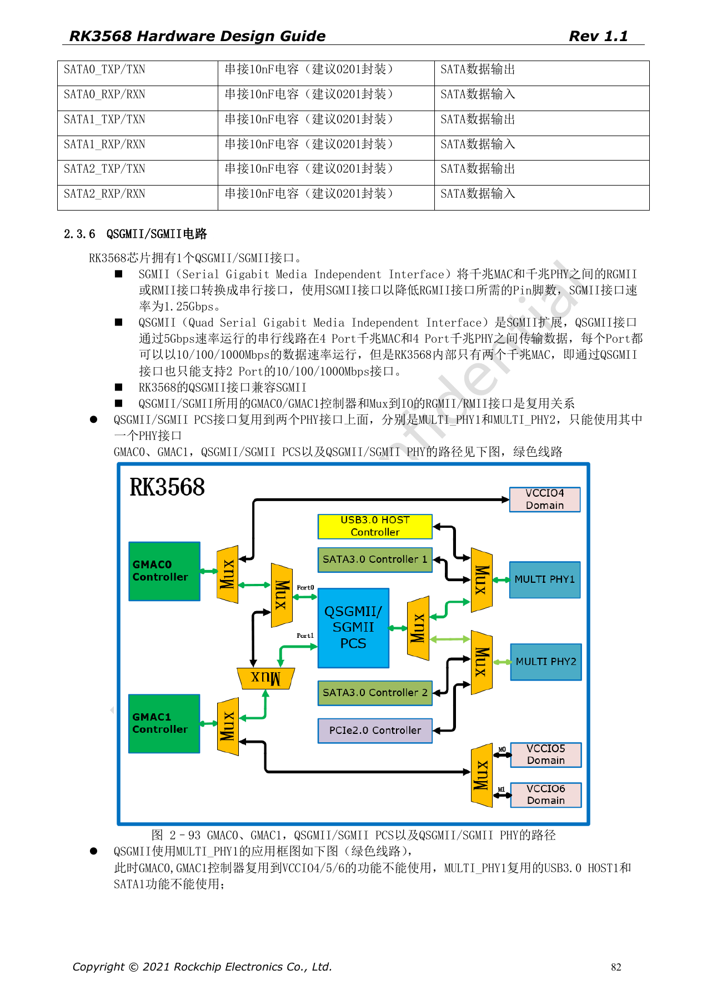
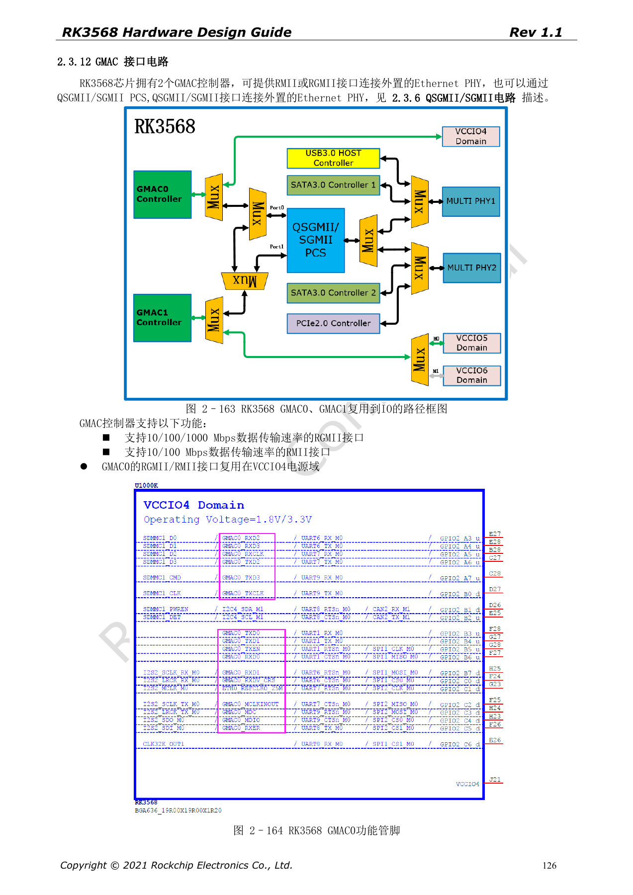
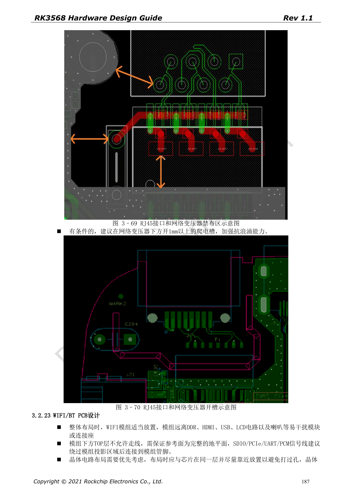

# RK3568-Ethernet: zwei GMACs, RGMII und QSGMII

Die Reihe ordnet RK3568 Hardware Design Guide V1.1 (Chinesisch, 2021-06-08) und den separaten High Speed PCB Design Guide V1.0.0 (Englisch, 2021-04-12) nach Entwicklungsfragen. ArmSoM [Sige3](https://www.armsom.org/sige3) verwendet RK3568B2. Die [Boarddokumentation](https://docs.armsom.org/armsom-sige3) bietet einen Produktbezug zum Lernen und Bewerten dieser Entwurfsfragen. SoC-Referenzschaltungen beschreiben nicht alle tatsächlichen Schaltungen und herausgeführten Schnittstellen des Sige3. SDK/BSP, Kernel, Chiprevision, Firmware und Peripheriekombination prüfen. Werte sind Quellenreferenzen, keine ArmSoM-Messungen.

**CN V1.1 §2.3.6; §2.3.12; §3.2.22 · EN PCB §1.8; §1.19**

## MAC, PHY und Modus unterscheiden

RK3568 hat zwei GMACs: RGMII für 10/100/1000Mbps, RMII für 10/100Mbps. QSGMII kann protokollseitig vier Ports transportieren, doch dieser Chip hat nur zwei MACs; das Handbuch begrenzt ihn ausdrücklich auf zwei Ethernetports. QSGMII/SGMII teilt die MACs mit RGMII/RMII und wählt entweder MULTI_PHY1 oder MULTI_PHY2.

## Das RTL8211F-Beispiel ist nicht universell

Im Beispiel akzeptiert RTL8211F/FI-Reset nur 3.3V und erhält nahe 100nF. RSET: 2.49kΩ, 1%; MDIO: empfohlener externer Pull-up 1.5–1.8kΩ. Bei anderem PHY Reset, Versorgung, Straps, Takt, interne Verzögerung und Transformator-Mittelanzapfung neu prüfen. RJ45-Tab-up/down-Pinrichtung mit dem Footprint abgleichen.

## Timing und Isolation gemeinsam prüfen

RGMII-TX-Daten/Enable zu TXCLK und RX-Daten/Valid zu RXCLK getrennt abgleichen. Englische Vorgaben: <120mil Differenz, <5in Länge, 50Ω±10% single-ended. TX und RX bilden keine gemeinsame Matchinggruppe. QSGMII/SGMII: 100Ω±10%, Paardifferenz <12mil, Länge <6in, Referenzkopplung 100nF±20%. Transformator-Keepout, Isolation und Surge-Rückweg ebenfalls prüfen. Schutzbeispiele sind keine Systemzertifizierung.

## Quellenparameter und Vorgaben

| Punkt | Quellenreferenz |
| --- | --- |
| GMAC | 2 |
| QSGMII / SGMII | 5Gbps / 1.25Gbps |
| RGMII | 50Ω±10%; <120mil; <5in |
| RTL8211F/FI RSET | 2.49kΩ ±1% |
| MDIO | 1.5–1.8kΩ pull-up |

## Quellenabbildungen

Die Quellenseiten erhalten Schaltungsbeschriftung und Kontext; Text und Tabellen bleiben editierbar. Eine passende englische Ausgabe des chinesischen Haupthandbuchs liegt nicht vor, daher bleiben dessen Abbildungen in allen Sprachen chinesisch. Bilder des separaten englischen PCB-Handbuchs sind entsprechend markiert. Seitenzahlen beziehen sich auf physische PDF-Seiten.

Chinesisches Hardwarehandbuch · PDF 82

Chinesisches Hardwarehandbuch · PDF 126

Chinesisches Hardwarehandbuch · PDF 187

## Weiterlesen und Entwicklungsunterlagen

- [RK3568-Hardwaredesign: 10 Themen zu Schaltung, PCB und Fertigung](/de/articles/rk3568-hardware-design-series/)
- [RK3568-Erweiterungen: USB, SATA, PCIe-Multiplexing und Takt](/de/articles/rk3568-usb-sata-pcie-hardware/)
- [RK3568-Display und Kamera: VOP, MIPI, HDMI und Versorgung](/de/articles/rk3568-display-camera-hardware/)
- [ArmSoM Docs](https://docs.armsom.org/)
- [ArmSoM](https://www.armsom.org/)
