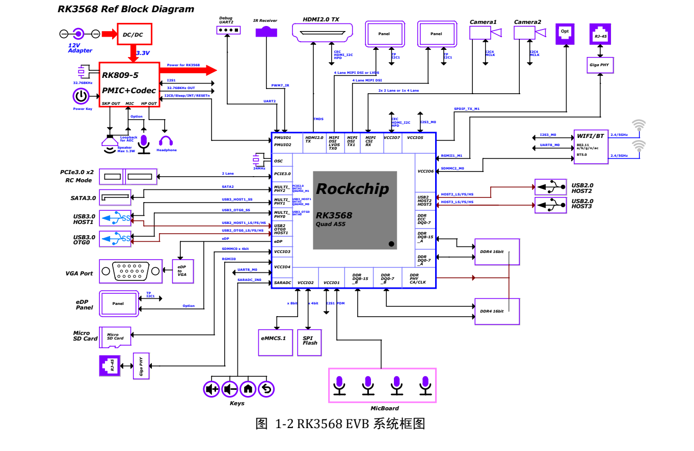
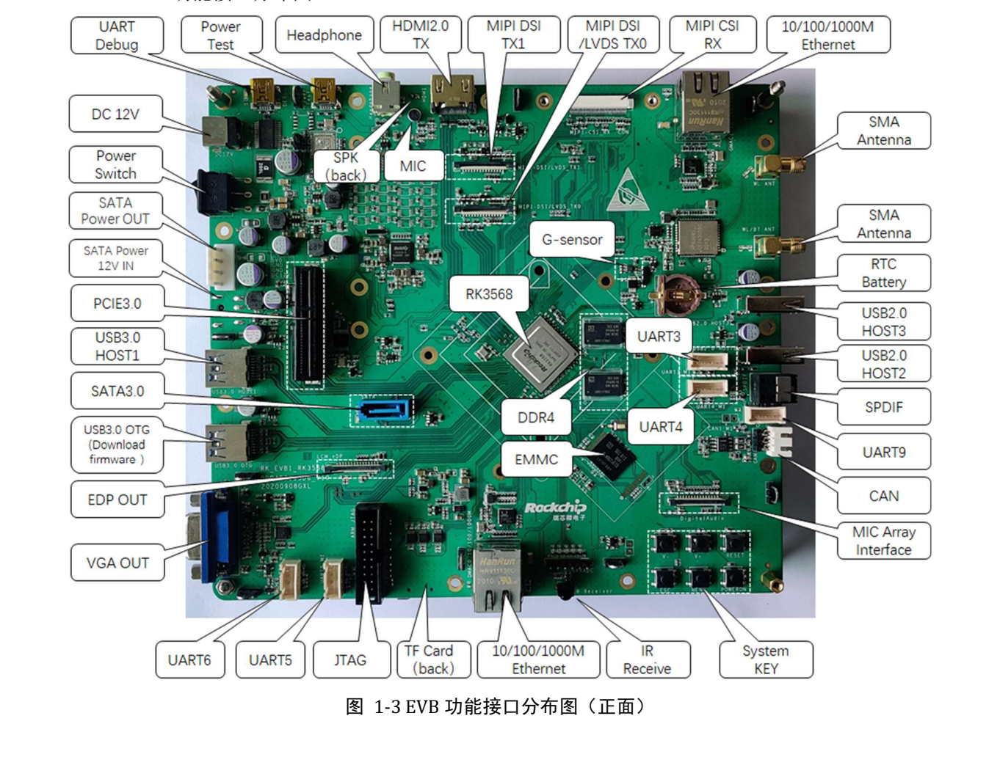

Dieser thematische Leitfaden erläutert das Quelldokument mit wichtigen Daten, Grenzen und Originalabbildungen. Er ist keine seitenweise Übersetzung und kein vollständiges Pin- oder Registerhandbuch. Herstellerbeispiele sind keine ArmSoM-Messungen. Vor der Anwendung sind Platinenrevision, Schaltplan, SDK/BSP, Kernel und Treiber zu prüfen; für diesen Artikel wurden keine neuen Hardwaretests durchgeführt.

**Hauptquelle：** `Rockchip_RK3568_EVB_User_Guide_V1.0_CN.pdf` · PDF 43 Seiten.

## Referenzplatine und Sige3 trennen

Das Handbuch gilt für `RK_EVB1_RK3568_DDR4P216SD6_V10_20200908`: RK809-5, 2GB DDR4, 32GB eMMC und 12V/2A-Kitnetzteil. Sige3 ist als RK3568B2 dokumentiert. Speicher, Versorgung, Stecker und Firmware anhand seiner eigenen Unterlagen prüfen.


[](/assets/hardware-reference-20261110/rk3568-evb-p11.png)

*RK3568-EVB-Systemverbindungen — Chinesische Originalabbildung; in dieser Auswahl liegt keine entsprechende englische Abbildung vor. `Rockchip_RK3568_EVB_User_Guide_V1.0_CN.pdf`, PDF p. 11.*


## Unterlagen für die erste Debugsitzung

Revision und Anschlüsse fotografieren, Netzteil, Image und Tool notieren. USB Debug mit dem PC verbinden und COM bestimmen. Die Quelle nutzt UART2 über FT232RL mit `1500000` (1.5M), RTS/CTS deaktiviert. Bei unleserlichem Text zuerst Rate, Port, Verdrahtung und Pegel prüfen.


[](/assets/hardware-reference-20261110/rk3568-evb-p13.png)

*Vorderseitige RK3568-EVB-Anschlüsse — Chinesische Originalabbildung; in dieser Auswahl liegt keine entsprechende englische Abbildung vor. `Rockchip_RK3568_EVB_User_Guide_V1.0_CN.pdf`, PDF p. 13.*


## Loader und Maskrom unterscheiden

Für Loader USB3.0 OTG verbinden, RECOVER beim Einschalten/Reset halten und nach Erkennung loslassen. Die Quelle nennt Low an `SARADC_VIN0`. Die MASKROM-Taste verhindert den eMMC-Boot; der Text beschreibt `eMMC_D0` gegen Masse. In der Praxis den vorgesehenen Tastenablauf der konkreten Revision nutzen, keine beliebigen Platinen kurzschließen.

Nach Erkennung passende Loader-, Parameter-, Uboot- und weitere Images wählen und vorher sichern. Das Treiberbeispiel liegt unter `SDK\RKTools\windows\Release_DriverAssitant`. Die Schreibweise `Rcovery` bleibt als Quellenfehler dokumentiert und dient nicht zum Erraten eines Firmware-Dateinamens.

Bei einem ADB-fähigen Image nach dem Boot prüfen:

```sh
adb devices
adb shell
```

UART zeigt frühen Bootverlauf; ADB braucht System und Dienst. Die Kanäle ersetzen sich nicht.

## Multiplexing in Hardware und Software prüfen

| Funktion | Quellenbeschreibung | Prüfpunkt |
| --- | --- | --- |
| Kamera | 1×4-lane oder 2×2-lane MIPI CSI | Treiber, Takt, Versorgung, Reset und Stecker |
| Display | MIPI DSI/LVDS, zweites MIPI, HDMI, eDP/VGA | Auswahl und Bestückung, nicht nur Anschlüsse zählen |
| Erweiterung | Gemeinsame CIF/EBC/RGMII/BT656-Ressourcen | Widerstände und Pinmux nach §3.19 |
| PCIe | PCIe3.0, 2 Lanes, RC | Karte, Referenztakt, Reset, Versorgung und Aushandlung |
| SATA | Daten und Versorgung getrennt | Standardpfad für 12V nicht bestückt |

S. 41 verlangt separate SATA-12V-Versorgung. Die vorgesehene Verbindung von System-12V zum Laufwerk ist standardmäßig offen; FB8301 wird als Bestückungsposition genannt. Das ist eine EVB-Option, keine Sige3-Änderungsanleitung. Ein SATA-Datenkabel stellt keine Laufwerksversorgung sicher.

## Stille kann an der Audioführung liegen

Auf S. 36 wählen S7000 1-8 und 2-7 ON sowie 3-6 und 4-5 OFF den normalen MIC-Pfad; umgekehrt wird Speaker-Loopback gewählt. S1900/S1901 schalten I2S1 um. Analoge/digitale Wege ändern sich, Softwarelautstärke ist nur eine mögliche Ursache.

Aufnahme, Wiedergabe und Loopback einzeln, dann Vollduplex prüfen. Schaltplan, Schalter und Mixerzustand gemeinsam speichern. Bauteilnummern gelten für das EVB, nicht Sige3.

## I2C ist mehr als eine Adresstabelle

S. 21 nennt RK809-5 `0X20` und TCS4525 `0X1C` an I2C0 mit 3.3V; Kamera-I2C4 hat 1.8V und eine offene Adresse. Erweiterungen enthalten `TBD`. Vor Anschluss Versorgungsdomäne und Pull-ups prüfen, nicht nur Adresskonflikte.

## Methode auf Sige3 übertragen

Reihenfolge Versorgung → UART → Download → Speicher → Einzelschnittstelle → Parallelbelastung übernehmen, aber mit Sige3-Pins, Speicher, Device Tree und Image ausfüllen. Dauerlast nach Erwärmung, Stromausfall und Suspend/Resume ergänzen. RK3399-Kopfzeilen auf S. 17–18 sind Vorlagenfehler, kein Plattformwechsel dieses RK3568-Handbuchs.


## Produkte und Entwicklungsunterlagen

- **Sige3** — [Produkt](https://www.armsom.org/sige3) · [Dokumentation](https://docs.armsom.org/armsom-sige3)


## Weiterführende Artikel

- [RK3568-Ressourcen und Auswahl](/de/articles/rk3568-datasheet-v12/)
