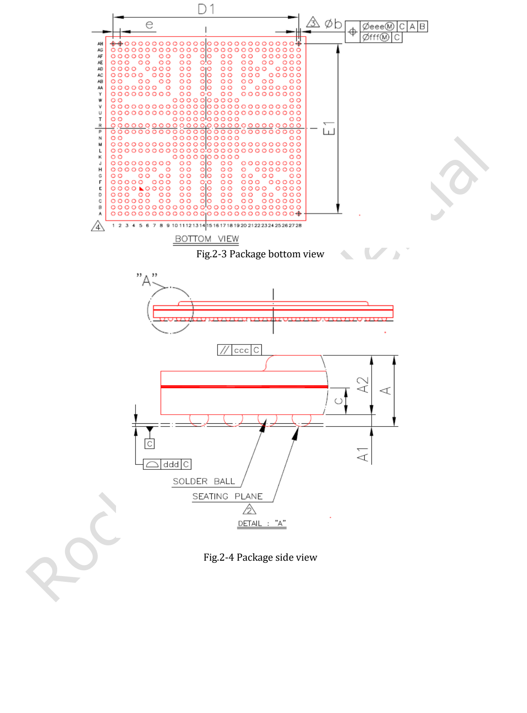
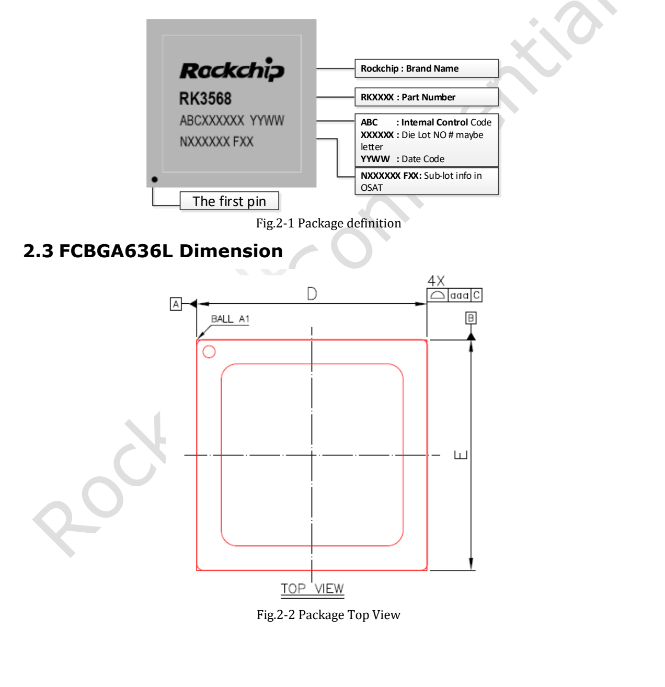
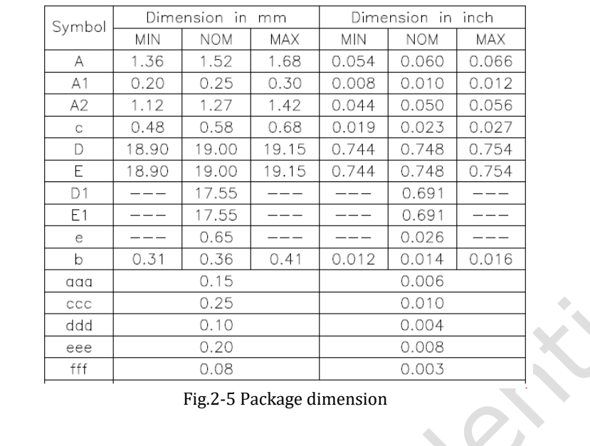

Dieser Artikel basiert auf der angegebenen Datenblattrevision. Die Werte sind Herstellerspezifikationen und keine ArmSoM-Messungen; neue Hardwaretests wurden nicht durchgeführt. Prüfen Sie Siliziumrevision, Schaltplan, SDK/BSP, Kernel und Treiber. Erläuterungen und editierbare Tabellen helfen beim Lesen; die vollständige Spezifikation und hier nicht vertiefte Bitdefinitionen stehen im Original-PDF.

**RK3568 · Rockchip RK3568 Datasheet V1.2-20210601.pdf · PDF 20–41.**

*Englische Originalabbildung, PDF S. 21.*

## Gehäuse vor dem Routing festlegen

Dies sind Gehäusenennmaße, keine Pad- oder Schablonenmaße. Ober-, Unter- und Ballansicht sind zu unterscheiden; A1 muss zu Footprint und Bestückungsplan passen. Ähnliche Teilenamen sind kein Ersatz.

| Merkmal | Spezifikation / Quellenhinweis |
|---|---|
| Gehäuse | FCBGA636L |
| Gehäusekörper | 19 × 19 mm |
| Balldurchmesser | 0.35 mm |
| Raster | 0.65 mm |

**Abweichende Gehäuseangaben:** Die Funktionsliste auf PDF-Seite 18 nennt 0,35 mm Balldurchmesser; Maß b auf Seite 22 lautet Min 0,31 / Nom 0,36 / Max 0,41 mm. Beide Angaben bleiben erhalten. Für Footprint- und Bestückungsfreigabe ist die aktuelle offizielle Gehäusespezifikation zu verwenden.

## Alternativfunktionen lesen

Schrägstriche trennen Alternativfunktionen eines Balls, keine unabhängig gleichzeitig nutzbaren Pins. Wählen Sie Peripherie und Mux-Gruppe, prüfen Sie dann sämtliche Signale, I/O-Versorgung und Einschaltzustände. Suffixe _M0, _u und _d bleiben erhalten. DDR-Zuordnungen verschiedener Speichertypen sind nicht austauschbar.

## Vollständige Balltabelle

Nach PDF-Seite gruppiert. Nur extraktionsbedingte Umbrüche in Signalnamen wurden verbunden; Namen oder fehlende Funktionen wurden nicht erfunden. Per Browsersuche finden und mit der Zeichnung abgleichen.
### PDF 23

| Ball | Signal und Alternativfunktionen (Original) |
|---|---|
| `A1` | `VSS_1` |
| `F22` | `SARADC_VIN5` |
| `A2` | `DDR4_CS0n/LPDDR4_CS0n_A/DDR3_ODT1/LPDDR3_ODT0/AC25` |
| `F24` | `I2S2_LRCK_RX_M0/GMAC0_RXDV_CRS/UART6_CTSn_M0/SPI1_CS0_M0/GPIO2_C0_d` |
| `A3` | `VSS_2` |
| `F25` | `I2S2_SCLK_TX_M0/GMAC0_MCLKINOUT/UART7_CTSn_M0/SPI2_MISO_M0/GPIO2_C2_d` |
| `A4` | `DDR4_CLKN/LPDDR4_CLKN_A/DDR3_CLKN/LPDDR3_CLKN/AC24` |
| `F26` | `I2S2_SDI_M0/GMAC0_RXER/UART8_TX_M0/SPI2_CS1_M0/GPIO2_C5_d` |
| `A5` | `DDR4_A9/LPDDR4_CLKN_B/DDR3_A5/-/AC9` |
| `F27` | `GMAC0_RXD0/UART1_CTSn_M0/SPI1_MISO_M0/GPIO2_B6_u` |
| `A6` | `VSS_3` |
| `F28` | `GMAC0_TXD0/UART1_RX_M0/GPIO2_B3_u` |
| `A7` | `DDR4_A6/LPDDR4_A1_B/DDR3_A13/LPDDR3_A1/AC6` |
| `G1` | `DDR_DQS0P_A/DDR4_DQSL_P_A/LPDDR4_DQS0P_A/DDR3_DQS0P/LPDDR3_DQS1P` |
| `A8` | `DDR4_A7/LPDDR4_ODT0_CA_B/DDR3_A8/-/AC7` |
| `G2` | `DDR_DQS0N_A/DDR4_DQSL_N_A/LPDDR4_DQS0N_A/DDR3_DQS0N/LPDDR3_DQS1N` |
| `A9` | `DDR_DQ1_B/DDR4_DQU5_B/LPDDR4_DQ1_B/DDR3_DQ17/LPDDR3_DQ5` |
| `G5` | `VSS_38` |
| `A10` | `VSS_4` |
| `G6` | `VSS_39` |
| `A11` | `DDR_DQS0P_B/DDR4_DQSU_P_B/LPDDR4_DQS0P_B/DDR3_DQS2P/LPDDR3_DQS0P` |
| `G8` | `VSS_40` |

### PDF 24

| Ball | Signal und Alternativfunktionen (Original) |
|---|---|
| `A12` | `DDR_DQ4_B/DDR4_DQU0_B/LPDDR4_DQ4_B/DDR3_DQ20/LPDDR3_DQ2` |
| `G9` | `VSS_41` |
| `A13` | `DDR_DQ13_B/DDR4_DQL5_B/LPDDR4_DQ13_B/DDR3_DQ29/LPDDR3_DQ17` |
| `G11` | `VSS_42` |
| `A14` | `VSS_5` |
| `G12` | `VSS_43` |
| `A15` | `DDR_DQS1N_B/DDR4_DQSL_N_B/LPDDR4_DQS1N_B/DDR3_DQS3N/LPDDR3_DQS2N` |
| `G14` | `VSS_44` |
| `A16` | `DDR_DQ8_B/DDR4_DQL0_B/LPDDR4_DQ8_B/DDR3_DQ24/LPDDR3_DQ18` |
| `G15` | `VSS_45` |
| `A17` | `DDR_DQ10_B/DDR4_DQL4_B/LPDDR4_DQ10_B/DDR3_DQ26/LPDDR3_DQ22` |
| `G17` | `VSS_46` |
| `A18` | `VSS_6` |
| `G18` | `VSS_47` |
| `A19` | `I2S1_MCLK_M0/UART3_RTSn_M0/SCR_CLK/PCIE30X1_PERSTn_M2/GPIO1_A2_d` |
| `G20` | `SARADC_VIN6` |
| `A20` | `I2S1_LRCK_TX_M0/UART4_RTSn_M0/SCR_RST/PCIE30X1_CLKREQn_M2/ACODEC_DAC_SYNC/GPIO1_A5_d` |
| `G21` | `SARADC_VIN4` |
| `A21` | `I2S1_SDO3_M0/I2S1_SDI1_M0/PDM_SDI1_M0/PCIE20_PERSTn_M2/GPIO1_B2_d` |
| `G23` | `I2S2_MCLK_M0/ETH0_REFCLKO_25M/UART7_RTSn_M0/SPI2_CLK_M0/GPIO2_C1_d` |
| `A22` | `FSPI_CLK/FLASH_ALE/GPIO1_D0_d` |
| `G24` | `VSS_48` |
| `A23` | `EMMC_CLKOUT/FLASH_DQS/GPIO1_C5_d` |
| `G27` | `GMAC0_TXD1/UART1_TX_M0/GPIO2_B4_u` |
| `A24` | `EMMC_D0/FLASH_D0/GPIO1_B4_u` |
| `G28` | `GMAC0_TXEN/UART1_RTSn_M0/SPI1_CLK_M0/GPIO2_B5_u` |
| `A25` | `EMMC_D4/FLASH_D4/GPIO1_C0_u` |
| `H1` | `DDR_DQ6_A/DDR4_DQL3_A/LPDDR4_DQ6_A/DDR3_DQ6/LPDDR3_DQ8` |
| `A26` | `EMMC_DATA_STROBE/FSPI_CS1n/FLASH_CLE/GPIO1_C6_d` |
| `H2` | `VSS_49` |
| `A27` | `FSPI_D3/FLASH_CS1n/GPIO1_D4_u` |
| `H3` | `VSS_50` |
| `A28` | `VSS_7` |
| `H4` | `DDR_DQ7_A/DDR4_DQL1_A/LPDDR4_DQ7_A/DDR3_DQ7/LPDDR3_DQ11` |
| `AA1` | `CIF_D6/EBC_SDDO6/SDMMC2_DET_M0/I2S1_SDI2_M1/VOP_BT656_D6_M1/GPIO3_D4_d` |
| `H5` | `DDR_DM0_A/DDR4_DML_A/LPDDR4_DM0_A/DDR3_DM0/LPDDR3_DM1` |
| `AA2` | `CIF_D11/EBC_SDDO11/GMAC1_RXD2_M1/PDM_SDI1_M1/GPIO4_A1_d` |
| `H6` | `VSS_51` |
| `AA3` | `CIF_D10/EBC_SDDO10/GMAC1_TXCLK_M1/PDM_CLK1_M1/GPIO4_A0_d` |
| `H7` | `DDR_RZQ` |
| `AA4` | `VSS_133` |
| `H9` | `DDRPHY_VDDQ_1` |
| `AA5` | `CIF_D7/EBC_SDDO7/SDMMC2_PWREN_M0/I2S1_SDI3_M1/VOP_BT656_D7_M1/GPIO3_D5_d` |
| `H11` | `DDRPHY_VDDQ_2` |
| `AA6` | `CIF_D1/EBC_SDDO1/SDMMC2_D1_M0/I2S1_SCLK_TX_M1/VOP_BT656_D1_M1/GPIO3_C7_d` |
| `H12` | `DDRPHY_VDDQ_3` |
| `AA7` | `LCDC_VSYNC/VOP_BT1120_D14/SPI1_MISO_M1/UART5_TX_M1/I2S1_SDO3_M2/GPIO3_C2_d` |
| `H14` | `DDRPHY_VDDQ_4` |
| `AA9` | `VSS_134` |
| `H15` | `DDRPHY_VDDQ_5` |
| `AA11` | `PWM15_IR_M1/SPI3_MOSI_M1/CAN1_TX_M1/PCIE30X2_WAKEn_M2/I2S3_SCLK_M1/GPIO4_C3_d` |
| `H17` | `VCCIO1` |
| `AA12` | `AVSS_24` |
| `H18` | `VCCIO2` |
| `AA14` | `AVSS_25` |
| `H20` | `OTP_VCC18` |
| `AA15` | `AVSS_26` |
| `H22` | `SARADC_AVDD_1V8` |
| `AA17` | `AVSS_27` |
| `H23` | `I2S2_SDO_M0/GMAC0_MDIO/UART9_CTSn_M0/SPI2_CS0_M0/GPIO2_C4_d` |
| `AA18` | `HDMI_TX_REXT` |
| `H24` | `I2S2_LRCK_TX_M0/GMAC0_MDC/UART9_RTSn_M0/SPI2_MOSI_M0/GPIO2_C3_d` |
| `AA20` | `I2C2_SDA_M0/SPI0_MOSI_M0/PCIE20_PERSTn_M0/PWM2_M1/GPIO0_B6_u` |
| `H25` | `I2S2_SCLK_RX_M0/GMAC0_RXD1/UART6_RTSn_M0/SPI1_MOSI_M0/GPIO2_B7_d` |
| `AA22` | `GPIO0_A3_u` |
| `H26` | `SDMMC0_D2/ARMJTAG_TCK/UART5_CTSn_M0/GPIO1_D7_u` |
| `AA23` | `VSS_135` |
| `H27` | `SDMMC0_CMD/PWM10_M1/UART5_RX_M0/CAN0_TX_M1/GPIO2_A1_u` |
| `AA24` | `AVSS_28` |
| `H28` | `SDMMC0_CLK/TEST_CLKOUT/UART5_TX_M0/CAN0_RX_M1/GPIO2_A2_d` |
| `AA25` | `PCIE30_REFCLKN_IN` |
| `J1` | `DDR_DQ4_A/DDR4_DQL7_A/LPDDR4_DQ4_A/DDR3_DQ4/LPDDR3_DQ13` |
| `AA26` | `AVSS_29` |
| `J2` | `DDR_DQ5_A/DDR4_DQL5_A/LPDDR4_DQ5_A/DDR3_DQ5/LPDDR3_DQ12` |
| `AA27` | `PCIE30_TX0N` |
| `J3` | `VSS_52` |
| `AA28` | `PCIE30_TX0P` |
| `J4` | `DDR_DM1_A/DDR4_DMU_A/LPDDR4_DM1_A/DDR3_DM1/LPDDR3_DM3` |
| `AB1` | `CIF_D3/EBC_SDDO3/SDMMC2_D3_M0/I2S1_SDO0_M1/VOP_BT656_D3_M1/GPIO3_D1_d` |
| `J5` | `VSS_53` |
| `AB2` | `VSS_136` |
| `J6` | `DDR_DQ13_A/DDR4_DQU4_A/LPDDR4_DQ13_A/DDR3_DQ13/LPDDR3_DQ31` |
| `AB5` | `CIF_D2/EBC_SDDO2/SDMMC2_D2_M0/I2S1_LRCK_TX_M1/VOP_BT656_D2_M1/GPIO3_D0_d` |
| `J7` | `DDR_DQ14_A/DDR4_DQU6_A/LPDDR4_DQ14_A/DDR3_DQ14/LPDDR3_DQ30` |
| `AB6` | `VSS_137` |
| `J8` | `DDR_AVSS` |

### PDF 25

| Ball | Signal und Alternativfunktionen (Original) |
|---|---|
| `AB8` | `LCDC_D8/VOP_BT1120_D0/SPI1_CS0_M1/PCIE30X1_PERSTn_M1/SDMMC2_D0_M1/GPIO3_A1_d` |
| `J9` | `DDRPHY_VDDQ_6` |
| `AB9` | `GPIO4_D2_d` |
| `J11` | `DDRPHY_VDDQL_1` |
| `AB11` | `AVSS_30` |
| `J12` | `DDRPHY_VDDQL_2` |
| `AB12` | `AVSS_31` |
| `J14` | `DDRPHY_VDDQL_3` |
| `AB14` | `AVSS_32` |
| `J15` | `VDD_CPU_1` |
| `AB15` | `AVSS_33` |
| `J17` | `VSS_54` |
| `AB17` | `AVSS_34` |
| `J18` | `VSS_55` |
| `AB18` | `HDMI_TX_HPDIN` |
| `J20` | `VSS_56` |
| `AB20` | `I2C1_SDA/CAN0_RX_M0/PCIE20_BUTTONRSTn/MCU_JTAG_TCK/GPIO0_B4_u` |
| `J21` | `VCCIO4` |
| `AB21` | `I2C0_SDA/GPIO0_B2_u` |
| `J22` | `VSS_57` |
| `AB23` | `GPIO0_D4_d` |
| `J23` | `SDMMC0_D3/ARMJTAG_TMS/UART5_RTSn_M0/GPIO2_A0_u` |
| `AB24` | `TVSS` |
| `J24` | `SDMMC0_D1/UART2_RX_M1/UART6_RX_M1/PWM9_M1/GPIO1_D6_u` |
| `AB27` | `PCIE30_TX1N` |
| `J25` | `SDMMC0_D0/UART2_TX_M1/UART6_TX_M1/PWM8_M1/GPIO1_D5_u` |
| `AB28` | `PCIE30_TX1P` |
| `J26` | `VSS_58` |
| `AC1` | `CIF_D5/EBC_SDDO5/SDMMC2_CLK_M0/I2S1_SDI1_M1/VOP_BT656_D5_M1/GPIO3_D3_d` |
| `J27` | `AVSS_1` |
| `AC2` | `PWM15_IR_M0/SPDIF_TX_M1/GMAC1_MDIO_M0/UART7_RX_M1/I2S1_LRCK_RX_M2/GPIO3_C5_d` |
| `J28` | `EDP_TX_D0P` |
| `AC3` | `PWM14_M0/VOP_PWM_M1/GMAC1_MDC_M0/UART7_TX_M1/PDM_CLK1_M2/GPIO3_C4_d` |
| `K1` | `VSS_59` |
| `AC4` | `LCDC_DEN/VOP_BT1120_D15/SPI1_CLK_M1/UART5_RX_M1/I2S1_SCLK_RX_M2/GPIO3_C3_d` |
| `K2` | `DDR_DQ12_A/DDR4_DQU2_A/LPDDR4_DQ12_A/DDR3_DQ12/LPDDR3_DQ26` |
| `AC5` | `CIF_D0/EBC_SDDO0/SDMMC2_D0_M0/I2S1_MCLK_M1/VOP_BT656_D0_M1/GPIO3_C6_d` |
| `K10` | `DDRPHY_VDDQL_4` |
| `AC7` | `LCDC_D3/VOP_BT656_D3_M0/SPI0_CLK_M1/PCIE30X1_WAKEn_M1/I2S1_SDI0_M2/GPIO2_D3_d` |
| `K11` | `VSS_60` |
| `AC8` | `LCDC_D2/VOP_BT656_D2_M0/SPI0_CS0_M1/PCIE30X1_CLKREQn_M1/I2S1_LRCK_TX_M2/GPIO2_D2_d` |
| `K12` | `VSS_61` |
| `AC9` | `AVSS_35` |
| `K13` | `VSS_62` |
| `AC11` | `AVSS_36` |
| `K14` | `VSS_63` |
| `AC12` | `AVSS_37` |
| `K15` | `VDD_CPU_2` |
| `AC14` | `MIPI_DSI_TX1_D2N` |
| `K16` | `VDD_CPU_3` |
| `AC15` | `AVSS_38` |
| `K17` | `VDD_CPU_4` |
| `AC17` | `MIPI_DSI_TX1_D1N` |
| `K18` | `VDD_CPU_5` |
| `AC18` | `AVSS_39` |
| `K19` | `VSS_64` |
| `AC20` | `UART2_RX_M0/GPIO0_D0_u` |
| `K27` | `EDP_TX_D0N` |
| `AC21` | `PWM6/SPI0_MISO_M0/PCIE30X2_WAKEn_M0/GPIO0_C5_d` |
| `K28` | `EDP_TX_D1P` |
| `AC22` | `I2C2_SCL_M0/SPI0_CLK_M0/PCIE20_WAKEn_M0/PWM1_M1/GPIO0_B5_u` |
| `L1` | `DDR_DQS1N_A/DDR4_DQSU_N_A/LPDDR4_DQS1N_A/DDR3_DQS1N/LPDDR3_DQS3N` |
| `AC24` | `GPIO0_D6_d` |
| `L2` | `DDR_DQS1P_A/DDR4_DQSU_P_A/LPDDR4_DQS1P_A/DDR3_DQS1P/LPDDR3_DQS3P` |
| `AC25` | `AVSS_40` |
| `L3` | `VSS_65` |
| `AC26` | `AVSS_41` |
| `L4` | `DDR_DQ15_A/DDR4_DQU0_A/LPDDR4_DQ15_A/DDR3_DQ15/LPDDR3_DQ27` |
| `AC27` | `PCIE30_RX0N` |
| `L5` | `VSS_66` |
| `AC28` | `PCIE30_RX0P` |
| `L6` | `DDR_DQ11_A/DDR4_DQU5_A/LPDDR4_DQ11_A/DDR3_DQ11/LPDDR3_DQ29` |
| `AD1` | `LCDC_HSYNC/VOP_BT1120_D13/SPI1_MOSI_M1/PCIE20_PERSTn_M1/I2S1_SDO2_M2/GPIO3_C1_d` |
| `L7` | `DDR_DQ10_A/DDR4_DQU7_A/LPDDR4_DQ10_A/DDR3_DQ10/LPDDR3_DQ28` |
| `AD2` | `LCDC_D23/PWM13_M0/GMAC1_MCLKINOUT_M0/UART3_RX_M1/PDM_SDI3_M2/GPIO3_C0_d` |
| `L8` | `VSS_67` |
| `AD3` | `VSS_138` |
| `L9` | `DDRPHY_VDDQ_7` |
| `AD4` | `LCDC_D22/PWM12_M0/GMAC1_TXEN_M0/UART3_TX_M1/PDM_SDI2_M2/GPIO3_B7_d` |
| `L10` | `DDRPHY_VDDQL_5` |
| `AD6` | `LCDC_D6/VOP_BT656_D6_M0/SPI2_MOSI_M1/PCIE30X2_PERSTn_M1/I2S1_SDI3_M2/GPIO2_D6_d` |
| `L11` | `VSS_68` |
| `AD7` | `LCDC_D1/VOP_BT656_D1_M0/SPI0_MOSI_M1/PCIE20_WAKEn_M1/I2S1_SCLK_TX_M2/GPIO2_D1_d` |
| `L12` | `VDD_LOGIC_1` |
| `AD8` | `PWM12_M1/SPI3_MISO_M1/SATA1_ACT_LED/UART9_TX_M1/I2S3_SDO_M1/GPIO4_C5_d` |
| `L13` | `VSS_69` |
| `AD9` | `MIPI_CSI_RX_D3P` |
| `L14` | `VSS_70` |
| `AD11` | `MIPI_CSI_RX_D2N` |
| `L15` | `VDD_CPU_6` |
| `AD12` | `MIPI_DSI_TX1_D3P` |
| `L16` | `VDD_CPU_7` |
| `AD14` | `MIPI_DSI_TX1_D2P` |
| `L17` | `VDD_CPU_8` |
| `AD15` | `MIPI_DSI_TX1_CLKP` |
| `L18` | `VDD_CPU_9` |
| `AD17` | `MIPI_DSI_TX1_D1P` |
| `L19` | `VSS_71` |
| `AD18` | `MIPI_DSI_TX1_D0P` |
| `L20` | `VSS_72` |

### PDF 26

| Ball | Signal und Alternativfunktionen (Original) |
|---|---|
| `AD20` | `PWM7_IR/SPI0_CS0_M0/PCIE30X2_PERSTn_M0/GPIO0_C6_d` |
| `L21` | `VSS_73` |
| `AD21` | `PWM5/SPI0_CS1_M0/UART0_RTSn/GPIO0_C4_d` |
| `L22` | `VCCIO3` |
| `AD22` | `PWM1_M0/GPUAVS/UART0_RX/GPIO0_C0_d` |
| `L23` | `USB3_OTG0_ID` |
| `AD23` | `CLK32K_IN/CLK32K_OUT0/PCIE30X2_BUTTONRSTn/GPIO0_B0_u` |
| `L24` | `AVSS_2` |
| `AD25` | `GPIO0_D5_d` |
| `L25` | `EDP_TX_AUXP` |
| `AD26` | `AVSS_42` |
| `L26` | `AVSS_3` |
| `AD27` | `PCIE30_RX1N` |
| `L27` | `EDP_TX_D1N` |
| `AD28` | `PCIE30_RX1P` |
| `L28` | `EDP_TX_D2P` |
| `AE1` | `LCDC_D19/VOP_BT1120_D10/GMAC1_RXER_M0/I2C5_SDA_M0/PDM_SDI1_M2/GPIO3_B4_d` |
| `M1` | `DDR_DQ8_A/DDR4_DQU3_A/LPDDR4_DQ8_A/DDR3_DQ8/LPDDR3_DQ25` |
| `AE2` | `LCDC_D20/VOP_BT1120_D11/GMAC1_TXD0_M0/I2C3_SCL_M1/PWM10_M0/GPIO3_B5_d` |
| `M2` | `VSS_74` |
| `AE3` | `LCDC_D21/VOP_BT1120_D12/GMAC1_TXD1_M0/I2C3_SDA_M1/PWM11_IR_M0/GPIO3_B6_d` |
| `M3` | `VSS_75` |
| `AE5` | `LCDC_D9/VOP_BT1120_D1/GMAC1_TXD2_M0/I2S3_MCLK_M0/SDMMC2_D1_M1/GPIO3_A2_d` |
| `M4` | `DDR_ECC_DQ1` |
| `AE6` | `VSS_139` |
| `M5` | `DDR_ECC_DQ2` |
| `AE8` | `PWM13_M1/SPI3_CS0_M1/SATA0_ACT_LED/UART9_RX_M1/I2S3_SDI_M1/GPIO4_C6_d` |
| `M6` | `VSS_76` |
| `AE9` | `MIPI_CSI_RX_D3N` |
| `M7` | `DDR_ECC_DQ4` |
| `AE11` | `MIPI_CSI_RX_D2P` |
| `M8` | `VSS_77` |
| `AE12` | `MIPI_DSI_TX1_D3N` |
| `M9` | `DDRPHY_VDDQ_8` |
| `AE14` | `AVSS_43` |
| `M10` | `DDRPHY_VDDQL_6` |
| `AE15` | `MIPI_DSI_TX1_CLKN` |
| `M11` | `VSS_78` |
| `AE17` | `AVSS_44` |
| `M12` | `VDD_LOGIC_2` |
| `AE18` | `MIPI_DSI_TX1_D0N` |
| `M13` | `VSS_79` |
| `AE20` | `AVSS_45` |
| `M14` | `VSS_80` |
| `AE21` | `VSS_140` |
| `M15` | `VDD_CPU_COM` |
| `AE23` | `PWM4/VOP_PWM_M0/PCIE30X1_PERSTn_M0/MCU_JTAG_TRSTn/GPIO0_C3_d` |
| `M16` | `VSS_81` |
| `AE24` | `GPU_PWREN/SATA_CP_POD/PCIE30X2_CLKREQn_M0/GPIO0_A6_d` |
| `M17` | `VDD_CPU_10` |
| `AE26` | `GPIO0_D3_d` |
| `M18` | `VSS_82` |
| `AE27` | `AVSS_46` |
| `M19` | `VDD_NPU_1` |
| `AE28` | `AVSS_47` |
| `M20` | `EDP_TX_AVDD_0V9` |
| `AF1` | `LCDC_D18/VOP_BT1120_D9/GMAC1_RXDV_CRS_M0/I2C5_SCL_M0/PDM_SDI0_M2/GPIO3_B3_d` |
| `M21` | `AVSS_4` |
| `AF2` | `LCDC_D17/VOP_BT1120_D8/GMAC1_RXD1_M0/UART4_TX_M1/PWM9_M0/GPIO3_B2_d` |
| `M22` | `EDP_TX_AVDD_1V8` |
| `AF3` | `VSS_141` |
| `M23` | `USB3_AVDD_3V3` |
| `AF4` | `LCDC_D11/VOP_BT1120_D3/GMAC1_RXD2_M0/I2S3_LRCK_M0/SDMMC2_D3_M1/GPIO3_A4_d` |
| `M24` | `USB3_OTG0_VBUSDET` |
| `AF5` | `LCDC_D4/VOP_BT656_D4_M0/SPI2_CS1_M1/PCIE30X2_CLKREQn_M1/I2S1_SDI1_M2/GPIO2_D4_d` |
| `M25` | `EDP_TX_AUXN` |
| `AF6` | `LCDC_D5/VOP_BT656_D5_M0/SPI2_CS0_M1/PCIE30X2_WAKEn_M1/I2S1_SDI2_M2/GPIO2_D5_d` |
| `M26` | `AVSS_5` |
| `AF8` | `PWM14_M1/SPI3_CLK_M1/CAN1_RX_M1/PCIE30X2_CLKREQn_M2/I2S3_MCLK_M1/GPIO4_C2_d` |
| `M27` | `EDP_TX_D2N` |
| `AF9` | `AVSS_48` |
| `M28` | `EDP_TX_D3P` |
| `AF11` | `AVSS_49` |
| `N1` | `VSS_83` |
| `AF12` | `AVSS_50` |
| `N2` | `DDR_DQ9_A/DDR4_DQU1_A/LPDDR4_DQ9_A/DDR3_DQ9/LPDDR3_DQ24` |
| `AF14` | `AVSS_51` |
| `N10` | `SYSPLL_AVDD_1V8` |
| `AF15` | `AVSS_52` |
| `N11` | `SYSPLL_AVSS` |
| `AF17` | `AVSS_53` |
| `N12` | `VSS_84` |
| `AF18` | `AVSS_54` |
| `N13` | `VDD_LOGIC_3` |
| `AF20` | `AVSS_55` |
| `N14` | `VSS_85` |
| `AF21` | `AVSS_56` |
| `N15` | `VSS_86` |
| `AF23` | `PWM2_M0/NPUAVS/UART0_TX/MCU_JTAG_TDI/GPIO0_C1_d` |
| `N16` | `VDD_LOGIC_4` |
| `AF24` | `I2C0_SCL/GPIO0_B1_u` |
| `N17` | `VSS_87` |
| `AF25` | `SDMMC0_PWREN/SATA_MP_SWITCH/PCIE20_CLKREQn_M0/GPIO0_A5_d` |
| `N18` | `VSS_88` |
| `AF26` | `VSS_142` |
| `N19` | `VDD_NPU_2` |
| `AF27` | `XOUT24M` |
| `N27` | `EDP_TX_D3N` |
| `AF28` | `XIN24M` |
| `N28` | `AVSS_6` |
| `AG1` | `LCDC_D16/VOP_BT1120_D7/GMAC1_RXD0_M0/UART4_RX_M1/PWM8_M0/GPIO3_B1_d` |
| `P1` | `DDR_ECC_DQS_N` |
| `AG2` | `LCDC_D15/VOP_BT1120_D6/ETH1_REFCLKO_25M_M0/SDMMC2_PWREN_M1/GPIO3_B0_d` |
| `P2` | `DDR_ECC_DQS_P` |

### PDF 27

| Ball | Signal und Alternativfunktionen (Original) |
|---|---|
| `AG3` | `LCDC_D13/VOP_BT1120_CLK/GMAC1_TXCLK_M0/I2S3_SDI_M0/SDMMC2_CLK_M1/GPIO3_A6_d` |
| `P3` | `VSS_89` |
| `AG4` | `LCDC_D10/VOP_BT1120_D2/GMAC1_TXD3_M0/I2S3_SCLK_M0/SDMMC2_D2_M1/GPIO3_A3_d` |
| `P4` | `DDR_ECC_DQ6` |
| `AG5` | `VSS_143` |
| `P5` | `DDR_ECC_DQ0` |
| `AG6` | `LCDC_D0/VOP_BT656_D0_M0/SPI0_MISO_M1/PCIE20_CLKREQn_M1/I2S1_MCLK_M2/GPIO2_D0_d` |
| `P6` | `VSS_90` |
| `AG7` | `HDMITX_SDA/I2C5_SDA_M1/GPIO4_D0_u` |
| `P7` | `DDR_ECC_DM` |
| `AG8` | `HDMITX_SCL/I2C5_SCL_M1/GPIO4_C7_u` |
| `P8` | `DDR_VREFOUT` |
| `AG9` | `MIPI_CSI_RX_CLK1P` |
| `P9` | `USB2_AVDD_1V8` |
| `AG10` | `MIPI_CSI_RX_CLK0P` |
| `P10` | `USB2_AVDD_3V3` |
| `AG11` | `MIPI_CSI_RX_D1P` |
| `P11` | `SYSPLL_AVDD_0V9` |
| `AG12` | `MIPI_CSI_RX_D0P` |
| `P12` | `VSS_91` |
| `AG13` | `MIPI_DSI_TX0_D3N/LVDS_TX0_D3N` |
| `P13` | `VDD_LOGIC_5` |
| `AG14` | `MIPI_DSI_TX0_D2N/LVDS_TX0_D2N` |
| `P14` | `VSS_92` |
| `AG15` | `MIPI_DSI_TX0_CLKN/LVDS_TX0_CLKN` |
| `P15` | `VSS_93` |
| `AG16` | `MIPI_DSI_TX0_D1N/LVDS_TX0_D1N` |
| `P16` | `VDD_LOGIC_6` |
| `AG17` | `MIPI_DSI_TX0_D0N/LVDS_TX0_D0N` |
| `P17` | `VSS_94` |
| `AG18` | `AVSS_57` |
| `P18` | `VDD_NPU_3` |
| `AG19` | `HDMI_TX_CLKN` |
| `P19` | `VDD_NPU_4` |
| `AG20` | `HDMI_TX_D0P` |
| `P20` | `VDD_NPU_5` |
| `AG21` | `HDMI_TX_D1P` |
| `P21` | `AVSS_7` |
| `AG22` | `HDMI_TX_D2P` |
| `P22` | `USB3_AVDD_0V9` |
| `AG23` | `PWM3_IR/EDP_HPDIN_M1/PCIE30X1_WAKEn_M0/MCU_JTAG_TMS/GPIO0_C2_d` |
| `P23` | `USB3_AVDD_1V8` |
| `AG24` | `I2C1_SCL/CAN0_TX_M0/PCIE30X1_BUTTONRSTn/MCU_JTAG_TDO/GPIO0_B3_u` |
| `P24` | `USB3_HOST1_DP` |
| `AG25` | `FLASH_VOL_SEL/GPIO0_A7_u` |
| `P25` | `USB3_HOST1_DM` |
| `AG26` | `TSADC_SHUT_M0/TSADC_SHUT_ORG/GPIO0_A1_z` |
| `P26` | `AVSS_8` |
| `AG27` | `REFCLK_OUT/GPIO0_A0_d` |
| `P27` | `USB3_OTG0_DP` |
| `AG28` | `PMIC_SLEEP/TSADC_SHUT_M1/GPIO0_A2_d` |
| `P28` | `USB3_OTG0_DM` |
| `AH1` | `VSS_144` |
| `R1` | `USB2_HOST2_DM` |
| `AH2` | `LCDC_D14/VOP_BT1120_D5/GMAC1_RXCLK_M0/SDMMC2_DET_M1/GPIO3_A7_d` |
| `R2` | `USB2_HOST2_DP` |
| `AH3` | `LCDC_D12/VOP_BT1120_D4/GMAC1_RXD3_M0/I2S3_SDO_M0/SDMMC2_CMD_M1/GPIO3_A5_d` |
| `R3` | `VSS_95` |
| `AH4` | `LCDC_CLK/VOP_BT656_CLK_M0/SPI2_CLK_M1/UART8_RX_M1/I2S1_SDO1_M2/GPIO3_A0_d` |
| `R4` | `DDR_ECC_DQ7` |
| `AH5` | `LCDC_D7/VOP_BT656_D7_M0/SPI2_MISO_M1/UART8_TX_M1/I2S1_SDO0_M2/GPIO2_D7_d` |
| `R5` | `DDR_ECC_DQ3` |
| `AH6` | `HDMITX_CEC_M0/SPI3_CS1_M1/GPIO4_D1_u` |
| `R6` | `VSS_96` |
| `AH7` | `EDP_HPDIN_M0/SPDIF_TX_M2/SATA2_ACT_LED/PCIE30X2_PERSTn_M2/I2S3_LRCK_M1/GPIO4_C4_d` |
| `R7` | `DDR_ECC_DQ5` |
| `AH8` | `VSS_145` |
| `R8` | `USB2_AVDD_0V9` |
| `AH9` | `MIPI_CSI_RX_CLK1N` |
| `R9` | `VCCIO6_1` |
| `AH10` | `MIPI_CSI_RX_CLK0N` |
| `R10` | `VSS_97` |
| `AH11` | `MIPI_CSI_RX_D1N` |
| `R11` | `VSS_98` |
| `AH12` | `MIPI_CSI_RX_D0N` |
| `R12` | `VDD_LOGIC_7` |
| `AH13` | `MIPI_DSI_TX0_D3P/LVDS_TX0_D3P` |
| `R13` | `VDD_GPU_1` |
| `AH14` | `MIPI_DSI_TX0_D2P/LVDS_TX0_D2P` |
| `R14` | `VSS_99` |
| `AH15` | `MIPI_DSI_TX0_CLKP/LVDS_TX0_CLKP` |
| `R15` | `VSS_100` |
| `AH16` | `MIPI_DSI_TX0_D1P/LVDS_TX0_D1P` |
| `R16` | `VDD_LOGIC_8` |
| `AH17` | `MIPI_DSI_TX0_D0P/LVDS_TX0_D0P` |
| `R17` | `VSS_101` |
| `AH18` | `AVSS_58` |
| `R18` | `VSS_102` |
| `AH19` | `HDMI_TX_CLKP` |
| `R19` | `VSS_103` |
| `AH20` | `HDMI_TX_D0N` |
| `R20` | `MULTI_PHY_AVDD_0V9_1` |
| `AH21` | `HDMI_TX_D1N` |
| `R21` | `MULTI_PHY_AVDD_0V9_2` |
| `AH22` | `HDMI_TX_D2N` |
| `R22` | `MULTI_PHY_AVDD_1V8` |
| `AH23` | `AVSS_59` |
| `R23` | `AVSS_9` |
| `AH24` | `UART2_TX_M0/GPIO0_D1_u` |
| `R24` | `MULTI_PHY0_REFCLKP` |
| `AH25` | `HDMITX_CEC_M1/PWM0_M1/UART0_CTSn/GPIO0_C7_d` |
| `R25` | `MULTI_PHY0_REFCLKN` |
| `AH26` | `PWM0_M0/CPUAVS/GPIO0_B7_d` |
| `R26` | `AVSS_10` |
| `AH27` | `nPOR_u` |
| `R27` | `USB3_OTG0_SSRXN/SATA0_RXN` |
| `AH28` | `VSS_146` |
| `R28` | `USB3_OTG0_SSRXP/SATA0_RXP` |
| `B1` | `DDR4_A2/LPDDR4_A1_A/DDR3_A4/LPDDR3_A6/AC2` |
| `T1` | `USB2_HOST3_DM` |
| `B2` | `DDR4_CS1n/LPDDR4_CS1n_A/DDR3_CS1n/LPDDR3_ODT1/AC26` |
| `T2` | `USB2_HOST3_DP` |
| `B3` | `DDR4_CKE/LPDDR4_CKE0_A/DDR3_CKE/LPDDR3_CKE/AC22` |
| `T10` | `VSS_104` |

### PDF 28

| Ball | Signal und Alternativfunktionen (Original) |
|---|---|
| `B4` | `DDR4_CLKP/LPDDR4_CLKP_A/DDR3_CLKP/LPDDR3_CLKP/AC23` |
| `T11` | `VSS_105` |
| `B5` | `VSS_8` |
| `T12` | `VDD_LOGIC_9` |
| `B6` | `DDR4_A0/LPDDR4_CLKP_B/DDR3_A9/-/AC0` |
| `T13` | `VDD_GPU_2` |
| `B7` | `DDR4_A5/LPDDR4_A5_B/DDR3_A11/LPDDR3_A2/AC5` |
| `T14` | `VSS_106` |
| `B8` | `DDR4_A13/LPDDR4_A0_B/DDR3_A14/LPDDR3_A0/AC13` |
| `T15` | `VSS_107` |
| `B9` | `VSS_9` |
| `T16` | `VDD_LOGIC_10` |
| `B10` | `DDR_DQ0_B/DDR4_DQU7_B/LPDDR4_DQ0_B/DDR3_DQ16/LPDDR3_DQ1` |
| `T17` | `VSS_108` |
| `B11` | `DDR_DQS0N_B/DDR4_DQSU_N_B/LPDDR4_DQS0N_B/DDR3_DQS2N/LPDDR3_DQS0N` |
| `T18` | `VSS_109` |
| `B12` | `VSS_10` |
| `T19` | `VSS_110` |
| `B13` | `DDR_DQ12_B/DDR4_DQL7_B/LPDDR4_DQ12_B/DDR3_DQ28/LPDDR3_DQ16` |
| `T27` | `USB3_OTG0_SSTXN/SATA0_TXN` |
| `B14` | `DDR_DQ15_B/DDR4_DQL3_B/LPDDR4_DQ15_B/DDR3_DQ31/LPDDR3_DQ21` |
| `T28` | `USB3_OTG0_SSTXP/SATA0_TXP` |
| `B15` | `DDR_DQS1P_B/DDR4_DQSL_P_B/LPDDR4_DQS1P_B/DDR3_DQS3P/LPDDR3_DQS2P` |
| `U1` | `VSS_111` |
| `B16` | `VSS_11` |
| `U2` | `CIF_CLKIN/EBC_SDCLK/GMAC1_MCLKINOUT_M1/UART1_CTSn_M1/I2S2_SCLK_RX_M1/GPIO4_C1_d` |
| `B17` | `DDR_DQ9_B/DDR4_DQL2_B/LPDDR4_DQ9_B/DDR3_DQ25/LPDDR3_DQ19` |
| `U3` | `CIF_CLKOUT/EBC_GDCLK/PWM11_IR_M1/GPIO4_C0_d` |
| `B18` | `DDR_DQ11_B/DDR4_DQL6_B/LPDDR4_DQ11_B/DDR3_DQ27/LPDDR3_DQ23` |
| `U4` | `CIF_VSYNC/EBC_SDOE/GMAC1_MDIO_M1/I2S2_SCLK_TX_M1/GPIO4_B7_d` |
| `B19` | `I2S1_SCLK_TX_M0/UART3_CTSn_M0/SCR_IO/PCIE30X1_WAKEn_M2/ACODEC_DAC_CLK/GPIO1_A3_d` |
| `U5` | `CIF_HREF/EBC_SDLE/GMAC1_MDC_M1/UART1_RTSn_M1/I2S2_MCLK_M1/GPIO4_B6_d` |
| `B20` | `I2S1_SDO0_M0/UART4_CTSn_M0/SCR_DET/AUDIOPWM_ROUT_N/ACODEC_DAC_DATAL/GPIO1_A7_d` |
| `U6` | `VSS_112` |
| `B21` | `I2S1_SDI0_M0/PDM_SDI0_M0/GPIO1_B3_d` |
| `U7` | `VSS_113` |
| `B22` | `EMMC_CMD/FLASH_WRn/GPIO1_C4_u` |
| `U8` | `VSS_114` |
| `B23` | `VSS_12` |
| `U9` | `VCCIO6_2` |
| `B24` | `EMMC_D2/FLASH_D2/GPIO1_B6_u` |
| `U10` | `VSS_115` |
| `B25` | `EMMC_D7/FLASH_D7/GPIO1_C3_u` |
| `U11` | `VDD_GPU_3` |
| `B26` | `VSS_13` |
| `U12` | `VDD_GPU_4` |
| `B27` | `SARADC_VIN0` |
| `U13` | `VDD_GPU_5` |
| `B28` | `SDMMC1_D2/GMAC0_RXCLK/UART7_RX_M0/GPIO2_A5_u` |
| `U14` | `VSS_116` |
| `C1` | `DDR4_A8/LPDDR4_ODT0_CA_A/DDR3_A6/LPDDR3_A9/AC8` |
| `U15` | `VSS_117` |
| `C2` | `DDR4_A11/LPDDR4_A0_A/DDR3_A7/LPDDR3_A8/AC11` |
| `U16` | `VSS_118` |
| `C3` | `VSS_14` |
| `U17` | `VSS_119` |
| `C4` | `DDR4_A12/LPDDR4_A3_A/DDR3_BA2/-/AC12` |
| `U18` | `VSS_120` |
| `C5` | `DDR4_A14_WEn/LPDDR4_A4_A/DDR3_A15/LPDDR3_A5/AC14` |
| `U19` | `PCIE30_RESREF` |
| `C6` | `VSS_15` |
| `U20` | `PCIE30_AVDD_0V9_2` |
| `C8` | `VSS_16` |
| `U21` | `PCIE30_AVDD_0V9_1` |
| `C9` | `VSS_17` |
| `U22` | `PCIE30_AVDD_1V8` |
| `C11` | `VSS_18` |
| `U23` | `AVSS_11` |
| `C12` | `VSS_19` |
| `U24` | `MULTI_PHY1_REFCLKN` |
| `C14` | `VSS_20` |
| `U25` | `MULTI_PHY1_REFCLKP` |
| `C15` | `VSS_21` |
| `U26` | `AVSS_12` |
| `C17` | `VSS_22` |
| `U27` | `USB3_HOST1_SSRXN/SATA1_RXN/QSGMII_RXN_M0` |
| `C18` | `VSS_23` |
| `U28` | `USB3_HOST1_SSRXP/SATA1_RXP/QSGMII_RXP_M0` |
| `C20` | `I2S1_LRCK_RX_M0/UART4_TX_M0/PDM_CLK0_M0/AUDIOPWM_ROUT_P/GPIO1_A6_d` |
| `V1` | `I2C4_SCL_M0/EBC_GDOE/ETH1_REFCLKO_25M_M1/SPI3_CLK_M0/I2S2_SDO_M1/GPIO4_B3_d` |
| `C21` | `EMMC_D1/FLASH_D1/GPIO1_B5_u` |
| `V2` | `ISP_PRELIGHT_TRIG/EBC_SDCE3/GMAC1_RXDV_CRS_M1/I2S1_SDO2_M1/GPIO4_B1_d` |
| `C23` | `FSPI_CS0n/FLASH_CS0n/GPIO1_D3_u` |
| `V3` | `VSS_121` |
| `C24` | `FSPI_D0/FLASH_RDY/GPIO1_D1_u` |
| `V4` | `I2C4_SDA_M0/EBC_VCOM/GMAC1_RXER_M1/SPI3_MOSI_M0/I2S2_SDI_M1/GPIO4_B2_d` |
| `C25` | `VSS_24` |
| `V5` | `I2C2_SCL_M1/EBC_SDSHR/CAN2_TX_M0/I2S1_SDO3_M1/GPIO4_B5_d` |
| `C26` | `SARADC_VIN1` |
| `V6` | `I2C2_SDA_M1/EBC_GDSP/CAN2_RX_M0/ISP_FLASH_TRIGIN/VOP_BT656_CLK_M1/GPIO4_B4_d` |
| `C27` | `SDMMC1_D3/GMAC0_TXD2/UART7_TX_M0/GPIO2_A6_u` |
| `V7` | `CAM_CLKOUT1/EBC_SDCE2/GMAC1_RXD1_M1/SPI3_MISO_M0/I2S1_SDO1_M1/GPIO4_B0_d` |
| `C28` | `SDMMC1_CMD/GMAC0_TXD3/UART9_RX_M0/GPIO2_A7_u` |
| `V8` | `VSS_122` |

### PDF 29

| Ball | Signal und Alternativfunktionen (Original) |
|---|---|
| `D1` | `DDR_DQ3_A/DDR4_DQL6_A/LPDDR4_DQ3_A/DDR3_DQ3/LPDDR3_DQ9` |
| `V9` | `VSS_123` |
| `D2` | `VSS_25` |
| `V10` | `VCCIO5_1` |
| `D3` | `VSS_26` |
| `V11` | `VCCIO5_2` |
| `D5` | `DDR4_A16_RASn/LPDDR4_A5_A/DDR3_RASn/LPDDR3_A7/AC16` |
| `V12` | `VCCIO7` |
| `D6` | `DDR4_A10/LPDDR4_CKE0_B/DDR3_A10/-/AC10` |
| `V13` | `VSS_124` |
| `D8` | `DDR4_ODT1/LPDDR4_CS0n_B/DDR3_CS0n/LPDDR3_CS0n/AC28` |
| `V14` | `AVSS_13` |
| `D9` | `DDR4_A4/LPDDR4_A3_B/DDR3_BA1/LPDDR3_A3/AC4` |
| `V15` | `AVSS_14` |
| `D11` | `VSS_27` |
| `V16` | `AVSS_15` |
| `D12` | `DDR_DQ2_B/DDR4_DQU3_B/LPDDR4_DQ2_B/DDR3_DQ18/LPDDR3_DQ6` |
| `V17` | `HDMI_TX_AVDD_0V9_1` |
| `D14` | `DDR_DM0_B/DDR4_DMU_B/LPDDR4_DM0_B/DDR3_DM2/LPDDR3_DM0` |
| `V18` | `HDMI_TX_AVDD_0V9_2` |
| `D15` | `DDR_DQ5_B/DDR4_DQU6_B/LPDDR4_DQ5_B/DDR3_DQ21/LPDDR3_DQ3` |
| `V19` | `PMU_VDD_LOGIC_0V9` |
| `D17` | `DDR_DQ14_B/DDR4_DQL1_B/LPDDR4_DQ14_B/DDR3_DQ30/LPDDR3_DQ20` |
| `V20` | `PMUPLL_AVSS` |
| `D18` | `I2C3_SDA_M0/UART3_RX_M0/CAN1_RX_M0/AUDIOPWM_LOUT_P/ACODEC_ADC_DATA/GPIO1_A0_u` |
| `V21` | `PMUPLL_AVDD_0V9` |
| `D20` | `I2S1_SDO1_M0/I2S1_SDI3_M0/PDM_SDI3_M0/PCIE20_CLKREQn_M2/ACODEC_DAC_DATAR/GPIO1_B0_d` |
| `V22` | `AVSS_16` |
| `D21` | `EMMC_D3/FLASH_D3/GPIO1_B7_u` |
| `V23` | `AVSS_17` |
| `D23` | `FSPI_D1/FLASH_RDn/GPIO1_D2_u` |
| `V24` | `PCIE20_REFCLKP` |
| `D24` | `SARADC_VIN2` |
| `V25` | `PCIE20_REFCLKN` |
| `D26` | `SDMMC1_PWREN/I2C4_SDA_M1/UART8_RTSn_M0/CAN2_RX_M1/GPIO2_B1_d` |
| `V26` | `AVSS_18` |
| `D27` | `SDMMC1_CLK/GMAC0_TXCLK/UART9_TX_M0/GPIO2_B0_d` |
| `V27` | `USB3_HOST1_SSTXN/SATA1_TXN/QSGMII_TXN_M0` |
| `D28` | `VSS_28` |
| `V28` | `USB3_HOST1_SSTXP/SATA1_TXP/QSGMII_TXP_M0` |
| `E1` | `DDR_DQ1_A/DDR4_DQL2_A/LPDDR4_DQ1_A/DDR3_DQ1/LPDDR3_DQ14` |
| `W1` | `CAM_CLKOUT0/EBC_SDCE1/GMAC1_RXD0_M1/SPI3_CS1_M0/I2S1_LRCK_RX_M1/GPIO4_A7_d` |
| `E2` | `DDR_DQ2_A/DDR4_DQL4_A/LPDDR4_DQ2_A/DDR3_DQ2/LPDDR3_DQ10` |
| `W2` | `ISP_FLASHTRIGOUT/EBC_SDCE0/GMAC1_TXEN_M1/SPI3_CS0_M0/I2S1_SCLK_RX_M1/GPIO4_A6_d` |
| `E3` | `VSS_29` |
| `W10` | `VSS_125` |
| `E4` | `DDR4_A15_CASn/LPDDR4_A2_A/DDR3_A0/-/AC15` |
| `W11` | `VSS_126` |
| `E6` | `DDR4_ACTn/LPDDR4_CKE1_B/DDR3_CASn/-/AC17` |
| `W12` | `VSS_127` |
| `E7` | `VSS_30` |
| `W13` | `VSS_128` |
| `E8` | `DDR4_ODT0/LPDDR4_CS1n_B/DDR3_ODT0/LPDDR3_CS1n/AC27` |
| `W14` | `MIPI_CSI_RX_AVDD_0V9` |
| `E9` | `DDR4_BA1/LPDDR4_A4_B/DDR3_A12/LPDDR3_A4/AC19` |
| `W15` | `MIPI_DSI_TX1_AVDD_0V9` |
| `E11` | `DDR4_BA0/LPDDR4_A2_B/DDR3_A1/-/AC18` |
| `W16` | `MIPI_DSI_TX0/LVDS_TX0_AVDD_0V9` |
| `E12` | `DDR_DQ3_B/DDR4_DQU1_B/LPDDR4_DQ3_B/DDR3_DQ19/LPDDR3_DQ4` |
| `W17` | `AVSS_19` |
| `E14` | `DDR_DQ7_B/DDR4_DQU2_B/LPDDR4_DQ7_B/DDR3_DQ23/LPDDR3_DQ0` |
| `W18` | `HDMI_TX_AVDD_1V8` |
| `E15` | `DDR_DQ6_B/DDR4_DQU4_B/LPDDR4_DQ6_B/DDR3_DQ22/LPDDR3_DQ7` |
| `W19` | `PMUIO2` |
| `E17` | `DDR_DM1_B/DDR4_DML_B/LPDDR4_DM1_B/DDR3_DM3/LPDDR3_DM2` |
| `W27` | `PCIE20_TXP/SATA2_TXP/QSGMII_TXP_M1` |
| `E18` | `I2C3_SCL_M0/UART3_TX_M0/CAN1_TX_M0/AUDIOPWM_LOUT_N/ACODEC_ADC_CLK/GPIO1_A1_u` |
| `W28` | `PCIE20_TXN/SATA2_TXN/QSGMII_TXN_M1` |
| `E20` | `I2S1_SDO2_M0/I2S1_SDI2_M0/PDM_SDI2_M0/PCIE20_WAKEn_M2/ACODEC_ADC_SYNC/GPIO1_B1_d` |
| `Y1` | `CIF_D15/EBC_SDDO15/GMAC1_TXD1_M1/UART9_RX_M2/I2S2_LRCK_RX_M1/GPIO4_A5_d` |
| `E21` | `EMMC_D5/FLASH_D5/GPIO1_C1_u` |
| `Y2` | `CIF_D14/EBC_SDDO14/GMAC1_TXD0_M1/UART9_TX_M2/I2S2_LRCK_TX_M1/GPIO4_A4_d` |
| `E22` | `EMMC_D6/FLASH_D6/GPIO1_C2_u` |
| `Y3` | `CIF_D13/EBC_SDDO13/GMAC1_RXCLK_M1/UART7_RX_M2/PDM_SDI3_M1/GPIO4_A3_d` |
| `E23` | `SARADC_VIN3` |
| `Y4` | `CIF_D12/EBC_SDDO12/GMAC1_RXD3_M1/UART7_TX_M2/PDM_SDI2_M1/GPIO4_A2_d` |
| `E25` | `SDMMC1_DET/I2C4_SCL_M1/UART8_CTSn_M0/CAN2_TX_M1/GPIO2_B2_u` |
| `Y5` | `CIF_D9/EBC_SDDO9/GMAC1_TXD3_M1/UART1_RX_M1/PDM_SDI0_M1/GPIO3_D7_d` |
| `E26` | `CLK32K_OUT1/UART8_RX_M0/SPI1_CS1_M0/GPIO2_C6_d` |
| `Y6` | `CIF_D8/EBC_SDDO8/GMAC1_TXD2_M1/UART1_TX_M1/PDM_CLK0_M1/GPIO3_D6_d` |
| `E27` | `SDMMC1_D0/GMAC0_RXD2/UART6_RX_M0/GPIO2_A3_u` |
| `Y7` | `CIF_D4/EBC_SDDO4/SDMMC2_CMD_M0/I2S1_SDI0_M1/VOP_BT656_D4_M1/GPIO3_D2_d` |
| `E28` | `SDMMC1_D1/GMAC0_RXD3/UART6_TX_M0/GPIO2_A4_u` |
| `Y8` | `VSS_129` |
| `F1` | `VSS_31` |
| `Y9` | `VSS_130` |
| `F2` | `DDR_DQ0_A/DDR4_DQL0_A/LPDDR4_DQ0_A/DDR3_DQ0/LPDDR3_DQ15` |
| `Y11` | `VSS_131` |

### PDF 30

| Ball | Signal und Alternativfunktionen (Original) |
|---|---|
| `F3` | `VSS_32` |
| `Y12` | `VSS_132` |
| `F4` | `DDR4_A3/LPDDR4_CKE1_A/DDR3_A3/-/AC3` |
| `Y14` | `MIPI_CSI_RX_AVDD_1V8` |
| `F5` | `DDR4_A1/-/DDR3_A2/-/AC1` |
| `Y15` | `MIPI_DSI_TX1_AVDD_1V8` |
| `F7` | `DDR4_BG1/LPDDR4_ODT1_CA_A/DDR3_BA0/-/AC21` |
| `Y17` | `MIPI_DSI_TX0/LVDS_TX0_AVDD_1V8` |
| `F8` | `DDR4_BG0/LPDDR4_ODT1_CA_B/DDR3_WEn/-/AC20` |
| `Y18` | `AVSS_20` |
| `F9` | `VSS_33` |
| `Y20` | `PMUIO1` |
| `F11` | `DDR4_RESETn/LPDDR4_RESETn/DDR3_RESETn/AC29` |
| `Y21` | `PMUPLL_AVDD_1V8` |
| `F12` | `VSS_34` |
| `Y22` | `SDMMC0_DET/SATA_CP_DET/PCIE30X1_CLKREQn_M0/GPIO0_A4_u` |
| `F14` | `VSS_35` |
| `Y23` | `AVSS_21` |
| `F15` | `VSS_36` |
| `Y24` | `AVSS_22` |
| `F17` | `VSS_37` |
| `Y25` | `PCIE30_REFCLKP_IN` |
| `F18` | `I2S1_SCLK_RX_M0/UART4_RX_M0/PDM_CLK1_M0/SPDIF_TX_M0/GPIO1_A4_d` |
| `Y26` | `AVSS_23` |
| `F20` | `EMMC_RSTn/FSPI_D2/FLASH_WPn/GPIO1_C7_d` |
| `Y27` | `PCIE20_RXP/SATA2_RXP/QSGMII_RXP_M1` |
| `F21` | `SARADC_VIN7` |
| `Y28` | `PCIE20_RXN/SATA2_RXN/QSGMII_RXN_M1` |

## Schaltplan- und Footprintprüfung

1. Vergleichen Sie jeden Library-Ball einschließlich VSS, Analogmasse und Versorgung.
2. Prüfen Sie Versorgungsgruppen, I/O-Pegel, Pulls, Reset und Bootsignale.
3. Prüfen Sie DDR- und Differenzsignal-Escape, Rückstrompfade und Entkopplung mit dem Designleitfaden.
4. NC und reservierte Pins sind nach Herstellervorgabe zu behandeln, nicht willkürlich zu erden.
5. Nicht alle I/O-Beschreibungen und Mux-Auswahlregister sind hier vertieft. Vor der Freigabe Original-PDF und aktuelles TRM prüfen.

## Weitere Originalabbildungen

*Englische Originalabbildung, PDF S. 20.*

*Englische Originalabbildung, PDF S. 22.*

## ArmSoM-Produkte und Einsatzgrenzen

Sige3 verwendet RK3568B2. Grundlage ist das allgemeine RK3568-Datenblatt V1.2; Bestellvariante B2, Platinenrevision und herausgeführte Schnittstellen müssen gesondert geprüft werden.

- [Sige3](https://www.armsom.org/sige3) · [Docs](https://docs.armsom.org/armsom-sige3)

## Datenblattserie und Original-PDF

- [RK3568 Übersicht](/de/articles/rk3568-datasheet-v12/)
- [RK3568: Gehäuse und vollständige Tabelle der 636 Balls](/de/articles/rk3568-package-pin-reference/)
- [RK3568: DDR, Displays und PCIe/SATA/USB-Zuordnung](/de/articles/rk3568-architecture-phy-resource-planning/)
- [RK3568: Versorgung, I/O und Wärmewiderstand](/de/articles/rk3568-electrical-power-thermal/)
- [Vollständiges Original-PDF herunterladen](/assets/datasheet-series-20261110/Rockchip-RK3568-Datasheet-V1.2-20210601.pdf)
