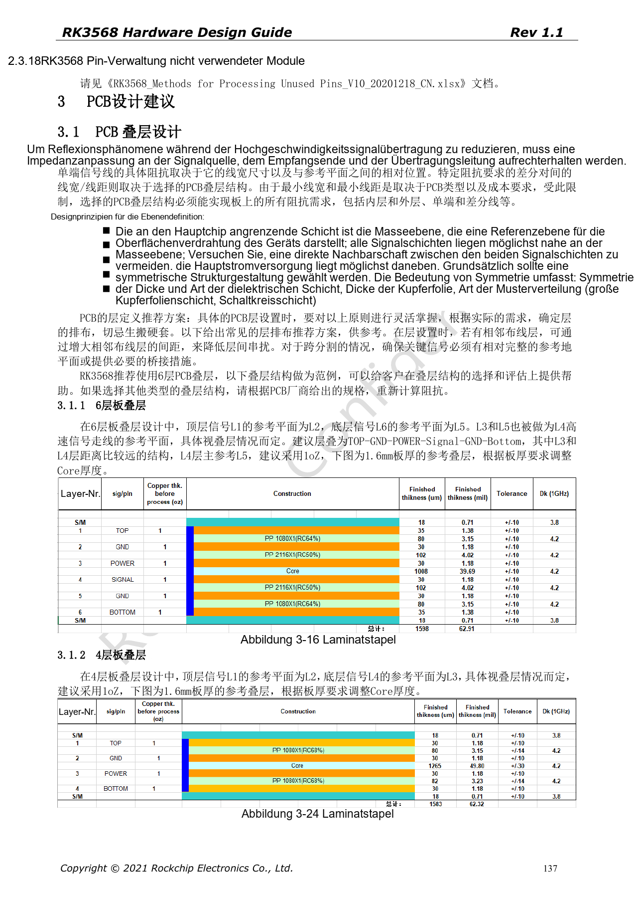
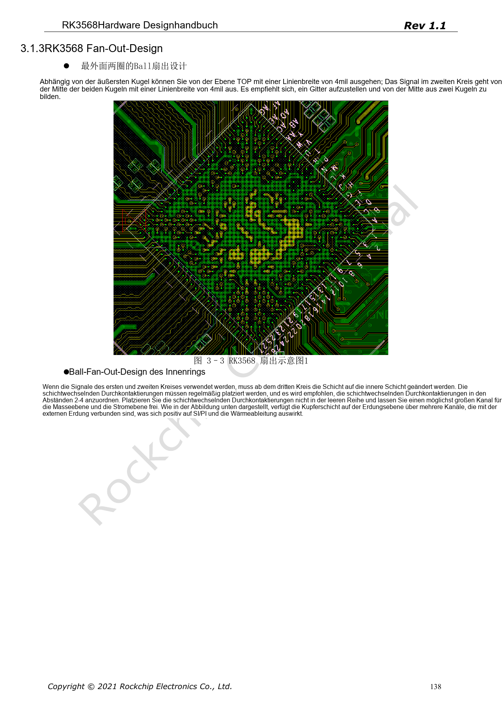
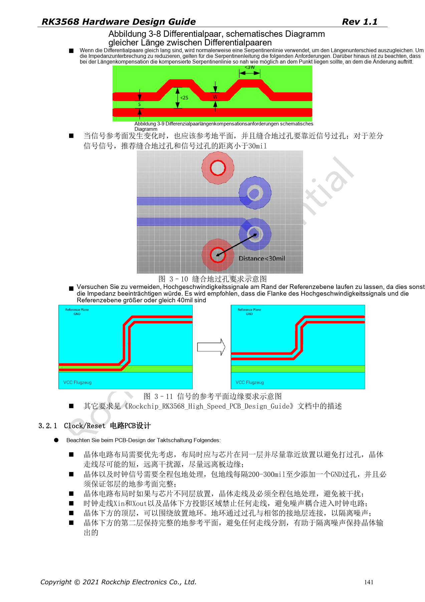

# RK3568-PCB-Design: Stackup, Fanout und Rückstrompfade

Die Reihe ordnet RK3568 Hardware Design Guide V1.1 (Chinesisch, 2021-06-08) und den separaten High Speed PCB Design Guide V1.0.0 (Englisch, 2021-04-12) nach Entwicklungsfragen. ArmSoM [Sige3](https://www.armsom.org/sige3) verwendet RK3568B2. Die [Boarddokumentation](https://docs.armsom.org/armsom-sige3) bietet einen Produktbezug zum Lernen und Bewerten dieser Entwurfsfragen. SoC-Referenzschaltungen beschreiben nicht alle tatsächlichen Schaltungen und herausgeführten Schnittstellen des Sige3. SDK/BSP, Kernel, Chiprevision, Firmware und Peripheriekombination prüfen. Werte sind Quellenreferenzen, keine ArmSoM-Messungen.

**CN V1.1 §3.1–3.2 · EN PCB V1.0.0 §1.1–1.26**

## Ein Referenzstackup ist kein Fertigungsauftrag

Die Quelle zeigt vier und sechs Lagen. Sechslagiges Beispiel: TOP–GND–POWER–Signal–GND–Bottom, 1.6mm und 1oz Kupfer. Dielektrikum, Kupfer und Laminierung beeinflussen Impedanz; Breite und Abstand mit dem Hersteller anhand der Zielwerte berechnen. Ein Vierlagenbeispiel garantiert keine beliebige Peripherie- und Wärmekonfiguration.

## Beim Fanout Masse- und Versorgungskanäle erhalten

Die äußeren zwei Ballreihen verwenden beispielhaft 4mil. Innere Vias regelmäßig setzen; nach zwei bis vier Reihen empfiehlt die Quelle eine freie Reihe, damit Flächenkanäle erhalten bleiben. Bei Referenzwechsel Massevias nahe an Signalvias platzieren; differenzieller Referenzabstand <30mil. High-Speed-Traces ≥40mil vom Flächenrand führen und Längendifferenzen nahe ihrer Entstehung kompensieren.

## Den englischen Leitfaden als separate Quelle behandeln

Die 45 englischen Seiten ergänzen Routingregeln für USB, SATA, PCIe, Display, Speicher, RGMII und DDR; sie übersetzen nicht die 199 chinesischen Seiten. Einheiten, strikte und inklusive Grenzen sowie Empfehlung und Minimum erhalten. DDR-Daten-, Befehls-, Steuer- und ECC-Tabellen hängen von der Topologie ab. Eine einzige Bus-Matchingregel reicht nicht. Freigabeunterlagen sollten Regeln, Ausnahmen und Simulationen enthalten.

## Versorgungslayout ebenso wie Stecker prüfen

Masserückwege der Entkopplung, PMIC-Schleifen, SoC-Feedback und Hochstromkupfer beeinflussen Stabilität. WLAN von DDR/HDMI/USB/Displaystörungen fernhalten. Antennenzuleitung: Referenz 50Ω, kurz und ohne Abzweige; VBAT-Referenzbreite >40mil. SI/PI und Funk mit realem Stackup, Fertigung, Kabeln und Gehäuse prüfen. Quellenbreiten sind keine universellen Impedanzwerte.

## Quellenparameter und Vorgaben

| Punkt | Quellenreferenz |
| --- | --- |
| Sechslagenbeispiel | TOP–GND–POWER–Signal–GND–Bottom |
| Äußerer Ball-Fanout | 4mil reference |
| Signalvia → Massevia | <30mil reference |
| Signal → Flächenrand | ≥40mil reference |

## Quellenabbildungen

Die Quellenseiten erhalten Schaltungsbeschriftung und Kontext; Text und Tabellen bleiben editierbar. Eine passende englische Ausgabe des chinesischen Haupthandbuchs liegt nicht vor, daher bleiben dessen Abbildungen in allen Sprachen chinesisch. Bilder des separaten englischen PCB-Handbuchs sind entsprechend markiert. Seitenzahlen beziehen sich auf physische PDF-Seiten.

Chinesisches Hardwarehandbuch · PDF 137

Chinesisches Hardwarehandbuch · PDF 138

Chinesisches Hardwarehandbuch · PDF 141

## Weiterlesen und Entwicklungsunterlagen

- [RK3568-Hardwaredesign: 10 Themen zu Schaltung, PCB und Fertigung](/de/articles/rk3568-hardware-design-series/)
- [RK3568-Audio und Steuerung: I2S, UART, SPI, CAN und I2C](/de/articles/rk3568-audio-control-interfaces-hardware/)
- [RK3568-Fertigungsprüfung: Wärme, ESD, Montage und Lagerung](/de/articles/rk3568-thermal-esd-assembly-hardware/)
- [ArmSoM Docs](https://docs.armsom.org/)
- [ArmSoM](https://www.armsom.org/)
