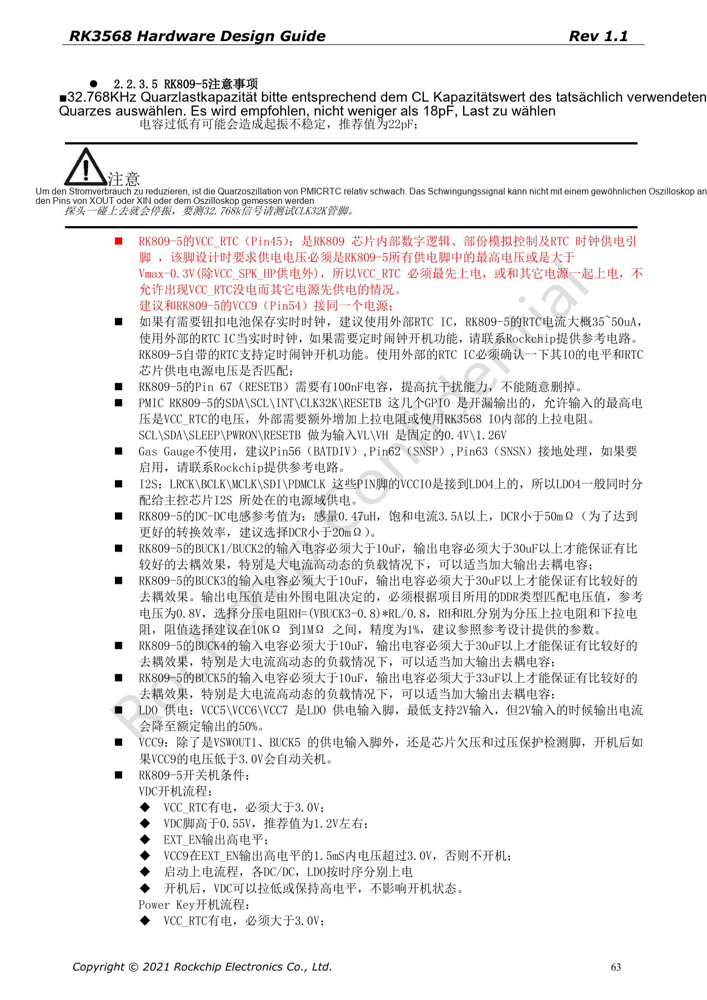
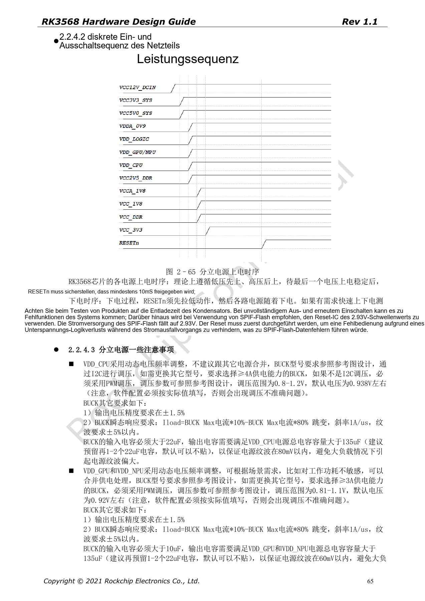

# RK3568-Versorgung und IO-Domänen: RK809-5 und Standby

Die Reihe ordnet RK3568 Hardware Design Guide V1.1 (Chinesisch, 2021-06-08) und den separaten High Speed PCB Design Guide V1.0.0 (Englisch, 2021-04-12) nach Entwicklungsfragen. ArmSoM [Sige3](https://www.armsom.org/sige3) verwendet RK3568B2. Die [Boarddokumentation](https://docs.armsom.org/armsom-sige3) bietet einen Produktbezug zum Lernen und Bewerten dieser Entwurfsfragen. SoC-Referenzschaltungen beschreiben nicht alle tatsächlichen Schaltungen und herausgeführten Schnittstellen des Sige3. SDK/BSP, Kernel, Chiprevision, Firmware und Peripheriekombination prüfen. Werte sind Quellenreferenzen, keine ArmSoM-Messungen.

**CN V1.1 §2.1.11; §2.2 · PDF 44–67**

## Versorgung und Software abgleichen

PMUIO0 ist fest 1.8V, PMUIO1 fest 3.3V. PMUIO2 und VCCIO1–7 unterstützen 1.8V/3.3V; VCCIO2 wird jedoch per FLASH_VOL_SEL gewählt. DTS-Werte der übrigen konfigurierbaren Domänen müssen den realen Spannungen entsprechen, ebenso Peripheriepegel und Pull-ups. Vor dem Abschalten ungenutzter Domänen auch die Pflichtversorgung beim ersten Einschalten prüfen.

## Spitzenstrom ist keine Systemleistung

Allgemein werden CPU-BUCKs mit mindestens 4A und GPU/NPU/LOGIC-BUCKs mit mindestens 2A verlangt. CPU-Gesamtkapazität >135µF, GPU/NPU/LOGIC in den allgemeinen Abschnitten >90µF. VDD_CPU_COM an die BUCK-Rückführung anschließen, um PCB-Spannungsabfall zu berücksichtigen. Seite 67 enthält einzelne Spitzenwerte; diese nicht zu einer SoC-Spitze oder Kühlleistung addieren. Start, Dauerlast, DVFS und Lastsprünge messen.

## Sequenzierung und Standby gemeinsam prüfen

Bei diskreter Versorgung RESETn mindestens 10ms nach Stabilisierung der letzten Schiene aktiv halten und beim Ausschalten zuerst aktivieren. Schnelle Neustarts erfordern eine Betrachtung der Kondensatorentladung. PMIC_SLEEP ist im Betrieb low, im Standby high und nach dem Aufwachen wieder low. DDR-Self-Refresh, PMU und benötigte Wake-IOs versorgen. USB-HID-Wakeup benötigt versorgten USB-PHY. DTS-Knoten unversorgter Module deaktivieren, damit Initialisierung nicht hängen bleibt.

## Quellenunterschiede sichtbar lassen

Seite 53 verlangt LOGIC-BUCK ≥2A, die diskrete Lösung auf Seite 66 ≥1.5A. Allgemeine Lastsprungwelligkeit: ±3%; diskreter Abschnitt: ±5%. Auch LOGIC-Kapazitäten sind mit >90µF und >99µF angegeben. Diese Vorgaben werden nicht stillschweigend vereinheitlicht. Mit aktuellen Errata, Referenzdesign und Reglermodellen klären und unter realer PCB-, Temperatur- und Lastbedingung prüfen.

## Vollständige Quellen-Spitzenstromtabelle

Tabelle 2–14, PDF-Seite 67. TBD bleibt unbestimmt. Werte nicht als SoC-Leistung summieren.

| PowerName | V | mA |
| --- | --- | --- |
| PMUPLL_AVDD_0V9 | 0.9 | 10 |
| PMUPLL_AVDD_1V8 | 1.8 | 9 |
| SYSPLL_AVDD_0V9 | 0.9 | 30 |
| SYSPLL_AVDD_1V8 | 1.8 | 18 |
| PMU_VDD_LOGIC_0V9 | 0.9 | 50 |
| VDD_CPU | DVFS | 3000 |
| VDD_GPU | DVFS | 1200 |
| VDD_NPU | DVFS | 1000 |
| VDD_LOGIC | 0.9 | 1200 |
| DDRPHY_VDDQ | 1.1/1.2/1.35/1.5 | TBD |
| DDRPHY_VDDQL | 0.6/1.1/1.2/1.35/1.5 | TBD |
| USB3_AVDD_0V9 | 0.9 | 5 |
| USB3_AVDD_1V8 | 1.8 | 30 |
| USB3_AVDD_3V3 | 3.3 | 10 |
| USB2_AVDD_0V9 | 0.9 | 5 |
| USB2_AVDD_1V8 | 1.8 | 30 |
| USB2_AVDD_3V3 | 3.3 | 10 |
| MULTI_PHY_AVDD_0V9 | 0.9 | 150 |
| MULTI_PHY_AVDD_1V8 | 1.8 | 21 |
| PCIE30_AVDD_0V9 | 0.9 | 160 |
| PCIE30_AVDD_1V8 | 1.8 | 60 |
| MIPI_CSI_RX_AVDD_0V9 | 0.9 | 10 |
| MIPI_CSI_RX_AVDD_1V8 | 1.8 | 2.5 |
| MIPI_DSI_TX0/LVDS_TX0_AVDD_0V9 | 0.9 | 50 |
| MIPI_DSI_TX0/LVDS_TX0_AVDD_1V8 | 1.8 | 15 |
| MIPI_DSI_TX1_AVDD_0V9 | 0.9 | 50 |
| MIPI_DSI_TX1_AVDD_1V8 | 1.8 | 15 |
| eDP_TX_AVDD_0V9 | 0.9 | 150 |
| eDP_TX_AVDD_1V8 | 1.8 | 100 |
| HDMI_TX_AVDD_0V9 | 0.9 | 25 |
| HDMI_TX_AVDD_1V8 | 1.8 | 16 |
| SARADC_AVDD_1V8 | 1.8 | 1.5 |
| OTP_VCC18 | 1.8 | 59 |
| PMUIO0 | 1.8 | TBD |
| PMUIO1 | 3.3 | TBD |
| PMUIO2/VCCIO1/2/3/4/5/6/7/ | 1.8/3.3 | TBD |


## Quellenparameter und Vorgaben

| Punkt | Quellenreferenz |
| --- | --- |
| VDD_CPU | BUCK ≥4A; C >135µF |
| VDD_GPU / VDD_NPU | BUCK ≥2A; C >90µF |
| VDD_LOGIC | p53 ≥2A / p66 ≥1.5A |
| RESETn | ≥10ms after final rail stable |
| PMIC_SLEEP | RUN=0; SLEEP=1 |

DTS-Quellenbeispiel bei realen 3.3V an VCCIO4. Versorgungsreferenz muss dazu passen; nicht blind auf andere Boards übertragen.

```dts
&pmu_io_domains {
    status = "okay";
    pmuio2-supply = <&vcc_3v3>;
    vccio1-supply = <&vcc_3v3>;
    vccio3-supply = <&vcc_3v3>;
    vccio4-supply = <&vcc_3v3>;
    vccio5-supply = <&vcc_3v3>;
    vccio6-supply = <&vcc_3v3>;
    vccio7-supply = <&vcc_3v3>;
};
```

## Quellenabbildungen

Die Quellenseiten erhalten Schaltungsbeschriftung und Kontext; Text und Tabellen bleiben editierbar. Eine passende englische Ausgabe des chinesischen Haupthandbuchs liegt nicht vor, daher bleiben dessen Abbildungen in allen Sprachen chinesisch. Bilder des separaten englischen PCB-Handbuchs sind entsprechend markiert. Seitenzahlen beziehen sich auf physische PDF-Seiten.

[](/assets/localized/figures/de/3ad031645b7713d9f24a.png)

Chinesisches Hardwarehandbuch · PDF 63

[](/assets/localized/figures/de/3931ac2d2fa776ffb863.png)

Chinesisches Hardwarehandbuch · PDF 65

## Weiterlesen und Entwicklungsunterlagen

- [RK3568-Hardwaredesign: 10 Themen zu Schaltung, PCB und Fertigung](/de/articles/rk3568-hardware-design-series/)
- [RK3568-Minimalsystem: Takt, Reset, Boot und Debug](/de/articles/rk3568-boot-clock-reset-hardware/)
- [RK3568-DDR-Design: Bausteine, Topologie, ECC und Routing](/de/articles/rk3568-ddr-topology-routing/)
- [ArmSoM Docs](https://docs.armsom.org/)
- [ArmSoM](https://www.armsom.org/)
