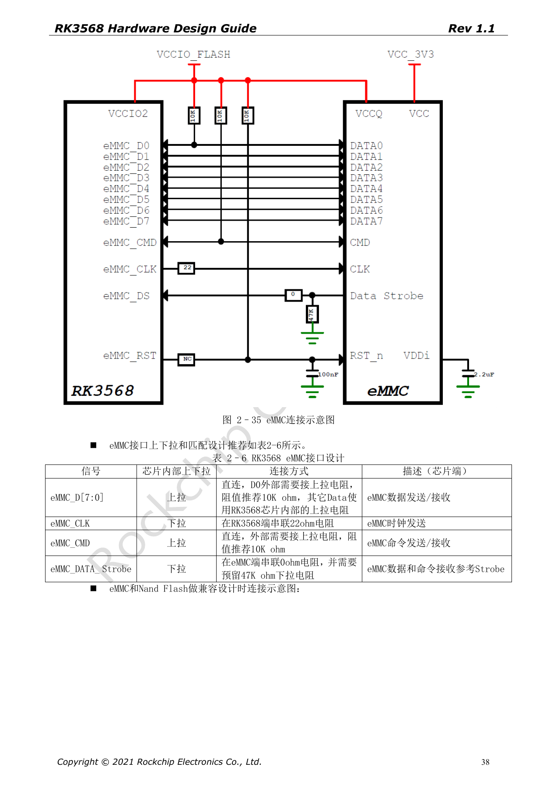
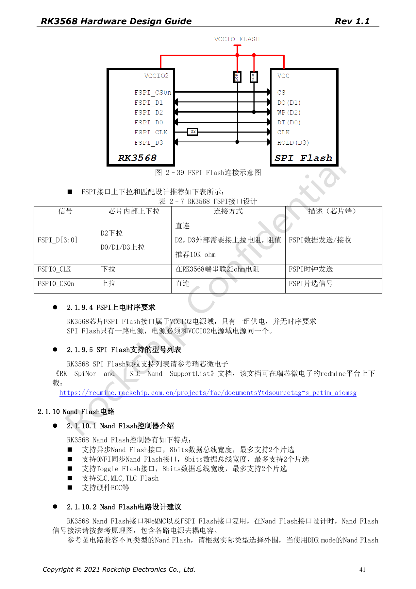
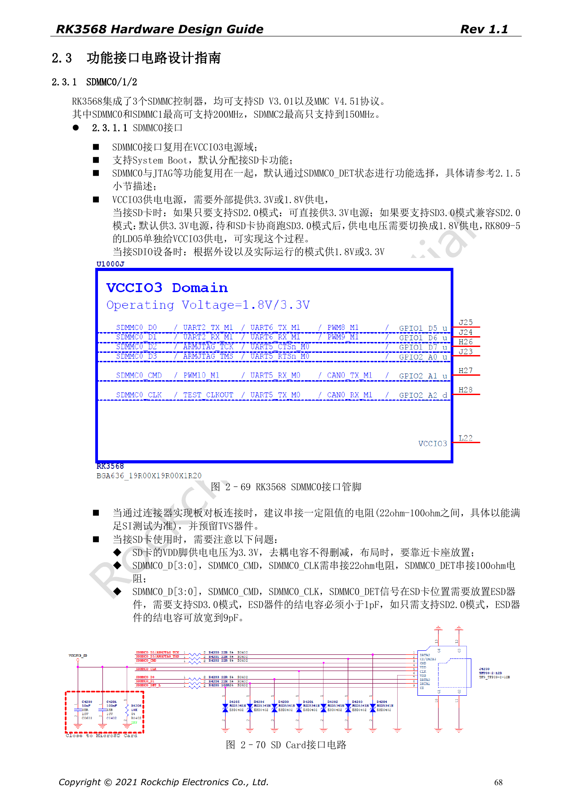

# RK3568-Bootspeicher: eMMC-, FSPI-, NAND- und SDMMC-Schaltungen

Die Reihe ordnet RK3568 Hardware Design Guide V1.1 (Chinesisch, 2021-06-08) und den separaten High Speed PCB Design Guide V1.0.0 (Englisch, 2021-04-12) nach Entwicklungsfragen. ArmSoM [Sige3](https://www.armsom.org/sige3) verwendet RK3568B2. Die [Boarddokumentation](https://docs.armsom.org/armsom-sige3) bietet einen Produktbezug zum Lernen und Bewerten dieser Entwurfsfragen. SoC-Referenzschaltungen beschreiben nicht alle tatsächlichen Schaltungen und herausgeführten Schnittstellen des Sige3. SDK/BSP, Kernel, Chiprevision, Firmware und Peripheriekombination prüfen. Werte sind Quellenreferenzen, keine ArmSoM-Messungen.

**CN V1.1 §2.1.8–2.1.10; §2.3.1 · EN PCB §1.11–1.15**

## Gemeinsame Pins bestimmen das Bootdesign

eMMC, NAND und FSPI teilen Ressourcen. VCCIO2 und FLASH_VOL_SEL müssen vor dem Einschalten übereinstimmen; eine Korrektur nach dem Boot ist zu spät. Genannt sind eMMC 4.41/4.51/5.0/5.1, 1/4/8-bit und HS200. Modus anhand von Baustein, Loader und BSP wählen. Mehrere Bestückungsvarianten benötigen eine Prüfung von Verzweigungen und unbestückten Stubs.

## Widerstände, Pull-ups und Wiederherstellung

eMMC D0 und CMD erhalten externe 10kΩ-Pull-ups, CLK 22Ω am SoC. Data Strobe erhält 0Ω am eMMC und eine Option für 47kΩ-Pull-down. FSPI D2/D3 benötigen 10kΩ-Pull-ups, CLK 22Ω; Flash und VCCIO2 verwenden dieselbe Versorgung. Der originale Maskrom-Serviceweg über Testpunkte verlangt das Lösen der Kurzverbindung nach Erkennung und ist wegen möglicher IO-Schäden kein normaler Updateweg. Zuerst einen regulären Loader-Zugang vorsehen.

## SD-Kartenversorgung und Signalpegel unterscheiden

Bootfähiges SDMMC0 liegt in VCCIO3. SDMMC1 dient standardmäßig SDIO-WLAN in VCCIO4 und bootet das System nicht. Die Quelle nennt 200MHz für SDMMC0/1 und 150MHz für SDMMC2. Karten-VDD bleibt 3.3V; für SD3.0 wird die IO-Domäne nach Aushandlung auf 1.8V umgeschaltet. ESD-Kapazität <1pF für SD3.0, bis 9pF für SD2.0. IO-Umschaltung nicht mit Kartenversorgung verwechseln.

## Geschwindigkeit in PCB-Vorgaben umsetzen

Die englischen Tabellen verlangen 50Ω±10% für diese Single-Ended-Busse. eMMC: Daten–Takt <120mil, Länge <4in; FSPI: <200mil und <4in. SDIO/SDMMC: <120mil, Länge <6in bei ≤50Mbps, sonst <4in. Mbps wird als Quelleneinheit erhalten und nicht in MHz umgeschrieben. Zielrate, Bausteinvarianten, Stromausfall und Dauerzugriffe prüfen.

## Quellenparameter und Vorgaben

| Punkt | Quellenreferenz |
| --- | --- |
| eMMC CLK / D0 / CMD | 22Ω / 10kΩ pull-up / 10kΩ pull-up |
| FSPI CLK / D2 / D3 | 22Ω / 10kΩ pull-up / 10kΩ pull-up |
| eMMC / FSPI length | <4in / <4in |
| SDMMC0/1 / SDMMC2 | ≤200MHz / ≤150MHz |

## Quellenabbildungen

Die Quellenseiten erhalten Schaltungsbeschriftung und Kontext; Text und Tabellen bleiben editierbar. Eine passende englische Ausgabe des chinesischen Haupthandbuchs liegt nicht vor, daher bleiben dessen Abbildungen in allen Sprachen chinesisch. Bilder des separaten englischen PCB-Handbuchs sind entsprechend markiert. Seitenzahlen beziehen sich auf physische PDF-Seiten.

Chinesisches Hardwarehandbuch · PDF 38

Chinesisches Hardwarehandbuch · PDF 41

Chinesisches Hardwarehandbuch · PDF 68

## Weiterlesen und Entwicklungsunterlagen

- [RK3568-Hardwaredesign: 10 Themen zu Schaltung, PCB und Fertigung](/de/articles/rk3568-hardware-design-series/)
- [RK3568-DDR-Design: Bausteine, Topologie, ECC und Routing](/de/articles/rk3568-ddr-topology-routing/)
- [RK3568-Erweiterungen: USB, SATA, PCIe-Multiplexing und Takt](/de/articles/rk3568-usb-sata-pcie-hardware/)
- [ArmSoM Docs](https://docs.armsom.org/)
- [ArmSoM](https://www.armsom.org/)
