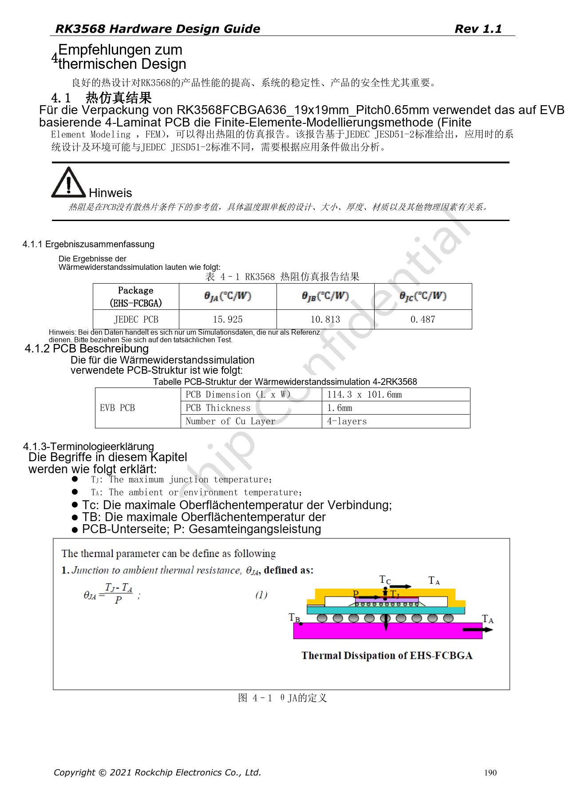
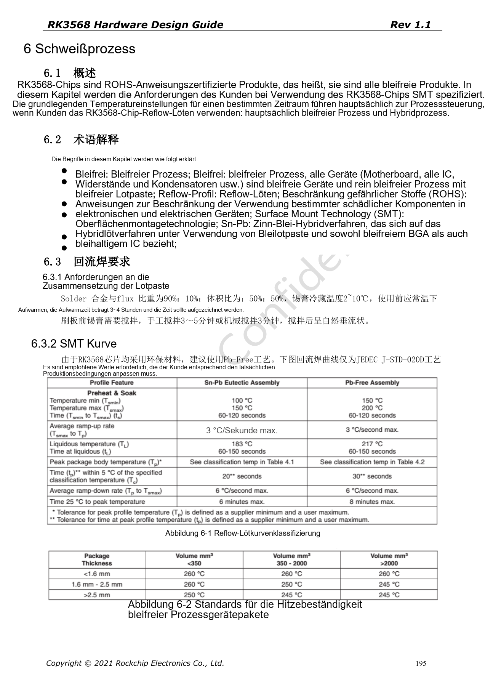
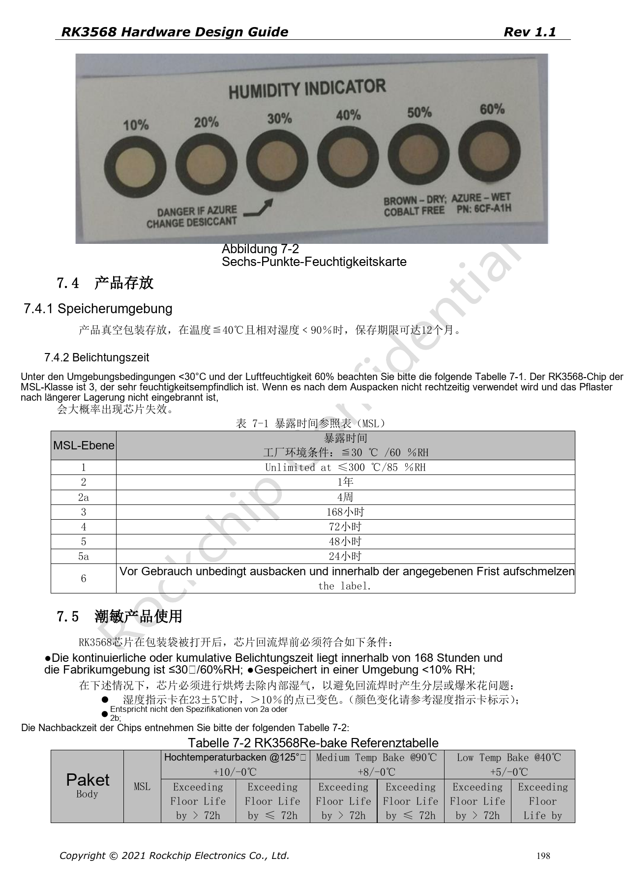

# RK3568-Fertigungsprüfung: Wärme, ESD, Montage und Lagerung

Die Reihe ordnet RK3568 Hardware Design Guide V1.1 (Chinesisch, 2021-06-08) und den separaten High Speed PCB Design Guide V1.0.0 (Englisch, 2021-04-12) nach Entwicklungsfragen. ArmSoM [Sige3](https://www.armsom.org/sige3) verwendet RK3568B2. Die [Boarddokumentation](https://docs.armsom.org/armsom-sige3) bietet einen Produktbezug zum Lernen und Bewerten dieser Entwurfsfragen. SoC-Referenzschaltungen beschreiben nicht alle tatsächlichen Schaltungen und herausgeführten Schnittstellen des Sige3. SDK/BSP, Kernel, Chiprevision, Firmware und Peripheriekombination prüfen. Werte sind Quellenreferenzen, keine ArmSoM-Messungen.

**CN V1.1 §4–7 · PDF 190–199**

## Thermische Ergebnisse gelten für konkrete Bedingungen

Die Simulation betrifft FCBGA636, 19×19mm, Raster 0.65mm auf einem 114.3×101.6mm großen, 1.6mm dicken Vierlagen-EVB ohne Kühlkörper. Das garantiert keine Sperrschichttemperatur beliebiger Träger und Gehäuse. Die Bildprüfung von Tabelle 4-1 bestätigt θJA=15.925°C/W, θJB=10.813°C/W und θJC=0.487°C/W. Dies sind Herstellersimulationen, keine Projektmessungen.

## Wärme betrifft mehr als den SoC

Empfohlen sind 20–50mm zwischen SoC und RK809-5, ausreichend Kupfer und Massevias sowie verteilte Wärmequellen. Hochstromkupfer muss ausreichend belastbar sein. Das geschlossene Produkt unter realer paralleler CPU/GPU/NPU-, Video- und IO-Last prüfen und Umgebung, Firmware, Frequenz und Drosselung dokumentieren. Auch PMIC, Induktivitäten und Backlightversorgung messen.

## ESD hängt von Rückwegen ab

Schutz nahe an externen Steckern beziehungsweise Eintrittspunkten platzieren und Oberflächenmasse erhalten. Signalleitungen sollen Stecker-Masseflächen nicht zerschneiden. Reset-, Takt- und Interruptnetze laut Quelle mindestens 5mm vom Rand; nPOR-100nF dicht am Pin mit kurzem Masseweg. Gehäuse, Schirme, Stecker und Versorgung bestimmen gemeinsam den Entladungsweg. Das ersetzt keine System-EMV-/ESD-Prüfung.

## MSL3 vor dem Reflow verwalten

Die Quelle klassifiziert RK3568 als MSL3 mit 168 Stunden kumulierter Offenzeit bei ≤30°C/60%RH. Vakuumlagerung: ≤40°C, <90%RH, bis zwölf Monate, unter Beachtung des Verpackungsetiketts. Nachtrocknungszeiten unterscheiden Dicke ≤1.4mm und Überschreitung über/unter 72h; Zeiten für 125°C, 90°C und 40°C nicht vermischen. Die MSL1-Zeile enthält „≤300°C“; dieser offensichtliche Quellenfehler wird protokolliert, nicht als Lagerbedingung verwendet.

## Quellenparameter und Vorgaben

| Punkt | Quellenreferenz |
| --- | --- |
| MSL3-Offenzeit | 168h at ≤30°C /60%RH |
| Gehäusedicke | ≤1.4mm |
| Nachtrocknen 125°C +10/−0°C | >72h: 9h; ≤72h: 7h |
| Nachtrocknen 90°C +8/−0°C | >72h: 33h; ≤72h: 23h |
| Nachtrocknen 40°C +5/−0°C | >72h: 13d; ≤72h: 9d |

## Quellenabbildungen

Die Quellenseiten erhalten Schaltungsbeschriftung und Kontext; Text und Tabellen bleiben editierbar. Eine passende englische Ausgabe des chinesischen Haupthandbuchs liegt nicht vor, daher bleiben dessen Abbildungen in allen Sprachen chinesisch. Bilder des separaten englischen PCB-Handbuchs sind entsprechend markiert. Seitenzahlen beziehen sich auf physische PDF-Seiten.

Chinesisches Hardwarehandbuch · PDF 190

Chinesisches Hardwarehandbuch · PDF 195

Chinesisches Hardwarehandbuch · PDF 198

## Weiterlesen und Entwicklungsunterlagen

- [RK3568-Hardwaredesign: 10 Themen zu Schaltung, PCB und Fertigung](/de/articles/rk3568-hardware-design-series/)
- [RK3568-PCB-Design: Stackup, Fanout und Rückstrompfade](/de/articles/rk3568-pcb-stackup-return-path-design/)
- [ArmSoM Docs](https://docs.armsom.org/)
- [ArmSoM](https://www.armsom.org/)
