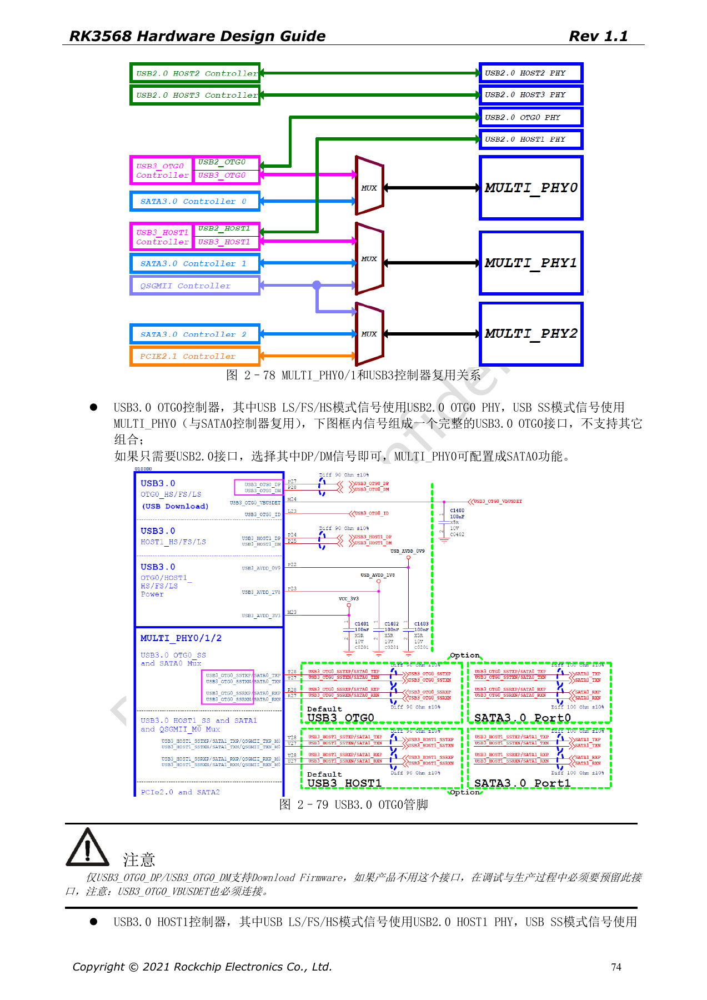
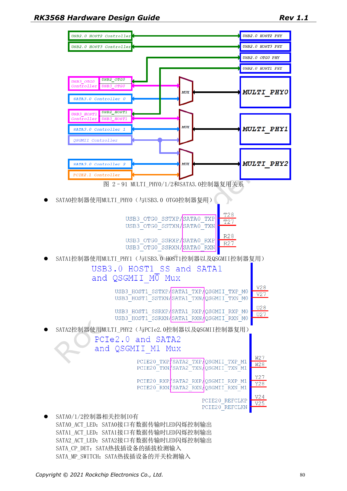
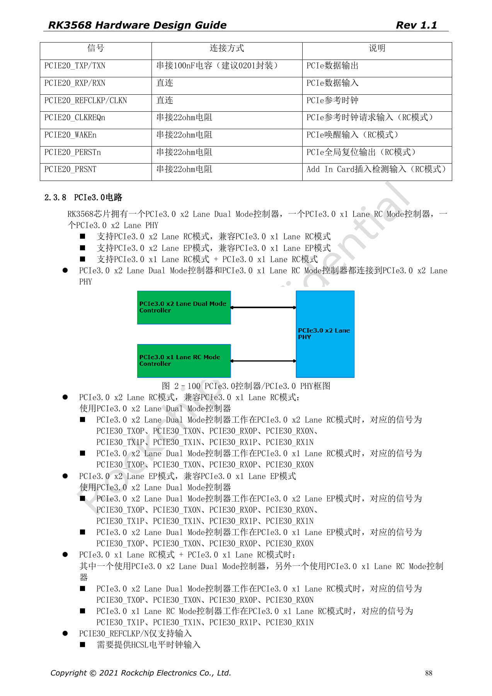

# RK3568-Erweiterungen: USB, SATA, PCIe-Multiplexing und Takt

Die Reihe ordnet RK3568 Hardware Design Guide V1.1 (Chinesisch, 2021-06-08) und den separaten High Speed PCB Design Guide V1.0.0 (Englisch, 2021-04-12) nach Entwicklungsfragen. ArmSoM [Sige3](https://www.armsom.org/sige3) verwendet RK3568B2. Die [Boarddokumentation](https://docs.armsom.org/armsom-sige3) bietet einen Produktbezug zum Lernen und Bewerten dieser Entwurfsfragen. SoC-Referenzschaltungen beschreiben nicht alle tatsächlichen Schaltungen und herausgeführten Schnittstellen des Sige3. SDK/BSP, Kernel, Chiprevision, Firmware und Peripheriekombination prüfen. Werte sind Quellenreferenzen, keine ArmSoM-Messungen.

**CN V1.1 §2.3.4–2.3.8 · EN PCB §1.1–1.6**

## Zuerst eine PHY-Matrix erstellen

MULTI_PHY0 wählt USB3 OTG0 oder SATA0. MULTI_PHY1 wählt USB3 HOST1, SATA1 oder QSGMII/SGMII. MULTI_PHY2 wählt PCIe2.0, SATA2 oder QSGMII/SGMII. Controllerzahlen sind keine Summe gleichzeitig nutzbarer Ports. USB3-SuperSpeed mit dem vorgesehenen USB2-PHY kombinieren; OTG0 DP/DM und VBUSDET als Downloadpfad erhalten.

## PCIe2 und PCIe3 haben verschiedene Taktrichtungen

PCIe2.0 ist x1 RC; REFCLK ist standardmäßig Ausgang, kann aber Eingang sein. PCIe3.0 nutzt einen Zwei-Lane-PHY als x2 RC, x2 EP oder zwei x1 RC. Sein REFCLK ist nur Eingang und benötigt einen PCIe3.0-konformen HCSL-Takt. CLKREQn/WAKEn als Funktionspins aus derselben M0/M1/M2-Gruppe nutzen. PERSTn darf GPIO sein; als Funktionspin muss die Gruppe passen. Standard-Slot-Signale mit 3.3V an die IO-Domäne anpassen.

## Kopplung und Impedanz je Schnittstelle verwalten

Der englische PCB-Leitfaden nennt USB3 TX 100nF, SATA TX/RX 10nF, PCIe2 TX 100nF und PCIe3 TX 220nF, jeweils ±20%, vorzugsweise 0201. USB-Daten: 90Ω±10%; SATA: 100Ω±10%; PCIe-Daten: 85Ω±10%; PCIe-REFCLK: 100Ω±10%. Eine pauschale 100Ω-Regel ist falsch. Für PCIe3 wird Post-Layout-Simulation einschließlich Stecker, Vias, Kondensatoren und Kanalverlusten empfohlen.

## Die reale Kombination validieren

Controller, PHY, Takt, IO-Gruppe, Versorgung und DTS vor Enumeration, Zielrate, Suspend/Resume und Dauertransfer festhalten. Bis zu fünf SATA-Geräte pro Port via Port Multiplier ist eine Quellenangabe, keine Freigabe beliebiger Treiber und Erweiterungsplatinen. Die PCIe-Tabelle nennt außerdem „Max inter-pair skew <6inches“, gleich der Gesamtlängengrenze. Diese Angabe nicht als präzises Matchingziel interpretieren.

## Quellenparameter und Vorgaben

| Punkt | Quellenreferenz |
| --- | --- |
| USB3 | 90Ω±10%; <12mil; <6in; 100nF±20% |
| SATA3 | 100Ω±10%; <12mil; <6in; 10nF±20% |
| PCIe2 | 85Ω±10%; <12mil; <6in; 100nF±20% |
| PCIe3 | 85Ω±10%; <12mil; <6in; 220nF±20% |

## Quellenabbildungen

Die Quellenseiten erhalten Schaltungsbeschriftung und Kontext; Text und Tabellen bleiben editierbar. Eine passende englische Ausgabe des chinesischen Haupthandbuchs liegt nicht vor, daher bleiben dessen Abbildungen in allen Sprachen chinesisch. Bilder des separaten englischen PCB-Handbuchs sind entsprechend markiert. Seitenzahlen beziehen sich auf physische PDF-Seiten.

Chinesisches Hardwarehandbuch · PDF 74

Chinesisches Hardwarehandbuch · PDF 80

Chinesisches Hardwarehandbuch · PDF 88

## Weiterlesen und Entwicklungsunterlagen

- [RK3568-Hardwaredesign: 10 Themen zu Schaltung, PCB und Fertigung](/de/articles/rk3568-hardware-design-series/)
- [RK3568-Bootspeicher: eMMC-, FSPI-, NAND- und SDMMC-Schaltungen](/de/articles/rk3568-storage-emmc-fspi-sdmmc-hardware/)
- [RK3568-Ethernet: zwei GMACs, RGMII und QSGMII](/de/articles/rk3568-ethernet-rgmii-qsgmii-hardware/)
- [ArmSoM Docs](https://docs.armsom.org/)
- [ArmSoM](https://www.armsom.org/)
