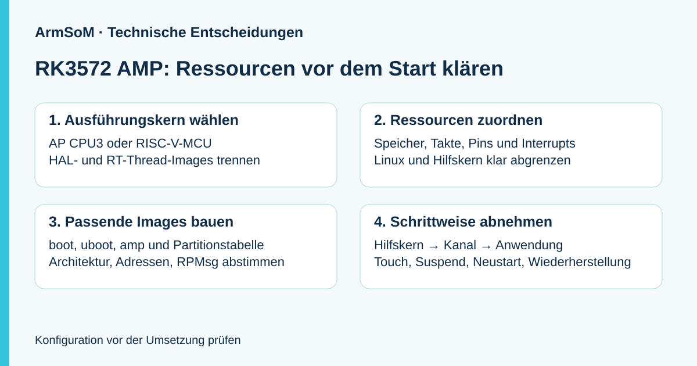

**Die erste RK3572-AMP-Aufgabe ist die Ressourcenzuordnung, nicht das bloße Kompilieren von RT-Thread.** Android und Hilfskern-Firmware müssen Speicher, Peripherie, Interrupts und Einsprungadressen gemeinsam festlegen. Erst dann lassen sich Bedienoberfläche und Netzwerk bei Android und ausgewählte Steuerungsaufgaben beim Hilfskern betreiben.

Dieser ArmSoM-Leitfaden basiert auf dem bereitgestellten Projekt **RK3572 EVB1, Android 16, Linux 6.12**. Er ist keine validierte Image-Anleitung für ein bestimmtes ArmSoM-RK3572-Produkt. Adressen, Pfade und Einstellungen gehören zur Beispielbasis. Der Screenshot endet im Wiederherstellungsabschnitt; fehlende Schritte werden nicht erfunden.



## 1. Eine von vier Kombinationen wählen

| Kombination | Hilfsressource | Firmware | Android-Anforderung |
| --- | --- | --- | --- |
| 1 | AP CPU3 | Rockchip HAL | Diesen Kern aus Linux SMP herausnehmen |
| 2 | AP CPU3 | RT-Thread | Ebenso, mit passender AP-Architektur und Adresse |
| 3 | RISC-V-MCU | Rockchip HAL | AP-Kerne bleiben Android, Peripherie separat zuordnen |
| 4 | RISC-V-MCU | RT-Thread | Hauptweg hier, eigenständig gebaute Firmware |

AP- und MCU-Images werden durch den gleichen Namen `amp.img` nicht austauschbar. Im Beispiel lautet der AP-Pfad `rk3572-64/Image/amp.img`, der MCU-Pfad `rk3572-mcu/Image/amp.img`. Auch AP-Start und MCU-Standalone-Start in U-Boot unterscheiden sich.

RPMsg dient der Kommunikation und schützt gemeinsame Ressourcen nicht automatisch. Die Linux-Dokumentation weist auf möglichen Zugriff von Hilfsprozessoren auf physischen Speicher und Peripherie hin; Kanäle und Nachrichtenrechte sollten begrenzt werden. [Linux RPMsg](https://docs.kernel.org/staging/rpmsg.html)

## 2. Repositories, Toolchain und Buildumfang festlegen

Benötigt werden zusammenpassende Releases von `u-boot`, `rkbin`, `kernel-6.12`, `device/rockchip` und `rt-thread-rk3572`. Androids `build.sh` ist kein RT-Thread-Builder; die Hilfsfirmware entsteht separat.

Für den MCU-Weg den Toolchainpfad durch einen echten absoluten Pfad ersetzen und die SDK-Anforderung an den Compiler prüfen:

```bash
cd rt-thread-rk3572/bsp/rockchip/rk3572-mcu
export RTT_EXEC_PATH=/absolute/path/to/riscv-toolchain/bin
test -x "$RTT_EXEC_PATH/riscv64-unknown-elf-gcc"
scons --menuconfig
scons -j8
./mkimage.sh
```

`RT_USING_RPMSG_LITE` aktiviert die Nachrichtenfunktion. Testbefehle können `RT_USING_COMMON_TEST` sowie GPIO/WDT-Optionen voraussetzen. `.config`, `rtconfig.h` und Ausgabe müssen übereinstimmen. Das Beispiel verpackt mit `mkimage.sh` die `rtt.bin` als FIT `Image/amp.img`; MCU-Ladeadresse ist `0x45000000`, kein allgemeiner Standard anderer BSPs.

## 3. Reservierten Speicher beidseitig abstimmen

Die folgende Zuordnung stammt aus dem Beispielprojekt und ist keine Vorlage für beliebige Boards.

| Bereich | Basis | Reservierung |
| --- | --- | --- |
| mcu_reserved | 0x45000000 | 2 MiB |
| amp_shmem_reserved | 0x45200000 | 2 MiB |
| rpmsg_reserved | 0x45400000 | 2 MiB |
| rpmsg_dma_reserved | 0x45600000 | 2 MiB |
| amp_reserved | 0x45800000 | 32 MiB |
| amp_uart_reserved | 0x47800000 | 128 KiB |

Das exklusive Ende von `amp_reserved` ist `0x47800000`; der nächste Bereich schließt ohne Überlappung an. Der AP-CPU3-Einstieg im Beispiel liegt bei `0x46400000` und unterscheidet sich vom MCU-Einstieg.

Der RPMsg-Knoten bildet nur den `0x20000` Byte großen vring-Bereich ab und verweist über `memory-region` auf einen separaten DMA-Pool. Reservierung, Abbildung und Nutzdatenkapazität sind nicht identisch:

```dts
rpmsg: rpmsg@45400000 {
    compatible = "rockchip,rpmsg";
    mbox-names = "rpmsg-rx", "rpmsg-tx";
    mboxes = <&mailbox0 0 &mailbox3 0>;
    rockchip,vdev-nums = <1>;
    rockchip,link-id = <0x03>;
    reg = <0x0 0x45400000 0x0 0x20000>;
    memory-region = <&rpmsg_dma_reserved>;
    status = "okay";
};
```

`rockchip,link-id`, Mailboxen und Adressen müssen zur rpmsg-lite-Konfiguration passen. `0x03` stammt aus dem Beispiel, nicht aus einer Ableitung des Kanalnamens. Zusammengeführten Device Tree und Linkerskripte prüfen: Beide Seiten können erfolgreich bauen und dennoch verschiedene Speicherbereiche nutzen.

## 4. Android-Kernel und Boardkonfiguration

Das Ausgangsprojekt nutzt eine Non-GKI-Basis. Daraus folgt nicht, dass jede AMP-Plattform GKI deaktivieren muss. Zuerst die unterstützte Kombination des Ziel-SDKs klären.

```makefile
BOARD_BUILD_GKI := false
PRODUCT_KERNEL_CONFIG += rockchip_amp.config
BOARD_WITH_SPECIAL_PARTITIONS += amp:4M
```

Beispielhafte Kerneleinstellungen:

```text
CONFIG_ROCKCHIP_AMP=y
CONFIG_MAILBOX=y
CONFIG_ROCKCHIP_MBOX=y
CONFIG_RPMSG=y
CONFIG_RPMSG_VIRTIO=y
CONFIG_RPMSG_NS=y
CONFIG_RPMSG_ROCKCHIP_MBOX=y
CONFIG_RPMSG_TTY=y
CONFIG_VIRTIO=y
```

Die Quelle bindet `rk3572-amp.dtsi` nach `rk3572-android.dtsi` ein. Nur für AP CPU3 wird dort der entsprechende CPU-Knoten deaktiviert:

```dts
&cpu_l3 {
    status = "disabled";
};
```

Diese Änderung nicht unnötig auf eine MCU-Kombination übertragen. `nproc` hängt auch von Onlinezustand und Affinität ab und beweist keine Kernzuständigkeit. Finalen DTS, CPU-Onlineliste und Startprotokolle zusammen auswerten.

## 5. Peripherie, Interrupts und GPIO zuordnen

Beim Übertragen einer Peripherie sind Linux-Knoten, Takte, Reset, Pinctrl, DMA und IRQ gemeinsam zu prüfen. Ein deaktivierter Treiber gibt nicht automatisch alle Ressourcen frei.

Das `amp-irqs` des Beispielbranches verwendet globale GIC-IDs. Bei ausdrücklich als SPI angegebenen relativen DTS-Nummern wird das laut Binding nötige `+32` genau einmal angewandt. Das ist keine dynamische virtuelle Linux-IRQ-Nummer; die linke Spalte von `/proc/interrupts` darf nicht direkt übernommen werden.

GPIO-Zuständigkeit kann auf Bank-/Ausgangsebene statt auf einzelnen Pins liegen. Der Autor beschreibt einen Touch-Ausfall nach Übernahme einer Bank durch MCU-Initialisierung und schlägt verzögerte IRQ-Anforderung vor. Der vollständige Patch liegt nicht vor; **ein Screenshotfragment wird deshalb nicht als geprüfte allgemeine Treiberkorrektur dargestellt**. Alle Nutzer der Bank erfassen und die tatsächlichen Regeln des Treibers prüfen.

## 6. Hilfsfirmware reproduzierbar integrieren

Der Android-Buildeinstieg des Beispiels folgt. Bedeutung der Optionen und Ausgabepfade zuerst im eigenen Skript prüfen:

```bash
./build.sh -ACKUu
ls -lh rockdev/Image-rk3572_a16/
sha256sum rockdev/Image-rk3572_a16/amp.img
```

| Ausgabe | Prüfpunkte |
| --- | --- |
| `boot.img` | Kernel, DTS, AMP und RPMsg passen zur Kombination |
| `uboot.img` | Firmwaretyp und Ladeweg |
| `amp.img` | Architektur, FIT-Metadaten, Einstieg und Speichervertrag |
| `parameter.txt` | Größen, Layout und tatsächliche Paketregeln |
| `update.img` | Richtige Versionen aller erforderlichen Images |

Wird `rockdev` beim Packen neu erstellt, geht eine einmal manuell kopierte `amp.img` beim nächsten Build verloren. Kopieren und Abbruch bei fehlender Datei in den Build integrieren, Hashes dokumentieren. Ein Überspringen fehlender Images mag beim Debuggen helfen, darf aber keine notwendige Produktionsfirmware unbemerkt auslassen.

## 7. Vorabprüfung und stufenweise Abnahme

Diese Abfragen schreiben keine Partitionen. Protokolle können ein Entwicklungsimage erfordern; Fehler festhalten:

```bash
adb shell cat /sys/devices/system/cpu/online
adb shell ls -l /dev/ttyRPMSG0
adb shell dmesg | grep -Ei 'amp|rpmsg|mailbox'
adb shell cat /proc/interrupts
adb shell ls -l /dev/block/by-name/
```

Bei Erstbereitstellung oder geänderter Partitionstabelle einen vollständigen, zu Board, Speichermedium, Loader, Signaturen und Layout passenden Satz verwenden. Daten sichern und Wiederherstellung vorbereiten. Der folgende Originalbefehl **schreibt Firmware und ist keine Diagnoseabfrage**; nur am bestätigten Entwicklungsgerät im passenden Upgrademodus ausführen:

```bash
./upgrade_tool uf update.img
```

Hier gibt es kein festes Schreibrezept für `/dev/block/sda13` oder eine LBA und keine erfundenen Maskrom-Schritte. Layoutänderungen machen solche Annahmen ungültig. Auch ein einzelnes `amp`-Update setzt unveränderte Partitionen, passende Images und Wiederherstellung voraus.

Reihenfolge: Hilfsimage in U-Boot geladen; Hilfskonsole aktiv; RPMsg-Name und Endpunkte vorhanden; kurze Nachrichten mit Längenprüfung; Anwendung; paralleler Touch-/Netz-/Speicherbetrieb; Neustart, Stromtrennung, Suspend und Wiederherstellung. `/dev/ttyRPMSG0` ist ein Beobachtungspunkt des Beispiels und kein garantierter Knoten aller Images.

Ein erfolgreicher Start beweist keine harte Echtzeitfähigkeit. Last, Messmethode, maximale Latenz und Fehlerbehandlung dokumentieren. Der [ArmSoM-AMP-Leitfaden](/de/articles/022-rockchip-amp/) erklärt Grundlagen; Einstellungen anderer SoCs ersetzen jedoch keine RK3572-Konfiguration. [Projektvorlage](https://mp.weixin.qq.com/s/LZsdrAUAg8sIBmwEcc1PAw)

## Produkte und weiterführende Artikel

Für ein ArmSoM-Projekt kommen [Sige7](https://www.armsom.org/sige7), [AIM7](https://www.armsom.org/aim7) und [LM7](https://www.armsom.org/lm7) mit RK3588 oder [CM5](https://www.armsom.org/cm5) und [Sige5](https://www.armsom.org/sige5) mit RK3576 infrage. Schnittstellen und verfügbare Images stehen in der Dokumentation zu [Sige7](https://docs.armsom.org/armsom-sige7), [CM5](https://docs.armsom.org/armsom-cm5) und [Sige5](https://docs.armsom.org/armsom-sige5). Die Links dienen der Produktauswahl und bestätigen keine Prüfung sämtlicher hier beschriebener SDK-Kombinationen.
