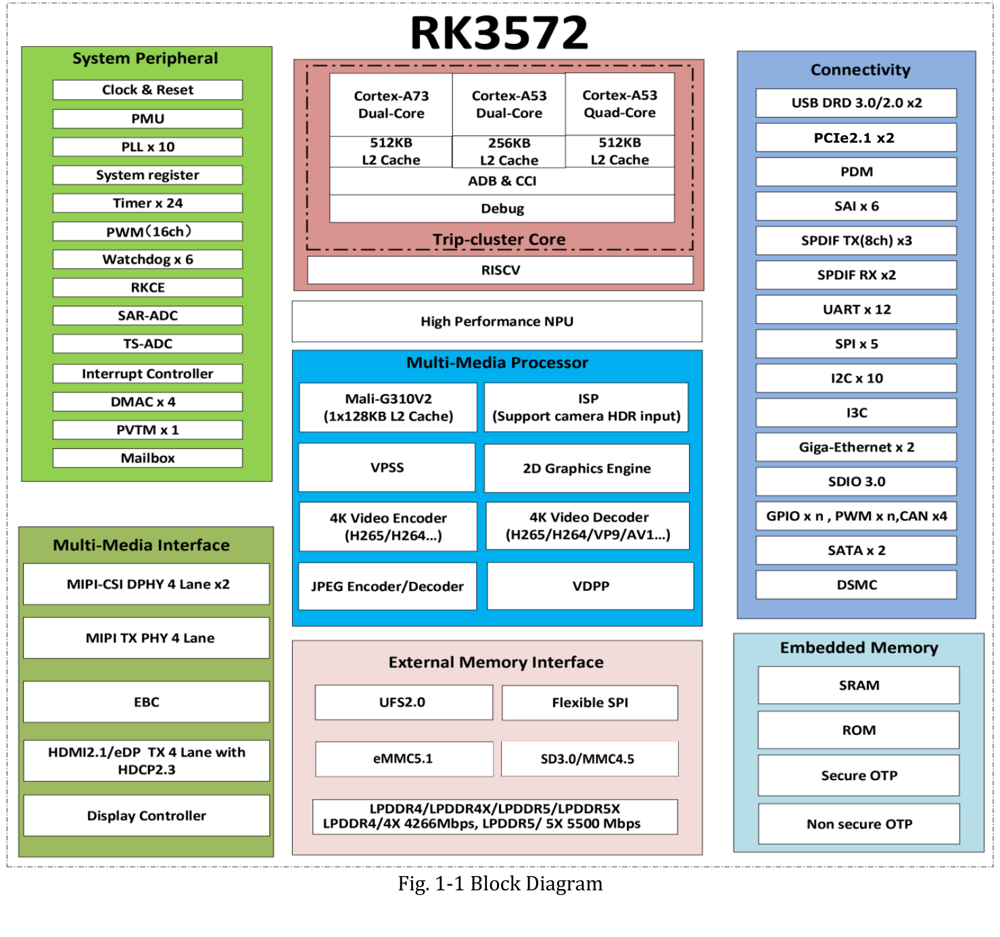

## Geltungsbereich

Dieser Leitfaden unterstützt den Entwurf von RK3572-Platinen und die Bewertung des ArmSoM-Zero5-Projekts. Grundlage sind der Hardware Design Guide V1.1 und das vorliegende Hardwarepaket. Schnittstellen des SoC sind nicht zwangsläufig auf einer Platine herausgeführt. Die endgültige Zero5-Konfiguration sowie verfügbare Betriebssysteme und Kernelversionen sind anhand der Dokumentation der jeweiligen Hardwareversion zu prüfen. Für diesen Artikel wurden keine ArmSoM-Hardwaremessungen durchgeführt.

Beim RK3572 entscheidet das Zusammenspiel von CPU, NPU, Multimedia und Schnittstellen. Vor der Auswahl von Speicher und Anschlüssen sind SoC-Funktionen, PHY-Multiplexing und Platinenimplementierung getrennt zu betrachten. Diese Seite wurde auf V1.1 aktualisiert; ihre bisherige URL bleibt erhalten.

## Was sich von V1.0 zu V1.1 geändert hat

| Merkmal | Spezifikation und Grenze |
|---|---|
| GPU API | Vulkan 1.2 → Vulkan 1.4 |
| LPDDR4 / LPDDR4X | Neue Einschränkung: R17 wird bei zwei Ranks nicht unterstützt. Die Kapazitätsgrenze bestätigt nicht jede DRAM-Organisation. |
| VideoPort1 | 2048 × 1080 @ 60 Hz, 8-bit |

Grundlage ist das 47-seitige `Rockchip RK3572 Datasheet V1.1-20260413.pdf`. Zuvor wurde V1.0 vom 2026-03-24 mit 51 Seiten verwendet. Die veränderte Seitenzahl ist kein Maß für geänderte Chipfunktionen. Neue Werte und Bedingungen haben Vorrang; v10 bleibt nur zur Linkstabilität in der URL.

*RK3572-Funktionsblockdiagramm*

## CPU, GPU, NPU und Speicher

| Merkmal | Spezifikation und Grenze |
|---|---|
| CPU | 2 × Cortex-A73 + 6 × Cortex-A53; ARMv8-A |
| CPU clusters | 2 × A73 / 4 × A53 / 2 × A53; L2 jeweils 512 / 512 / 256 KB |
| GPU | Mali-G310V2 MC1; OpenGL ES 3.2; OpenCL 3.0 Full Profile; Vulkan 1.4 |
| NPU | 4 TOPS (INT8 Sparse); INT4/INT8/INT16; FP4/FP8/FP16/BF16; W4A16 |
| DRAM | LPDDR4/4X-4266; LPDDR5/5X-5500; 32-bit; ≤16 GB; ≤4 ranks |
| MCU | RISC-V Nuclei N320; 24 KB ILM; 8 KB I-cache; 8 KB D-cache |

Die Angabe 4 TOPS gilt unter der Bedingung INT8 Sparse und beschreibt nicht den Durchsatz jedes Modells. 16 GB ist die Adressierungsgrenze, keine bestätigte Zero5-Speicheroption. Modellleistung, Speicherbandbreite, Kühlung und Leistungsaufnahme müssen mit konkreter Platine, Firmware und Modell geprüft werden.

## Videocodecs, Display und Bildeingang

| Merkmal | Spezifikation und Grenze |
|---|---|
| H.265 / VP9 / AV1 / AVS2 decode | 8K @ 30 / 4K @ 120 |
| H.264 decode | 4K @ 60 |
| H.264 / H.265 encode | 4K @ 40 |
| JPEG | 4K @ 60 |
| ISP | 12 MP |
| VideoPort0 | 4096 × 2160 @ 60 Hz; 10-bit |
| VideoPort1 | 2048 × 1080 @ 60 Hz; 8-bit |
| HDMI / eDP | HDMI 2.1 / eDP 1.3 Combo PHY; HDMI ≤4K @ 60 |
| MIPI DSI | 4 lanes; 2.5 Gbit/s/lane |
| MIPI CSI | 2 × 4-lane D-PHY; DVP |

Maximale Decodierung, Bandbreite des Ausgangs und gleichzeitiger Displaybetrieb sind unterschiedliche Grenzen. Das Blockdiagramm der V1.1 trägt weiterhin die Bezeichnung „4K Video Decoder“, der Text nennt jedoch 8K@30. Die Tabelle folgt den Codec- und Bildratenangaben im Text. Das Beispiel des Hardwareleitfadens mit 4096×2160@60 plus 2560×1600@60 widerspricht der VideoPort1-Grenze des Datenblatts. Diese Kombination wird hier nicht zugesichert; verbindliche Chipspezifikation und BSP sind zu prüfen.

## Speicher, Peripherie und Gehäuse

| Merkmal | Spezifikation und Grenze |
|---|---|
| Storage | eMMC 5.1; UFS 2.0 HS-G3 ×2; SDMMC; FSPI 1/2/4/8-bit |
| Network | 2 × GMAC |
| USB | 2 × USB 3.0 / USB 2.0 DRD |
| Low-speed I/O | 12 × UART; 10 × I2C; 5 × SPI; 4 × CAN; 16 × PWM |
| Package | FCCSP550L; 14.3 × 15.5 mm; ball 0.25 mm; pitch 0.42 / 0.52 / 0.65 mm |
| Assembly | MSL 3; SnAgCu |
| Junction temperature | <125 °C |
| Thermal coefficients | θJA / θJB / θJC / ψJT: TBD |

Schnittstellenzahlen müssen mit den Multiplexing-Diagrammen abgeglichen werden. V1.1 nennt zwei PCIe/SATA/USB-Combo-Schnittstellen und eine PCIe/SATA-Combo-Schnittstelle. Das sind drei multiplexierte PHY-Pfade, keine drei unabhängigen Controller. Der Leitfaden beschreibt zwei PCIe-Controller, zwei SATA-Controller und drei gemeinsam genutzte PHYs. Die Schaltungsartikel folgen dieser Zuordnung und zählen alternative MUX-Positionen nicht als eigenständige Ports. Thermische Kennwerte bleiben TBD; Kühlkörperberechnungen dürfen keine erfundenen Wärmewiderstände verwenden.

## ArmSoM-Produkte und nächste Schritte

Für ein kompaktes RK3572-Produkt empfiehlt sich zunächst der ArmSoM-Plan für das Zero-Format sowie eine Liste der benötigten Display-, Speicher-, Netzwerk- und Versorgungsschnittstellen. Der Planungsartikel ist keine Spezifikation eines veröffentlichten Modells und kein endgültiger Schaltplan. Für verfügbare Plattformen und deren Schnittstellen dienen der offizielle Produktkatalog und Docs.

- [RK3572 / ArmSoM Zero: Produktplanung](/de/articles/rockchip-rk3572-armsom-zero-preview/)
- [ArmSoM](https://www.armsom.org/category/all-products) · [ArmSoM Docs](https://docs.armsom.org/)

## Lesepfad durch die Reihe

- [RK3572-Datenblatt V1.1: Spezifikationen, Schnittstellen und Änderungen](/de/articles/rk3572-datasheet-v10/)
- [RK3572-Hardwaredesign: von der Referenzauswahl zur ersten Platine](/de/articles/rk3572-hardware-design-series/)
- [RK3572-Minimalsystem: 24-MHz-Takt, Reset, Boot und UART](/de/articles/rk3572-minimum-system-bringup/)
- [RK3572-Stromversorgung: Domänen, RK806-5 und zwei PMICs](/de/articles/rk3572-power-domains-pmic/)
- [RK3572-DDR-Design: LPDDR4X/LPDDR5-Schaltung und Leiterplattenregeln](/de/articles/rk3572-ddr-circuit-pcb/)
- [RK3572-DDRBIN-Konfiguration: Vorlagen, ADC-Auswahl und mehrere Profile](/de/articles/rk3572-ddrbin-adc-configuration/)
- [RK3572-Speicher und Boot: eMMC, UFS und FSPI anschließen und versorgen](/de/articles/rk3572-storage-boot-design/)
- [RK3572 USB und Type-C: Programmierung, Rollen und Versorgungserkennung](/de/articles/rk3572-usb-typec-power-design/)
- [RK3572 PCIe und SATA: Combo-PHY-Multiplexing, Takte und Routing](/de/articles/rk3572-high-speed-interface-design/)
- [RK3572-Displays und Kameras: HDMI, eDP, MIPI und Pegelanpassung](/de/articles/rk3572-display-camera-design/)
