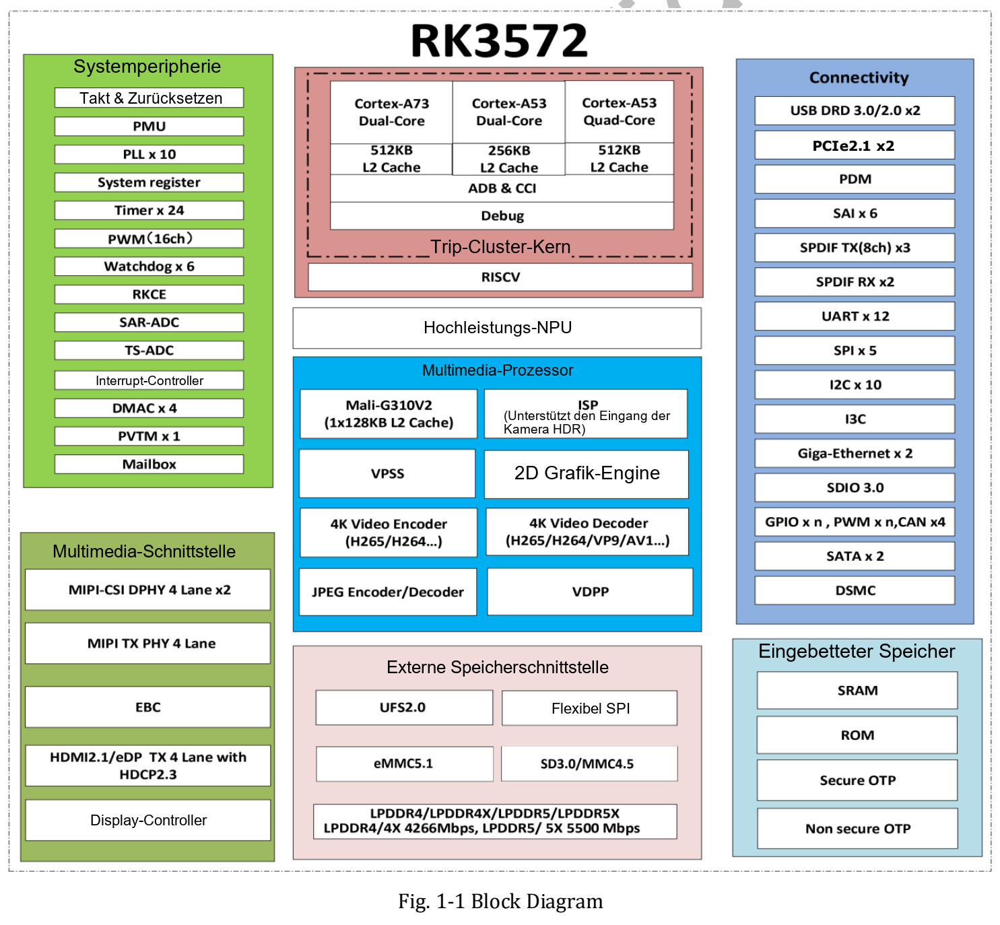
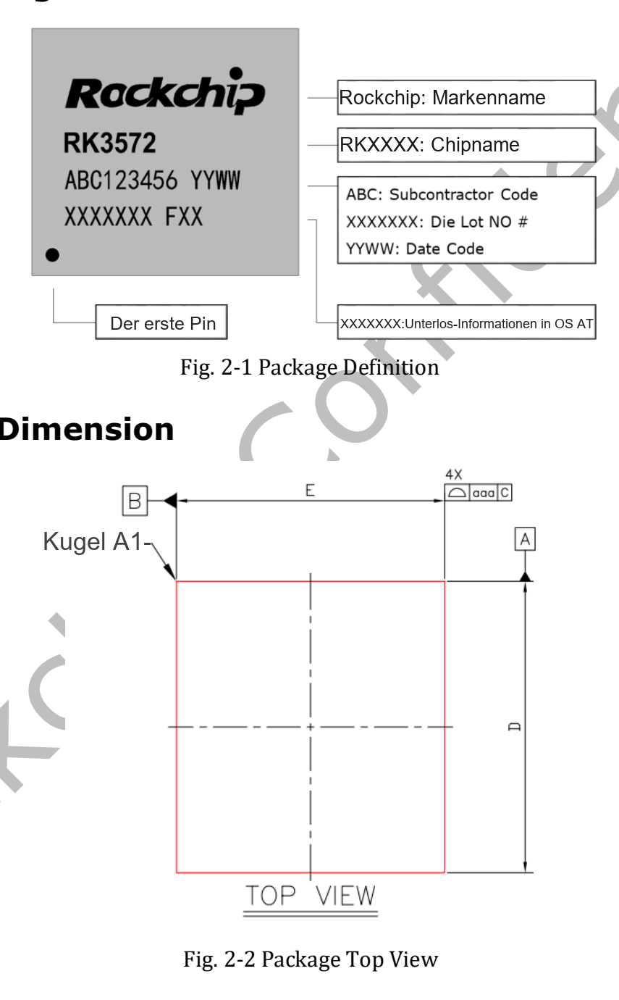
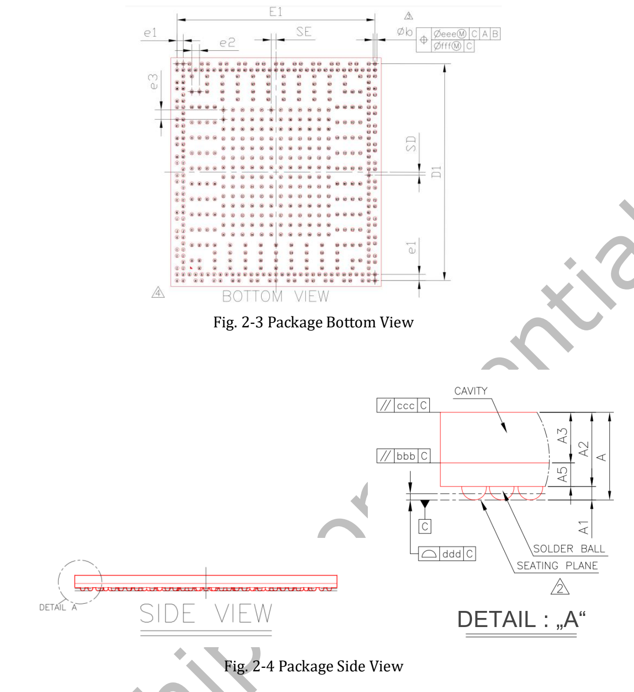
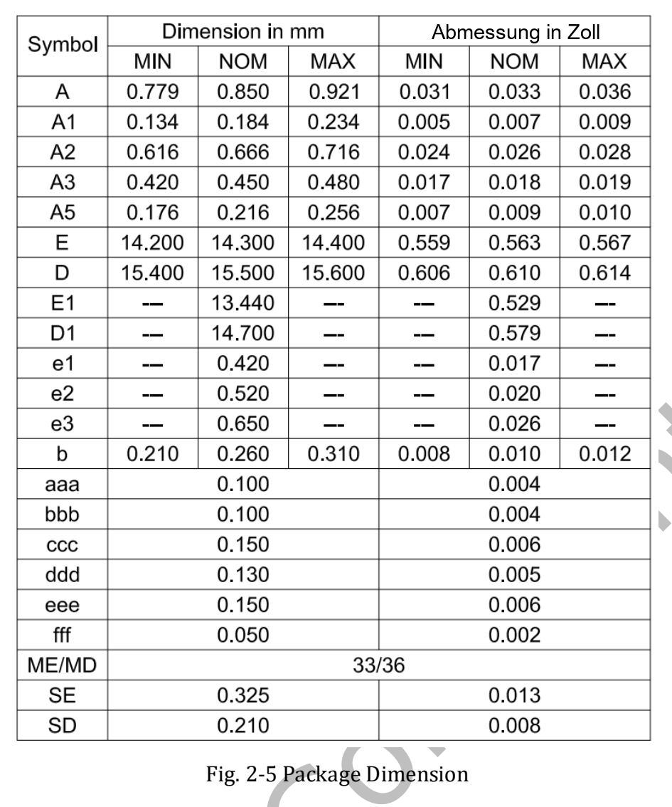

RK3572 verbindet acht CPU-Kerne, NPU, Bildverarbeitung und Videocodecs für kompakte AIoT-Geräte. Grundlage ist das **RK3572 Datasheet V1.0 mit 51 Seiten, Erstfassung vom 2026-03-24**. Dieser Beitrag erklärt die Bedingungen der technischen Angaben.

[Original RK3572 Datasheet V1.0 herunterladen (PDF, ca. 2.33 MiB)](/assets/rk3572-datasheet/RK3572-Datasheet-V1.0.pdf)

Dies ist ein Lese- und Auswahlleitfaden, keine vollständige Übersetzung aller 51 Seiten. Für elektrische Auslegung und Pins bleibt das Original maßgeblich. V1.0 wird nicht als neueste Revision bezeichnet.

## CPU, Speicher und KI

| Bereich | V1.0-Angabe | PDF-Seite |
|---|---|---|
| CPU | 2× Cortex-A73 + 6× Cortex-A53, Armv8-A | 7–8 |
| Cluster | Zwei A73, vier A53, zwei A53; L2 jeweils 512kB, 512kB, 256kB | 7–8 |
| Speicher | LPDDR4/4X-4266, LPDDR5/5X-5500; 32-bit; bis 16GB Adressraum | 8 |
| GPU | Mali G310V2 MC1; OpenGL ES 3.2, OpenCL 3.0 Full Profile, Vulkan 1.2 | 13 |
| NPU | 4 TOPS INT8, Fußnote Sparsity | 13 |
| Formate | INT4/INT8/INT16, FP4/FP8/FP16/BF16; asymmetrisches W4A16-MAC | 13 |

**Die 4 TOPS gelten mit Sparsität.** Sie beschreiben weder dichten Durchsatz jedes Modells noch eine Bildrate. Modell, Sparsität, Quantisierung, Operatoren und Runtime beeinflussen die Leistung. Formatunterstützung bedeutet nicht 4 TOPS bei jeder Präzision. Speichercontroller und Adressraum legen auch nicht die Bestückung eines zukünftigen ArmSoM-Boards fest.

## Blockdiagramm

Das Blockdiagramm nennt „4K Video Decoder“, der Überblick dagegen bis 8K@30fps. Beide Originalangaben bleiben erhalten; konkrete Modi anhand der Detailfunktionen und des BSP prüfen.

Das Diagramm zeigt Rechen-, Medien- und Peripherieblöcke. Anzahl und Multiplexbelegung anhand der Detailkapitel, Pins und Board-Schaltpläne prüfen. Nicht jeder Block wird ein gleichzeitig nutzbarer Anschluss.

## Video und Kamera

Seite 7 nennt H.265, VP9, AV1 und AVS2 mit Decodierung bis 8K@30fps oder 4K@120fps sowie H.264 bis 4K@60fps. H.264/H.265-Encodierung reicht bis 4K@40fps, JPEG-Verarbeitung bis 4K@60fps. Formate, Profile, Bittiefen und Kombinationen müssen im Funktionskapitel geprüft werden; nicht alle Höchstwerte gelten gleichzeitig.

Der ISP der 12MP-Klasse umfasst HDR, 3A, CAC, Rauschminderung, Schärfung, Entnebelung und Objektivkorrektur. Bildqualität hängt von Sensor, Optik und IQ-Abstimmung ab. RGA v2.5 kann passende Skalierungs-, Rotations- und Formatoperationen übernehmen, die CPU die Anwendung. Das eröffnet Entwicklungsmöglichkeiten für Bildanalyse, interaktive Displays und Terminals, stellt aber keine gemessene Produktleistung dar.

## Gehäuse und Fertigung

Genannt werden FCCSP550L, 14.3 × 15.5 mm Gehäusekörper, 0.25 mm Lotkugeln und ein gemischtes Raster von 0.42/0.52/0.65 mm. MSL: 3; Material: SnAgCu. Toleranzen, Orientierung und Einheiten aus den Zeichnungen ablesen. Dies sind Chip-, keine Boardabmessungen.

## Elektrische und thermische Grenzen

Absolute Grenzwerte beginnen auf Seite 41, empfohlene Betriebsbedingungen auf Seite 42. Für Versorgung und IO gelten die jeweiligen Spannungsdomänen. Absolute Grenzen sind keine Betriebsziele; GPIO nicht pauschal als 5V-tolerant behandeln.

Seite 51 verlangt eine Sperrschichttemperatur unter 125°C, keine entsprechende Umgebungstemperatur. θJA, θJB, θJC und ψJT sind in V1.0 sämtlich **TBD**. Daraus lassen sich keine Systemwärmewiderstände, Leistungsaufnahme oder Lüfterlosigkeit ableiten. Versorgung, Erwärmung und Dauerlast am Board testen.

## Wegweiser durch das PDF

| Seiten | Inhalt |
|---|---|
| 7–23 | Überblick, Funktionen, Blockdiagramm |
| 24–26 | Bestellung, Markierung, Gehäuse, MSL, Material |
| 27–40 | Pinliste |
| 41–50 | Elektrik, IO, LPDDR, PLL, PHY, ADC |
| 51 | Thermik und noch offene Parameter |

Der bisherige Blogbeitrag folgt Veröffentlichungsmaterial mit Vulkan 1.4; dieses ältere V1.0-Datenblatt nennt Vulkan 1.2. Quellen und Zeitstände bleiben getrennt. Tatsächliche APIs anhand des endgültigen BSP und GPU-Treibers prüfen.

## ArmSoMs RK3572-Plan

ArmSoM plant ein RK3572-Produkt im Raspberry-Pi-Zero-Formfaktor für kompakte Bildverarbeitung, Interaktion und Edge-KI. Modell, Speicher, Anschlüsse, Systeme, Preis und Termin sind hier noch nicht angekündigt. Die Bauform bestätigt keine Pin- oder Softwarekompatibilität.

[RK3572 und ArmSoMs Zero-Produktplan](/de/articles/rockchip-rk3572-armsom-zero-preview/) · [ArmSoM](https://www.armsom.org/)
