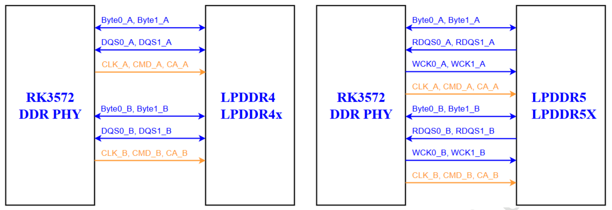
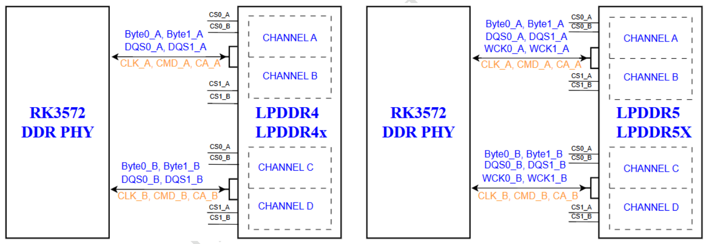
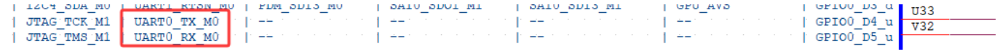
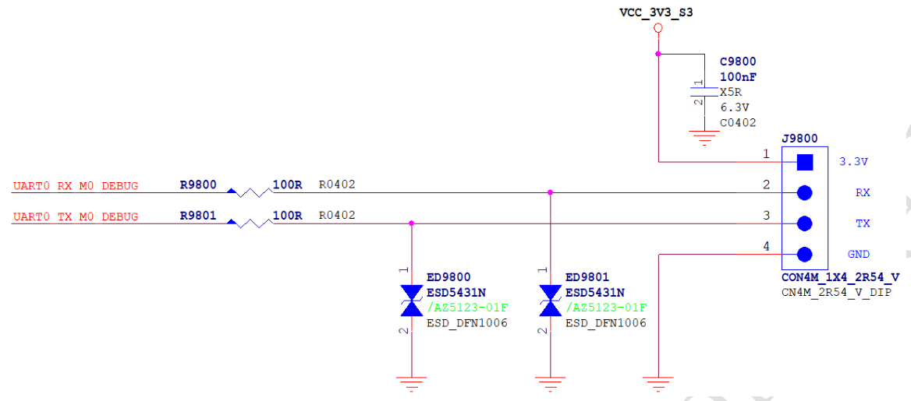
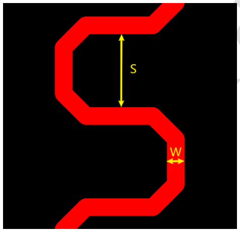
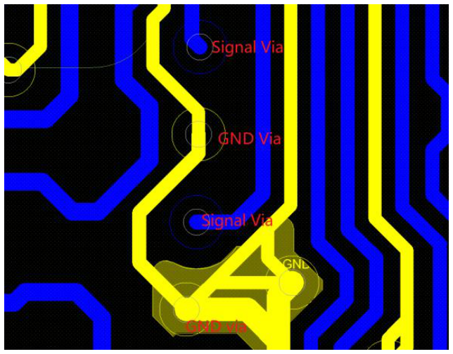
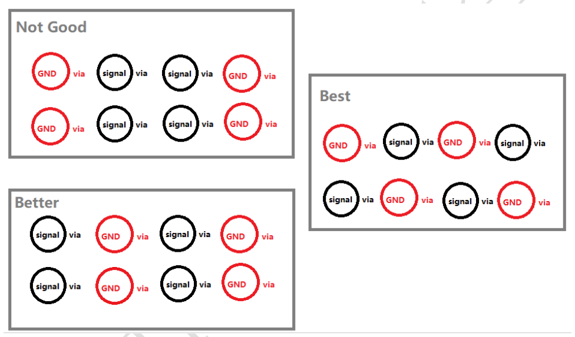

## Geltungsbereich

Dieser Leitfaden unterstützt den Entwurf von RK3572-Platinen und die Bewertung des ArmSoM-Zero5-Projekts. Grundlage sind der Hardware Design Guide V1.1 und das vorliegende Hardwarepaket. Schnittstellen des SoC sind nicht zwangsläufig auf einer Platine herausgeführt. Die endgültige Zero5-Konfiguration sowie verfügbare Betriebssysteme und Kernelversionen sind anhand der Dokumentation der jeweiligen Hardwareversion zu prüfen. Für diesen Artikel wurden keine ArmSoM-Hardwaremessungen durchgeführt.

Beim RK3572 sind DRAM-Organisation, Schaltung, PCB-Vorlage und DDRBIN gemeinsam festzulegen. „LPDDR5, 8 GB“ reicht nicht: Ranks, Gehäuse, Bytezuordnung, Versorgung und Trainingsparameter beeinflussen den Start. Mit einer passenden Herstellervorlage beginnen und Timing sowie Versorgungsintegrität für den tatsächlichen Lagenaufbau prüfen.

## 1. Busbreite, Kapazität und Topologie

| Merkmal | Anforderung |
|---|---|
| Controller | 32-bit; 1 channel; ≤4 ranks; ≤16 GB |
| LPDDR4 / LPDDR4X | ≤4266 MT/s |
| LPDDR5 / LPDDR5X | ≤5500 MT/s |
| LPDDR4 / LPDDR4X, V1.1 | R17 wird bei zwei Ranks nicht unterstützt |

Grenzwerte bestätigen nicht jede Kombination aus Kapazität, Gehäuse und Ranks. „64-bit DRAM“ beschreibt im Referenzbild die Speicherorganisation und Beschaltung, keinen 64-Bit-RK3572-Controller. Die Referenz mit zwei Bausteinen verlangt gleiche Kapazitäten. Bauteil, Gehäuse und CS-Organisation müssen zu Vorlage und DDRBIN passen.

*Punkt-zu-Punkt-Verbindung mit 32-Bit-DRAM*

*Alternative DRAM-Gehäusetopologie*

## 2. Welche Signale getauscht werden dürfen

| Merkmal | Anforderung |
|---|---|
| Byte lanes | Nur Byte 0↔1 und Byte 2↔3; nicht zwischen Gruppen |
| DQ | Innerhalb eines Bytes tauschbar; Zuordnung dokumentieren |
| DM / CLK / CS / WCK / DQS | Keine beliebigen Vertauschungen wie bei DQ |
| CA_A0–CA_A5 | Innerhalb der Gruppe tauschbar; CA_A6 ausgenommen |
| 4 ranks | Zuordnung über alle Ranks konsistent halten |

## 3. Versorgung und ZQ: SoC und DRAM unterscheiden

| Knoten | LPDDR4 | LPDDR4X | LPDDR5 / 5X |
|---|---|---|---|
| DRAM VDD1 | 1.8 V | 1.8 V | 1.8 V |
| DRAM VDD2 / VDD2H | 1.1 V | 1.1 V | 1.05 V |
| DRAM VDD2L | — | — | 0.9 / 1.05 V |
| DRAM VDDQ | 1.1 V | 0.6 V | 0.5 V |
| PHY VDDQ / CKVDDQ | 0.75 V | 0.6 V | 0.5 V |
| PHY VDDQH | 1.1 V | 1.1 V | 1.05 V |

Die Tabelle zeigt Versorgungsbeispiele des Leitfadens; für den konkreten Speicher gilt dessen Datenblatt. SoC-ZQ erhält 120 Ω, 1% nach DDRPHY_VDDQ_S0. DRAM-ZQ erhält 240 Ω, 1%: bei LPDDR4 nach VDD2, bei LPDDR4X/LPDDR5 nach VDDQ. LPDDR4-ODT_CA liegt an VDD2. Widerstand und Zielnetz getrennt prüfen; beide ZQ-Schaltungen sind verschieden.

*RK3572-DDR-ZQ-Pin*

*DRAM-ZQ- und ODT-Referenzanschlüsse*

## 4. CK, WCK und RDQS bei LPDDR5

LPDDR5 trennt Befehlstakt CK und Datentakt WCK mit dem Zwei- oder Vierfachen von CK; beim Lesen kommt RDQS hinzu. Routinggruppen, Laufzeitausgleich und Training müssen dazu passen, statt sämtliche LPDDR4-Regeln zu übernehmen. DDRPHY_VDDQH bleibt für Retention erforderlich; Self-Refresh und Wiederaufnahme vor dem Abschalten weiterer Schienen prüfen.

## 5. PCB-Impedanz und Laufzeitausgleich

| Merkmal | Anforderung |
|---|---|
| DQ / DM / CA | 40–45 Ω ±10%; bevorzugt 40 Ω |
| CLK / DQS / WCK | 90 Ω differential ±10% |
| DQ/DM ↔ DQS/WCK | ≤45 ps / ≤90 mil |
| CA/control ↔ CLK | ≤45 ps / ≤90 mil |
| Abweichung innerhalb des Paars | ≤1 ps / ≤5 mil |
| LPDDR5: DQS/WCK ↔ CLK | ≤130 ps / ≤550 mil |
| LPDDR4: DQS ↔ CLK | ≤90 ps / ≤410 mil |

Die ps- und mil-Angaben ergeben keinen allgemeinen Umrechnungsfaktor. Laufzeit hängt von Lagenaufbau, Material und Vias ab. Laufzeiten einschließlich Vias prüfen. Gewöhnliche Abstände betragen mindestens 2W, bei Takten/Strobes zu anderen Leitungen vorzugsweise 3W, mindestens 2W. Mäanderabstand S mindestens 3W; enge Mäander ersetzen keine Timinganalyse.

*Abstandsregeln für Mäander*

## 6. Referenzflächen, Rückstromvias und Versorgungsintegrität

*Rückstromvias bei Lagenwechseln*

*Anordnung von Signal- und Rückstromvias*

Bei Lagenwechseln beträgt der Abstand zum benachbarten Rückstromvia höchstens 25 mil zwischen den Mittelpunkten. Kontinuierliche Masse und mindestens 12 mil Abstand zur Referenzflächenkante vorsehen. Mindestens 0.8 Massevias je DRAM-Massepin prüfen. Massevias der Taktabschirmung höchstens 400 mil auseinander platzieren. Beim Entfernen ungenutzter Viapads Fertigungs- und Zuverlässigkeitsregeln beachten.

| Versorgung | 100 kHz–30 MHz | 30–100 MHz |
|---|---|---|
| LPDDR4X VDD2 / VDDQ; LPDDR5 VDDQ / VDD2H | ≤0.03 Ω | ≤0.04 Ω |
| LPDDR5 VDD2L | ≤0.075 Ω | ≤0.08 Ω |

PDN-Ziele zusammen mit Gehäuse, Entkopplung und PCB-Simulation bewerten. Dichte Signalvias dürfen Versorgungsflächen nicht durchtrennen. Kondensatorrückwege kurz halten; für 0603/0805 nennt der Leitfaden mindestens zwei zugehörige Versorgungs-/Massevias. Kaltstarts, wiederholte Resets, Kapazität, Speichertests, Temperatur und Suspend/Resume prüfen. Ein einzelner Systemstart qualifiziert DDR nicht.

## ArmSoM-Produkte und nächste Schritte

Für ein kompaktes RK3572-Produkt empfiehlt sich zunächst der ArmSoM-Plan für das Zero-Format sowie eine Liste der benötigten Display-, Speicher-, Netzwerk- und Versorgungsschnittstellen. Der Planungsartikel ist keine Spezifikation eines veröffentlichten Modells und kein endgültiger Schaltplan. Für verfügbare Plattformen und deren Schnittstellen dienen der offizielle Produktkatalog und Docs.

- [RK3572 / ArmSoM Zero: Produktplanung](/de/articles/rockchip-rk3572-armsom-zero-preview/)
- [ArmSoM](https://www.armsom.org/category/all-products) · [ArmSoM Docs](https://docs.armsom.org/)

## Lesepfad durch die Reihe

- [RK3572-Datenblatt V1.1: Spezifikationen, Schnittstellen und Änderungen](/de/articles/rk3572-datasheet-v10/)
- [RK3572-Hardwaredesign: von der Referenzauswahl zur ersten Platine](/de/articles/rk3572-hardware-design-series/)
- [RK3572-Minimalsystem: 24-MHz-Takt, Reset, Boot und UART](/de/articles/rk3572-minimum-system-bringup/)
- [RK3572-Stromversorgung: Domänen, RK806-5 und zwei PMICs](/de/articles/rk3572-power-domains-pmic/)
- [RK3572-DDR-Design: LPDDR4X/LPDDR5-Schaltung und Leiterplattenregeln](/de/articles/rk3572-ddr-circuit-pcb/)
- [RK3572-DDRBIN-Konfiguration: Vorlagen, ADC-Auswahl und mehrere Profile](/de/articles/rk3572-ddrbin-adc-configuration/)
- [RK3572-Speicher und Boot: eMMC, UFS und FSPI anschließen und versorgen](/de/articles/rk3572-storage-boot-design/)
- [RK3572 USB und Type-C: Programmierung, Rollen und Versorgungserkennung](/de/articles/rk3572-usb-typec-power-design/)
- [RK3572 PCIe und SATA: Combo-PHY-Multiplexing, Takte und Routing](/de/articles/rk3572-high-speed-interface-design/)
- [RK3572-Displays und Kameras: HDMI, eDP, MIPI und Pegelanpassung](/de/articles/rk3572-display-camera-design/)
