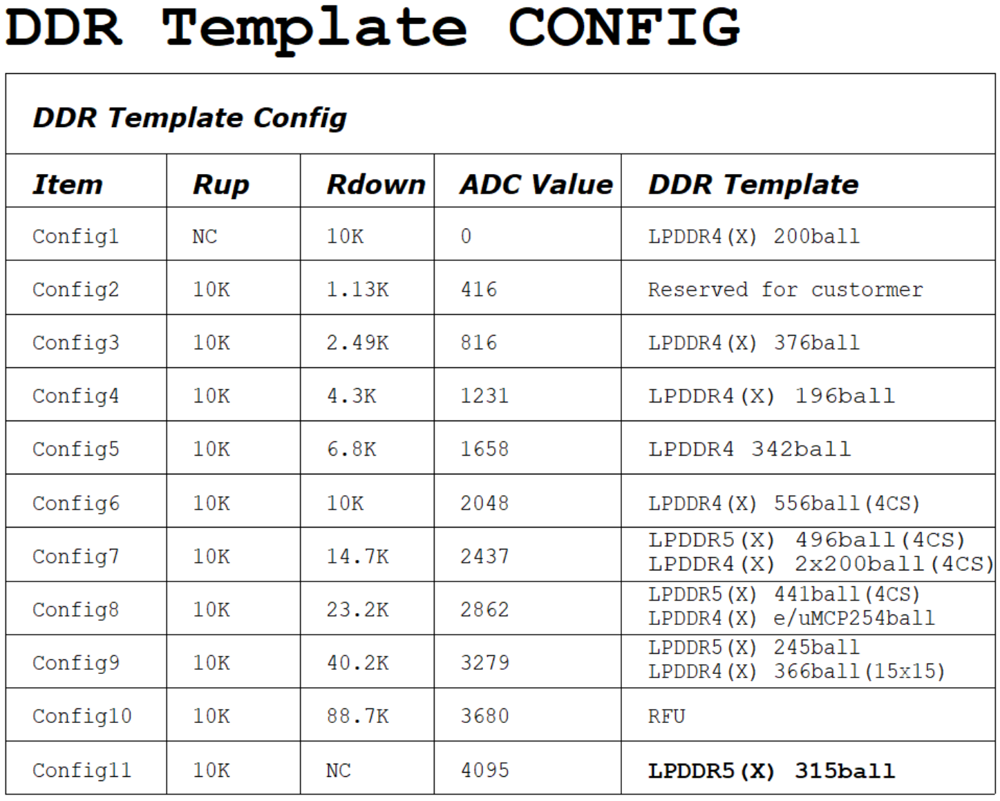
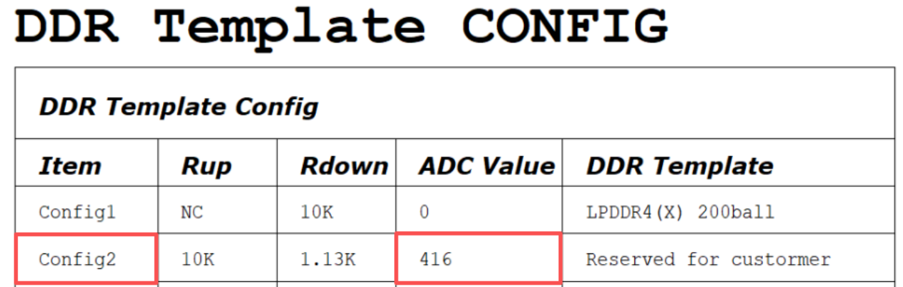

## Geltungsbereich

Dieser Leitfaden unterstützt den Entwurf von RK3572-Platinen und die Bewertung des ArmSoM-Zero5-Projekts. Grundlage sind der Hardware Design Guide V1.1 und das vorliegende Hardwarepaket. Schnittstellen des SoC sind nicht zwangsläufig auf einer Platine herausgeführt. Die endgültige Zero5-Konfiguration sowie verfügbare Betriebssysteme und Kernelversionen sind anhand der Dokumentation der jeweiligen Hardwareversion zu prüfen. Für diesen Artikel wurden keine ArmSoM-Hardwaremessungen durchgeführt.

DDRBIN verwendet keinen einheitlichen Parametersatz für jeden Speicher. RK3572-DDR-Vorlage, ADC-Auswahl, DRAM-Typ und Binärversion gemeinsam dokumentieren. Dieser Artikel folgt der Anleitung vom 2026-05-18 für Linux und Windows und erhält die Bedeutung der Befehlsparameter.

## 1. Drei passende Eingaben vorbereiten

Tatsächliche DDR-Schaltungs-/PCB-Vorlage, deren `_ddrbin_tool_config.txt` und zur SDK-Version passendes `rk3572_ddr_*MHz_v*.*.bin` bereitstellen. Fehlt eine Vorlagenkonfiguration, sieht die Anleitung den rkbin-Standard vor; diese Entscheidung dokumentieren und keine Werte aus ähnlichen Kapazitäten ableiten. Originalbinary, Konfiguration, Werkzeugversion und Prüfsumme des Ergebnisses sichern.

## 2. ADC Config ist ein Index, kein Messwert

| Config | Rup | Rdown | ADC | DDR-Vorlagenauswahl |
|---|---|---|---|---|
| 1 | NC | 10 kΩ | 0 | LPDDR4(X) 200-ball |
| 2 | 10 kΩ | 1.13 kΩ | 416 | Für Kunden reserviert |
| 3 | 10 kΩ | 2.49 kΩ | 816 | LPDDR4(X) 376-ball |
| 4 | 10 kΩ | 4.3 kΩ | 1231 | LPDDR4(X) 196-ball |
| 5 | 10 kΩ | 6.8 kΩ | 1658 | LPDDR4 342-ball |
| 6 | 10 kΩ | 10 kΩ | 2048 | LPDDR4(X) 556-ball (4 CS) |
| 7 | 10 kΩ | 14.7 kΩ | 2437 | LPDDR5(X) 496-ball (4 CS) / LPDDR4(X) 2 × 200-ball (4 CS) |
| 8 | 10 kΩ | 23.2 kΩ | 2862 | LPDDR5(X) 441-ball (4 CS) / LPDDR4(X) e/uMCP 254-ball |
| 9 | 10 kΩ | 40.2 kΩ | 3279 | LPDDR5(X) 245-ball / LPDDR4(X) 366-ball (15 × 15) |
| 10 | 10 kΩ | 88.7 kΩ | 3680 | RFU |
| 11 | 10 kΩ | NC | 4095 | LPDDR5(X) 315-ball |

ADC 416 entspricht beispielsweise Config 2: Der Parameter lautet `adc_value_to_ddr_config=2`, nicht `=416`. Config 2 ist der Kundenplatz des Quellbeispiels und keine allgemeine LPDDR4-Einstellung. Auch die Bootmedienauswahl nutzt eine ADC-Teilertabelle; diese beschreibt jedoch die Bootreihenfolge und ersetzt die DDR-Zuordnung nicht.

## 3. Konfiguration unter Linux

Zuerst `rkbin/tools/ddrbin_tool_user_guide.txt` der passenden Version lesen und danach `ddrbin_tool.py` im Werkzeugverzeichnis verwenden. Unten steht die Befehlsvorlage der Quelle. Vorlagenname sowie Frequenz-/Versionsplatzhalter durch eindeutige Dateinamen ersetzen; keine mehreren DDR-Binaries per Wildcard auswählen. Der Vorgang ändert eine Hostdatei und programmiert keine Platine.

```text
./ddrbin_tool.py rk3572 模板名称_ddrbin_tool_config.txt rk3572_ddr_*MHz_v*.*.bin LPDDR4 adc_value_to_ddr_config=2
```

Plattform rk3572, tatsächliche PCB-Vorlage, DRAM-Typ und durch Widerstände gewählten ADC Config prüfen. Ausgabepfad und Dateiname richten sich nach der Werkzeugversion. Ergebnis und geänderte Datei vor der SDK-Paketierung kontrollieren. Plattformen ohne ADC-Tabelle lassen laut Quelle DRAM-Typ und ADC-Argumente weg; das RK3572-Beispiel gilt nicht pauschal für alle Plattformen.

[](/assets/rk3572-hardware-20261119/ddrbin-config-5.png)

*DDRBIN-Werkzeug und Konfigurationsfelder*

## 4. Konfiguration unter Windows

Die Quelle verwendet `rk_ddrBin_tool_windows`: Plattform, DramType (im Beispiel LPDDR4) und ADC Config (2) wählen, DDRBIN importieren und Vorlagenparameter einzeln eintragen. Die Zuordnung zwischen Linux-Konfiguration und GUI nicht allein aus Screenshots ableiten; passende Anleitung, Vorlage und Ergebnisprüfung nutzen. Gezeigte Kapazitäten und Timings gelten nicht automatisch für andere Speicherbausteine.

[](/assets/rk3572-hardware-20261119/ddrbin-config-6.png)

*DDR-Parametrierung unter Windows*

## 5. Mehrere Profile in einem Ergebnisbinary zusammenführen

Ein Vorgang ändert nur den gewählten DRAM-Typ und ADC-Platz. Bei mehreren Profilen das erste geänderte Binary als zweiten Eingang verwenden und so fortfahren. Erneutes Öffnen des Originals sammelt frühere Änderungen nicht. Eingang, Ausgang, DRAM-Typ und Config pro Schritt dokumentieren und jede vorgesehene Hardwareauswahl prüfen.

## 6. Abnahme vor Firmwarefreigabe

| Merkmal | Anforderung |
|---|---|
| Hardware | PCB-Revision, vollständiger DRAM-Typ, Kapazität, Ranks und bestückte ADC-Widerstände |
| Dateien | Vorlage, Konfiguration, Werkzeugversion und Prüfsummen beider Binaries |
| Validierung | Bootprotokoll, Kapazität, Speichertest und Resume je Profil |

Für diesen Artikel wurden die Werkzeuge nicht ausgeführt und keine Ergebnisdateien auf Zero5 getestet. Vor Serienfreigabe müssen Hardware- und SDK-Verantwortliche das finale Binary prüfen. Ein erfolgreicher EVB-Start bestätigt nicht alle Speicheroptionen.

## ArmSoM-Produkte und nächste Schritte

Für ein kompaktes RK3572-Produkt empfiehlt sich zunächst der ArmSoM-Plan für das Zero-Format sowie eine Liste der benötigten Display-, Speicher-, Netzwerk- und Versorgungsschnittstellen. Der Planungsartikel ist keine Spezifikation eines veröffentlichten Modells und kein endgültiger Schaltplan. Für verfügbare Plattformen und deren Schnittstellen dienen der offizielle Produktkatalog und Docs.

- [RK3572 / ArmSoM Zero: Produktplanung](/de/articles/rockchip-rk3572-armsom-zero-preview/)
- [ArmSoM](https://www.armsom.org/category/all-products) · [ArmSoM Docs](https://docs.armsom.org/)

## Lesepfad durch die Reihe

- [RK3572-Datenblatt V1.1: Spezifikationen, Schnittstellen und Änderungen](/de/articles/rk3572-datasheet-v10/)
- [RK3572-Hardwaredesign: von der Referenzauswahl zur ersten Platine](/de/articles/rk3572-hardware-design-series/)
- [RK3572-Minimalsystem: 24-MHz-Takt, Reset, Boot und UART](/de/articles/rk3572-minimum-system-bringup/)
- [RK3572-Stromversorgung: Domänen, RK806-5 und zwei PMICs](/de/articles/rk3572-power-domains-pmic/)
- [RK3572-DDR-Design: LPDDR4X/LPDDR5-Schaltung und Leiterplattenregeln](/de/articles/rk3572-ddr-circuit-pcb/)
- [RK3572-DDRBIN-Konfiguration: Vorlagen, ADC-Auswahl und mehrere Profile](/de/articles/rk3572-ddrbin-adc-configuration/)
- [RK3572-Speicher und Boot: eMMC, UFS und FSPI anschließen und versorgen](/de/articles/rk3572-storage-boot-design/)
- [RK3572 USB und Type-C: Programmierung, Rollen und Versorgungserkennung](/de/articles/rk3572-usb-typec-power-design/)
- [RK3572 PCIe und SATA: Combo-PHY-Multiplexing, Takte und Routing](/de/articles/rk3572-high-speed-interface-design/)
- [RK3572-Displays und Kameras: HDMI, eDP, MIPI und Pegelanpassung](/de/articles/rk3572-display-camera-design/)
